# Cloud map brief (option B): one AWS-style deployment map per chapter

Two edits per chapter file.

## Edit 1: colour the tiers in BOTH existing icon flowcharts

At the END of each of the two `flowchart TB` blocks (section 6 and section 8), add one `style` line per subgraph that exists in that diagram. Use the subgraph id (the word before `[` or the bare word after `subgraph`). Colours:

```
    style Clients fill:#f8fafc,stroke:#64748b,stroke-width:1.5px
    style Edge fill:#fff7ed,stroke:#f97316,stroke-width:1.5px
    style Services fill:#eff6ff,stroke:#2563eb,stroke-width:1.5px
    style Data fill:#ecfdf5,stroke:#059669,stroke-width:1.5px
    style Async fill:#f5f3ff,stroke:#7c3aed,stroke-width:1.5px
    style External fill:#f1f5f9,stroke:#475569,stroke-dasharray:4 3
```

Only add lines for subgraphs that are present. If a subgraph has a different id (for example `Workers`, `Realtime`, `Clients2`), pick the closest colour above. Do not change anything else in the flowchart.

## Edit 2: add a Deployment map after the section 8 component table

Insert this block right AFTER the component table that follows the section 8 flowchart (the `| Component | Job | Technology example |` table), before the next `##` heading:

````
### Deployment map (AWS)

```mermaid
architecture-beta
    group internet(mdi:earth)[Internet]
    group edge(logos:aws-cloudfront)[Edge]
    group vpc(logos:aws-vpc)[AWS VPC]
    group app(logos:aws-ecs)[Service subnet] in vpc
    group data(logos:aws-rds)[Data subnet] in vpc

    service user(mdi:cellphone)[Users] in internet
    service cdn(logos:aws-cloudfront)[CDN] in edge
    service alb(logos:aws-elastic-load-balancing)[Load balancer] in edge
    service api(logos:aws-ecs)[API service] in app
    service worker(logos:aws-lambda)[Workers] in app
    service cache(logos:aws-elasticache)[Redis] in data
    service db(logos:aws-rds)[Postgres] in data
    service queue(logos:aws-sqs)[Queue] in data

    user:R --> L:cdn
    cdn:R --> L:alb
    alb:B --> T:api
    api:B --> T:cache
    api:R --> L:db
    api:B --> T:queue
    queue:R --> L:worker
```



One line per box: who runs where. Edge boxes sit outside the VPC; everything stateful sits in the data subnet.
````

Adapt the EXAMPLE to the chapter: the services must be the real components from that chapter's section 8 flowchart (same names), 6 to 10 services, 6 to 12 edges, every edge between two services in the map. Keep the five groups (`internet`, `edge`, `vpc`, `app` in vpc, `data` in vpc); add `group ext(mdi:earth)[Third parties]` only when the chapter has an external provider (payment, maps, push). Replace the one-line caption with one true sentence about this chapter's layout.

### architecture-beta syntax rules (strict)

- `group id(icon)[Title]` and `service id(icon)[Title]`, with `in parent` to nest. Ids: lowercase letters and digits only, no dashes.
- Titles: letters, digits, spaces only. No parentheses, slashes, commas, colons or quotes inside `[...]`.
- Edges: `a:SIDE --> SIDE:b` where SIDE is `L`, `R`, `T`, or `B`. Use `-->` only (no labels, no dotted edges). Exactly one space on each side of `-->`.
- Pick sides that make sense: left to right across groups (`:R --> L:`), top to bottom inside the VPC (`:B --> T:`).
- One blank line between the group block, the service block, and the edge block. Four-space indent.

### Icon list for the map (use exactly these)

| Component | icon |
|---|---|
| users / phone / browser | `mdi:cellphone` or `mdi:laptop` |
| DNS | `logos:aws-route53` |
| CDN | `logos:aws-cloudfront` |
| WAF / DDoS shield | `logos:aws-waf` |
| load balancer | `logos:aws-elastic-load-balancing` |
| API gateway | `logos:aws-api-gateway` |
| auth / identity | `logos:aws-cognito` |
| stateless service on containers | `logos:aws-ecs` |
| service on VMs | `logos:aws-ec2` |
| Kubernetes fleet | `logos:aws-eks` |
| serverless function / worker | `logos:aws-lambda` |
| batch / long job workers | `logos:aws-batch` |
| ML inference | `logos:aws-sagemaker` |
| Postgres / MySQL / relational | `logos:aws-rds` |
| DynamoDB / key value / wide column | `logos:aws-dynamodb` |
| Redis / Memcached / cache | `logos:aws-elasticache` |
| Elasticsearch / search | `logos:aws-opensearch` |
| Kafka / event stream | `logos:kafka-icon` |
| Kinesis stream | `logos:aws-kinesis` |
| SQS queue / DLQ | `logos:aws-sqs` |
| SNS / push fan-out | `logos:aws-sns` |
| EventBridge / scheduler / cron | `logos:aws-eventbridge` |
| Step Functions / workflow | `logos:aws-step-functions` |
| S3 / object store / files / video | `logos:aws-s3` |
| Redshift / warehouse | `logos:aws-redshift` |
| Spark / EMR / batch analytics | `logos:aws-emr` |
| Flink / stream analytics | `logos:flink` |
| CloudWatch / metrics / alarms | `logos:aws-cloudwatch` |
| email | `logos:aws-ses` |
| payment provider | `logos:stripe` |
| maps / routing API | `logos:google-maps` |
| GitHub | `logos:github-icon` |
| LLM / model API | `logos:openai-icon` |
| any third party | `mdi:earth` |

## Check before saving

1. Both flowcharts end with the `style` lines for their subgraphs; nothing else in them changed.
2. The new `### Deployment map (AWS)` block sits after the section 8 component table.
3. Every service id in an edge is defined; every icon is in the list above; titles have only letters, digits, spaces.
4. Sequence diagram, prose, other tables and ASCII blocks are byte-for-byte unchanged.
