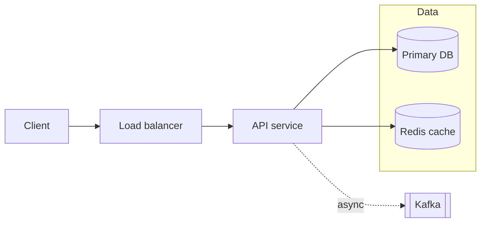
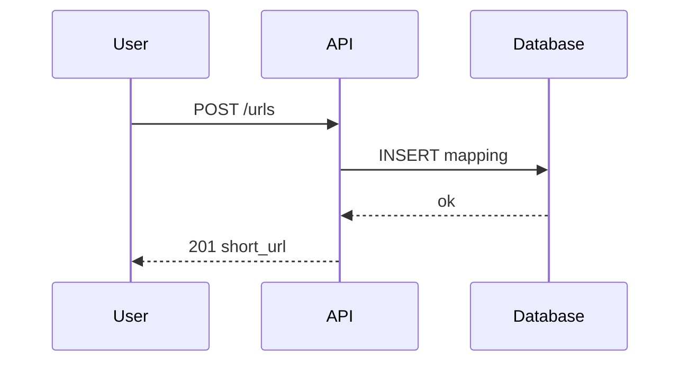

# Diagram pass (shared by all diagram agents)

You are editing existing markdown chapters in
`/Users/shahdevs/.kiro/crew/workspace/system-design-pdf/questions/NN-slug.md`.
Shell commands are NOT available to you. Use the file read/edit tools only. Do not create new files.

## Goal

Replace the ASCII-art architecture diagrams with real Mermaid diagrams, so the PDF shows
drawn boxes and arrows. Mermaid blocks render at build time; you cannot preview them, so
follow the syntax rules below exactly.

## What to change in EACH chapter (3 edits)

1. **Section `## 6. High-level design`**: the first ```text block there is the ASCII system
   diagram. Replace that whole fenced block with a ```mermaid `flowchart LR` showing the same
   components and arrows. Keep every component that the ASCII had. Add the main data stores and
   external systems. 8 to 16 nodes.

2. **Section 6, right after the first `### How will users ...` request-flow walkthrough**
   (the numbered list): ADD a ```mermaid `sequenceDiagram` for that one flow. 4 to 7
   participants, 6 to 14 messages. Put it after the numbered list, before the next H3.

3. **Section `## 8. Final architecture`**: the ```text block there is the final ASCII diagram.
   Replace it with a ```mermaid `flowchart TB` (or LR) that includes the deep-dive additions
   (cache, queue, CDN, sharding, etc.). 10 to 20 nodes. Use `subgraph` to group tiers
   (Clients, Edge, Services, Data, Async).

Leave all other ASCII ```text blocks (in the deep dives) alone. Do not change any prose.
Do not touch the H2 headings.

## Mermaid syntax rules (STRICT; a syntax error renders as a red error box in the PDF)

Flowcharts:

- Node ids: letters and digits only (`API`, `DB1`, `CDN`). Never reuse an id for two nodes.
- Labels go inside brackets. If a label contains `(`, `)`, `[`, `]`, `{`, `}`, `|`, `"`, `#`, `;`
  or `:`, wrap the label in double quotes: `S["Service (stateless)"]`. Avoid those characters
  when you can.
- Shapes: `[text]` box, `[(text)]` database, `[[text]]` queue/subroutine, `([text])` rounded,
  `{text}` decision, `((text))` circle.
- Arrows: `-->` solid, `-. label .->` dotted with label, `-- label -->` solid with label.
  Edge labels: letters, digits, spaces, commas, periods only. No colons, no parentheses.
- `subgraph Name` ... `end`. Subgraph names: single word or quoted `subgraph "Data tier"`.
- No HTML, no `<br>`, no `style`, no `classDef`, no click handlers. Keep it plain.
- Max about 20 nodes so it fits one PDF page.

Sequence diagrams:

- `participant X as Label` lines first. Ids: letters only.
- `->>` request, `-->>` response. Message text after the colon: plain words, no colons inside,
  no quotes, no brackets.
- Optional: `Note over A,D: text`, `alt condition` / `else` / `end`, `loop text` / `end`.
  Keep nesting to one level.
- 6 to 14 messages. One flow only.

## Done condition

For each assigned file: exactly 3 ```mermaid blocks added (two flowcharts, one sequenceDiagram),
the two replaced ```text blocks are gone from sections 6 and 8, all 11 H2 headings still present
and unchanged. Report one line per file: path and "3 mermaid blocks".
