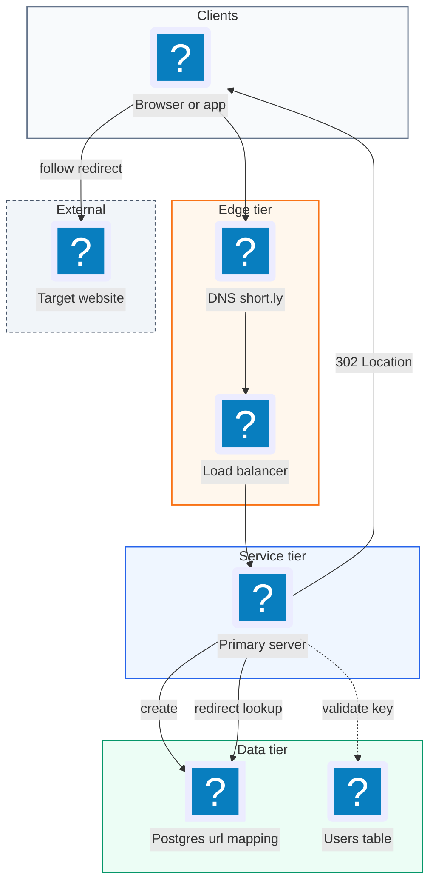
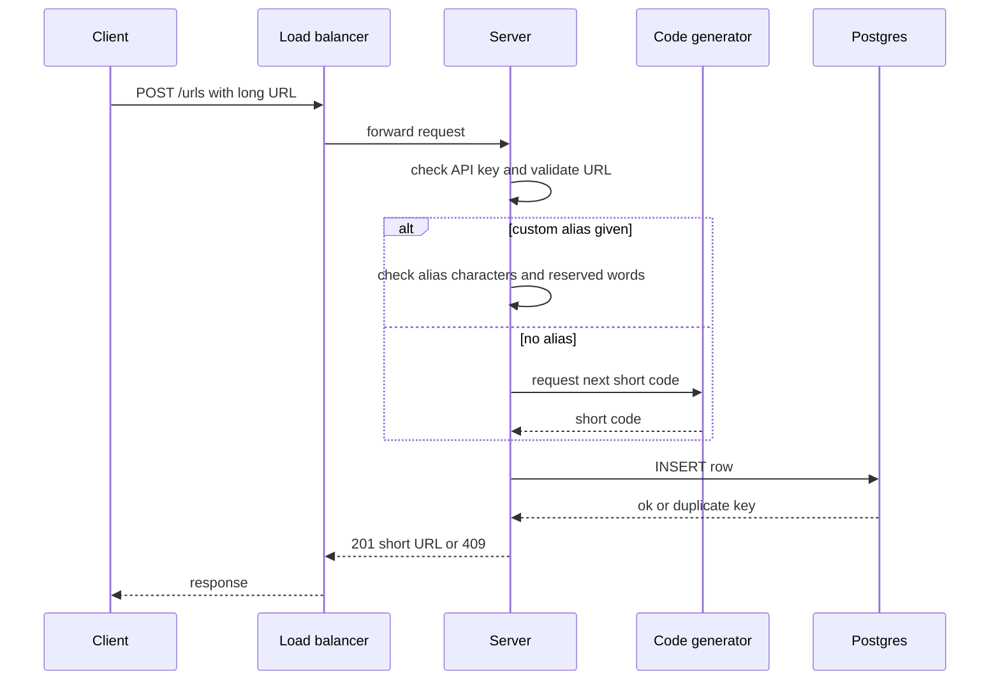
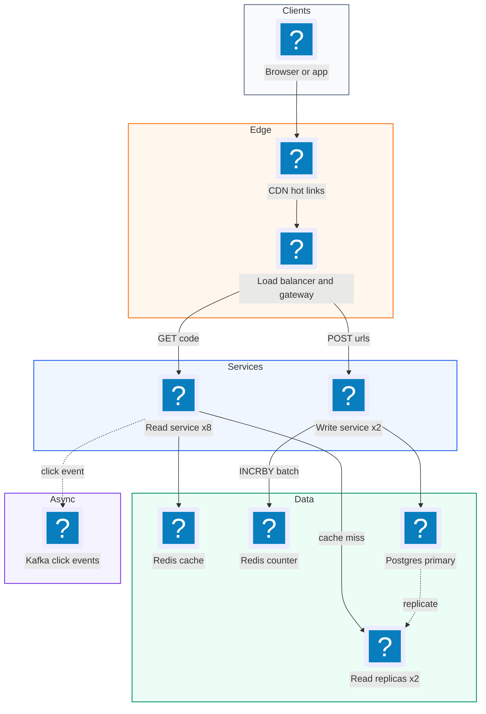

# 01. Bitly (URL Shortener)  (Easy)

> Bitly takes a long web address, like a 300-character product link, and gives back a tiny one, like `short.ly/aZ3k9`. When anyone clicks the tiny link, they land on the original page. The interviewer is really testing three things: can you generate short codes that never collide, can you make a read-heavy system fast with caching, and can you scale writes without breaking uniqueness.

## 1. Functional requirements

Core (must have):

1. Users can submit a long URL and get back a short URL.
2. Users can optionally pick a custom alias (for example `short.ly/my-sale`).
3. Users can optionally set an expiration date for the link.
4. Anyone who opens a short URL is redirected to the original long URL.

Below the line (out of scope):

1. Click analytics (counts per country, per device). Useful, but it is a separate pipeline and does not change the core design.
2. User accounts and link management dashboards. We assume an API key is enough.
3. Spam and malware scanning of target URLs. Real systems do it, but it is a side service.

## 2. Non-functional requirements

1. Uniqueness: every short code maps to exactly one long URL. A collision is a correctness bug, not a performance bug.
2. Low latency: p99 redirect latency under 100 ms, measured at the server. Creating a link can be slower, p99 under 500 ms.
3. High availability for reads: 99.99% for redirects (about 52 minutes of downtime per year). A broken redirect breaks every page that embedded the link.
4. Scale: 1 billion stored links, 100 million daily active users, 10k redirects per second at peak.
5. Consistency: eventual consistency is fine for reads. If a new link takes a second to appear in every cache, nobody notices. Strong consistency is needed only for the uniqueness check when writing.
6. CAP choice: we pick availability over consistency (AP) for redirects. During a network partition we would rather serve a slightly stale mapping than fail the redirect. Writes rely on a database UNIQUE constraint, which is a local, consistent check.

## 3. Back-of-the-envelope estimates

| Assumption | Number |
|---|---|
| Daily active users | 100M |
| New links per day | 1M |
| Read to write ratio | 1000 : 1 |
| Average row size (code + URL + metadata) | 500 bytes |
| Retention | 5 years |
| Average redirect response size | 500 bytes |

```text
Writes:  1M links/day / 86,400 s     ~= 12 writes/sec  (peak x5 = 60/s)
Reads:   12 x 1000                   ~= 12k reads/sec  (avg)
         Design target: 10k-20k redirects/sec, peak 50k/s

Storage: 1M/day x 365 x 500 B        ~= 182 GB/year
         5 years                     ~= 0.9 TB  (fits one Postgres box)

Bandwidth (reads): 12k/s x 500 B     ~= 6 MB/s  (tiny)

Cache: 20% of links get 80% of traffic.
       Hot set = 20% of 1M daily new x 500 B = 100 MB/day, a few GB total.
```

The key takeaway: storage and bandwidth are small. The hard part is read QPS and unique code generation.

## 4. Core entities

- URL mapping: the record that ties a short code to a long URL. Fields: `short_code`, `long_url`, `created_at`, `expires_at`, `user_id`.
- User: who created the link. Fields: `user_id`, `api_key_hash`, `created_at`.
- Counter: a single global number used to generate unique codes. Fields: `name`, `value`.
- Custom alias: not a separate table, just a URL mapping whose `short_code` was chosen by the user.

```sql
CREATE TABLE url_mapping (
  short_code  VARCHAR(16) PRIMARY KEY,   -- PRIMARY KEY gives a B-tree index
  long_url    TEXT        NOT NULL,
  user_id     BIGINT,
  created_at  TIMESTAMP   NOT NULL DEFAULT now(),
  expires_at  TIMESTAMP,
  is_custom   BOOLEAN     NOT NULL DEFAULT false
);

CREATE TABLE users (
  user_id       BIGSERIAL PRIMARY KEY,
  api_key_hash  TEXT NOT NULL,
  created_at    TIMESTAMP NOT NULL DEFAULT now()
);
```

## 5. API design

`POST /urls` -- create a short URL.

```json
// request (Authorization: Bearer <api key>)
{
  "long_url": "https://shop.example.com/product/12345?ref=summer",
  "custom_alias": "summer-sale",
  "expires_at": "2027-01-01T00:00:00Z"
}
// response 201 Created
{
  "short_url": "https://short.ly/summer-sale",
  "short_code": "summer-sale",
  "expires_at": "2027-01-01T00:00:00Z"
}
```

Status codes: `201` created, `400` invalid URL, `409` alias already taken, `401` bad API key, `429` rate limited.

`GET /{short_code}` -- redirect to the long URL. No auth, this is public.

```text
HTTP/1.1 302 Found
Location: https://shop.example.com/product/12345?ref=summer
Cache-Control: private, max-age=0
```

Status codes: `302` redirect, `404` unknown code, `410 Gone` expired.

## 6. High-level design



We start with one stateless server and one database. Deep dives add the cache, the counter, and split services.

### How will users shorten a URL?

1. Client sends `POST /urls` with the long URL, optional alias, optional expiry.
2. Server checks the API key, then validates the URL (scheme is http/https, length under 2,048 chars, host is not our own domain to avoid redirect loops).
3. If a custom alias was given, the server checks it only contains `[A-Za-z0-9-]` and is not reserved (like `api` or `login`).
4. Otherwise the server generates a short code (deep dive below).
5. Server inserts the row. The `PRIMARY KEY` on `short_code` rejects duplicates. For a custom alias, a duplicate returns `409`.
6. Server returns `201` with the short URL.



We do not deduplicate long URLs by default. Two users shortening the same link may want different expirations, so each gets its own code.

### How will users be redirected from a short URL to the original long URL?

1. Browser requests `GET https://short.ly/aZ3k9`. Our domain points at our load balancer.
2. Server looks up `aZ3k9` in the database by primary key.
3. If missing, return `404`. If `expires_at` is in the past, return `410 Gone`.
4. Otherwise return `302 Found` with `Location: <long_url>`.
5. The browser follows the `Location` header automatically.

Why 302 and not 301? A 301 means "moved permanently", and browsers cache it forever. After the first click, the browser would skip our server, so we could never expire or edit the link, and we lose click counts. A 302 means "temporary", so every click comes back to us.

| Code | Browser caches? | Can we expire/edit? | Server load |
|---|---|---|---|
| 301 Moved Permanently | Yes, aggressively | No, not reliably | Lower |
| 302 Found | No | Yes | Higher |

## 7. Deep dives

### How can we ensure that each shortened URL is short and unique?

The problem: we need codes that are short (6-8 chars), never collide, and are cheap to generate.

First, how short can we go? We use Base62, which means the 62 characters `0-9`, `a-z`, `A-Z`. Each character holds 62 possibilities.

```text
62^6 = 56.8 billion codes
62^7 = 3.5 trillion codes
We need 1B links -> 6 characters is already enough, 7 gives headroom.
```

| Option | How it works | Pros | Cons |
|---|---|---|---|
| Random string | Pick 7 random Base62 chars, retry on conflict | Simple, unpredictable | Collisions grow as table fills; needs a DB check every time |
| Hash + truncate | `base62(md5(long_url))[:7]` | Same URL gives same code | Collisions still possible; must handle them |
| Counter + Base62 | Global counter increments, encode number in Base62 | Zero collisions by construction, very short codes | Needs a shared counter; codes are predictable |

Recommended: counter + Base62, with a Redis counter shared by all write servers. Uniqueness is guaranteed because each number is handed out once. If predictability matters (people guessing other links), we can run the number through a reversible scramble, like a Feistel cipher or a fixed bijective shuffle, before encoding. The DB `PRIMARY KEY` is the final safety net.

```python
ALPHABET = "0123456789abcdefghijklmnopqrstuvwxyzABCDEFGHIJKLMNOPQRSTUVWXYZ"

def base62_encode(n: int) -> str:
    """Turn a non-negative integer into a Base62 string."""
    if n == 0:
        return ALPHABET[0]
    out = []
    while n > 0:
        n, rem = divmod(n, 62)
        out.append(ALPHABET[rem])
    return "".join(reversed(out))

# Example: counter value 1,000,000,000 -> "15ftgG" (6 chars)
```

To keep custom aliases from clashing with future generated codes, we can require custom aliases to contain a hyphen or be at least 8 characters, so the two namespaces never overlap.

### How can we ensure that redirects are fast?

The problem: a redirect is on the critical path of every click. A DB round trip is 5-10 ms when warm, but under 10k QPS a single DB becomes the bottleneck.

Step one is the index. Because `short_code` is the primary key, Postgres uses a B-tree index, so lookups are `O(log n)`, not a full table scan. For 1B rows that is about 30 comparisons.

Step two is caching. The access pattern is extremely skewed: a viral link gets millions of clicks.

| Option | Latency | Hit rate | Notes |
|---|---|---|---|
| DB only with index | 5-10 ms | n/a | Fine at low QPS, falls over at peak |
| In-memory cache (Redis) in front of DB | under 1 ms | 90%+ | Cache-aside, LRU eviction |
| CDN / edge redirect | under 20 ms end to end for the user | Very high for hot links | Short TTL needed so expiry still works |

Recommended: Redis cache-aside, plus optional CDN edge caching for very hot links with a short TTL (for example 60 s).

```python
def resolve(code: str) -> str | None:
    long_url = redis.get(f"url:{code}")
    if long_url:
        return long_url                      # cache hit, < 1 ms
    row = db.fetch_one(
        "SELECT long_url, expires_at FROM url_mapping WHERE short_code = %s",
        (code,))
    if row is None or (row.expires_at and row.expires_at < now()):
        redis.set(f"url:{code}", "__none__", ex=60)  # negative cache
        return None
    ttl = 86400
    if row.expires_at:
        ttl = min(ttl, int((row.expires_at - now()).total_seconds()))
    redis.set(f"url:{code}", row.long_url, ex=ttl)
    return row.long_url
```

Notice two details. The cache TTL never outlives the link's expiry, so expired links stop working on time. And we cache "not found" briefly, so a bot hammering random codes does not hit the database every time.

### How can your system scale to support 10k redirects (reads) per second?

The problem: one server and one DB will not survive 10k reads per second plus spikes, and we want the read path to survive failures.

```text
Per-instance capacity (rough): a stateless redirect server ~2-5k RPS
10k RPS / 2k per box = 5 boxes, run 8 for headroom and AZ loss.
Redis single node: ~100k ops/sec, so one primary + replica is plenty.
Expected DB load after a 95% cache hit rate: 10k x 5% = 500 QPS.
```

| Option | What it fixes | Trade-off |
|---|---|---|
| Split Read Service and Write Service | Scale redirects independently of creates | Two deployables |
| Horizontal scaling behind a load balancer | More RPS, survives a box dying | Needs stateless servers |
| DB read replicas | Absorb cache misses | Replication lag of ~ms |
| Shard DB by `short_code` hash | Past 10 TB or very high write QPS | Not needed at 1 TB |

Recommended: split read and write services, run the read service on 6-10 stateless instances across availability zones, put Redis in front, and add 1-2 Postgres read replicas. Sharding is not needed at this size; say so in the interview and explain when you would add it.

The write side has one catch. If several write servers each keep their own counter, they will hand out the same number. So we keep one counter in Redis and use counter batching:

```python
BATCH = 1000

class CodeAllocator:
    def __init__(self):
        self.next = 0
        self.end = 0

    def next_code(self) -> str:
        if self.next >= self.end:
            # INCRBY is atomic in Redis, so two servers never get
            # overlapping ranges.
            self.end = redis.incrby("global_url_counter", BATCH)
            self.next = self.end - BATCH
        n = self.next
        self.next += 1
        return base62_encode(n)
```

Each write server talks to Redis once per 1,000 links instead of once per link. If a server crashes, it wastes up to 999 numbers, which is fine: we need uniqueness, not a gap-free sequence.

### What happens when something fails?

| Failure | Effect | Mitigation |
|---|---|---|
| Redis cache node dies | Cache misses spike to DB | Replica promotion; DB replicas absorb ~10k QPS briefly |
| Redis counter loses last writes on failover | A few numbers might be reissued | DB `PRIMARY KEY` rejects duplicate, writer retries with next number |
| Primary DB dies | Writes fail, reads keep working from cache and replicas | Automatic failover (for example RDS Multi-AZ, ~60 s) |
| One region down | Users in that region fail | Multi-region read path, each region gets a disjoint counter range |

## 8. Final architecture



| Component | Job | Technology example |
|---|---|---|
| CDN | Serve hottest redirects from the edge | CloudFront, Cloudflare |
| Load balancer / gateway | TLS, routing, rate limiting | ALB, Nginx, API Gateway |
| Read Service | Resolve code, return 302 | Stateless Go/Java service |
| Write Service | Validate, allocate code, insert | Stateless service |
| Redis cache | `code -> long_url` lookups | ElastiCache Redis |
| Redis counter | Hand out unique number ranges | Redis `INCRBY` with replica |
| Database | Source of truth for mappings | Postgres / Aurora, DynamoDB also fine |

### Deployment map (AWS)

```mermaid
architecture-beta
    group internet(mdi:earth)[Internet]
    group edge(logos:aws-cloudfront)[Edge]
    group vpc(logos:aws-vpc)[AWS VPC]
    group app(logos:aws-ecs)[Service subnet] in vpc
    group data(logos:aws-rds)[Data subnet] in vpc

    service user(mdi:cellphone)[Browser or app] in internet
    service cdn(logos:aws-cloudfront)[CDN hot links] in edge
    service alb(logos:aws-elastic-load-balancing)[Load balancer] in edge
    service rs(logos:aws-ecs)[Read service] in app
    service ws(logos:aws-ecs)[Write service] in app
    service rc(logos:aws-elasticache)[Redis cache] in data
    service ctr(logos:aws-elasticache)[Redis counter] in data
    service pg(logos:aws-rds)[Postgres primary] in data
    service rr(logos:aws-rds)[Read replicas] in data
    service k(logos:kafka-icon)[Kafka click events] in data

    user:R --> L:cdn
    cdn:R --> L:alb
    alb:B --> T:rs
    alb:B --> T:ws
    rs:B --> T:rc
    rs:R --> L:rr
    rs:L --> R:k
    ws:B --> T:ctr
    ws:R --> L:pg
    pg:B --> T:rr
```



The CDN and load balancer sit at the edge, the read and write services scale separately in the service subnet, and both Redis clusters, Postgres and Kafka live in the data subnet.

## 9. Common mistakes and interviewer follow-ups

- Using a 301 redirect. It hurts because browsers cache it and you lose control of expiry and analytics. Say: "I'll use 302 so every click hits us; I can add a short CDN TTL if load is an issue."
- Hashing the long URL and ignoring collisions. Truncated hashes do collide. Say how you detect and retry, or switch to a counter.
- Keeping a counter in each server's memory. Two servers produce the same code. Say: "One atomic counter in Redis, with batching."
- Jumping to sharding. 1 TB fits on one machine. Say: "We don't need to shard yet; here is the size where I would."
- Forgetting expiry in the cache. A cached entry with a 24 h TTL keeps an expired link alive. Cap the TTL at `expires_at`.
- Predictable codes. Sequential codes let people enumerate links. Mention a reversible scramble if privacy matters.
- Follow-up: "How do you add analytics?" Answer: the read service emits a click event to Kafka asynchronously, so the redirect is not slowed down.

## 10. One-page cheat sheet

| Topic | Key point |
|---|---|
| Scale | 1B links, ~12 writes/s, 10k-50k reads/s, ~1 TB over 5 years |
| Code format | Base62, 7 chars = 3.5 trillion codes |
| Uniqueness | Redis `INCRBY` counter with batches of 1,000 + DB primary key |
| Redirect | 302 Found, 410 for expired, 404 for unknown |
| Fast reads | B-tree primary key, Redis cache-aside, negative caching, CDN for hot links |
| Scaling | Separate read/write services, 8 stateless read nodes, read replicas |
| CAP | AP for redirects, uniqueness enforced by DB constraint |
| Failure | Cache dies: DB replicas; counter loses data: PK catches dupes |

## Sources

- [Hello Interview: Design a URL Shortener like Bit.ly](https://www.hellointerview.com/learn/system-design/problem-breakdowns/bitly)
- [System Design Primer: Pastebin / URL shortener](https://github.com/donnemartin/system-design-primer/blob/master/solutions/system_design/pastebin/README.md)
- [MDN: 302 Found](https://developer.mozilla.org/en-US/docs/Web/HTTP/Status/302)
- [MDN: 301 Moved Permanently](https://developer.mozilla.org/en-US/docs/Web/HTTP/Status/301)
- [Redis INCRBY command](https://redis.io/docs/latest/commands/incrby/)
