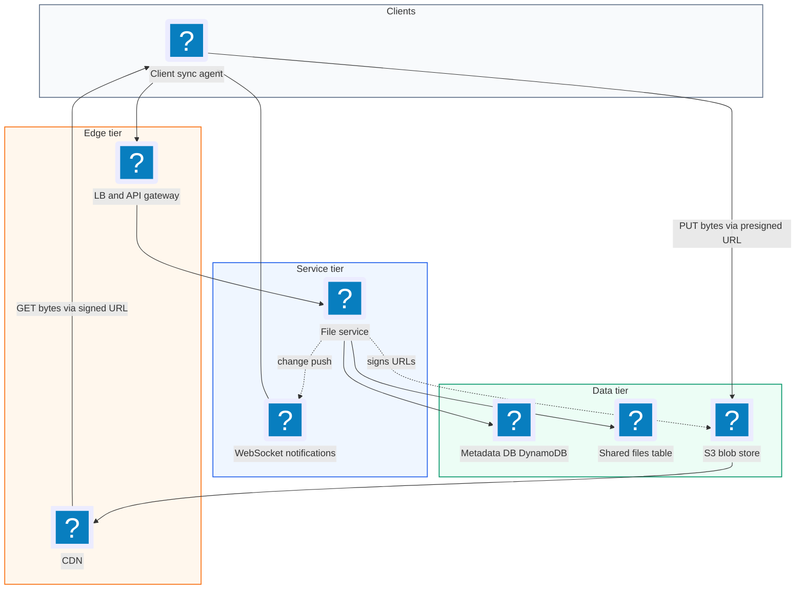
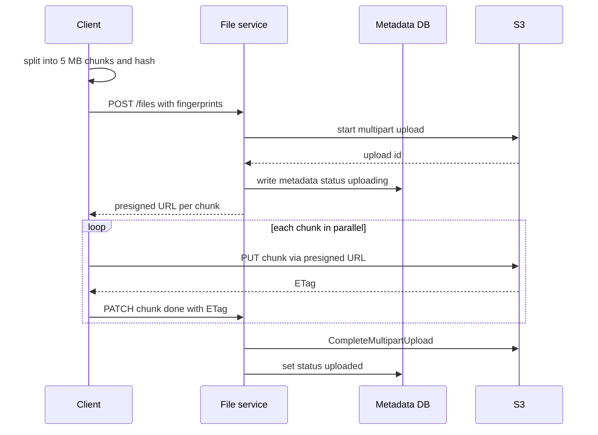
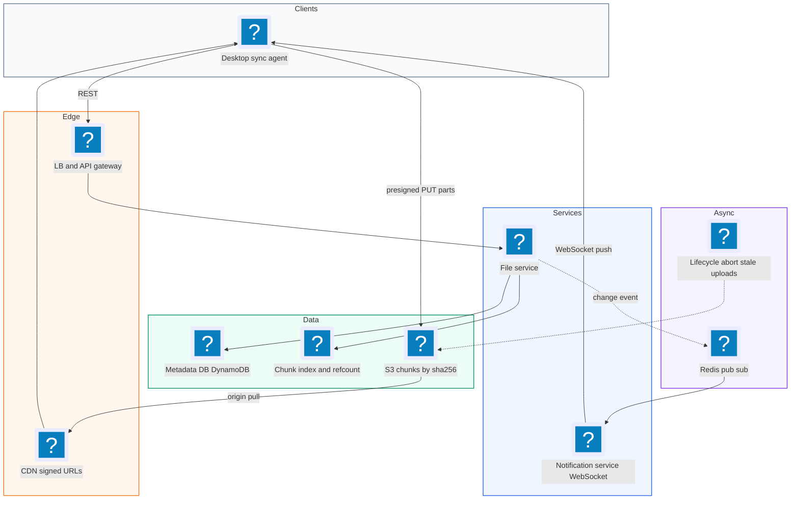

# 02. Dropbox (File Storage and Sync)  (Easy)

> Dropbox lets you drop a file into a folder on your laptop and see it appear on your phone and your other computers a few seconds later. You can also share files with other people and download them from anywhere. The interviewer is really testing how you move big files (up to 50 GB) reliably over flaky networks, how you keep many devices in sync, and whether you keep your servers out of the heavy data path.

## 1. Functional requirements

Core (must have):

1. Users can upload a file from any device.
2. Users can download a file from any device.
3. Users can share a file with other users and see files shared with them.
4. Files sync automatically across all of a user's devices.

Below the line (out of scope):

1. Full version history and restore. We keep a simple version number, but a full timeline is a separate feature.
2. Real-time collaborative editing (like Google Docs). That needs operational transforms, a different problem.
3. Search inside file contents. It needs a text index and is not core to storage.

## 2. Non-functional requirements

1. Large files: support files up to 50 GB.
2. Reliability and durability: no uploaded file is ever lost. Target 11 nines (99.999999999%) durability, which is what S3 advertises.
3. Resumable transfers: a dropped connection should not restart a 50 GB upload from zero.
4. Low sync latency: a change on one device shows on others within about 5 seconds when online.
5. Availability over consistency: 99.99% availability for upload and download. It is fine if a user in another country sees the new file a few seconds late. We choose AP because nothing breaks when sync is briefly stale, unlike a bank balance.
6. Security: only owners and people a file was shared with can read it. Encryption in transit (TLS) and at rest.

## 3. Back-of-the-envelope estimates

| Assumption | Number |
|---|---|
| Total users | 500M |
| Daily active users | 100M |
| Files uploaded per DAU per day | 2 |
| Average file size | 1 MB (most are small; a few are huge) |
| Chunk size | 5 MB |
| Downloads per upload | 3 |
| Metadata per file | 1 KB |

```text
Uploads:   100M x 2 / 86,400 s        ~= 2,300 uploads/sec  (peak ~7k/s)
Downloads: 2,300 x 3                  ~= 7,000 downloads/sec

New data/day:  200M files x 1 MB      = 200 TB/day
Per year:      200 TB x 365           ~= 73 PB/year (before dedup)
With ~30% dedup savings               ~= 50 PB/year

Metadata/year: 200M x 365 x 1 KB      ~= 73 TB/year (DB, shardable)

Upload bandwidth: 200 TB / 86,400 s   ~= 2.3 GB/s (straight into S3)

One 50 GB upload at 100 Mbps:
  50 GB x 8 bits / 100 Mbps = 4,000 s ~= 1.1 hours
```

The 1.1 hour number is the whole point: you cannot do that in a single HTTP request.

## 4. Core entities

- File: the raw bytes. Stored in blob storage (S3), not in a database.
- FileMetadata: name, size, MIME type, owner, status, content fingerprint, list of chunks.
- Chunk: a 5 MB slice of a file. Fields: index, SHA-256 fingerprint, upload status, ETag.
- User: the account. Fields: `user_id`, email.
- SharedFile: who can access which file. Fields: `file_id`, `user_id`, permission.
- Device: a client that syncs. Fields: `device_id`, `user_id`, `last_sync_cursor`.

A fingerprint is a hash, like SHA-256, of the bytes. Same bytes always give the same fingerprint, so it is a way to recognize content without comparing whole files.

```json
// FileMetadata (stored in DynamoDB or Postgres)
{
  "file_id": "f_8f2c",
  "owner_id": "u_42",
  "name": "trip.mov",
  "size": 734003200,
  "mime_type": "video/quicktime",
  "fingerprint": "sha256:9b1e...",
  "status": "uploading",
  "version": 3,
  "s3_key": "blobs/9b1e...",
  "chunks": [
    {"index": 0, "fp": "sha256:aa01...", "status": "uploaded", "etag": "\"e1\""},
    {"index": 1, "fp": "sha256:bb02...", "status": "not_uploaded"}
  ],
  "updated_at": "2026-11-03T10:00:00Z"
}
```

```sql
CREATE TABLE shared_files (
  file_id    TEXT NOT NULL,
  user_id    TEXT NOT NULL,
  permission TEXT NOT NULL CHECK (permission IN ('read', 'write')),
  PRIMARY KEY (user_id, file_id)       -- "files shared with me" is one scan
);
```

## 5. API design

All endpoints require a session token or JWT in the `Authorization` header. The user id comes from the token, never from the request body, because a client can forge the body.

`POST /files` -- start an upload. Returns presigned URLs for each chunk.

```json
// request
{"name": "trip.mov", "size": 734003200, "fingerprint": "sha256:9b1e...",
 "chunk_fingerprints": ["sha256:aa01...", "sha256:bb02..."]}
// response 201
{"file_id": "f_8f2c", "upload_id": "s3-mpu-123",
 "parts": [{"index": 1, "url": "https://s3.../part1?X-Amz-Signature=..."}],
 "already_uploaded": [0]}
```

`PATCH /files/{file_id}/chunks/{index}` -- report a finished chunk. Body `{"etag": "\"e1\""}`. Response `200`. When all chunks are done, the server completes the upload.

`GET /files/{file_id}` -- get metadata plus a short-lived signed download URL. Response `200 {"metadata": {...}, "download_url": "https://cdn.../f_8f2c?Expires=..."}`. `403` if no access, `404` if missing.

`POST /files/{file_id}/share` -- share. Body `{"emails": ["bob@example.com"], "permission": "read"}`. Response `204`.

`GET /files/changes?since={cursor}` -- list changes since the last sync. Response `200 {"changes": [{"file_id": "f_8f2c", "type": "updated", "version": 3}], "next_cursor": "c_9912"}`.

## 6. High-level design



The key idea: the File Service is a control plane. It handles metadata and signs URLs. File bytes go straight from the client to S3 and from the CDN to the client. Our servers never touch a 50 GB stream.

### How will users upload a file?

1. The client splits the file into 5 MB chunks and computes a SHA-256 for each chunk and for the whole file.
2. Client calls `POST /files`. The File Service starts an S3 multipart upload, writes metadata with `status = uploading`, and returns one presigned URL per chunk.
3. A presigned URL is a normal S3 URL with a signature and expiry baked in. Anyone holding it can do exactly one action (PUT this part) for a short time.
4. The client uploads chunks in parallel (for example 4 at a time) directly to S3.
5. After each chunk, the client sends `PATCH .../chunks/{i}` with the ETag S3 returned.
6. When all chunks are uploaded, the service calls S3 `CompleteMultipartUpload` and sets `status = uploaded`.



### How will users download a file?

1. Client calls `GET /files/{id}`. The service checks ownership or the share table.
2. The service returns a CDN signed URL valid for 5 minutes.
3. The client downloads from the nearest CDN edge. On a miss, the CDN pulls from S3 once and caches it.

### How will users share a file?

1. Owner calls `POST /files/{id}/share` with emails.
2. The service resolves emails to user ids and inserts rows into `shared_files`.
3. Bob's "shared with me" list is a single query on `user_id = bob`, which the primary key covers.

### How will files sync across devices?

1. Local to remote: a sync agent watches the folder using OS events (FSEvents on macOS, inotify on Linux, ReadDirectoryChangesW on Windows), queues changed files, and uploads them with the flow above.
2. Remote to local: each device holds one WebSocket connection. When a file changes, the server pushes a small "file f_8f2c is now version 3" message.
3. The device then calls `GET /files/changes?since=<cursor>` and downloads only what changed.
4. As a safety net, the device also polls `/files/changes` every few minutes in case a push was missed.

## 7. Deep dives

### How do we upload a 50 GB file reliably? (chunking)

The problem: a single 50 GB POST would take over an hour, hit gateway limits (Amazon API Gateway caps payloads at 10 MB), and restart from zero on any network blip.

| Option | How it works | Pros | Cons |
|---|---|---|---|
| Single POST to our server | Stream whole file through app servers | Simple | Timeouts, payload limits, servers burn bandwidth |
| Single presigned PUT to S3 | Client sends whole file to S3 | Servers out of data path | S3 caps one PUT at 5 GB; no resume |
| Client-side chunking + multipart upload | 5-10 MB parts, each its own PUT | Parallel, resumable, progress bar | More client logic, more metadata |

Recommended: client-side chunking with S3 multipart upload. Chunking must happen on the client. Chunking on the server is a classic mistake, because the whole file still has to cross the network in one piece first.

```python
import hashlib

CHUNK = 5 * 1024 * 1024  # 5 MB

def chunk_file(path):
    """Yield (index, sha256, bytes) for each 5 MB slice."""
    with open(path, "rb") as f:
        i = 0
        while True:
            data = f.read(CHUNK)
            if not data:
                break
            yield i, hashlib.sha256(data).hexdigest(), data
            i += 1

# 50 GB / 5 MB = 10,240 parts (S3 allows up to 10,000, so use ~6 MB
# for files this big; S3 parts must be 5 MB to 5 GB each).
```

### How do we make uploads resumable?

The problem: if the laptop closes at 49 GB, the user should only send the last 1 GB.

| Option | Source of truth for "which chunks are done" | Risk |
|---|---|---|
| Client remembers locally | Local file | Lost if client reinstalls or switches device |
| Client reports each chunk, server trusts it | Metadata DB | Client could lie or a PATCH could be lost |
| Client reports, server verifies with S3 `ListParts` | S3 + Metadata DB | Small extra call |

Recommended: the third option. On resume, the client sends the whole-file fingerprint. The server finds the matching `uploading` record, calls S3 `ListParts`, and returns which part numbers exist. The client uploads only the rest.

```python
def resume(user_id, file_fp):
    meta = db.find_one(owner_id=user_id, fingerprint=file_fp,
                       status="uploading")
    if not meta:
        return None
    done = {p["PartNumber"] for p in
            s3.list_parts(Bucket=B, Key=meta.s3_key,
                          UploadId=meta.upload_id)["Parts"]}
    missing = [c.index for c in meta.chunks if c.index + 1 not in done]
    return {"upload_id": meta.upload_id,
            "urls": [presign_part(meta, i + 1) for i in missing]}
```

Unfinished multipart uploads cost storage, so add an S3 lifecycle rule that aborts them after 7 days.

### How do we sync fast and handle conflicts?

The problem: a 1 GB file where the user changed one paragraph should not re-upload 1 GB. And two devices may edit the same file while offline.

For delta sync, fixed 5 MB chunks have a flaw. Insert one byte at the start and every boundary shifts, so every chunk hash changes. Content-defined chunking (CDC) fixes this. A rolling hash (like Rabin fingerprinting) slides over the bytes and cuts a chunk wherever the hash hits a pattern, for example its low 22 bits are zero. Because boundaries depend on content, an edit only changes the one or two chunks around it.

| Conflict strategy | Behavior | Good for |
|---|---|---|
| Last write wins | Latest timestamp overwrites | Simple, but silently loses edits |
| Version check + conflicted copy | Upload says "I edited version 3"; if server is at 4, save as a copy | What Dropbox actually does |
| Merge (OT/CRDT) | Combine edits | Docs editors, out of scope |

Recommended: optimistic version check. Each upload carries the `base_version` it edited. The server only commits if the current version still matches.

```sql
UPDATE file_metadata
SET version = version + 1, chunks = :new_chunks, updated_at = now()
WHERE file_id = :id AND version = :base_version;
-- 0 rows updated -> someone else won. Save ours as
-- "trip (Alice's MacBook conflicted copy).mov" and notify the user.
```

Nobody loses work, and the user decides which copy to keep.

### How do we save storage with deduplication?

The problem: 50 PB a year is expensive, and many users upload the same files (the same PDF, the same installer).

| Option | Scope | Savings | Trade-off |
|---|---|---|---|
| No dedup | n/a | 0% | Simple |
| File-level dedup | Same whole-file hash | Medium | Misses near-identical files |
| Chunk-level dedup | Same chunk hash | Highest | Need a chunk index and reference counts |

Recommended: chunk-level dedup, keyed by the chunk's SHA-256. Store each unique chunk once at `chunks/<sha256>`. When a client starts an upload, the server checks which chunk hashes already exist and tells the client to skip them. A reference count per chunk tells a cleanup job when nothing uses a chunk anymore. One security note: cross-user dedup can leak whether a file exists ("does anyone have this leaked PDF?"). A safe default is to dedup within one user or team, or always require the upload to finish before showing the skip.

### How do we make downloads fast with a CDN, and what if something fails?

The problem: a user in Sydney pulling from a US bucket gets 200 ms+ per round trip and slow throughput.

A CDN (content delivery network) caches files at edge servers around the world. We hand out a CDN signed URL that expires in 5 minutes, so a leaked link stops working quickly. For big files the client uses HTTP Range requests (`Range: bytes=0-10485759`) to download several byte ranges in parallel and resume a broken download.

| Failure | Mitigation |
|---|---|
| Client disconnects mid-upload | Resume via `ListParts` |
| PATCH for a chunk is lost | Server verifies against S3, not just DB |
| WebSocket drops | Periodic poll of `/files/changes` |
| Metadata DB node dies | DynamoDB replicates across 3 AZs automatically |
| S3 region outage | Cross-region replication for paid tiers |

## 8. Final architecture



| Component | Job | Technology example |
|---|---|---|
| Sync agent | Watch folder, chunk, hash, upload, apply changes | Native client (Rust/C++) |
| API Gateway | Auth, rate limit, routing | AWS API Gateway, Envoy |
| File Service | Metadata, permissions, sign URLs | Stateless service |
| Metadata DB | File records, versions, shares | DynamoDB or Postgres sharded by user |
| Chunk index | Dedup lookup and ref counts | DynamoDB table keyed by SHA-256 |
| Blob store | Durable bytes | S3 multipart upload |
| CDN | Fast global downloads | CloudFront signed URLs |
| Notification Service | Push change events to devices | WebSocket servers + Redis pub/sub |

### Deployment map (AWS)

```mermaid
architecture-beta
    group internet(mdi:earth)[Internet]
    group edge(logos:aws-cloudfront)[Edge]
    group vpc(logos:aws-vpc)[AWS VPC]
    group app(logos:aws-ecs)[Service subnet] in vpc
    group data(logos:aws-rds)[Data subnet] in vpc

    service sa(mdi:laptop)[Desktop sync agent] in internet
    service gw(logos:aws-api-gateway)[LB and API gateway] in edge
    service cdn(logos:aws-cloudfront)[CDN signed URLs] in edge
    service fs(logos:aws-ecs)[File service] in app
    service ns(logos:aws-ecs)[Notification service] in app
    service lc(logos:aws-eventbridge)[Lifecycle abort job] in app
    service md(logos:aws-dynamodb)[Metadata DB] in data
    service ci(logos:aws-dynamodb)[Chunk index] in data
    service s3(logos:aws-s3)[S3 chunks] in data
    service ps(logos:aws-elasticache)[Redis pub sub] in data

    sa:R --> L:gw
    gw:B --> T:fs
    fs:B --> T:md
    fs:B --> T:ci
    sa:B --> T:s3
    s3:R --> L:cdn
    cdn:L --> R:sa
    fs:R --> L:ps
    ps:T --> B:ns
    ns:L --> R:sa
    lc:B --> T:s3
```



The gateway and CDN sit at the edge while the file and notification services stay in the service subnet, and the client streams chunk bytes straight to S3 in the data subnet.

## 9. Common mistakes and interviewer follow-ups

- Sending file bytes through your app servers. It wastes bandwidth and hits payload limits. Say: "Servers sign URLs; bytes go client to S3."
- Chunking on the server. The file still crosses the network in one piece. Chunk on the client.
- Identifying a file by its name for resume or dedup. Names collide. Use a content fingerprint plus a UUID `file_id`.
- Trusting the client's chunk status. Verify with S3 `ListParts` before marking parts done.
- Last write wins with no warning. It silently destroys edits. Use a version check and a conflicted copy.
- Fixed-size chunks for delta sync. One inserted byte changes every chunk. Mention content-defined chunking.
- Follow-up: "Polling or push?" Answer: push over one WebSocket per device, plus slow polling as a safety net.

## 10. One-page cheat sheet

| Topic | Key point |
|---|---|
| Scale | 100M DAU, ~2.3k uploads/s, ~200 TB/day new data |
| Big files | 50 GB at 100 Mbps = 1.1 h, so chunk on client (5-10 MB) |
| Upload path | Presigned URLs, S3 multipart, servers out of data path |
| Resume | Whole-file fingerprint finds record, `ListParts` finds done parts |
| Sync | Fs watcher up, WebSocket push down, poll as backup, cursors |
| Delta | Content-defined chunking, re-upload only changed chunks |
| Conflicts | `base_version` check, conflicted copy on mismatch |
| Dedup | Chunk-level by SHA-256, ref counts, beware cross-user leaks |
| Download | CDN signed URL (5 min), HTTP Range for parallel/resume |
| CAP | AP: availability first, sync is eventually consistent |

## Sources

- [Hello Interview: Design Dropbox](https://www.hellointerview.com/learn/system-design/problem-breakdowns/dropbox)
- [AWS: Uploading objects using multipart upload](https://docs.aws.amazon.com/AmazonS3/latest/userguide/mpuoverview.html)
- [AWS: Sharing objects with presigned URLs](https://docs.aws.amazon.com/AmazonS3/latest/userguide/ShareObjectPreSignedURL.html)
- [Dropbox Tech Blog: Streaming file synchronization](https://dropbox.tech/infrastructure/streaming-file-synchronization)
- [Dropbox Help: Conflicted copies](https://help.dropbox.com/organize/conflicted-copy)
- [Wikipedia: Rolling hash and content-defined chunking](https://en.wikipedia.org/wiki/Rolling_hash)
