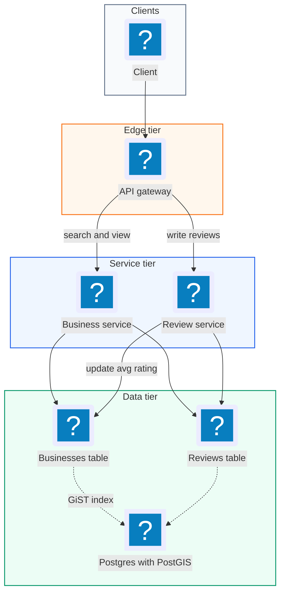
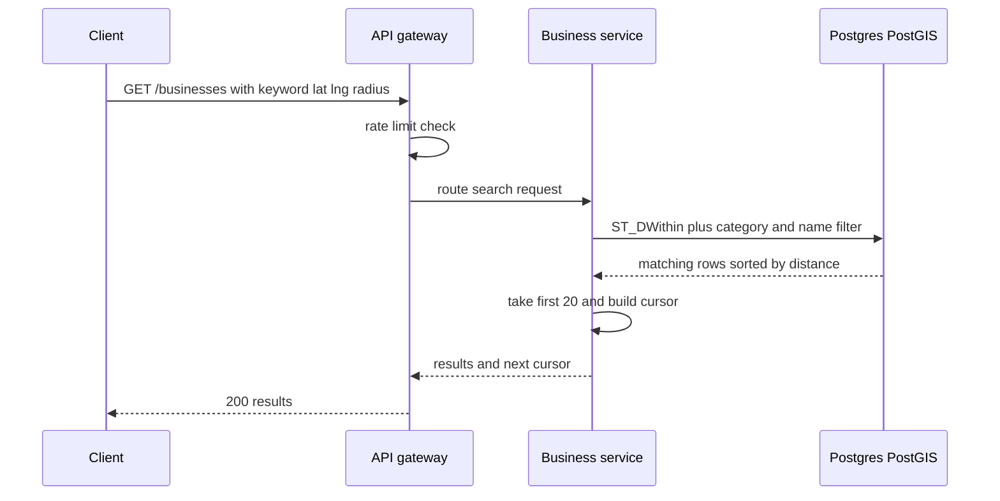
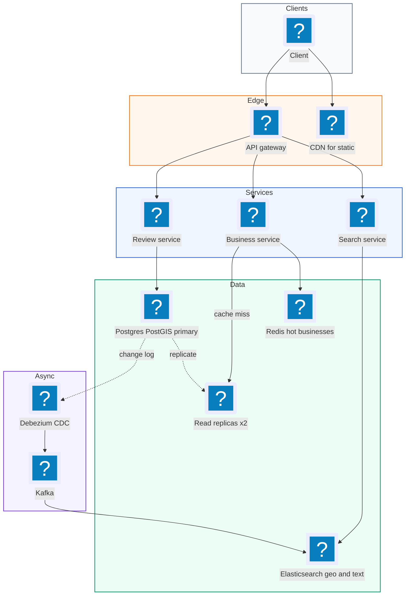

# 03. Yelp (Business Reviews with Geo Search)  (Easy)

> Yelp lets you search for local businesses, like "pizza near me", look at a business page with its reviews, and leave your own 1 to 5 star review. The interviewer is really testing three things: how you search by location quickly (a geospatial index), how you keep the average rating cheap to read at huge read volume, and how you enforce a simple business rule, one review per user per business, correctly.

## 1. Functional requirements

Core (must have):

1. Users can search businesses by name or keyword, by location (latitude and longitude plus a radius), and by category.
2. Users can view a business and its reviews.
3. Users can leave a review: a required 1-5 star rating and optional text. One review per user per business.

Below the line (out of scope):

1. Admin tools to add or edit businesses. We assume businesses are loaded by another system.
2. Map view with pins. It reuses the same search API, so it adds no new backend design.
3. Personalized recommendations. That needs an ML pipeline, a separate problem.

## 2. Non-functional requirements

1. Low latency: p99 search latency under 500 ms; business page under 200 ms.
2. High availability: 99.99% for search and viewing. Reviews can tolerate brief write failures with a retry.
3. Scale: 100M daily users, 10M businesses, about 1B reviews total.
4. Consistency: eventual consistency for search results and the average rating. If a new review shows up in the average 30 seconds later, that is fine.
5. Correctness: the one-review-per-user rule must be strongly enforced. A user must never end up with two reviews on one business.
6. CAP choice: AP for reads (search and view), because showing a slightly stale rating is better than failing. The uniqueness rule is enforced inside a single database with a constraint, which gives us a consistent check where we need it.

## 3. Back-of-the-envelope estimates

| Assumption | Number |
|---|---|
| Daily active users | 100M |
| Searches per user per day | 5 |
| Business page views per user per day | 3 |
| Reviews written per day | 1M |
| Businesses | 10M |
| Business row size | 1 KB |
| Review size (with text) | 1 KB |

```text
Search QPS:  100M x 5 / 86,400       ~= 5,800/s  (peak x3 ~= 17k/s)
View QPS:    100M x 3 / 86,400       ~= 3,500/s
Review QPS:  1M / 86,400             ~= 12 writes/s

Read : write ratio                   ~= 800 : 1

Business data:  10M x 1 KB           = 10 GB  (fits in memory)
Reviews total:  1B x 1 KB            = 1 TB
New reviews:    1M x 365 x 1 KB      ~= 365 GB/year
```

Two takeaways. The business table is small enough to fit in RAM on one machine. Reviews are bigger but writes are tiny, so this is a read-heavy system.

## 4. Core entities

- Business: a place. Fields: `id`, `name`, `category`, `lat`, `lng`, `address`, `avg_rating`, `num_ratings`.
- Review: one user's opinion of one business. Fields: `id`, `business_id`, `user_id`, `rating`, `text`, `created_at`.
- User: the person. Fields: `id`, `name`.
- Location: a named area, like "Brooklyn" or "San Francisco". Fields: `id`, `name`, `polygon`.

```sql
CREATE EXTENSION IF NOT EXISTS postgis;

CREATE TABLE businesses (
  id           BIGSERIAL PRIMARY KEY,
  name         TEXT NOT NULL,
  category     TEXT NOT NULL,
  location     GEOGRAPHY(Point, 4326) NOT NULL,  -- lat/lng on Earth
  avg_rating   NUMERIC(2,1) NOT NULL DEFAULT 0,
  num_ratings  INT NOT NULL DEFAULT 0
);

CREATE TABLE reviews (
  id           BIGSERIAL PRIMARY KEY,
  business_id  BIGINT NOT NULL REFERENCES businesses(id),
  user_id      BIGINT NOT NULL,
  rating       SMALLINT NOT NULL CHECK (rating BETWEEN 1 AND 5),
  text         TEXT,
  created_at   TIMESTAMP NOT NULL DEFAULT now(),
  UNIQUE (user_id, business_id)       -- one review per user per business
);
```

## 5. API design

`GET /businesses?query=pizza&lat=40.71&lng=-74.00&radius_m=2000&category=restaurant&cursor=abc&limit=20` -- search. Public, no auth needed.

```json
// response 200
{
  "results": [
    {"id": 101, "name": "Joe's Pizza", "category": "restaurant",
     "avg_rating": 4.5, "num_ratings": 2381, "distance_m": 420}
  ],
  "next_cursor": "def"
}
```

`GET /businesses/{id}` -- business details. Response `200` with business fields, `404` if missing.

`GET /businesses/{id}/reviews?cursor=xyz&limit=10` -- paginated reviews, newest first. Response `200 {"reviews": [...], "next_cursor": "..."}`.

`POST /businesses/{id}/reviews` -- leave a review. Requires a logged-in user (JWT). The user id comes from the token.

```json
// request
{"rating": 5, "text": "Best slice in town."}
// response 201
{"id": 99012, "business_id": 101, "rating": 5, "created_at": "2026-11-03T12:00:00Z"}
```

Status codes: `201` created, `400` rating not 1-5, `401` not logged in, `409` already reviewed this business.

## 6. High-level design



We split reads (Business Service) from writes (Review Service) because reads are 800 times more frequent. Both talk to one Postgres database with the PostGIS extension for location queries.

### How will users search for businesses?

1. Client sends `GET /businesses` with keyword, lat/lng, radius, and category.
2. The gateway routes it to the Business Service.
3. The Business Service runs one query that filters by distance, category, and name, then sorts.
4. It returns the first 20 results and a cursor for the next page.



```sql
SELECT id, name, avg_rating, num_ratings,
       ST_Distance(location, ST_MakePoint(-74.00, 40.71)::geography) AS d
FROM businesses
WHERE ST_DWithin(location, ST_MakePoint(-74.00, 40.71)::geography, 2000)
  AND category = 'restaurant'
  AND name ILIKE '%pizza%'
ORDER BY d
LIMIT 20;
```

Without the right indexes this scans all 10M rows. The deep dive fixes that.

### How will users view a business and its reviews?

1. Client calls `GET /businesses/101`. The service reads one row by primary key (fast).
2. Client calls `GET /businesses/101/reviews`. The service reads from an index on `(business_id, created_at DESC)` and returns 10 at a time.
3. We never load all 2,381 reviews at once. Cursor pagination keeps each page a cheap index range scan.

### How will users leave a review?

1. Client sends `POST /businesses/101/reviews` with a JWT.
2. Review Service validates the rating is 1-5 and inserts the row.
3. If the `UNIQUE (user_id, business_id)` constraint fires, return `409 Conflict`.
4. The service updates the business's average rating (see deep dive).

## 7. Deep dives

### How do we search by location efficiently? (geospatial index)

The problem: "find businesses within 2 km" on a normal B-tree index does not work well. A B-tree sorts one dimension. You can index latitude or longitude, but a range on both still scans a wide strip of rows. We need an index that understands 2D space.

| Option | How it works | Pros | Cons |
|---|---|---|---|
| Geohash | Encode lat/lng into a string; nearby points share a prefix | Works on any B-tree or key-value store; easy to shard | Edge cases at cell borders; must query neighbor cells |
| Quadtree | Split the map into 4 squares, recursively, until each holds at most N businesses | Adapts to density (Manhattan gets tiny cells, Nevada big ones) | Custom in-memory structure; rebuild on changes |
| PostGIS / R-tree (GiST index) | Database indexes bounding boxes of shapes | Built in, exact distance, handles polygons | Ties you to Postgres; heavy queries at very high QPS |
| Elasticsearch `geo_point` | Search engine with geo plus full-text | Combines location, text, filters in one query | Another system to sync and operate |

A geohash turns a location into a short string. Each extra character makes the cell smaller. For example a 6-character geohash is a cell about 1.2 km by 0.6 km. Two points with the same 6-character prefix are in the same cell.

```python
# pip install pygeohash
import pygeohash as pgh

def candidate_cells(lat, lng, precision=6):
    """The user's cell plus its 8 neighbors, so we don't miss
    businesses just across a cell border."""
    center = pgh.encode(lat, lng, precision=precision)
    return [center] + pgh.neighbors(center)   # 9 cells

# Query: WHERE geohash6 IN (...9 cells...) then filter exact distance.
```

Recommended: for 10M businesses, PostGIS with a GiST index is enough and simplest. The whole table is 10 GB, so it lives in memory. If search QPS or text-search needs grow, move search to Elasticsearch with `geo_point` and full-text in one index (next deep dive).

```sql
CREATE INDEX idx_biz_location ON businesses USING GIST (location);
```

### How do we search by name and location together at scale?

The problem: `name ILIKE '%pizza%'` cannot use a normal index because of the leading `%`. So the database scans every row in the radius and string-matches each one. Real search also wants typo tolerance ("piza") and relevance ranking.

| Option | Text search | Geo | Ranking | Ops cost |
|---|---|---|---|---|
| Postgres `ILIKE` | Full scan | PostGIS | Manual | Low |
| Postgres full-text (`tsvector` + GIN) + PostGIS | Inverted index | PostGIS | Basic | Low |
| Elasticsearch | Inverted index, fuzzy | `geo_point`, `geo_distance` | BM25 + boosts | Medium |

An inverted index is a map from each word to the list of documents that contain it, like the index at the back of a book. It makes word lookup fast.

Recommended: Elasticsearch as the search index, fed from Postgres by change data capture (CDC). CDC means reading the database's change log (for example with Debezium) and streaming every insert or update to another system. Postgres stays the source of truth.

```json
{
  "query": {
    "bool": {
      "must":   [{"match": {"name": {"query": "piza", "fuzziness": "AUTO"}}}],
      "filter": [
        {"term": {"category": "restaurant"}},
        {"geo_distance": {"distance": "2km",
                          "location": {"lat": 40.71, "lon": -74.00}}}
      ]
    }
  },
  "sort": [{"_score": "desc"}, {"avg_rating": "desc"}],
  "size": 20
}
```

For named places like "Brooklyn", store each area's boundary polygon in a `locations` table. Resolve "Brooklyn" to its polygon, then use a `geo_shape` filter (Elasticsearch) or `ST_Within` (PostGIS) instead of a circle.

### How do we keep the average rating fast to read at scale?

The problem: search results show the average rating of every business. Computing `AVG(rating)` over 2,381 reviews for each of 20 results on every search, at 17k searches per second, is far too expensive.

| Option | How | Read cost | Write cost | Freshness |
|---|---|---|---|---|
| Compute on read | `SELECT AVG(rating) ... GROUP BY` | High | None | Exact |
| Store running totals, update in the same transaction | Keep `avg_rating` and `num_ratings` on the business row | One column read | One row update | Exact |
| Async aggregation | Queue the event, a worker updates the average | One column read | Tiny | Seconds stale |

Recommended: store the running average on the business row and update it in the same transaction as the review insert. At about 12 reviews per second overall, row contention is not a real issue. Use the incremental formula so you never re-scan reviews.

```sql
BEGIN;
INSERT INTO reviews (business_id, user_id, rating, text)
VALUES (101, 42, 5, 'Best slice in town.');

-- new_avg = (old_avg * n + new_rating) / (n + 1)
UPDATE businesses
SET avg_rating  = (avg_rating * num_ratings + 5) / (num_ratings + 1),
    num_ratings = num_ratings + 1
WHERE id = 101;
COMMIT;
```

The single `UPDATE` statement takes a row lock, so two concurrent reviews on the same business apply one after the other and neither is lost. If a single business ever got thousands of reviews per second, switch to the async option: push events to a queue and let one worker per business batch the updates.

### How do we ensure a user can only leave one review per business?

The problem: a check like "select first, insert if none" has a race. Two requests from the same user (a double click) can both see "no review" and both insert.

| Option | Correct under races? | Notes |
|---|---|---|
| Check in app code before insert | No | Race window between SELECT and INSERT |
| Database `UNIQUE (user_id, business_id)` | Yes | The database rejects the second insert atomically |
| Distributed lock per (user, business) | Yes | Overkill and adds a failure point |

Recommended: the database unique constraint. It is the simplest correct answer. The second insert fails with a unique violation, and the service returns `409 Conflict`. If reviews are later sharded, shard by `business_id` so that the `(user_id, business_id)` pair always lands on one shard and the constraint still works locally.

```python
from psycopg2 import errors

def create_review(user_id, business_id, rating, text):
    try:
        with db.transaction():
            insert_review_and_update_avg(user_id, business_id, rating, text)
        return 201
    except errors.UniqueViolation:
        return 409   # already reviewed; client can offer "edit your review"
```

Failure handling: if the database primary fails, reviews fail for about 30-60 seconds during failover. The client retries with the same request, and the unique constraint makes the retry safe, it can never create a duplicate. Reads keep working from replicas and Elasticsearch.

## 8. Final architecture



| Component | Job | Technology example |
|---|---|---|
| API Gateway | Auth, rate limit, routing | AWS API Gateway, Kong |
| Search Service | Geo + keyword + category search | Stateless service |
| Search index | Inverted index plus geo filters | Elasticsearch / OpenSearch |
| Business Service | Business page and review pages | Stateless service |
| Cache | Hot business pages | Redis, 60 s TTL |
| Review Service | Insert review, update average atomically | Stateless service |
| Primary DB | Source of truth, unique constraint | Postgres + PostGIS |
| CDC pipeline | Keep search index in sync | Debezium + Kafka |

### Deployment map (AWS)

```mermaid
architecture-beta
    group internet(mdi:earth)[Internet]
    group edge(logos:aws-cloudfront)[Edge]
    group vpc(logos:aws-vpc)[AWS VPC]
    group app(logos:aws-ecs)[Service subnet] in vpc
    group data(logos:aws-rds)[Data subnet] in vpc

    service c(mdi:cellphone)[Client] in internet
    service cdn(logos:aws-cloudfront)[CDN for static] in edge
    service gw(logos:aws-api-gateway)[API gateway] in edge
    service ss(logos:aws-ecs)[Search service] in app
    service bs(logos:aws-ecs)[Business service] in app
    service rs(logos:aws-ecs)[Review service] in app
    service es(logos:aws-opensearch)[Elasticsearch geo and text] in data
    service rd(logos:aws-elasticache)[Redis hot businesses] in data
    service pg(logos:aws-rds)[Postgres PostGIS primary] in data
    service k(logos:kafka-icon)[Kafka CDC] in data

    c:R --> L:cdn
    c:R --> L:gw
    gw:B --> T:ss
    gw:B --> T:bs
    gw:B --> T:rs
    ss:B --> T:es
    bs:B --> T:rd
    rs:B --> T:pg
    pg:R --> L:k
    k:L --> R:es
```



The gateway fans out to three stateless services in the service subnet, while Postgres, Redis, Kafka and the Elasticsearch index it feeds all sit in the data subnet.

## 9. Common mistakes and interviewer follow-ups

- Using a B-tree on lat and lng for "nearby". It still scans a large strip. Say: "I need a 2D index: geohash, quadtree, or PostGIS GiST."
- Forgetting neighbor cells with geohash. A business 10 m away across a border gets missed. Always query the 8 neighbors too.
- Computing `AVG()` on every search. Too slow at 17k QPS. Store `avg_rating` and `num_ratings` on the business.
- Enforcing one review per user in app code only. Races create duplicates. Use a `UNIQUE` constraint.
- `ILIKE '%term%'` for search. Full scan. Use an inverted index (Postgres full-text or Elasticsearch).
- Making Elasticsearch the source of truth. It is a derived index. Keep Postgres as truth and rebuild ES from it.
- Follow-up: "How do you search by city name?" Answer: store area polygons, resolve the name, filter with `ST_Within` or `geo_shape`.

## 10. One-page cheat sheet

| Topic | Key point |
|---|---|
| Scale | 100M DAU, ~6k search/s (peak 17k), ~12 review writes/s |
| Data | 10M businesses = 10 GB, 1B reviews = 1 TB |
| Geo index | PostGIS GiST at this size; geohash/quadtree to explain the idea |
| Text search | Elasticsearch fed by CDC; fuzzy match, geo_distance filter |
| Avg rating | Running `avg_rating`, `num_ratings` updated in same transaction |
| One review | `UNIQUE (user_id, business_id)`, return 409 |
| Named areas | Polygons + `ST_Within` / `geo_shape` |
| CAP | AP for reads, consistent constraint for writes |

## Sources

- [Hello Interview: Design Yelp](https://www.hellointerview.com/learn/system-design/problem-breakdowns/yelp)
- [PostGIS: ST_DWithin](https://postgis.net/docs/ST_DWithin.html)
- [Elasticsearch: Geo-distance query](https://www.elastic.co/guide/en/elasticsearch/reference/current/query-dsl-geo-distance-query.html)
- [Wikipedia: Geohash](https://en.wikipedia.org/wiki/Geohash)
- [Wikipedia: Quadtree](https://en.wikipedia.org/wiki/Quadtree)
- [Debezium: Change data capture for Postgres](https://debezium.io/documentation/reference/stable/connectors/postgresql.html)
