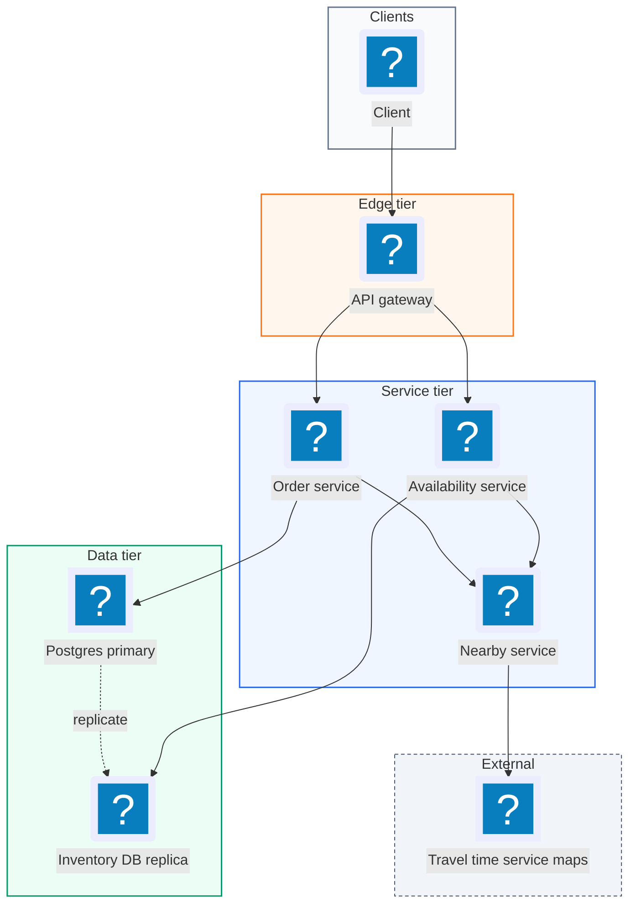
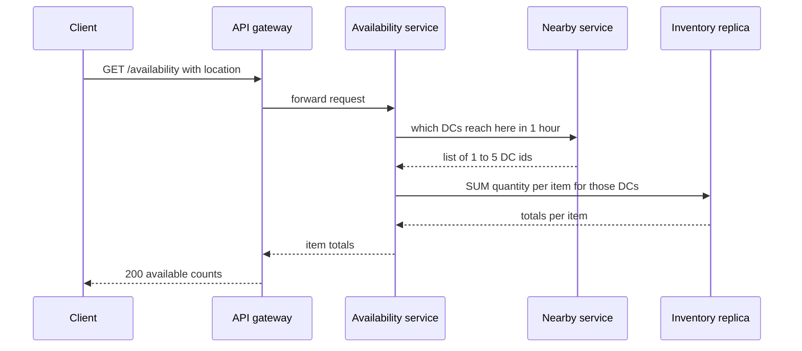
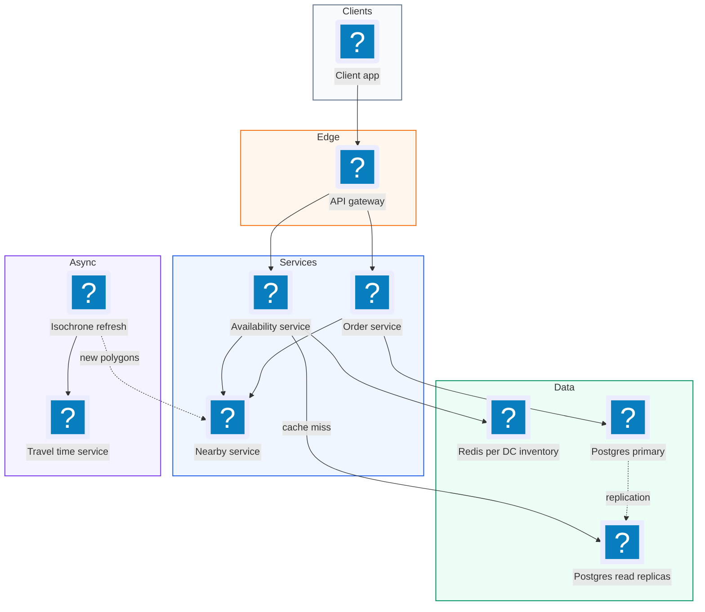

# 04. Local Delivery Service (Gopuff)  (Easy)

> A local delivery service like Gopuff stocks snacks, drinks, and household items in hundreds of small warehouses called distribution centers (DCs), also known as micro-fulfillment centers. A customer opens the app, sees what can reach them within 1 hour, and places an order. The interviewer is really testing two things: can you answer "what is available near me?" in under 100 ms by combining many nearby warehouses, and can you take an order without ever selling the same physical item twice.

## 1. Functional requirements

Core (must have):

1. Customers can see which items are available to them for delivery within 1 hour, based on their location. Availability is the sum of stock across all DCs that can reach them in time.
2. Customers can order several items in one order.

Below the line (out of scope):

1. Payments. A payment provider handles it; it does not change inventory design.
2. Driver dispatch and routing. A separate logistics system.
3. Catalog search and browsing pages. We focus on availability and ordering.
4. Cancellations and returns. They add a "put stock back" flow but no new concepts.

## 2. Non-functional requirements

1. Fast availability: p99 under 100 ms. It is called on every page and search, so it must feel instant.
2. Strong consistency for orders: two customers must never buy the same physical unit. Overselling means a driver shows up with half an order.
3. Scale: 10k DCs, 100k catalog items, 10M orders per day.
4. Availability: 99.9% for ordering, 99.99% for availability reads.
5. CAP choice: split by path. Availability reads are AP: a count that is a few seconds stale is fine, since the order step re-checks. Ordering is CP: if we cannot confirm stock consistently, we reject the order rather than oversell.

## 3. Back-of-the-envelope estimates

| Assumption | Number |
|---|---|
| Orders per day | 10M |
| Items per order | 5 |
| Availability calls per order (browse, search, cart) | 20 |
| DCs | 10,000 |
| Items stocked per DC | 5,000 (of 100k catalog) |
| Inventory row size | 50 bytes |

```text
Order QPS:        10M / 86,400            ~= 115 orders/s  (peak x5 ~= 600/s)
Inventory decrements: 115 x 5             ~= 600 row updates/s (peak 3k/s)
Availability QPS: 10M x 20 / 86,400       ~= 2,300/s  (peak ~= 12k/s)

Inventory rows:   10k DCs x 5k items      = 50M rows
Inventory size:   50M x 50 B              = 2.5 GB  (fits in memory)
Orders/year:      10M x 365 x 1 KB        ~= 3.6 TB/year
```

Inventory is small, only 2.5 GB. The hard parts are latency of the availability query and correctness of the order write.

## 4. Core entities

- Item: a product type, like "Cheetos 8 oz". Fields: `item_id`, `name`, `price`. Think of it as a class.
- Inventory: how many units of an item sit in one DC. Fields: `dc_id`, `item_id`, `quantity`. Think of it as instances at a place.
- Distribution Center (DC): a warehouse. Fields: `dc_id`, `lat`, `lng`, `region`.
- Order: a customer's purchase. Fields: `order_id`, `user_id`, `status`, `delivery_lat`, `delivery_lng`.
- OrderItem: one line of an order. Fields: `order_id`, `item_id`, `dc_id`, `quantity`.

```sql
CREATE TABLE inventory (
  dc_id     INT    NOT NULL,
  item_id   INT    NOT NULL,
  quantity  INT    NOT NULL CHECK (quantity >= 0),  -- can never go negative
  PRIMARY KEY (dc_id, item_id)
);

CREATE TABLE orders (
  order_id      UUID PRIMARY KEY,
  user_id       BIGINT NOT NULL,
  status        TEXT NOT NULL,          -- 'placed', 'packed', 'delivered'
  created_at    TIMESTAMP NOT NULL DEFAULT now()
);

CREATE TABLE order_items (
  order_id  UUID NOT NULL REFERENCES orders(order_id),
  item_id   INT  NOT NULL,
  dc_id     INT  NOT NULL,
  quantity  INT  NOT NULL,
  PRIMARY KEY (order_id, item_id, dc_id)
);
```

## 5. API design

`GET /availability?lat=40.71&lng=-74.00&item_ids=11,12,13` -- quantities deliverable within 1 hour. Or `?lat=..&lng=..&cursor=..&limit=50` to page through everything available. Auth optional.

```json
// response 200
{"items": [{"item_id": 11, "name": "Cheetos 8 oz", "available": 37},
           {"item_id": 12, "name": "Sparkling Water 12pk", "available": 0}],
 "next_cursor": null}
```

`POST /orders` -- place an order. Requires a logged-in user. Includes an idempotency key so a retry does not create two orders.

```json
// request  (Idempotency-Key: 6f1c-...)
{"lat": 40.71, "lng": -74.00,
 "items": [{"item_id": 11, "quantity": 2}, {"item_id": 13, "quantity": 1}]}
// response 201
{"order_id": "9b2e...", "status": "placed", "eta_minutes": 34}
```

Status codes: `201` placed, `409` an item is out of stock (body lists which), `400` invalid request, `401` not logged in.

## 6. High-level design



### How will customers see what is available near them?

1. Client calls `GET /availability` with its location.
2. The Availability Service asks the Nearby Service: "which DCs can deliver here within 1 hour?"
3. The Nearby Service returns a short list, typically 1-5 DC ids.
4. The Availability Service queries inventory for those DCs and sums quantity per item.
5. It returns the totals.



```sql
SELECT i.item_id, it.name, SUM(i.quantity) AS available
FROM inventory i
JOIN items it ON it.item_id = i.item_id
WHERE i.dc_id = ANY(:nearby_dc_ids)
  AND i.item_id = ANY(:item_ids)
GROUP BY i.item_id, it.name;
```

### How will customers place an order?

1. Client calls `POST /orders` with location, items, and an idempotency key.
2. The Order Service gets the nearby DCs again (the customer may have moved).
3. In one database transaction it checks stock, decrements it, and writes the order.
4. If any item is short, the whole transaction rolls back and the client gets `409` with the missing items.
5. On success the client gets `201` and the order id.

## 7. Deep dives

### How do we find nearby DCs that can deliver within 1 hour?

The problem: "within 1 hour" is about driving time, not straight-line distance. A DC 3 km away across a river with one bridge might take 50 minutes. But calling a maps API for all 10k DCs on every request is too slow and too expensive.

| Option | How | Accuracy | Latency | Cost |
|---|---|---|---|---|
| Straight-line distance (Haversine) | Math on lat/lng | Poor near rivers, highways | under 1 ms | Free |
| Travel-time API for every DC | Ask maps for 10k routes | Exact | Seconds | Very high |
| Filter by distance, then travel-time API on the few left | Haversine to get top ~10 within 30 km, then route those | Good | 20-50 ms | Low |
| Precomputed delivery zones (isochrones) | Each DC stores a polygon reachable in 1 hour; point-in-polygon test | Good, refresh hourly for traffic | under 5 ms | Low |

An isochrone is a map shape covering every point reachable within a set time from a location, like a 60-minute "blob" around each DC.

Recommended: precomputed isochrone polygons per DC, refreshed every 15-60 minutes from the travel-time service, with a fast point-in-polygon check. Because there are only 10k DCs, the whole set fits in memory on each Nearby Service instance. Fall back to "Haversine filter, then route the top 10" if a polygon is stale.

```python
import math
from shapely.geometry import Point

def haversine_km(lat1, lng1, lat2, lng2):
    """Great-circle distance on a sphere of radius 6371 km."""
    p1, p2 = math.radians(lat1), math.radians(lat2)
    dp, dl = p2 - p1, math.radians(lng2 - lng1)
    a = math.sin(dp/2)**2 + math.cos(p1)*math.cos(p2)*math.sin(dl/2)**2
    return 2 * 6371 * math.asin(math.sqrt(a))

def nearby_dcs(lat, lng, dcs):
    # Step 1: cheap prefilter, nothing beyond 40 km reaches us in 1 hour
    close = [d for d in dcs if haversine_km(lat, lng, d.lat, d.lng) < 40]
    # Step 2: exact-ish check against the 60-min isochrone polygon
    p = Point(lng, lat)
    return [d.id for d in close if d.isochrone_60min.contains(p)]
```

We must also leave time to pack and hand off. If packing takes 10 minutes, use the 50-minute isochrone, not the 60-minute one.

### How do we keep inventory consistent when orders are placed?

The problem: two customers both see "1 left" and both tap Order at the same moment. Without care, both succeed and we oversell. An order also spans several items, and we want all or nothing.

| Option | How | Correct? | Notes |
|---|---|---|---|
| Read, check in app, then write | SELECT then UPDATE in two steps | No | Race between read and write |
| Distributed lock (Redis) per item | Lock, check, decrement, unlock | Yes if done right | Extra system; lock and DB can disagree on failure |
| Single ACID transaction with conditional update | `UPDATE ... SET q = q - n WHERE q >= n` | Yes | Simple; DB serializes per row |

Recommended: one Postgres transaction with conditional decrements. The `WHERE quantity >= n` clause makes each decrement atomic. If it updates 0 rows, there was not enough stock. The `CHECK (quantity >= 0)` constraint is a second safety net.

```python
def place_order(user_id, idem_key, lines, nearby_dc_ids):
    with db.transaction():              # BEGIN ... COMMIT or ROLLBACK
        if db.exists("SELECT 1 FROM orders WHERE order_id = %s", idem_key):
            return get_order(idem_key)  # retry of a past request
        db.execute("INSERT INTO orders (order_id, user_id, status) "
                   "VALUES (%s, %s, 'placed')", (idem_key, user_id))
        for line in lines:
            # Pick the DC with most stock among nearby ones, lock its row.
            row = db.fetch_one("""
                SELECT dc_id FROM inventory
                WHERE item_id = %s AND dc_id = ANY(%s) AND quantity >= %s
                ORDER BY quantity DESC LIMIT 1
                FOR UPDATE""", (line.item_id, nearby_dc_ids, line.qty))
            if row is None:
                raise OutOfStock(line.item_id)     # whole tx rolls back
            db.execute("""UPDATE inventory SET quantity = quantity - %s
                          WHERE dc_id = %s AND item_id = %s""",
                       (line.qty, row.dc_id, line.item_id))
            db.execute("INSERT INTO order_items VALUES (%s,%s,%s,%s)",
                       (idem_key, line.item_id, row.dc_id, line.qty))
    return {"order_id": idem_key, "status": "placed"}
```

`FOR UPDATE` takes a row lock, so a second order for the same row waits until the first commits, then sees the new quantity. At a peak of ~3k row updates per second, one well-sized Postgres primary handles this. If it ever does not, shard inventory by region, since an order only touches DCs near one customer.

Failure handling: the idempotency key (used as `order_id`) means a client retry after a timeout returns the original order instead of charging twice. If the primary fails mid-transaction, the transaction rolls back, nothing is half-written, and the client retries.

### How do we make the availability query fast (under 100 ms)?

The problem: every browse and search page calls availability, up to 12k QPS at peak. Each call needs a nearby-DC lookup plus a sum over inventory rows. Sending all of that to the order primary would slow down orders.

| Option | Latency | Freshness | Load on primary |
|---|---|---|---|
| Query primary directly | 10-30 ms, worse under load | Exact | High |
| Read replicas | 5-20 ms | ~100 ms lag | None |
| Redis cache of per-DC inventory, short TTL | 1-3 ms | A few seconds | None |

Recommended: read from Postgres read replicas, plus a Redis cache keyed by DC with a short TTL (for example 5 s). Because many customers in the same neighborhood share the same 2-3 DCs, the cache hit rate is high. Staleness is safe because the order transaction re-checks real stock.

```text
Latency budget for GET /availability (target p99 < 100 ms):
  Gateway + auth                  5 ms
  Nearby DCs (in-memory polygons) 2 ms
  Redis MGET inv:{dc} for 3 DCs   3 ms  (on miss: replica query 15 ms)
  Sum + JSON                      2 ms
  Network to client              30 ms
  Total                         ~42 ms  (miss path ~55 ms)
```

```python
def availability(dc_ids, item_ids):
    keys = [f"inv:{dc}" for dc in dc_ids]
    totals = defaultdict(int)
    for dc, blob in zip(dc_ids, redis.mget(keys)):
        stock = json.loads(blob) if blob else load_and_cache(dc)  # replica
        for item in item_ids:
            totals[item] += stock.get(str(item), 0)
    return totals
```

A nice extra: when a cached count is 0, the UI greys the item out, so most customers never even try to order out-of-stock items.

### How do we estimate travel time, and what if the maps service fails?

The problem: isochrones and ETAs depend on an external travel-time service (Google Maps, Mapbox, or OSRM, an open-source routing engine). It can be slow, rate limited, or down.

| Failure | Mitigation |
|---|---|
| Travel-time API slow or down | Keep using last good isochrones (they change slowly); refresh later |
| Traffic spike makes ETA wrong | Refresh isochrones every 15 min at rush hour; add a safety buffer |
| A DC goes offline (power cut) | Mark DC inactive; Nearby Service drops it, its stock vanishes from totals |
| Postgres primary fails | Orders return 503 for ~30-60 s during failover; reads keep working from replicas and cache |

## 8. Final architecture



| Component | Job | Technology example |
|---|---|---|
| API Gateway | Auth, rate limiting, routing | AWS API Gateway, Envoy |
| Availability Service | Sum stock across nearby DCs | Stateless service |
| Nearby Service | Location to list of DCs in 1 hour | In-memory polygons (Shapely, S2) |
| Travel Time Service | Driving times and isochrones | OSRM, Google Maps, Mapbox |
| Inventory cache | Per-DC stock, 5 s TTL | Redis |
| Read replicas | Serve availability on cache miss | Postgres replicas |
| Order Service | Atomic check and decrement | Stateless service |
| Primary DB | Source of truth for stock and orders | Postgres / Aurora |

### Deployment map (AWS)

```mermaid
architecture-beta
    group internet(mdi:earth)[Internet]
    group edge(logos:aws-cloudfront)[Edge]
    group vpc(logos:aws-vpc)[AWS VPC]
    group app(logos:aws-ecs)[Service subnet] in vpc
    group data(logos:aws-rds)[Data subnet] in vpc
    group ext(mdi:earth)[Third parties]

    service c(mdi:cellphone)[Client app] in internet
    service gw(logos:aws-api-gateway)[API gateway] in edge
    service avail(logos:aws-ecs)[Availability service] in app
    service near(logos:aws-ecs)[Nearby service] in app
    service order(logos:aws-ecs)[Order service] in app
    service rf(logos:aws-eventbridge)[Isochrone refresh] in app
    service rc(logos:aws-elasticache)[Redis per DC inventory] in data
    service rr(logos:aws-rds)[Postgres read replicas] in data
    service pg(logos:aws-rds)[Postgres primary] in data
    service tt(logos:google-maps)[Travel time service] in ext

    c:R --> L:gw
    gw:B --> T:avail
    gw:B --> T:order
    avail:R --> L:near
    avail:B --> T:rc
    avail:B --> T:rr
    order:L --> R:near
    order:B --> T:pg
    pg:L --> R:rr
    rf:R --> L:tt
    rf:L --> R:near
```



The availability, nearby and order services plus the isochrone refresh job run in the service subnet, Redis and Postgres sit in the data subnet, and the travel time provider is the only third party.

## 9. Common mistakes and interviewer follow-ups

- Using straight-line distance for "within 1 hour". Rivers and highways make it wrong. Say: "Distance to prefilter, travel time or isochrones to decide."
- Mixing up Item and Inventory. An item is a product type; inventory is units at a DC. Availability is a sum of inventory across DCs.
- Check-then-write in app code. Two orders both pass the check. Use a conditional `UPDATE ... WHERE quantity >= n` in a transaction.
- Putting availability reads on the primary. It slows orders. Use replicas and a short-TTL cache; the order path re-checks.
- No idempotency key on orders. A retry double-orders. Use the key as the order id.
- Forgetting packing time. A 60-minute isochrone plus 10 minutes of packing misses the promise.
- Follow-up: "What if items in one order come from two DCs?" Answer: allowed here, each order line records its `dc_id`; dispatch may batch pickups.

## 10. One-page cheat sheet

| Topic | Key point |
|---|---|
| Scale | 10k DCs, 100k items, 10M orders/day (~115/s), ~2.3k availability/s |
| Data | Inventory 50M rows = 2.5 GB, fits in memory |
| Nearby DCs | Haversine prefilter + precomputed 1-hour isochrones |
| Availability | Replicas + Redis per-DC cache (5 s TTL), p99 < 100 ms |
| Ordering | One ACID tx, `FOR UPDATE`, `quantity >= n`, all or nothing |
| Safety nets | `CHECK (quantity >= 0)`, idempotency key as order id |
| CAP | AP for availability reads, CP for orders |
| Failure | Stale isochrones OK, DC offline removes its stock |

## Sources

- [Hello Interview: Design a Local Delivery Service like Gopuff](https://www.hellointerview.com/learn/system-design/problem-breakdowns/gopuff)
- [PostgreSQL: Explicit locking (SELECT FOR UPDATE)](https://www.postgresql.org/docs/current/explicit-locking.html)
- [OSRM: Open Source Routing Machine](https://project-osrm.org/)
- [Mapbox: Isochrone API](https://docs.mapbox.com/api/navigation/isochrone/)
- [Wikipedia: Haversine formula](https://en.wikipedia.org/wiki/Haversine_formula)
- [Stripe: Idempotent requests](https://docs.stripe.com/api/idempotent_requests)
