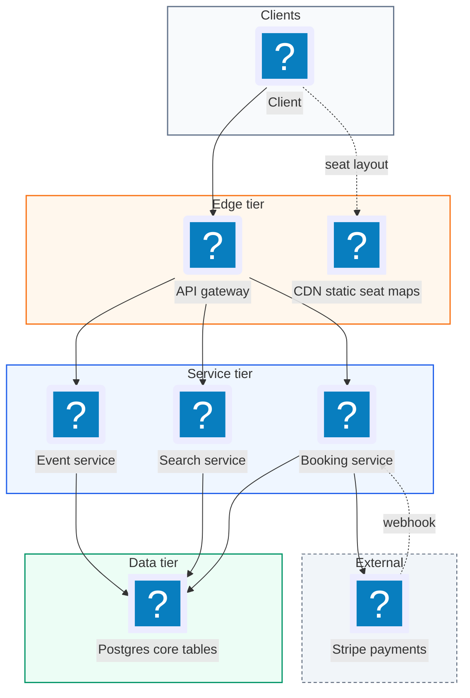
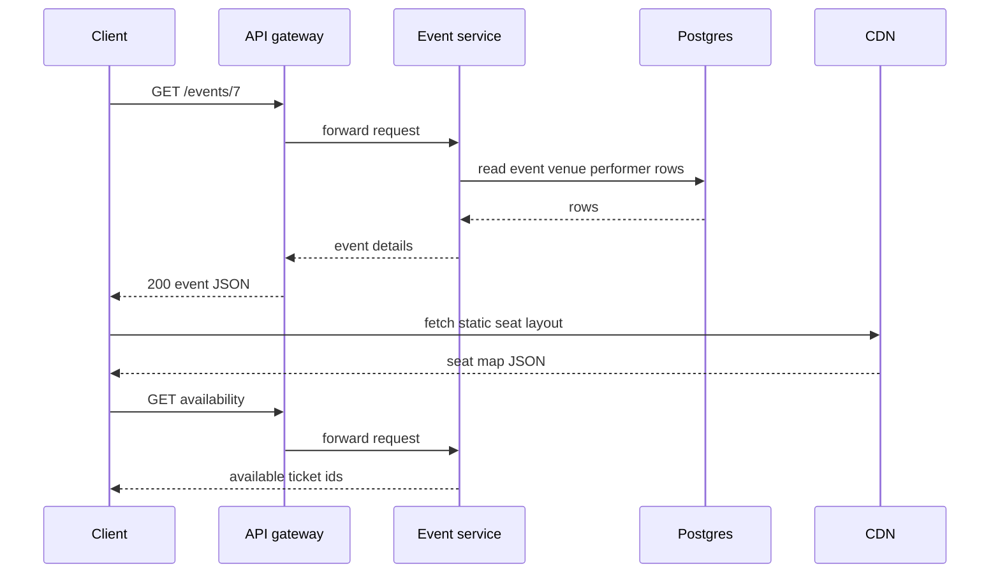
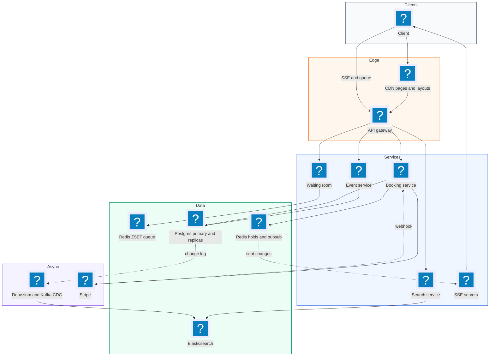

# 05. Ticketmaster (Event Ticket Booking)  (Medium)

> Ticketmaster sells tickets to concerts, sports games, and shows. Users search for events, open an event page with a seat map, pick seats, and pay. The interviewer is really testing how you prevent two people from buying the same seat, how you hold a seat for a few minutes while someone pays, and how you survive the moment a huge on-sale opens and 10 million fans hit the site at once for 50,000 seats.

## 1. Functional requirements

Core (must have):

1. Users can view an event: details, venue, performers, and a seat map showing which seats are available.
2. Users can search for events by keyword, performer, location, date, and type.
3. Users can book tickets: select seats, hold them while paying, then confirm the purchase.

Below the line (out of scope):

1. Users can view their past bookings. It is a simple read on the bookings table.
2. Admins or promoters can create events. Assume events are loaded by another tool.
3. Dynamic pricing. It changes prices, not the booking mechanics.
4. Ticket resale and transfer. A separate marketplace with its own rules.

## 2. Non-functional requirements

1. No double booking: a seat is sold to at most one person. This needs strong consistency on the booking path.
2. High availability for view and search: 99.99%. Browsing must keep working even during a huge on-sale.
3. Low latency for search: p99 under 500 ms.
4. Read-heavy: about 100 reads (views and searches) for every booking.
5. Surge handling: support 10M concurrent users trying to book one popular event, with a fair experience.
6. CAP choice: split by path. Booking is CP: we prefer to reject a request rather than sell a seat twice. Viewing and search are AP: a seat map a second or two stale is fine because the booking step re-checks.

## 3. Back-of-the-envelope estimates

| Assumption | Number |
|---|---|
| Daily active users | 10M |
| Events listed at any time | 1M |
| Average seats per event | 10,000 (big stadiums 50k-100k) |
| Tickets sold per day (normal) | 1M |
| Views + searches per user per day | 10 |
| Ticket row size | 100 bytes |
| Hot on-sale | 10M users, 50,000 seats, first 10 minutes |

```text
Normal read QPS:     10M x 10 / 86,400       ~= 1,200/s  (peak x5 ~= 6k/s)
Normal booking QPS:  1M / 86,400             ~= 12/s

Hot on-sale:
  Page loads: 10M users refresh in ~1 min    ~= 170k req/s on one event page
  Seat clicks: say 10% try in 1 min          ~= 1M reserve attempts/min
                                             ~= 17k reserve/s, 50k winners

Storage:
  Tickets: 1M events x 10k seats x 100 B     = 1 TB
  Bookings: 1M/day x 365 x 500 B             ~= 180 GB/year
  Events/venues/performers metadata          ~= tens of GB
```

The normal load is small. The design is shaped by the hot on-sale: 170k reads per second on one page and fierce contention on a few thousand rows.

## 4. Core entities

- Event: a single show. Fields: `id`, `venue_id`, `performer_id`, `name`, `date`, `description`.
- Venue: the place, including its seat map layout (sections, rows, seat coordinates).
- Performer: the artist or team.
- Ticket: one seat for one event. Fields: `id`, `event_id`, `section`, `row`, `seat`, `price`, `status`, `booking_id`. One row is created per seat when an event is created.
- Booking: one user's purchase of one or more tickets. Fields: `id`, `user_id`, `ticket_ids`, `total`, `status` (`in_progress`, `confirmed`, `expired`).
- User: the buyer.

```sql
CREATE TABLE tickets (
  id          BIGSERIAL PRIMARY KEY,
  event_id    BIGINT NOT NULL,
  section     TEXT NOT NULL,
  row_label   TEXT NOT NULL,
  seat_number INT  NOT NULL,
  price_cents INT  NOT NULL,
  status      TEXT NOT NULL DEFAULT 'available',  -- available | reserved | sold
  booking_id  BIGINT,
  reserved_until TIMESTAMP,
  UNIQUE (event_id, section, row_label, seat_number)
);
CREATE INDEX idx_tickets_event_status ON tickets (event_id, status);

CREATE TABLE bookings (
  id          BIGSERIAL PRIMARY KEY,
  user_id     BIGINT NOT NULL,
  event_id    BIGINT NOT NULL,
  status      TEXT NOT NULL,          -- in_progress | confirmed | expired
  total_cents INT  NOT NULL,
  payment_ref TEXT UNIQUE,            -- Stripe PaymentIntent id
  created_at  TIMESTAMP NOT NULL DEFAULT now()
);
```

## 5. API design

`GET /events/{event_id}` -- event details, venue, performer, and seat map with availability. Public.

```json
// response 200
{"event": {"id": 7, "name": "Taylor Swift - Eras", "date": "2027-06-01T20:00:00Z"},
 "venue": {"id": 3, "name": "MetLife Stadium", "seat_map_url": "https://cdn.../map3.json"},
 "available_ticket_ids": "https://api.../events/7/availability"}
```

`GET /events/{event_id}/availability` -- current seat statuses (compact). Response `200 {"version": 18231, "available": [10001, 10002, ...]}`.

`GET /events/search?keyword=swift&city=NYC&start=2027-06-01&end=2027-06-30&type=concert&cursor=..` -- search. Response `200 {"events": [...], "next_cursor": "..."}`.

`POST /bookings/reserve` -- hold seats for 10 minutes. Requires login. Body `{"event_id": 7, "ticket_ids": [10001, 10002]}`.

```json
// response 201
{"booking_id": 55012, "status": "in_progress",
 "expires_at": "2027-02-01T10:10:00Z"}
```

Status codes: `201` held, `409` one or more seats already held or sold, `429` too many attempts, `403` not admitted from the waiting room yet.

`POST /bookings/{booking_id}/confirm` -- pay. Body `{"payment_token": "tok_from_stripe_js"}`. Response `200 {"status": "confirmed"}`, `410` if the hold expired, `402` if payment failed. Card details never touch our servers; Stripe.js turns them into a token in the browser.

`GET /events/{event_id}/seats/stream` -- Server-Sent Events stream of seat changes (deep dive).

## 6. High-level design



One Postgres database holds all core tables. That is fine: the data is tightly linked (bookings need tickets need events), and booking needs ACID transactions. Splitting into a database per service would add distributed transactions for no gain.

### How will users view an event?

1. Client requests `GET /events/7`.
2. The gateway forwards to the Event Service.
3. The Event Service reads the event, venue, and performer rows and returns them.
4. The client then loads seat availability and draws the map. The static seat layout (shapes, coordinates) comes from the CDN; only the statuses come from our API.



### How will users search for events?

1. Client calls `GET /events/search` with filters.
2. The Search Service queries the database by date range, city, and type, with keyword matching.
3. Results come back sorted by date, 20 per page.

This starts as a SQL query with `LIKE`, which is slow; the deep dive moves it to Elasticsearch.

### How will users book tickets?

1. User clicks seats and the client calls `POST /bookings/reserve`.
2. The Booking Service puts a 10-minute hold on those seats (deep dive) and creates a booking with `status = in_progress`.
3. The client shows a countdown timer and the payment form.
4. The client sends a Stripe token to `POST /bookings/{id}/confirm`; the service creates a Stripe PaymentIntent.
5. Stripe calls our webhook when payment succeeds. In one transaction we set the tickets to `sold` and the booking to `confirmed`.
6. If the user walks away, the hold expires after 10 minutes and the seats become available again.

## 7. Deep dives

### How do we reserve a seat while the user pays, without double booking?

The problem: the simple design checks availability only at payment time. A user spends 3 minutes typing card details and then learns someone else bought the seat. We need a hold that (a) only one user can get, (b) disappears on its own if the user leaves, and (c) becomes permanent on payment.

| Option | How it works | Pros | Cons |
|---|---|---|---|
| Long-running DB transaction with `SELECT ... FOR UPDATE` | Keep row locked until payment | Simple idea | Holds DB locks for minutes; connections pile up; terrible at scale |
| Status column + `reserved_until` + cleanup job | Set `status='reserved'`, expiry time; a cron frees expired rows | Durable, all in Postgres | Seats stay stuck until cron runs; every read must also check expiry |
| Distributed lock in Redis with TTL | `SET ticket:{id} {booking} NX EX 600` | Auto-expires exactly on time; very fast; keeps contention off DB | Redis failure can drop holds; need DB as final guard |

Recommended: Redis lock with a TTL for the hold, with the database as the final source of truth. `NX` means "set only if the key does not exist", so only one booking can win a seat. `EX 600` means the key deletes itself after 600 seconds, so abandoned holds free up automatically with no cron.

```python
HOLD_SECONDS = 600

def reserve(user_id, event_id, ticket_ids):
    booking_id = new_booking_id()
    won = []
    for t in sorted(ticket_ids):       # sorted order avoids deadlock-ish
        ok = redis.set(f"hold:{t}", booking_id, nx=True, ex=HOLD_SECONDS)
        if not ok:
            for w in won:              # all or nothing: release partial wins
                release_if_owner(w, booking_id)
            raise SeatTaken(t)         # -> 409
        won.append(t)
    db.execute("INSERT INTO bookings (id, user_id, event_id, status, total_cents)"
               " VALUES (%s, %s, %s, 'in_progress', %s)",
               (booking_id, user_id, event_id, price_of(ticket_ids)))
    return booking_id

# Release only if we still own it (Lua keeps check+delete atomic).
RELEASE_LUA = """
if redis.call('GET', KEYS[1]) == ARGV[1] then
  return redis.call('DEL', KEYS[1]) else return 0 end
"""
def release_if_owner(ticket_id, booking_id):
    redis.eval(RELEASE_LUA, 1, f"hold:{ticket_id}", booking_id)
```

On payment, the webhook does the final write with a guard so the database itself refuses a double sale, even if Redis lost a key:

```sql
BEGIN;
UPDATE tickets
SET status = 'sold', booking_id = :booking_id
WHERE id = ANY(:ticket_ids) AND status = 'available';
-- If rows updated != number of tickets: ROLLBACK and refund. Should
-- be rare; it only happens if a Redis hold was lost.
UPDATE bookings SET status = 'confirmed', payment_ref = :pi
WHERE id = :booking_id AND status = 'in_progress';
COMMIT;
```

The webhook must be idempotent, because Stripe retries webhooks. Checking `status = 'in_progress'` and the `UNIQUE` on `payment_ref` makes a repeated webhook a no-op.

### How do we handle a high-demand on-sale? (virtual waiting room)

The problem: 10M fans arrive for 50k seats. If all of them hit the Booking Service at once, Redis and Postgres get hammered, most clicks return "seat taken", and the site may fall over. It is also unfair: whoever has the fastest connection wins.

| Option | How | Pros | Cons |
|---|---|---|---|
| Just autoscale | Add servers | No new concept | Contention is on the same rows; more servers do not help |
| Rate limit per user/IP | Reject over N req/s | Protects backend | Bots rotate IPs; real users see errors |
| Virtual waiting room (queue) | Users join a queue; admitted in batches at a safe rate | Smooth load, fair order, clear UX | More moving parts; queue itself must scale |

Recommended: a virtual waiting room in front of the booking flow for events flagged as high-demand. Users get a queue position. A controller admits, say, 2,000 users per minute, which is a rate the booking path handles comfortably. Admitted users get a signed, short-lived access token that the Booking Service checks.

```python
# Join: score = arrival time, so earlier users are served first.
def join_queue(event_id, user_id):
    redis.zadd(f"queue:{event_id}", {user_id: time.time()}, nx=True)
    return redis.zrank(f"queue:{event_id}", user_id)   # position

# Admission controller, runs every few seconds per event.
def admit(event_id, batch=200):
    users = redis.zpopmin(f"queue:{event_id}", batch)
    for user_id, _ in users:
        token = sign_jwt({"uid": user_id, "eid": event_id}, ttl=900)
        push_to_client(user_id, {"type": "admitted", "token": token})
```

```text
Throughput math:
  50,000 seats, average 2 per booking  = 25,000 bookings
  Admit 2,000 users/min, ~70% buy     = 1,400 bookings/min
  Time to sell out                    ~= 18 minutes
  Booking path load                   ~= 2,000 / 60 ~= 35 users/s
```

Users in the queue hold a WebSocket or SSE connection to see their position, so they do not need to refresh. When the event sells out, everyone still waiting is told immediately instead of waiting for nothing. Bot protection (CAPTCHA at join time, one queue spot per verified account) keeps the queue fair.

### How do we make search fast at scale?

The problem: `WHERE name LIKE '%swift%'` cannot use a B-tree index because of the leading wildcard, so it scans every event. Users also expect typo tolerance and filters on several fields at once.

| Option | Keyword search | Filters + sort | Notes |
|---|---|---|---|
| SQL `LIKE` | Full table scan | OK | Fine at 10k events, not 1M |
| Postgres full-text (`tsvector` + GIN index) | Indexed | OK | Good middle ground, one system |
| Elasticsearch | Inverted index, fuzzy, relevance | Fast filters, geo, facets | Separate system, needs sync |

Recommended: Elasticsearch, kept in sync from Postgres using change data capture (CDC, reading the database change log with a tool like Debezium and streaming changes through Kafka). Postgres stays the source of truth.

```json
{
  "query": {
    "bool": {
      "must":   [{"multi_match": {"query": "swift", "fields": ["name^3", "performer", "description"],
                                  "fuzziness": "AUTO"}}],
      "filter": [{"term": {"type": "concert"}},
                 {"term": {"city": "NYC"}},
                 {"range": {"date": {"gte": "2027-06-01", "lte": "2027-06-30"}}}]
    }
  },
  "sort": [{"_score": "desc"}, {"date": "asc"}],
  "size": 20
}
```

Popular queries repeat a lot ("taylor swift"). Cache full search responses in Redis or at the CDN for 30-60 seconds, keyed by the normalized query string. Elasticsearch also has its own node query cache for repeated filters.

### How do we cache event pages for 170k requests per second?

The problem: during an on-sale, millions of users refresh the same event page. Event details almost never change, but seat availability changes every second.

The trick is to split the page into a static part and a dynamic part.

| Data | Changes how often | Cache where | TTL |
|---|---|---|---|
| Event, venue, performer info | Rarely | CDN + Redis | Hours, purge on edit |
| Seat map layout (shapes, coordinates) | Never for a venue | CDN as a static JSON file | Days |
| Seat availability | Every second | Redis bitmap, pushed via SSE | Live |

Recommended: put event details and seat layout on the CDN, so 170k req/s mostly never reach our servers. Keep seat availability in Redis as a compact structure (one bit per seat: 50k seats = about 6 KB) and serve it from an edge-friendly endpoint with a 1-2 second TTL, or push changes over SSE. The Event Service scales horizontally behind a load balancer for the cache misses.

```text
Request mix during a hot on-sale (170k req/s):
  Event details + layout  -> CDN hit rate ~99%  -> ~1.7k req/s to origin
  Availability snapshot   -> 1 s micro-cache    -> ~1 req/s per edge per event
  Seat changes            -> SSE stream, no polling
```

### How do we show a live seat map with Server-Sent Events?

The problem: a seat map loaded 30 seconds ago is wrong during an on-sale. Users click seats that are gone, get `409`, click again, and get angry. Polling every second from millions of clients is wasteful.

| Option | Direction | Cost | Fit |
|---|---|---|---|
| Polling every 1-2 s | Client pulls | Many wasted requests | OK for small events |
| Server-Sent Events (SSE) | Server pushes over HTTP | One long-lived connection, simple | Great for one-way updates |
| WebSockets | Two-way | More complex infra | Overkill; we only push |

Server-Sent Events is a standard where the browser opens one HTTP connection and the server keeps writing small text events down it. The browser's `EventSource` reconnects on its own if the connection drops.

Recommended: SSE for normal events. When a seat is held, released, or sold, the Booking Service publishes to Redis pub/sub channel `seats:{event_id}`. SSE servers subscribed to that channel forward the change to every connected client watching that event.

```python
# SSE endpoint (async web framework style)
async def seat_stream(request, event_id):
    async def gen():
        sub = redis.pubsub()
        await sub.subscribe(f"seats:{event_id}")
        snapshot = await availability_snapshot(event_id)
        yield f"event: snapshot\ndata: {json.dumps(snapshot)}\n\n"
        async for msg in sub.listen():
            if msg["type"] == "message":
                # e.g. {"ticket_id": 10001, "status": "reserved", "v": 18232}
                yield f"event: seat\ndata: {msg['data']}\n\n"
    return StreamingResponse(gen(), media_type="text/event-stream")
```

For the very hottest events, the waiting room changes the picture: only admitted users see the map, so the number of live SSE connections is a few thousand, not millions. Some systems even skip the map and auto-assign "best available" seats to admitted users, which removes the seat-picking race entirely.

Failure handling across the booking path:

| Failure | Effect | Mitigation |
|---|---|---|
| Redis primary fails | Some holds lost | Replica promotion; DB `status='available'` guard prevents double sale; refund the rare loser |
| Stripe webhook delayed | Hold may expire before confirm | Extend hold when payment starts; on late webhook, re-check seats, refund if gone |
| SSE connection drops | Map goes stale | `EventSource` auto-reconnects; server sends a fresh snapshot with a version number |
| Booking Service crash mid-reserve | Partial holds | TTL frees them in 10 minutes automatically |
| Postgres primary fails | Confirms fail briefly | Multi-AZ failover; webhook retries by Stripe complete the confirm |

## 8. Final architecture



| Component | Job | Technology example |
|---|---|---|
| CDN | Static event data, seat layouts, cached searches | CloudFront, Akamai |
| API Gateway | Auth, rate limit, check waiting-room token | AWS API Gateway, Envoy |
| Waiting Room | Fair queue and admission for hot events | Redis sorted set + controller |
| Event Service | Event details and availability snapshot | Stateless service |
| Search Service | Keyword, filters, sort | Elasticsearch / OpenSearch |
| Booking Service | Hold seats, start payment, confirm | Stateless service |
| Seat holds | 10-minute TTL locks | Redis `SET NX EX` |
| SSE servers | Push seat changes | Async HTTP servers + Redis pub/sub |
| Database | Tickets, bookings, events (source of truth) | Postgres with replicas |
| CDC | Sync DB to search index | Debezium + Kafka |
| Payments | Card handling, webhooks | Stripe |

### Deployment map (AWS)

```mermaid
architecture-beta
    group internet(mdi:earth)[Internet]
    group edge(logos:aws-cloudfront)[Edge]
    group vpc(logos:aws-vpc)[AWS VPC]
    group app(logos:aws-ecs)[Service subnet] in vpc
    group data(logos:aws-rds)[Data subnet] in vpc
    group ext(mdi:earth)[Third parties]

    service c(mdi:cellphone)[Client] in internet
    service cdn(logos:aws-cloudfront)[CDN pages and layouts] in edge
    service gw(logos:aws-api-gateway)[API gateway] in edge
    service wr(logos:aws-ecs)[Waiting room] in app
    service ev(logos:aws-ecs)[Event service] in app
    service bk(logos:aws-ecs)[Booking service] in app
    service sse(logos:aws-ecs)[SSE servers] in app
    service rh(logos:aws-elasticache)[Redis holds and pubsub] in data
    service pg(logos:aws-rds)[Postgres primary and replicas] in data
    service st(logos:stripe)[Stripe] in ext

    c:R --> L:cdn
    cdn:R --> L:gw
    gw:B --> T:wr
    gw:B --> T:ev
    gw:B --> T:bk
    ev:B --> T:pg
    bk:B --> T:rh
    bk:B --> T:pg
    bk:R --> L:st
    rh:R --> L:sse
    sse:L --> R:c
```



The waiting room, event, booking and SSE servers run in the service subnet, seat holds in Redis and the Postgres source of truth sit in the data subnet, and Stripe is the only third party.

## 9. Common mistakes and interviewer follow-ups

- Checking availability only at payment time. Users lose seats after typing card details. Say: "Hold the seat at selection with a TTL lock."
- Holding a DB row lock for the whole checkout. It ties up connections for minutes. Use a Redis TTL hold or a status column with expiry.
- Trusting Redis alone. A failover can lose a hold. Keep a conditional `UPDATE ... WHERE status='available'` in the DB as the final guard.
- A non-idempotent payment webhook. Stripe retries and you double-process. Check booking status and use a unique payment reference.
- Thinking autoscaling solves the on-sale. Contention is on the same rows. Say: "Virtual waiting room to meter admission."
- Serving the whole event page dynamically. Split static (CDN) from dynamic (seat statuses).
- `LIKE '%term%'` for search. Full scan. Use Elasticsearch or Postgres full-text with CDC.
- Follow-up: "Polling or push for the seat map?" Answer: SSE, because updates are one-way; WebSockets only if the client must send too.

## 10. One-page cheat sheet

| Topic | Key point |
|---|---|
| Scale | 10M DAU, ~1.2k reads/s normal, 170k req/s on a hot event page |
| Hot on-sale | 10M users, 50k seats, waiting room admits ~2k/min |
| No double booking | Redis `SET hold:{t} NX EX 600` + DB `WHERE status='available'` |
| Checkout | Reserve, then confirm via Stripe webhook (idempotent) |
| Search | Elasticsearch via CDC, fuzzy keyword, filters, 30-60 s result cache |
| Event page | Static on CDN, seat statuses in Redis bitmap (~6 KB for 50k seats) |
| Live map | SSE + Redis pub/sub, snapshot with version on reconnect |
| CAP | CP for booking, AP for view and search |
| Failure | TTL frees crashed holds; DB guard catches lost Redis keys |

## Sources

- [Hello Interview: Design Ticketmaster](https://www.hellointerview.com/learn/system-design/problem-breakdowns/ticketmaster)
- [Redis: SET command (NX, EX options)](https://redis.io/docs/latest/commands/set/)
- [Redis: Distributed locks](https://redis.io/docs/latest/develop/use/patterns/distributed-locks/)
- [MDN: Using server-sent events](https://developer.mozilla.org/en-US/docs/Web/API/Server-sent_events/Using_server-sent_events)
- [Stripe: Receive webhook events (idempotency, retries)](https://docs.stripe.com/webhooks)
- [AWS: Virtual Waiting Room on AWS](https://aws.amazon.com/solutions/implementations/virtual-waiting-room-on-aws/)
- [Elasticsearch: Bool query](https://www.elastic.co/guide/en/elasticsearch/reference/current/query-dsl-bool-query.html)
