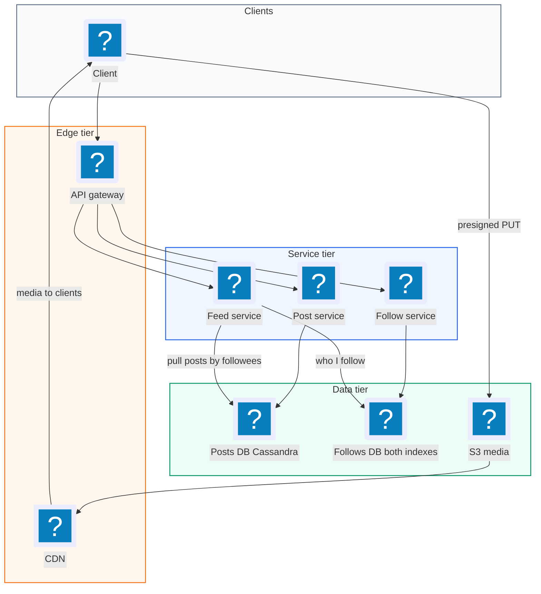
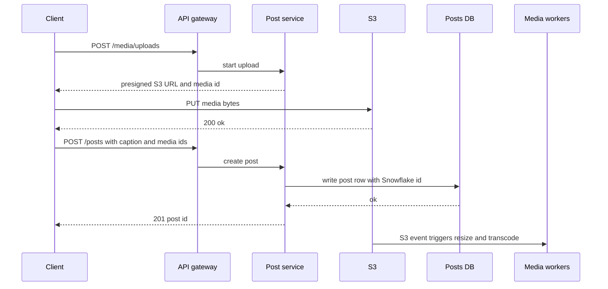
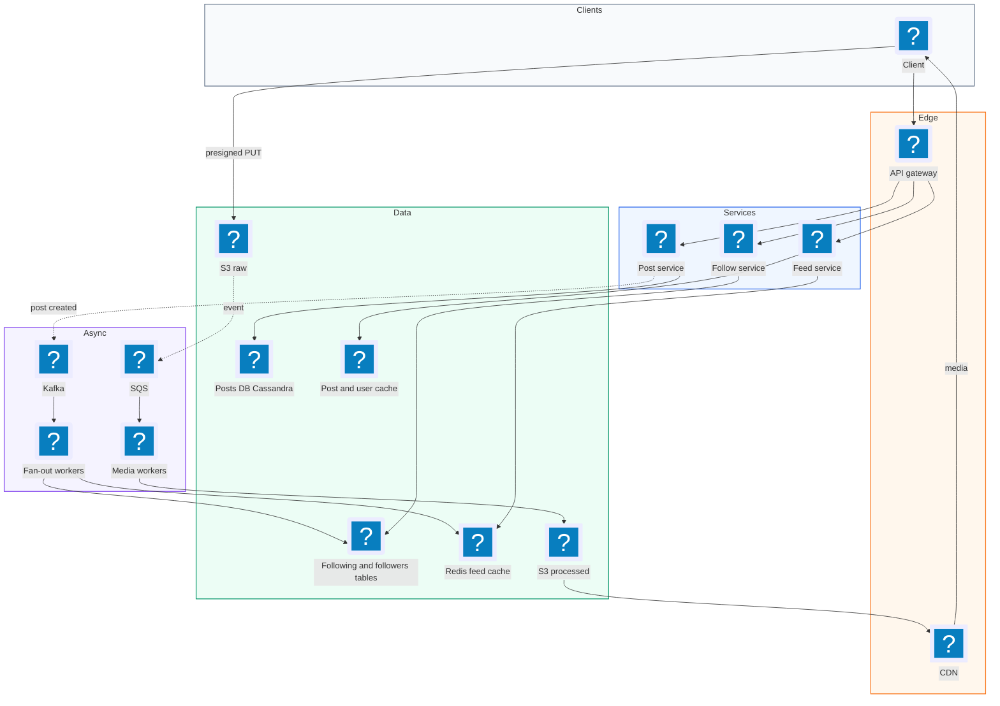

# 06. Instagram (Photo Sharing Feed)  (Medium)

> Instagram lets people post photos and videos with a caption, follow other people, and scroll a feed of recent posts from everyone they follow. The interviewer is really testing how you build a feed for 500M daily users that loads in under half a second, how you handle celebrities with hundreds of millions of followers, and how you upload and serve huge amounts of media without your servers becoming the bottleneck.

## 1. Functional requirements

Core (must have):

1. Users can create a post with one or more photos or videos and a caption.
2. Users can follow and unfollow other users.
3. Users can see a feed of recent posts from people they follow, newest first, with infinite scroll.

Below the line (out of scope):

1. Likes and comments. They are counters and lists attached to a post; they do not change the feed design.
2. Search for users, hashtags, or places. That needs a search index, a separate topic.
3. Stories and live video. Ephemeral content and streaming are their own systems.
4. Ranked (algorithmic) feed. We build a chronological feed; ranking would re-order the same candidates.

## 2. Non-functional requirements

1. Low feed latency: p99 under 500 ms to load the first page of the feed.
2. Fast media: photos (up to 8 MB) and videos (up to 4 GB) should start showing almost instantly, from a nearby CDN.
3. High availability: 99.99% for feed reads and media serving.
4. Scale: 500M daily active users, 100M new posts per day.
5. Consistency: eventual consistency is fine. If a friend's post shows up in your feed 10-30 seconds late, nobody is hurt. A user should always see their own new post right away (read-your-own-writes).
6. Durability: uploaded media is never lost.
7. CAP choice: AP. We prefer to always show a feed, even a slightly stale one, over showing an error.

## 3. Back-of-the-envelope estimates

| Assumption | Number |
|---|---|
| Daily active users | 500M |
| New posts per day | 100M |
| Feed loads per user per day | 10 |
| Average follows per user | 200 |
| Average media per post (after compression, all sizes) | 2 MB |
| Post metadata | 1 KB |
| Celebrity follower count | up to 500M |

```text
Post writes:  100M / 86,400              ~= 1,160 posts/s  (peak x3 ~= 3.5k/s)
Feed reads:   500M x 10 / 86,400         ~= 58,000 feed loads/s (peak ~150k/s)
Read : write  ~= 50 : 1

Media/day:    100M x 2 MB                = 200 TB/day
Media/year:   200 TB x 365               ~= 73 PB/year  (S3 + CDN)
Metadata/yr:  100M x 365 x 1 KB          ~= 36 TB/year

Fan-out on write (naive):
  avg follower count ~200 -> 100M x 200   = 20B feed inserts/day
                                          ~= 230k inserts/s
  one celebrity post with 500M followers  = 500M inserts for ONE post

Feed cache: keep 500 post ids per user x 8 B = 4 KB/user
            500M users x 4 KB             = 2 TB of Redis (sharded)

CDN egress: 58k feed loads/s x 10 images x 200 KB ~= 116 GB/s
```

The 500M-inserts-for-one-post number is why celebrities need special handling.

## 4. Core entities

- User: account. Fields: `user_id`, `username`, `is_celebrity` (follower count above a threshold).
- Post: one share. Fields: `post_id`, `user_id`, `caption`, `media_ids`, `created_at`.
- Media: one photo or video. Fields: `media_id`, `post_id`, `s3_key`, `status`, `variants` (thumbnail, 1080p, HLS for video).
- Follow: an edge "A follows B". Fields: `follower_id`, `followee_id`, `created_at`.
- Feed: a precomputed, per-user list of recent post ids. Lives in a cache.

```sql
-- Wide-column / key-value style, shown as SQL for clarity.
CREATE TABLE posts (
  user_id     BIGINT,
  post_id     BIGINT,            -- time-sortable id (Snowflake-style)
  caption     TEXT,
  media_ids   BIGINT[],
  created_at  TIMESTAMP,
  PRIMARY KEY (user_id, post_id) -- "posts by user, newest first" is a range scan
);

CREATE TABLE follows (
  follower_id BIGINT,
  followee_id BIGINT,
  created_at  TIMESTAMP,
  PRIMARY KEY (follower_id, followee_id)   -- "who do I follow?"
);
-- Plus a reverse index: PRIMARY KEY (followee_id, follower_id)
-- for "who follows me?" (needed for fan-out).
```

```json
// Redis: feed:{user_id} is a sorted set, score = post timestamp
{"feed:42": [[1730620800123, "p_9001"], [1730620700456, "p_8999"]]}
```

A Snowflake-style id packs a timestamp, a machine id, and a sequence number into 64 bits. Sorting by id is sorting by time, which makes "newest first" free.

## 5. API design

All endpoints need a logged-in user (JWT). The user id always comes from the token.

`POST /posts` -- create a post. Media is uploaded separately first (see flow).

```json
// request
{"caption": "Sunset in Lisbon", "media_ids": [771, 772]}
// response 201
{"post_id": "p_9001", "created_at": "2026-11-03T18:00:00Z"}
```

`POST /media/uploads` -- start an upload, get a presigned URL. Body `{"content_type": "image/jpeg", "size": 6200000}`. Response `201 {"media_id": 771, "upload_url": "https://s3...&X-Amz-Signature=...", "multipart": false}`. Large videos get multipart URLs.

`POST /users/{user_id}/follow` -- follow. Response `204`. `DELETE /users/{user_id}/follow` -- unfollow. Response `204`.

`GET /feed?cursor={post_id}&limit=20` -- feed page, newest first.

```json
// response 200
{"posts": [{"post_id": "p_9001", "author": {"id": 7, "username": "ana"},
            "caption": "Sunset in Lisbon",
            "media": [{"type": "image", "url": "https://cdn.../771_1080.jpg"}],
            "created_at": "2026-11-03T18:00:00Z"}],
 "next_cursor": "p_8950"}
```

Status codes: `200`, `401` unauthenticated, `400` bad cursor, `429` rate limited.

## 6. High-level design



### How will users create a post?

1. Client calls `POST /media/uploads` for each photo or video and gets a presigned S3 URL.
2. Client uploads bytes directly to S3. Our servers never carry the media.
3. Client calls `POST /posts` with the caption and media ids.
4. The Post Service writes the post row with a Snowflake id and returns `201`.
5. An S3 event triggers media processing (resize, transcode) in the background.



### How will users follow other users?

1. Client calls `POST /users/7/follow`.
2. The Follow Service writes the edge to two tables: `(follower_id=42, followee_id=7)` and the reverse `(followee_id=7, follower_id=42)`.
3. Both writes are idempotent: following twice leaves one edge.

### How will users see their feed?

In the simplest version (pull on read):

1. Client calls `GET /feed`.
2. Feed Service gets the list of people user 42 follows (about 200).
3. For each, it reads their newest posts from the Posts DB.
4. It merges them by time and returns the top 20.

That is 200 queries per feed load, times 58k loads per second. It works for a demo and breaks at scale. The deep dives fix it.

## 7. Deep dives

### How do we build the feed fast? (push vs pull vs hybrid)

The problem: a feed is a merge of recent posts from about 200 accounts. Doing that merge on every read is too slow. Doing it on every write is too expensive for accounts with millions of followers.

| Option | When work happens | Read cost | Write cost | Celebrity problem |
|---|---|---|---|---|
| Pull (fan-out on read) | At read time | ~200 queries + merge | 1 insert | None, but reads are slow for everyone |
| Push (fan-out on write) | At post time, write post id into every follower's feed | 1 Redis read | 1 insert per follower | 500M inserts for one post, minutes of lag |
| Hybrid | Push for normal users, pull for celebrities | 1 Redis read + a few celebrity reads | Bounded by threshold | Solved |

Recommended: hybrid. Pick a threshold, say 100k followers. For normal authors, a fan-out worker pushes the new post id into each follower's Redis feed. For celebrities, we do not push. At read time, the Feed Service reads the user's precomputed feed and also pulls the latest posts from the handful of celebrities they follow, then merges.

```python
CELEB_THRESHOLD = 100_000
FEED_LEN = 500

# Fan-out worker: consumes "post_created" events from Kafka.
def on_post_created(post):
    author = users.get(post.user_id)
    if author.follower_count >= CELEB_THRESHOLD:
        return                                   # pulled at read time
    for batch in follows.followers_of(post.user_id, batch_size=1000):
        pipe = redis.pipeline()
        for follower_id in batch:
            key = f"feed:{follower_id}"
            pipe.zadd(key, {post.post_id: post.ts})
            pipe.zremrangebyrank(key, 0, -FEED_LEN - 1)  # keep newest 500
        pipe.execute()

# Read path
def get_feed(user_id, cursor_ts, limit=20):
    ids = redis.zrevrangebyscore(f"feed:{user_id}", cursor_ts, "-inf",
                                 start=0, num=limit, withscores=True)
    for celeb in follows.celebrities_followed_by(user_id):   # usually < 20
        ids += posts.latest_ids(celeb, before=cursor_ts, limit=limit)
    ids.sort(key=lambda x: x[1], reverse=True)
    return hydrate(ids[:limit])                  # batch-fetch post bodies
```

```text
Fan-out math after the threshold:
  Normal author, 200 followers:   200 Redis writes, done in ~10 ms
  Author with 99k followers:      99k writes in batches of 1000
                                  = 99 pipelines, ~2-5 s, async
  Celebrity, 500M followers:      0 writes; pulled by readers
```

The fan-out runs asynchronously through Kafka, so `POST /posts` returns in milliseconds. To give the author read-your-own-writes, the client inserts the new post at the top of its own feed immediately, and the Feed Service always merges the user's own latest posts.

A small detail that saves a lot of memory: inactive users (no login in 30 days) are skipped during fan-out. When they come back, we rebuild their feed with a pull once.

### How do we upload and serve photos and videos quickly?

The problem: 200 TB of new media per day, files up to 4 GB, and users all over the world who expect images to appear instantly on a phone connection.

| Option | Upload path | Serving | Problem |
|---|---|---|---|
| Upload through app servers | Client to API to S3 | App servers | Servers become a bandwidth bottleneck |
| Presigned URL straight to S3 | Client to S3 | S3 directly | Far from many users; full-size files on mobile |
| Presigned upload + processing + CDN | Client to S3, workers make variants | CDN edge, right size per device | More pipeline, but standard |

Recommended: presigned uploads (multipart for videos above about 100 MB), a processing pipeline, and a CDN. When the upload lands, an S3 event puts a job on a queue. Workers create variants: several image sizes (150 px thumbnail, 640 px, 1080 px) in WebP or AVIF, and for video, HLS renditions. HLS (HTTP Live Streaming) cuts a video into 2-6 second segments at several bitrates, so the player starts quickly at low quality and steps up as bandwidth allows.

```text
 Client --presigned PUT--> S3 raw/ --event--> SQS --> Media workers
                                                     | resize images
                                                     | transcode HLS
                                                     v
                                        S3 processed/ ---> CDN edge
                           Media table: status = ready, variants = {...}
```

```python
def process_image(media_id, raw_key):
    img = load_from_s3(raw_key)
    variants = {}
    for width in (150, 640, 1080):
        out = resize(img, width).encode("webp", quality=80)
        key = f"processed/{media_id}_{width}.webp"
        s3.put_object(Bucket=B, Key=key, Body=out,
                      CacheControl="public, max-age=31536000, immutable")
        variants[str(width)] = f"https://cdn.example.com/{key}"
    media.update(media_id, status="ready", variants=variants)
```

Media files never change once written, so they get a one-year cache header. The client picks the variant that fits its screen. A 1080 px WebP is about 200 KB versus a 6 MB original, a 30x saving on mobile data.

### How do we paginate the feed?

The problem: users scroll forever. New posts keep arriving at the top while they scroll. Offset pagination (`LIMIT 20 OFFSET 40`) shows duplicates when new posts push items down, and gets slower the deeper you go.

| Option | Stable with new posts? | Deep page cost | Notes |
|---|---|---|---|
| Offset (`page=3`) | No, duplicates and gaps | Grows with offset | Simple but wrong for feeds |
| Cursor on timestamp / post id | Yes | Constant | Needs a sortable, unique key |
| Opaque token encoding cursor + celeb positions | Yes | Constant | Best for hybrid merges |

Recommended: cursor pagination using the Snowflake post id (which is time-sortable and unique). The response returns `next_cursor` = the id of the last post shown. The next call asks for posts strictly older than that.

```python
def page(user_id, cursor=None, limit=20):
    max_score = f"({cursor_ts(cursor)}" if cursor else "+inf"  # "(" = exclusive
    rows = redis.zrevrangebyscore(f"feed:{user_id}", max_score, "-inf",
                                  start=0, num=limit, withscores=True)
    # ...merge celebrity posts older than cursor, as above...
    next_cursor = encode_cursor(rows[-1]) if rows else None
    return rows, next_cursor
```

When the user reaches the end of the 500 cached ids, the Feed Service falls back to a pull query for older posts. Very few users scroll that far, so the cost is small.

### How do we store the follow graph?

The problem: we need two fast questions. "Who does user 42 follow?" (for the celebrity pull and feed rebuild) and "Who follows user 7?" (for fan-out, possibly 99k rows streamed in batches). There are about 500M users x 200 follows = 100B edges.

| Option | Who-I-follow | Who-follows-me | Scale |
|---|---|---|---|
| Single SQL table with two indexes | Fast | Fast | 100B rows needs sharding; cross-shard index pain |
| Graph database | Fast | Fast | Great for multi-hop queries we do not need |
| Wide-column store, two tables partitioned by each side | One partition read | One partition read | Scales linearly, simple |

```text
Edge storage: 100B edges x ~30 B x 2 tables ~= 6 TB, spread over a cluster
```

Recommended: a wide-column store like Cassandra or DynamoDB with two tables: `following` partitioned by `follower_id`, and `followers` partitioned by `followee_id`. Every follow writes both. Each question becomes a single-partition read. Keep `follower_count` as a separate counter so the fan-out worker can check the celebrity threshold in one lookup.

### How do we handle read-heavy traffic with caching, and what if things fail?

The problem: 58k feed loads per second (150k at peak), each needing 20 post bodies plus author info. Hitting the Posts DB for every one is 1M+ row reads per second.

| Cache layer | What it holds | Hit rate | TTL |
|---|---|---|---|
| CDN | All media variants | 95%+ | 1 year (immutable) |
| Feed cache (Redis sorted sets) | Post ids per user | Very high for active users | Rebuilt on miss |
| Post cache (Redis / Memcached) | `post_id -> post JSON` | 90%+ (recent posts are hot) | Hours |
| User cache | `user_id -> username, avatar` | 95%+ | Hours |

Recommended: all four. The feed read becomes one sorted-set read plus one batched `MGET` for 20 post bodies and authors. Hot keys (a viral celebrity post read millions of times per second) get replicated across several cache nodes or held in a small in-process cache on each Feed Service host for a few seconds.

```text
Feed read latency budget (p99 < 500 ms):
  Gateway + auth                      10 ms
  ZREVRANGE feed:{uid}                 2 ms
  Celebrity pulls (cached, ~10)        10 ms (parallel)
  MGET 20 posts + 20 authors           3 ms
  Serialize + network                 60 ms
  Total                              ~85 ms server+network, images load from CDN
```

| Failure | Effect | Mitigation |
|---|---|---|
| Redis feed shard lost | Some users have empty feeds | Rebuild on read via pull; Redis replicas |
| Fan-out workers lag | Posts appear late | Kafka buffers events; autoscale workers on lag |
| Media worker fails | Post stuck "processing" | Queue retries, dead-letter queue, client shows placeholder |
| Region outage | Users in region fail | Multi-region read replicas; CDN keeps serving media |
| Posts DB node down | Some writes slow | Cassandra replication factor 3, quorum writes |

## 8. Final architecture



| Component | Job | Technology example |
|---|---|---|
| API Gateway | Auth, rate limit, routing | AWS API Gateway, Envoy |
| Post Service | Create posts, Snowflake ids | Stateless service |
| Posts DB | Posts partitioned by author | Cassandra, DynamoDB |
| Follow Service + DB | Two edge tables, follower counts | Cassandra / DynamoDB |
| Event bus | Decouple post creation from fan-out | Kafka |
| Fan-out workers | Push post ids to follower feeds | Consumer group, autoscaled on lag |
| Feed cache | Per-user list of 500 post ids | Redis Cluster sorted sets |
| Post / user cache | Hydrate feed items fast | Redis or Memcached |
| Feed Service | Merge cache + celebrity pulls, paginate | Stateless service |
| Blob store | Raw and processed media | S3 |
| Media workers | Resize images, transcode HLS | SQS + containers / Lambda + MediaConvert |
| CDN | Serve media near users | CloudFront, Akamai |

### Deployment map (AWS)

```mermaid
architecture-beta
    group internet(mdi:earth)[Internet]
    group edge(logos:aws-cloudfront)[Edge]
    group vpc(logos:aws-vpc)[AWS VPC]
    group app(logos:aws-ecs)[Service subnet] in vpc
    group data(logos:aws-rds)[Data subnet] in vpc

    service c(mdi:cellphone)[Client] in internet
    service gw(logos:aws-api-gateway)[API gateway] in edge
    service cdn(logos:aws-cloudfront)[CDN] in edge
    service ps(logos:aws-ecs)[Post service] in app
    service fd(logos:aws-ecs)[Feed service] in app
    service fo(logos:aws-lambda)[Fan out workers] in app
    service pdb(logos:aws-dynamodb)[Posts DB] in data
    service fc(logos:aws-elasticache)[Redis feed cache] in data
    service k(logos:kafka-icon)[Kafka] in data
    service s3(logos:aws-s3)[S3 media] in data

    c:R --> L:gw
    gw:B --> T:ps
    gw:B --> T:fd
    ps:B --> T:pdb
    ps:R --> L:k
    k:T --> B:fo
    fo:B --> T:fc
    fd:B --> T:fc
    c:B --> T:s3
    s3:R --> L:cdn
    cdn:L --> R:c
```



Posting and feed reads go through the gateway to services in the service subnet, fan out workers fill the Redis feed cache from Kafka, and media bytes go straight to S3 and back out through the CDN.

## 9. Common mistakes and interviewer follow-ups

- Pure fan-out on write. One celebrity post becomes 500M writes and minutes of lag. Say: "Hybrid: push for normal users, pull for accounts over a threshold."
- Pure fan-out on read. 200 queries per feed load at 58k loads/s is ~12M queries/s. Precompute for normal users.
- Uploading media through app servers. They become a bandwidth bottleneck. Use presigned URLs to S3.
- Serving the original 6 MB photo to phones. Slow and costly. Make variants and serve via CDN with long cache headers.
- Offset pagination for the feed. New posts shift pages and cause duplicates. Use a cursor on a time-sortable id.
- Storing follows only one way. Fan-out needs "who follows me" and the feed needs "who I follow". Store both directions.
- Forgetting read-your-own-writes. The author does not see their own post and thinks it failed. Merge the user's own posts on read.
- Follow-up: "How would you add ranking?" Answer: keep the same candidate set from the hybrid feed, then score candidates with a model before returning the page.

## 10. One-page cheat sheet

| Topic | Key point |
|---|---|
| Scale | 500M DAU, ~1.2k posts/s, ~58k feed loads/s (peak 150k) |
| Media | ~200 TB/day; presigned upload, variants, CDN, 1-year cache |
| Feed model | Hybrid: push for under 100k followers, pull for celebrities |
| Feed cache | Redis sorted set `feed:{uid}`, newest 500 ids, ~2 TB total |
| Fan-out | Async via Kafka, batched pipelines, skip inactive users |
| Pagination | Cursor on Snowflake post id, exclusive bound |
| Follow graph | Two wide-column tables (following, followers) + counter |
| Caching | CDN, feed cache, post cache, user cache; hot-key replication |
| Consistency | Eventual for feeds, read-your-own-writes for the author |
| CAP | AP: always show a feed |

## Sources

- [Hello Interview: Design Instagram](https://www.hellointerview.com/learn/system-design/problem-breakdowns/instagram)
- [Hello Interview: Design a News Feed](https://www.hellointerview.com/learn/system-design/problem-breakdowns/fb-news-feed)
- [Instagram Engineering: Sharding and IDs at Instagram](https://instagram-engineering.com/sharding-ids-at-instagram-1cf5a71e5a5c)
- [System Design Primer: Design the Twitter timeline](https://github.com/donnemartin/system-design-primer/blob/master/solutions/system_design/twitter/README.md)
- [Redis: Sorted sets](https://redis.io/docs/latest/develop/data-types/sorted-sets/)
- [Apple: HTTP Live Streaming](https://developer.apple.com/streaming/)
- [AWS: Uploading objects with presigned URLs](https://docs.aws.amazon.com/AmazonS3/latest/userguide/PresignedUrlUploadObject.html)
