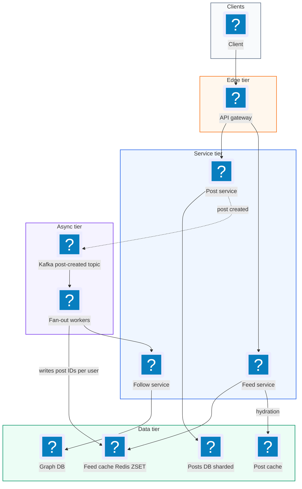
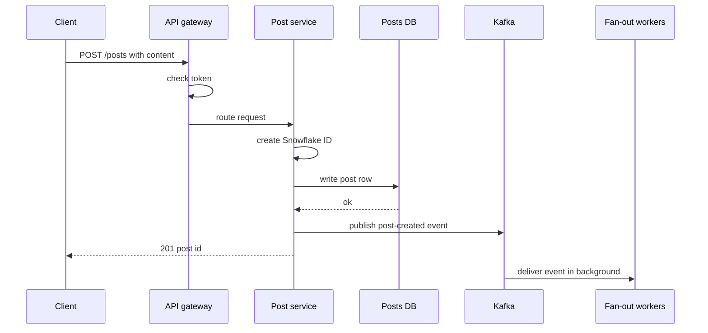
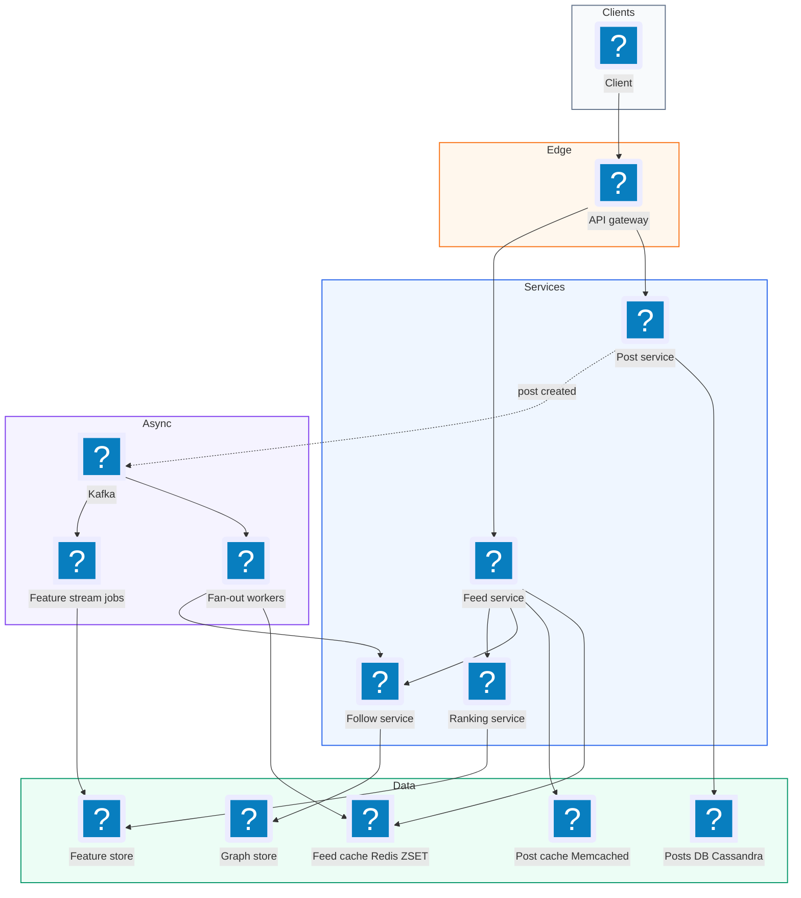

# 07. Facebook News Feed  (Medium)

> Facebook News Feed is the scrolling list of posts you see when you open Facebook. It shows recent posts from your friends and from pages and people you follow. You can scroll forever, and new posts keep appearing. The interviewer is really testing three things: how you build a personal feed for billions of people quickly, how you deal with accounts that have millions of followers (the "celebrity problem"), and how you page through a feed that keeps changing under you.

## 1. Functional requirements

Core (must have):

1. Users can create a post (text, optionally with a link or a media reference).
2. Users can follow (or friend) other users. Following is one-way here: A follows B does not mean B follows A.
3. Users can view a feed of posts from the people they follow, newest or best first.
4. Users can page through the feed with infinite scroll.

Below the line (out of scope):

1. Likes, comments, and shares. They are counters and lists attached to a post. They feed the ranking model but do not change the feed pipeline.
2. Media upload and processing. That is a blob storage and CDN problem, covered in the Instagram and Dropbox chapters.
3. Privacy settings per post (friends only, custom lists). Real but adds filtering, not new architecture.
4. Ads in the feed. Ads are inserted by a separate ads system at read time.

## 2. Non-functional requirements

1. Low latency: p99 under 500 ms to return the first page of the feed (20 posts).
2. High availability: 99.99% for feed reads. A slightly stale feed is far better than an error page.
3. Consistency: eventual. A new post may take up to 1 minute to appear in followers' feeds. The author must see their own post immediately (read-your-own-writes).
4. Scale: 2B users, 1B daily active users, up to 100M followers on a single account.
5. Write durability: an accepted post is never lost.
6. CAP choice: AP (availability and partition tolerance). During a network split we serve whatever feed we have rather than block. Nobody is harmed by a missing post for a minute.

## 3. Back-of-the-envelope estimates

| Assumption | Number |
|---|---|
| Daily active users (DAU) | 1B |
| Feed loads per user per day | 10 |
| Posts per user per day | 0.5 |
| Average followers per user | 200 |
| Post metadata size | 1 KB |
| Feed cache entry (post ID + score) | 16 bytes |
| Feed cache length per user | 500 entries |

```text
Feed reads:
  1B users * 10 loads/day = 10B loads/day
  10B / 86,400 s          ~= 115,000 reads/s average
  peak (x3)               ~= 350,000 reads/s

Post writes:
  1B * 0.5 = 500M posts/day
  500M / 86,400           ~= 5,800 writes/s, peak ~= 17,000/s

Fan-out writes (if we push every post to every follower):
  5,800 posts/s * 200 followers = 1.16M feed inserts/s average

Post storage per year:
  500M * 1 KB = 500 GB/day -> ~180 TB/year (before replication)

Precomputed feed cache:
  1B users * 500 entries * 16 B = 8 TB of RAM (spread over a Redis cluster)

Bandwidth for feed reads:
  350k reads/s * 20 posts * 1 KB = 7 GB/s at peak (metadata only)
```

The key insight from the math: reads outnumber posts by about 20 to 1, and fan-out turns each post into 200 cache writes. That ratio drives every design choice below.

## 4. Core entities

- User: a person or page. Fields: `user_id`, `name`, `created_at`.
- Follow: a directed edge "follower follows followee". Fields: `follower_id`, `followee_id`, `created_at`.
- Post: a piece of content. Fields: `post_id`, `author_id`, `content`, `created_at`.
- Feed entry: one item in a user's precomputed feed. Fields: `user_id`, `post_id`, `score` (time or rank).
- Cursor: an opaque token that marks where the client is in the feed.

```sql
CREATE TABLE posts (
  post_id     BIGINT PRIMARY KEY,      -- Snowflake ID, sortable by time
  author_id   BIGINT NOT NULL,
  content     TEXT,
  created_at  TIMESTAMP NOT NULL
);
CREATE INDEX posts_by_author ON posts (author_id, created_at DESC);

CREATE TABLE follows (
  follower_id BIGINT NOT NULL,
  followee_id BIGINT NOT NULL,
  created_at  TIMESTAMP NOT NULL,
  PRIMARY KEY (follower_id, followee_id)
);
-- Reverse lookup: "who follows X?" is needed for fan-out.
CREATE INDEX follows_by_followee ON follows (followee_id, follower_id);
```

A Snowflake ID is a 64-bit number made of a timestamp, a machine ID, and a counter. Sorting by it sorts by time, which makes pagination easy.

## 5. API design

`POST /posts` -- create a post.

```json
// request
{ "content": "Hello world" }
// response 201
{ "post_id": "7182736451", "created_at": "2026-11-03T10:00:00Z" }
```

Status codes: 201 created, 400 bad input, 401 not logged in. The author comes from the auth token, never from the body.

`PUT /users/{user_id}/followers` -- follow a user. `DELETE /users/{user_id}/followers` -- unfollow.

```json
// response 204, no body
```

Status codes: 204 ok, 404 user not found, 409 already following.

`GET /feed?cursor={cursor}&limit=20` -- get a page of the feed.

```json
// response 200
{
  "items": [
    { "post_id": "7182736451", "author_id": "42",
      "content": "Hello world", "created_at": "2026-11-03T10:00:00Z" }
  ],
  "next_cursor": "eyJzIjoxNzMwNjI4MDAwLCJpZCI6NzE4MjczNjQ1MX0"
}
```

All endpoints require a bearer token. `limit` is capped at 50 to protect the backend.

## 6. High-level design



### How will users create a post?

1. Client sends `POST /posts` with the content.
2. The gateway checks the token and routes to the Post Service.
3. Post Service creates a Snowflake ID and writes the row to the Posts DB (sharded by `post_id`).
4. It publishes a `post-created` event to Kafka (a durable log that consumers read in order).
5. It returns 201 to the client right away. Fan-out happens in the background.



### How will users follow someone?

1. Client sends `PUT /users/42/followers`.
2. Follow Service writes the row `(me, 42)` into the follows table.
3. Optional: a background job copies 42's last few posts into my feed cache so I see them right away.

### How will users view their feed?

1. Client sends `GET /feed`.
2. Feed Service reads the user's sorted list of post IDs from the feed cache.
3. It merges in recent posts from any celebrities the user follows (see deep dive).
4. It "hydrates" the IDs: looks up post bodies and author names from the post cache in one batched call.
5. It passes candidates through the ranking service (optional, see deep dive).
6. It returns 20 posts plus a `next_cursor`.

### How will users page through the feed?

1. The client sends back the `next_cursor` it got last time.
2. The cursor encodes "the last score and post ID I showed you". The Feed Service asks Redis for items strictly older than that point.
3. Repeat until the cache runs out, then fall back to querying the Posts DB directly for older history.

## 7. Deep dives

### Should we fan out on write or fan out on read?

The problem: when a user opens the feed, we need posts from up to hundreds of followed accounts, sorted. We can do that work when the post is written, or when the feed is read.

- Fan-out on write (push): when Alice posts, copy her post ID into every follower's feed list.
- Fan-out on read (pull): when Bob opens the feed, query recent posts of everyone Bob follows and merge them.

| | Fan-out on write (push) | Fan-out on read (pull) |
|---|---|---|
| Read cost | 1 cache read, very fast | N queries + merge, slow for N = 500 |
| Write cost | 1 write per follower (200 avg, 100M worst) | 1 write |
| Storage | Feed list per user (8 TB RAM) | None extra |
| Freshness | Delay while fan-out runs | Always fresh |
| Inactive users | Wasted work for users who never log in | No waste |
| Celebrity post | 100M writes, minutes of lag | Fine |

Neither wins alone. Push makes reads fast, which matters because reads are 20x writes. Pull handles celebrities. So we use a hybrid, covered next.

A fan-out worker looks like this:

```python
FEED_LEN = 500

def handle_post_created(event):
    post_id, author_id, ts = event["post_id"], event["author_id"], event["ts"]
    if is_celebrity(author_id):
        return  # celebrities are pulled at read time, not pushed
    for batch in follow_service.followers(author_id, batch_size=1000):
        pipe = redis.pipeline()
        for follower_id in batch:
            if not is_active(follower_id):   # skip users idle > 30 days
                continue
            key = f"feed:{follower_id}"
            pipe.zadd(key, {post_id: ts})
            pipe.zremrangebyrank(key, 0, -FEED_LEN - 1)  # keep newest 500
        pipe.execute()
```

### How do we handle users with millions of followers?

The problem: follower counts are very uneven. Most users have 200 followers. A few have 100M. If a celebrity posts and we push, that is 100M Redis writes. At 1M writes/s per cluster that is 100 seconds of lag, and it starves everyone else's fan-out.

| Option | How it works | Downside |
|---|---|---|
| Push everything, just add workers | Scale fan-out horizontally | Wastes huge capacity, lag still spikes |
| Pull everything | Merge at read time | Slow reads for everyone |
| Hybrid (recommended) | Push for normal users, pull for celebrities | Two code paths to maintain |

Recommended: hybrid. Mark an account as a "celebrity" when it has more than, say, 100k followers. Their posts are not pushed. Instead each celebrity has a small cache of their own recent posts. At read time, the Feed Service:

1. Reads the user's pushed feed from Redis (one call).
2. Looks up which celebrities the user follows (usually fewer than 50, cached).
3. Reads each celebrity's recent posts list (one batched `MGET`-style call).
4. Merges everything by score.

```python
def get_feed_candidates(user_id, before_score, limit):
    pushed = redis.zrevrangebyscore(
        f"feed:{user_id}", before_score, "-inf",
        start=0, num=limit, withscores=True)
    celebs = follow_service.celebrities_followed(user_id)   # cached
    pipe = redis.pipeline()
    for c in celebs:
        pipe.zrevrangebyscore(f"posts:{c}", before_score, "-inf",
                              start=0, num=limit, withscores=True)
    pulled = [item for res in pipe.execute() for item in res]
    merged = sorted(pushed + pulled, key=lambda x: x[1], reverse=True)
    return merged[:limit]
```

Two refinements interviewers like:

- Skip inactive users during push. If a user has not logged in for 30 days, do not maintain their feed. When they return, build it once with pull. This cuts fan-out work a lot.
- Use a gradient, not a cliff. Accounts with 10k-100k followers can be pushed only to followers who were active in the last day, and pulled for the rest.

### How does the feed ranking service work?

The problem: a pure time-sorted feed shows the newest post, not the most interesting one. Facebook ranks. We need to rank without blowing the 500 ms budget.

| Option | Latency | Quality | Notes |
|---|---|---|---|
| Chronological only | Lowest | Low | Simple, good starting point |
| Rank at write time (store a score) | Low | Medium | Score cannot react to likes after posting |
| Two-stage rank at read time (recommended) | Medium | High | Candidate fetch, then ML scoring |

Recommended: two stages.

1. Candidate generation: take the top 500 recent candidates from the hybrid fetch above. This is cheap.
2. Scoring: a Ranking Service scores each candidate with a model using features like author affinity (how often you interact with this person), post age, post type, and early engagement. Return the top 20.

```text
Feed Service
   | 500 candidate IDs
   v
Feature Store (affinity, counts) ---> Ranking Service (model) ---> top 20
   ^                                       |
   | features updated by Kafka streams     | p99 budget ~100 ms
```

Keep it inside budget: score in batches, cache features, and if the ranker times out, fall back to the chronological order. Rank only the first page with the full model; later pages can use a cheaper model.

A gotcha: if ranking re-orders the feed on every request, page 2 may repeat or skip posts from page 1. The fix is to save the ranked list for this session (in Redis with a 30 minute TTL) and page through that saved list with a cursor.

### How do we paginate a feed that keeps changing?

The problem: new posts arrive at the top while the user scrolls. With offset paging (`?page=2` means skip 20), a new post shifts everything by one, so the user sees a duplicate.

| Option | Duplicates/skips | Cost of deep pages | Notes |
|---|---|---|---|
| Offset (`LIMIT 20 OFFSET 40`) | Yes, when new posts arrive | Gets slower the deeper you go | Avoid |
| Cursor on `(score, post_id)` (recommended) | No | Constant | Stable under inserts |
| Page token pointing to a saved session list | No | Constant | Needed when ranking re-orders |

Recommended: an opaque cursor. It encodes the last item's score and post ID. The next request asks for items strictly "before" that pair. Including the post ID breaks ties when two posts have the same timestamp.

```python
import base64, json

def encode_cursor(score, post_id):
    raw = json.dumps({"s": score, "id": post_id}).encode()
    return base64.urlsafe_b64encode(raw).decode()

def decode_cursor(cursor):
    if not cursor:
        return float("inf"), None
    d = json.loads(base64.urlsafe_b64decode(cursor))
    return d["s"], d["id"]
```

The SQL fallback for old history uses the same idea (this is called keyset pagination):

```sql
SELECT post_id, author_id, content, created_at
FROM posts
WHERE author_id = ANY(:followees)
  AND (created_at, post_id) < (:last_ts, :last_id)
ORDER BY created_at DESC, post_id DESC
LIMIT 20;
```

Make the cursor opaque (base64) so clients do not build their own and so you can change its contents later. Sign it with an HMAC if you worry about tampering.

### What happens when parts of the system fail?

The problem: fan-out workers crash, Redis nodes die, Kafka lags. The feed must still load.

| Failure | Effect | Mitigation |
|---|---|---|
| Fan-out worker crashes mid-batch | Some followers miss a post | Kafka consumer re-reads from last committed offset; `ZADD` is idempotent, so replays are safe |
| Redis feed shard lost | Users on that shard have empty feeds | Replicas with automatic failover; if both lost, rebuild with pull on next read |
| Ranking service slow | Feed latency breaches 500 ms | Timeout at 100 ms, fall back to chronological |
| Kafka lag spike (big event) | Posts appear late | Autoscale consumers on lag metric; celebrities already bypass push |
| Posts DB shard down | Hydration fails for some posts | Serve from post cache; drop missing items rather than fail the page |

Idempotency is the important word. Because the feed is a sorted set keyed by post ID, writing the same post twice is harmless. That lets us use "at least once" delivery from Kafka without worrying.

## 8. Final architecture



| Component | Job | Technology example |
|---|---|---|
| API Gateway | Auth, rate limit, routing | Envoy, AWS API Gateway |
| Post Service | Validate and store posts, emit events | Stateless service |
| Posts DB | Durable post storage, sharded by post ID | Cassandra, MySQL shards (TAO-like) |
| Follow Service + Graph store | Who follows whom, celebrity list | MySQL shards + cache |
| Kafka | Durable post-created stream | Apache Kafka |
| Fan-out workers | Push post IDs to followers' feeds | Kafka consumers |
| Feed Cache | Per-user sorted list of post IDs | Redis Cluster sorted sets |
| Feed Service | Merge pushed + pulled, paginate | Stateless service |
| Ranking Service | Score candidates | Model server (TF Serving, custom) |
| Feature Store | Affinity and engagement features | Redis, Cassandra |
| Post Cache | Hydrate post bodies | Memcached |

### Deployment map (AWS)

```mermaid
architecture-beta
    group internet(mdi:earth)[Internet]
    group edge(logos:aws-cloudfront)[Edge]
    group vpc(logos:aws-vpc)[AWS VPC]
    group app(logos:aws-ecs)[Service subnet] in vpc
    group data(logos:aws-rds)[Data subnet] in vpc

    service c(mdi:cellphone)[Client] in internet
    service gw(logos:aws-api-gateway)[API gateway] in edge
    service ps(logos:aws-ecs)[Post service] in app
    service fd(logos:aws-ecs)[Feed service] in app
    service rk(logos:aws-sagemaker)[Ranking service] in app
    service fs(logos:aws-ecs)[Follow service] in app
    service fo(logos:aws-lambda)[Fan out workers] in app
    service pdb(logos:aws-dynamodb)[Posts DB] in data
    service fc(logos:aws-elasticache)[Feed cache Redis ZSET] in data
    service k(logos:kafka-icon)[Kafka] in data

    c:R --> L:gw
    gw:B --> T:ps
    gw:B --> T:fd
    ps:B --> T:pdb
    ps:R --> L:k
    k:T --> B:fo
    fo:B --> T:fc
    fo:L --> R:fs
    fd:B --> T:fc
    fd:R --> L:fs
    fd:L --> R:rk
```



Every service including the ranking model server runs in the service subnet behind one gateway, and the posts store, Redis feed cache and Kafka log all sit in the data subnet.

## 9. Common mistakes and interviewer follow-ups

- Picking push only. A 100M-follower post makes fan-out lag for minutes. Say: "push for normal users, pull for celebrities, merge at read time."
- Using offset pagination. New posts cause duplicates and deep pages get slow. Say: "cursor on (score, post_id), opaque to the client."
- Storing full posts in every feed list. That multiplies storage by 200. Store only post IDs and hydrate from a post cache.
- Doing fan-out synchronously in the post request. The author waits seconds. Return 201 after the DB write and fan out from Kafka.
- Maintaining feeds for users who never log in. Huge wasted work. Skip inactive users and rebuild on return.
- Forgetting the author's own post. With eventual fan-out the author may not see it. Insert it into the author's own feed synchronously, or merge it client-side.
- Follow-up: "What if a user follows 5,000 accounts?" Cap the follow count, or treat heavy followers specially: pushed feed covers them, and pull only for celebrities.
- Follow-up: "How do you handle a deleted post?" Do not chase it through 200 feeds. Mark it deleted in the Posts DB; hydration drops it at read time.

## 10. One-page cheat sheet

| Topic | Key point |
|---|---|
| Scale | 1B DAU, ~350k feed reads/s peak, ~17k posts/s peak |
| Read/write ratio | ~20:1, so optimize reads |
| Fan-out | Hybrid: push for normal, pull for >100k followers |
| Feed store | Redis sorted set `feed:{uid}`, 500 post IDs, ~8 TB RAM |
| Posts store | Cassandra or sharded MySQL, Snowflake IDs |
| Async pipeline | Kafka post-created -> fan-out workers |
| Ranking | Two stages: 500 candidates -> model -> top 20, fallback to chrono |
| Pagination | Opaque cursor on (score, post_id), keyset SQL for history |
| Consistency | Eventual (< 1 min), read-your-own-writes for author |
| CAP | AP, serve stale feed over error |
| Failure trick | Idempotent ZADD makes Kafka replays safe |
| Waste saver | Skip inactive users during fan-out |

## Sources

- [Hello Interview: Design Facebook News Feed](https://www.hellointerview.com/learn/system-design/problem-breakdowns/fb-news-feed)
- [Facebook Engineering: Serving Facebook Multifeed](https://engineering.fb.com/2015/03/10/production-engineering/serving-facebook-multifeed-efficiency-performance-gains-through-redesign/)
- [Facebook Engineering: TAO, the power of the graph](https://engineering.fb.com/2013/06/25/core-infra/tao-the-power-of-the-graph/)
- [System Design Primer (GitHub)](https://github.com/donnemartin/system-design-primer)
- [High Scalability: The Architecture Twitter Uses to Deal with 150M Active Users](http://highscalability.com/blog/2013/7/8/the-architecture-twitter-uses-to-deal-with-150m-active-users.html)
- [Meta: News Feed ranking explained](https://about.fb.com/news/2021/01/how-does-news-feed-predict-what-you-want-to-see/)
