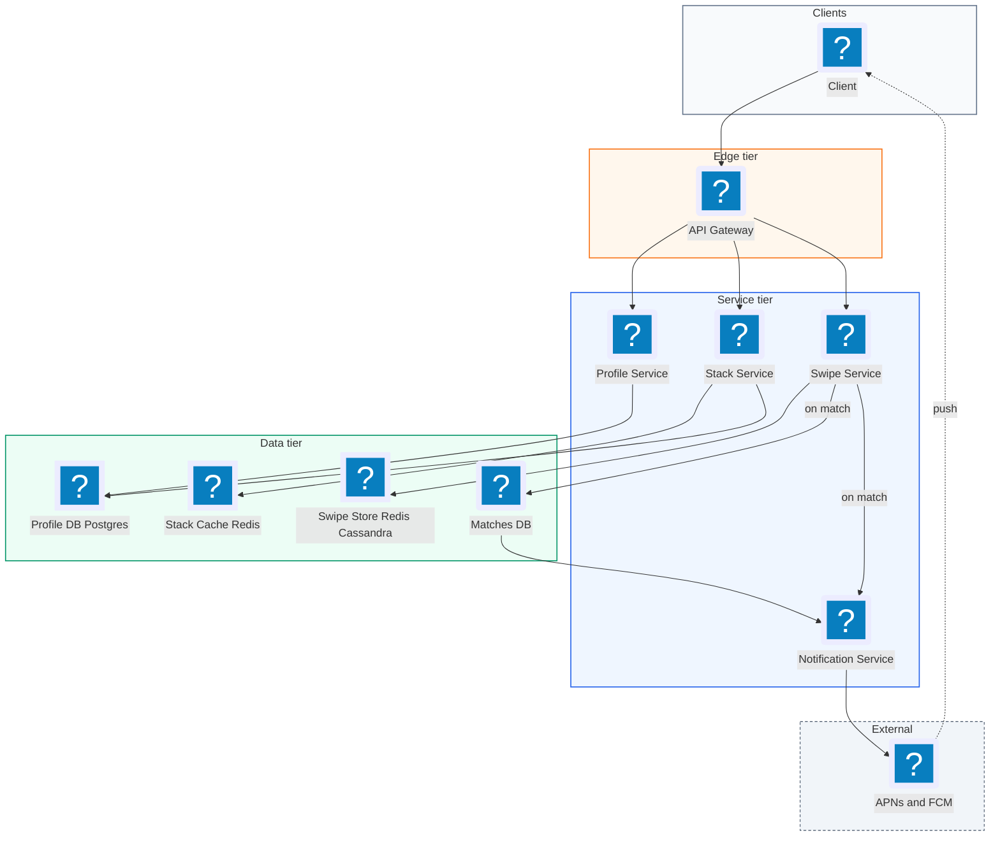
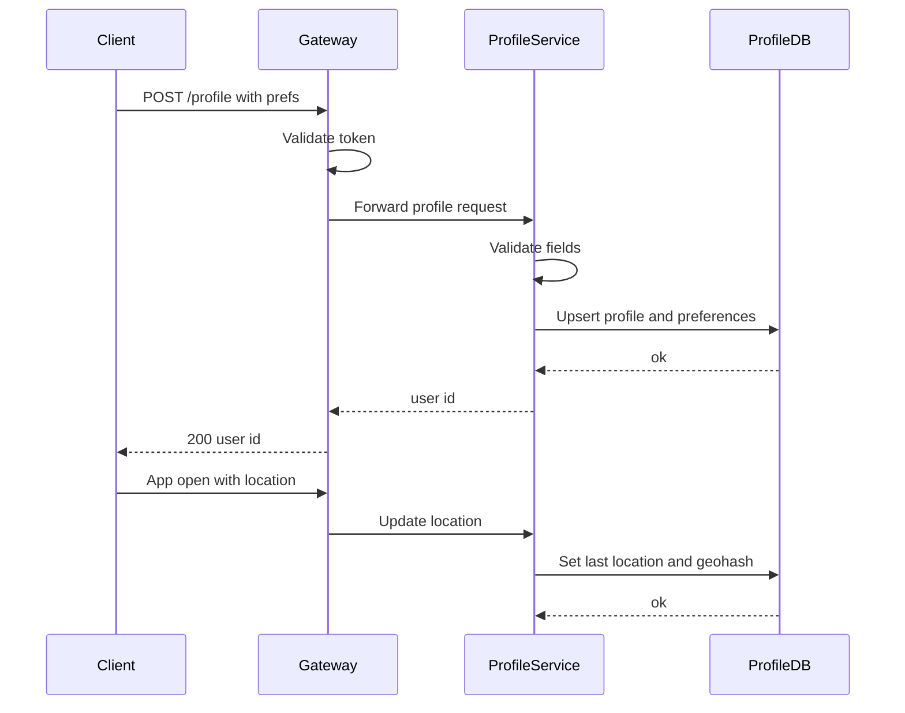
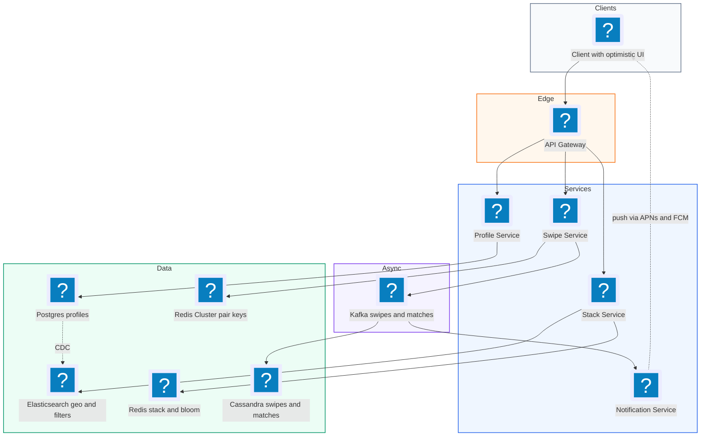

# 08. Tinder (Dating App Swipe and Match)  (Medium)

> Tinder shows you a stack of profiles of people near you. You swipe right if you like someone and left if you do not. If two people both swipe right on each other, it is a "match" and both get notified so they can chat. The interviewer is really testing four things: how you make sure a match is never missed when two people swipe at the same moment, how you store billions of swipes cheaply, how you build a stack of nearby profiles quickly, and how you avoid showing someone a profile they have already swiped on.

## 1. Functional requirements

Core (must have):

1. Users can create a profile with preferences: age range, gender interest, and maximum distance.
2. Users can see a stack of nearby profiles that match their preferences.
3. Users can swipe right (like) or left (pass) on a profile.
4. Users get a match notification when both people have swiped right on each other.

Below the line (out of scope):

1. Chat after matching. That is a messaging system, covered in the WhatsApp chapter.
2. Photo upload and moderation. Blob storage plus CDN, covered elsewhere.
3. Premium features (super likes, rewind, see who liked you). They reuse the swipe store but add business rules.
4. ML-based ranking of the stack (desirability scores). We mention it as a hook but do not design the model.

## 2. Non-functional requirements

1. Strong consistency for matches: if both users swipe right, a match must be created exactly once, even if they swipe in the same millisecond. Missing a match is the worst bug in the product.
2. Low swipe latency: p99 under 100 ms. Swiping is a fast physical gesture and must feel instant.
3. Fast stack loading: p99 under 300 ms to fetch the next batch of profiles.
4. No repeats: a user should not see a profile they already swiped on (a tiny error rate is OK, under 1 in 1,000).
5. Scale: 20M daily active users, 100 swipes per user per day.
6. Availability: 99.9% for swiping. Profile stacks can be slightly stale (a new user nearby may take minutes to appear).
7. CAP choice: mostly AP for profile discovery, but the match check needs per-pair consistency (CP behaviour on a small key). We get that by co-locating both directions of a pair on one partition and using an atomic operation.

## 3. Back-of-the-envelope estimates

| Assumption | Number |
|---|---|
| Daily active users | 20M |
| Swipes per user per day | 100 |
| Right-swipe rate | 30% |
| Match rate of right swipes | 5% |
| Swipe record size | 50 bytes |
| Profile size (metadata, photo URLs) | 2 KB |
| Stack batch size | 50 profiles |

```text
Swipe writes:
  20M * 100 = 2B swipes/day
  2B / 86,400 s ~= 23,000 swipes/s average, peak (x3) ~= 70,000/s

Stack fetches:
  100 swipes / 50 per batch = 2 fetches/user/day
  20M * 2 = 40M/day ~= 460/s average, ~1,400/s peak (light)

Matches:
  2B * 0.30 * 0.05 = 30M matches/day ~= 350/s

Swipe storage:
  2B * 50 B = 100 GB/day -> ~36 TB/year (before replication)

Profile storage:
  75M total users * 2 KB = 150 GB (fits in memory on a few nodes)

Bloom filter per user (to avoid repeats):
  say 10,000 swipes stored, 0.1% false positive -> ~14.4 bits/item
  10,000 * 14.4 / 8 ~= 18 KB per user
  20M active users * 18 KB ~= 360 GB of Redis
```

So swipes are the heavy write path (70k/s peak, 36 TB/year), while stack fetching is read-light but compute-heavy (geo query plus filtering).

## 4. Core entities

- User / Profile: who you are. Fields: `user_id`, `name`, `age`, `gender`, `bio`, `photos`, `last_location`, `last_active`.
- Preferences: who you want to see. Fields: `user_id`, `min_age`, `max_age`, `interested_in`, `max_distance_km`.
- Swipe: one decision. Fields: `swiper_id`, `swipee_id`, `decision` (like or pass), `created_at`.
- Match: two people who liked each other. Fields: `match_id`, `user_a`, `user_b`, `created_at`.
- Stack: a cached, ordered list of candidate profile IDs for one user.

```sql
-- Cassandra (CQL). Partition by swiper, so "all my swipes" is one read.
CREATE TABLE swipes (
  swiper_id  bigint,
  swipee_id  bigint,
  decision   text,          -- 'like' or 'pass'
  created_at timestamp,
  PRIMARY KEY ((swiper_id), swipee_id)
);

CREATE TABLE matches (
  user_id    bigint,
  match_id   timeuuid,
  other_user bigint,
  PRIMARY KEY ((user_id), match_id)
) WITH CLUSTERING ORDER BY (match_id DESC);
```

```json
{
  "user_id": 123,
  "age": 29,
  "gender": "f",
  "prefs": { "min_age": 27, "max_age": 35, "interested_in": "m",
             "max_distance_km": 25 },
  "location": { "lat": 40.7128, "lng": -74.0060, "geohash": "dr5regw" }
}
```

## 5. API design

`POST /profile` -- create or update profile and preferences.

```json
// request
{ "age": 29, "gender": "f", "bio": "...",
  "prefs": { "min_age": 27, "max_age": 35, "interested_in": "m",
             "max_distance_km": 25 } }
// response 200
{ "user_id": 123 }
```

`GET /feed?lat=40.71&lng=-74.00` -- get the next batch of profiles.

```json
// response 200
{ "profiles": [ { "user_id": 456, "name": "Sam", "age": 31,
                  "distance_km": 3, "photos": ["https://cdn/..."] } ] }
```

The client sends its current location with each call. The server never trusts a `user_id` in the query; it comes from the token.

`POST /swipe/{target_user_id}` -- record a swipe.

```json
// request
{ "decision": "like" }
// response 200
{ "matched": true, "match_id": "b1f0..." }
```

Status codes: 200 ok, 400 invalid decision, 404 target not found, 409 already swiped (idempotent: return the same result again), 429 swipe rate limit hit.

`GET /matches?cursor=...` -- list my matches.

All endpoints need a bearer token. Match notifications go out by push (APNs or FCM), not by polling.

## 6. High-level design



### How will users create a profile?

1. Client sends `POST /profile`.
2. Profile Service validates and writes to the Profile DB.
3. On each app open, the client sends its location. The service updates `last_location` and its geohash (a short string that names a grid cell on the map; nearby points share a prefix).



### How will users see a stack of nearby profiles?

1. Client calls `GET /feed` with its location.
2. Stack Service checks the Stack Cache for a precomputed list for this user. If there are at least 20 left, return the next 50.
3. If not, it runs a geo query: users within `max_distance_km` whose age and gender match, who also want someone like me (preferences must match both ways).
4. It removes profiles I have already swiped on (bloom filter check, see deep dive).
5. It orders the rest (recently active first, or by a ranking score), saves them to the Stack Cache, and returns the first 50.

### How will users swipe?

1. Client sends `POST /swipe/456` with `like`.
2. Swipe Service records the swipe and atomically checks whether 456 already liked me (see deep dive).
3. It adds 456 to my "already swiped" bloom filter.
4. It returns `{ matched: true/false }` within 100 ms.

### How will users get notified of a match?

1. If the atomic check finds a mutual like, Swipe Service writes two rows to the Matches DB (one per user).
2. It publishes a `match-created` event.
3. Notification Service sends a push to the other user. The swiper already knows from the HTTP response.

## 7. Deep dives

### How do we make sure a match is never missed when both swipe at once?

The problem: Alice and Bob swipe right on each other at the same moment. A naive flow is "write my swipe, then read their swipe". If both requests write first and then both read before the other write is visible (say, on different replicas), both see "no like yet" and no match is created. Or both see a like and two matches are created.

| Option | How | Problem |
|---|---|---|
| Write then read on an eventually consistent DB | Two separate operations | Race: missed or duplicate matches |
| Distributed lock per pair | Lock `pair:alice:bob`, then check | Extra round trips, lock service is a dependency |
| Single atomic op on a pair key (recommended) | Store both directions under one key, update and check in one Redis Lua script | Need pair key routing, Redis durability (backed by Cassandra log) |
| DB transaction with `SERIALIZABLE` | Postgres row per pair | Works, but 70k/s is a lot for one SQL cluster |

Recommended: make a pair key from the two IDs sorted, so Alice-Bob and Bob-Alice land on the same key and the same Redis shard. A Lua script runs atomically on that shard (Redis runs one script at a time per shard), so there is no race.

```python
# Key is the same no matter who swipes first.
def pair_key(a, b):
    lo, hi = sorted((a, b))
    return f"swipe:{lo}:{hi}"

# Hash fields: "lo_likes" and "hi_likes". Returns 1 if this swipe created a match.
LUA = """
local key, me_field, other_field = KEYS[1], ARGV[1], ARGV[2]
local decision = ARGV[3]
redis.call('HSET', key, me_field, decision)
redis.call('EXPIRE', key, 7776000)      -- 90 days
if decision == 'like' and redis.call('HGET', key, other_field) == 'like' then
  if redis.call('HSETNX', key, 'matched', 1) == 1 then
    return 1
  end
end
return 0
"""

def swipe(me, target, decision):
    lo, hi = sorted((me, target))
    me_f, other_f = ("lo", "hi") if me == lo else ("hi", "lo")
    matched = redis.eval(LUA, 1, pair_key(me, target),
                         me_f + "_likes", other_f + "_likes", decision)
    kafka.send("swipes", {"swiper": me, "swipee": target, "d": decision})
    if matched:
        create_match(me, target)   # idempotent, keyed by pair
    return bool(matched)
```

`HSETNX` on a `matched` field means only one of two concurrent calls ever returns 1, so we never create a duplicate match. Swipes are also streamed to Kafka and written to Cassandra for durability; if a Redis node is lost, we can rebuild pair state from the log.

### How do we store billions of swipes at scale?

The problem: 2B swipes a day, 36 TB a year, and we need two very different reads: "did X like me?" (pair lookup, hot, recent) and "all profiles X has swiped on" (used to filter the stack).

| Store | Good at | Weak at |
|---|---|---|
| Postgres | Transactions, simple | 70k writes/s and 36 TB/year needs heavy sharding |
| Cassandra (recommended for the log) | Huge write throughput, partition by swiper | No cross-partition atomicity |
| Redis (recommended for hot state) | Atomic Lua, sub-ms | RAM cost, needs TTL |
| Bloom filter in Redis (recommended for "seen") | 18 KB per user answers "seen?" | Small false positive rate, no deletes |

Recommended: three layers.

1. Redis pair hashes for the match check, with a 90-day TTL (most matches happen within days of swiping).
2. Cassandra `swipes` table, partitioned by `swiper_id`, as the durable history. It is written from Kafka, so the swipe request does not wait for it.
3. A per-user bloom filter of "profiles I have swiped on", used by the stack builder.

A bloom filter is a compact bit array plus a few hash functions. To add an item, set k bits. To check, see if all k bits are set. It can say "maybe seen" by mistake (false positive) but never "not seen" by mistake. A false positive only means we skip one profile, which is harmless.

```python
import math, mmh3

def bloom_params(n_items, fp_rate):
    m = math.ceil(-n_items * math.log(fp_rate) / (math.log(2) ** 2))  # bits
    k = round(m / n_items * math.log(2))                              # hashes
    return m, k

m, k = bloom_params(10_000, 0.001)   # m ~= 143,776 bits (18 KB), k = 10

def bloom_add(user_id, item):
    for i in range(k):
        redis.setbit(f"seen:{user_id}", mmh3.hash(str(item), i) % m, 1)

def bloom_maybe_seen(user_id, item):
    return all(redis.getbit(f"seen:{user_id}", mmh3.hash(str(item), i) % m)
               for i in range(k))
```

In production you would use the RedisBloom module (`BF.ADD`, `BF.EXISTS`) instead of hand-rolled bits, and pipeline the checks for a whole batch of 500 candidates.

### How do we generate a geo-based profile stack quickly?

The problem: find people within 25 km, of the right age and gender, who also want someone like me, out of 75M users, in under 300 ms.

| Option | How | Trade-off |
|---|---|---|
| Scan with lat/lng `BETWEEN` | Plain B-tree index | Slow, can only index one dimension well |
| Postgres + PostGIS geo index | `ST_DWithin` on a GiST index | Solid; scale reads with replicas |
| Geohash buckets in Redis or Elasticsearch (recommended) | Look up my cell and its 8 neighbours, filter | Fast, easy to shard by geohash |
| Precompute stacks in background (recommended addition) | Cron or event-driven job fills Stack Cache | Stack may be minutes stale |

Recommended: an Elasticsearch (or OpenSearch) index of active profiles with a `geo_point` field plus age, gender, and preference fields. It supports geo distance filters and multi-field filters in one query, and shards well. Then precompute the stack in the background so `GET /feed` is usually a cache hit.

```json
{
  "query": { "bool": { "filter": [
    { "geo_distance": { "distance": "25km",
                        "location": { "lat": 40.71, "lon": -74.00 } } },
    { "term":  { "gender": "m" } },
    { "range": { "age": { "gte": 27, "lte": 35 } } },
    { "term":  { "interested_in": "f" } },
    { "range": { "pref_min_age": { "lte": 29 } } },
    { "range": { "pref_max_age": { "gte": 29 } } },
    { "range": { "last_active": { "gte": "now-7d" } } }
  ] } },
  "size": 500
}
```

The two-way preference check (`interested_in` and `pref_*_age` against my own age) is easy to forget and interviewers notice. After the query, filter out seen profiles with the bloom filter, rank, and keep 50 to 200 in the Stack Cache. When the user's remaining stack drops below 20, kick off a refill in the background so they never wait.

### How do we avoid showing repeat profiles?

The problem: if I passed on Sam yesterday, Sam should not show up today. The stack is rebuilt often, and the "seen" set grows forever.

| Option | Accuracy | Cost | Notes |
|---|---|---|---|
| Query Cassandra for every candidate | Exact | 500 reads per stack build | Too slow |
| Exclude list inside the ES query (`must_not ids`) | Exact | Query grows with history | Breaks down past a few thousand IDs |
| Bloom filter per user (recommended) | 99.9% | 18 KB per user, one pipelined call | Tiny false positives are fine |
| Client-side cache of recent IDs | Exact for recent | Free | Good extra layer for the current session |

Recommended: bloom filter plus a small client-side list of the last few hundred IDs (covers the gap between swiping and the filter update). Remove stack items from the Stack Cache the moment they are returned, so two devices or two quick refreshes do not get the same profile.

If a filter fills up (say past 10,000 items, the false positive rate starts to rise), rotate: start a new filter, keep the old one for checks, and rebuild from Cassandra in the background.

### How do we keep swipes fast and survive failures?

The problem: a swipe must return in 100 ms even at 70k/s peak, and losing a swipe could mean losing a match.

| Concern | Approach |
|---|---|
| Latency | Only the Redis Lua call is on the hot path (~1 ms). Cassandra write and bloom update go async via Kafka |
| Client feel | Optimistic UI: animate the card away at once, send the request in the background, retry on failure |
| Duplicate requests (retries) | Swipe is idempotent: same pair, same decision, same result. `HSETNX matched` guards duplicates |
| Redis shard failure | Replica promoted by Redis Cluster; any pair state lost in the gap is rebuilt from the Kafka/Cassandra log, then re-check matches for those pairs |
| Hot user (very popular profile) | Pair keys spread one user's swipes across many shards, since the key includes the other person |
| Abuse (bots swiping right on everyone) | Rate limit per user (for example 100 likes per 12 hours on free tier) at the gateway |

```text
 swipe request
     |
     v
 Swipe Service --(1 ms Lua)--> Redis pair key  --> response to client
     |
     +--(async)--> Kafka "swipes" --> Cassandra writer
                                  --> Bloom updater
                                  --> Match reconciler (rechecks on failover)
```

## 8. Final architecture



| Component | Job | Technology example |
|---|---|---|
| API Gateway | Auth, swipe rate limits | Envoy, Kong |
| Profile Service | Profile and preference CRUD, location updates | Stateless service |
| Profile DB | Source of truth for profiles | Postgres |
| Search index | Geo + attribute queries | Elasticsearch / OpenSearch |
| Stack Service | Build, cache, refill stacks | Stateless + background workers |
| Stack Cache and bloom filters | Ready stacks, seen sets | Redis (RedisBloom) |
| Swipe Service | Atomic swipe + match check | Redis Lua on pair keys |
| Event log | Durable swipe stream | Kafka |
| Swipe and match history | Long-term storage | Cassandra |
| Notification Service | Match pushes | APNs, FCM |

### Deployment map (AWS)

```mermaid
architecture-beta
    group internet(mdi:earth)[Internet]
    group edge(logos:aws-cloudfront)[Edge]
    group vpc(logos:aws-vpc)[AWS VPC]
    group app(logos:aws-ecs)[Service subnet] in vpc
    group data(logos:aws-rds)[Data subnet] in vpc
    group ext(mdi:earth)[Third parties]

    service c(mdi:cellphone)[Client] in internet
    service gw(logos:aws-api-gateway)[API Gateway] in edge
    service ss(logos:aws-ecs)[Stack Service] in app
    service sw(logos:aws-ecs)[Swipe Service] in app
    service ns(logos:aws-ecs)[Notification Service] in app
    service pg(logos:aws-rds)[Postgres profiles] in data
    service es(logos:aws-opensearch)[Elasticsearch geo and filters] in data
    service rc(logos:aws-elasticache)[Redis Cluster pair keys] in data
    service k(logos:kafka-icon)[Kafka swipes and matches] in data
    service push(mdi:earth)[APNs and FCM] in ext

    c:R --> L:gw
    gw:B --> T:ss
    gw:B --> T:sw
    ss:B --> T:es
    ss:B --> T:pg
    pg:R --> L:es
    sw:B --> T:rc
    sw:B --> T:k
    k:T --> B:ns
    ns:R --> L:push
    push:L --> R:c
```



Only the Redis pair key check sits on the swipe hot path inside the VPC, Kafka carries match events to the notification service, and Apple and Google push services are the only third parties.

## 9. Common mistakes and interviewer follow-ups

- Write-then-read match check on an eventually consistent store. You will miss or duplicate matches under concurrency. Say: "pair key with both directions, checked atomically in one Lua script."
- Putting the whole swipe history into the search query as an exclude list. Queries balloon. Say: "bloom filter per user, filter after the geo query."
- Only checking my preferences, not theirs. You show people who would never like you back, and the like rate falls. Say: "preferences must match in both directions."
- Doing the geo query on every swipe. Wasteful. Precompute stacks and refill in the background below a threshold.
- Synchronous Cassandra write on the swipe path. Adds latency. Write Redis on the hot path, stream to Cassandra via Kafka.
- Follow-up: "What if a user travels to a new city?" Location updates on app open; invalidate the Stack Cache when the geohash prefix changes.
- Follow-up: "How would you rank the stack?" Add a scoring step after filtering: recency of activity, mutual likelihood, a desirability score. Keep the pipeline the same.
- Follow-up: "Why not one big Postgres?" 70k writes/s and 36 TB/year needs sharding anyway, and you would still need atomic pair handling. Redis plus Cassandra fits the access pattern better.

## 10. One-page cheat sheet

| Topic | Key point |
|---|---|
| Scale | 20M DAU, 2B swipes/day, ~70k swipes/s peak, ~36 TB/year |
| Match correctness | Pair key `swipe:{lo}:{hi}`, atomic Lua, `HSETNX matched` |
| Swipe latency | Only Redis on hot path, rest async via Kafka, optimistic UI |
| Durable history | Cassandra partitioned by swiper |
| Stack building | Elasticsearch geo_distance + two-way preference filter |
| Stack serving | Precomputed in Redis, refill below 20 left |
| No repeats | Per-user bloom filter, ~18 KB for 10k items at 0.1% FP |
| Notifications | Kafka match-created -> push via APNs / FCM |
| CAP | AP for discovery, atomic per-pair for matches |
| Failover | Rebuild pair state from Kafka/Cassandra log, re-check matches |

## Sources

- [Hello Interview: Design Tinder](https://www.hellointerview.com/learn/system-design/problem-breakdowns/tinder)
- [Tinder Tech Blog: Geosharded recommendations](https://medium.com/tinder/geosharded-recommendations-part-1-sharding-approach-d5d54e0ec77a)
- [Redis docs: Bloom filter](https://redis.io/docs/latest/develop/data-types/probabilistic/bloom-filter/)
- [Redis docs: Scripting with Lua](https://redis.io/docs/latest/develop/interact/programmability/eval-intro/)
- [Elasticsearch: Geo-distance query](https://www.elastic.co/guide/en/elasticsearch/reference/current/query-dsl-geo-distance-query.html)
- [Wikipedia: Bloom filter](https://en.wikipedia.org/wiki/Bloom_filter)
