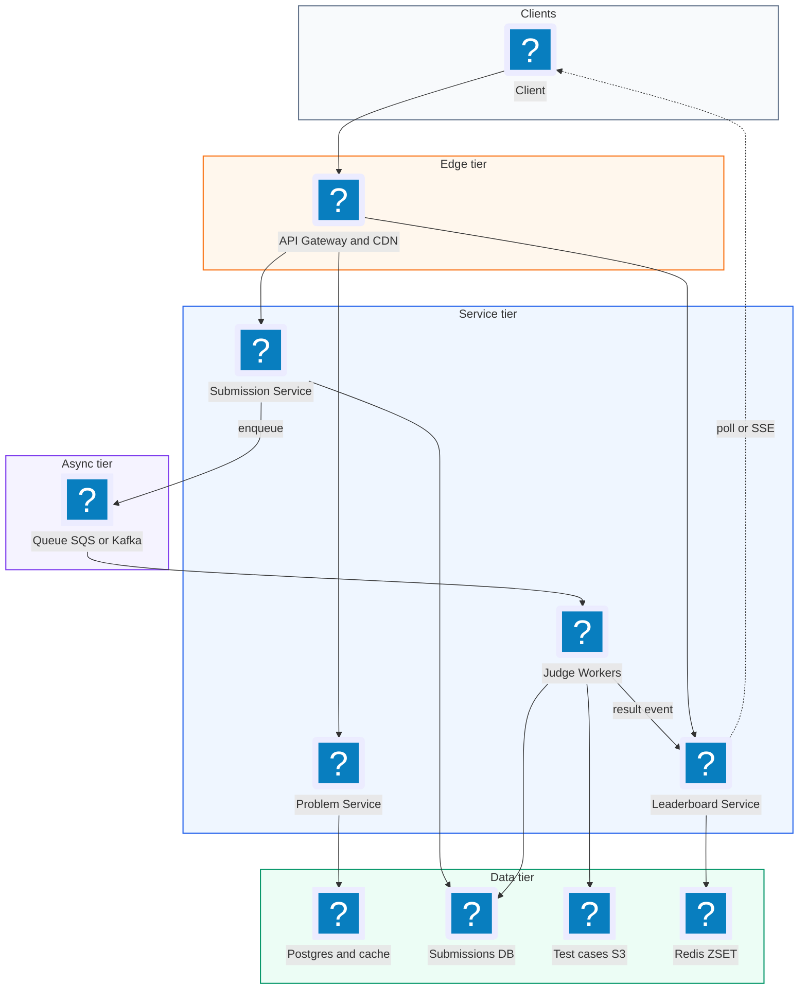
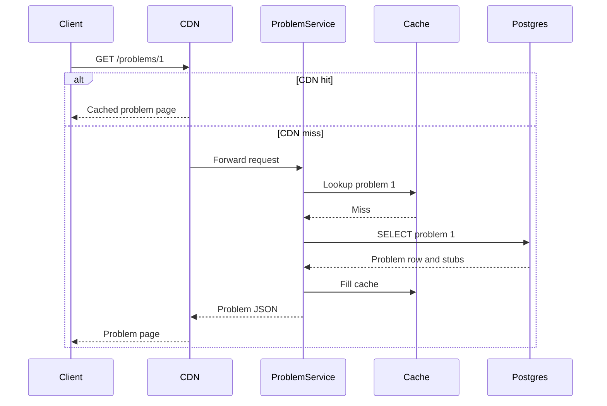
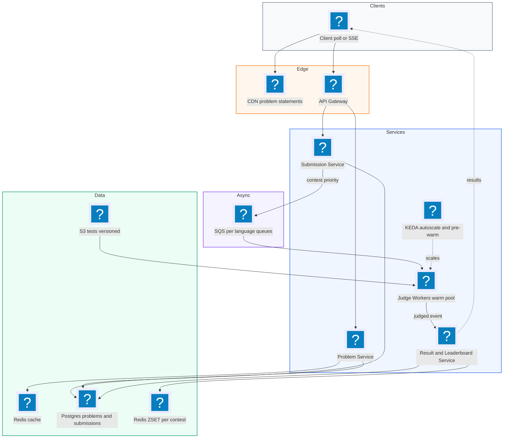

# 09. LeetCode (Online Code Judge)  (Medium)

> LeetCode is a website where people solve coding problems. You read a problem, write code in the browser in a language like Python or Java, and submit it. The site runs your code against hidden test cases and tells you if it passed, how fast it ran, and how much memory it used. It also runs timed contests with a live leaderboard. The interviewer is really testing how you run untrusted code from strangers safely, how you run many test cases quickly, how you build a live leaderboard, and how you survive the traffic spike when 100,000 people start a contest at the same second.

## 1. Functional requirements

Core (must have):

1. Users can view a list of problems and open one problem (statement, examples, code stub).
2. Users can submit code in one of several languages and get a result: accepted, wrong answer, time limit exceeded, runtime error, or compile error.
3. Users can join a coding contest and see a live leaderboard.

Below the line (out of scope):

1. Discussion forums and solution posts. Standard CRUD, no new ideas.
2. "Run" with custom input. It reuses the same execution path as submit with one test case.
3. Problem authoring tools. Internal, low traffic.
4. Plagiarism detection. A batch job after the contest.

## 2. Non-functional requirements

1. Security: user code must never escape its sandbox, read other users' code, reach the network, or harm the host. This is the top priority.
2. Result latency: p95 under 5 seconds from submit to verdict outside contests; under 10 seconds during a contest peak.
3. Leaderboard freshness: updated within a few seconds of an accepted submission.
4. Scale: 100k contestants in one contest, each submitting about 20 times over 90 minutes, with a burst at the start and the end.
5. Availability: 99.9% for browsing problems; submissions may be queued (delayed) under load, but never dropped.
6. Fairness: the same code on the same tests should get the same verdict and similar timings, whichever worker runs it.
7. CAP choice: availability for reading problems (AP, cached). For submissions, durability matters more than speed: accept the submission into a durable queue, then process. Leaderboard is eventually consistent.

## 3. Back-of-the-envelope estimates

| Assumption | Number |
|---|---|
| Contestants in a big contest | 100,000 |
| Submissions per contestant per contest | 20 |
| Contest length | 90 minutes |
| Peak multiplier (first and last 10 min) | 5x |
| Test cases per problem | 100 |
| Average CPU time per submission (all tests) | 2 s |
| Submission size (code) | 5 KB |
| Normal-day submissions | 2M/day |

```text
Contest submissions:
  100k * 20 = 2M submissions in 90 min = 5,400 s
  average = 2M / 5,400 ~= 370 submissions/s
  peak (x5) ~= 1,850 submissions/s

Worker CPU needed at peak:
  1,850 subs/s * 2 CPU-s = 3,700 CPU cores busy
  with containers using 1 core each, plus 30% headroom ~= 5,000 cores
  at 32 cores per machine ~= 160 machines (scale up only for contests)

Normal day:
  2M / 86,400 ~= 23 subs/s -> ~50 cores. Contest is ~100x normal load.

Storage:
  2M subs/day * 5 KB = 10 GB/day of code -> ~3.6 TB/year
  Problems: 3,000 problems * (statement + tests ~5 MB) = 15 GB

Leaderboard:
  100k entries in one Redis sorted set, ~100 bytes each = 10 MB
```

The key insight: execution is CPU-bound and contest traffic is about 100 times a normal day. So the design must queue work and autoscale workers, not try to keep 5,000 cores idle all week.

## 4. Core entities

- Problem: a coding question. Fields: `problem_id`, `title`, `statement`, `difficulty`, `time_limit_ms`, `memory_limit_mb`, `code_stubs` per language.
- TestCase: hidden input and expected output. Fields: `problem_id`, `case_id`, `input_uri`, `expected_uri`. Stored in blob storage, not the DB.
- Submission: one attempt. Fields: `submission_id`, `user_id`, `problem_id`, `contest_id`, `language`, `code`, `status`, `runtime_ms`, `memory_kb`, `created_at`.
- Contest: a timed event. Fields: `contest_id`, `start_at`, `end_at`, `problem_ids`.
- LeaderboardEntry: a user's contest standing. Fields: `contest_id`, `user_id`, `score`, `penalty_minutes`.

```sql
CREATE TABLE submissions (
  submission_id BIGINT PRIMARY KEY,
  user_id       BIGINT NOT NULL,
  problem_id    INT NOT NULL,
  contest_id    INT,
  language      TEXT NOT NULL,
  code          TEXT NOT NULL,
  status        TEXT NOT NULL DEFAULT 'queued',
  -- queued | running | accepted | wrong_answer | tle | mle | runtime_error
  -- | compile_error
  runtime_ms    INT,
  memory_kb     INT,
  created_at    TIMESTAMP NOT NULL DEFAULT now()
);
CREATE INDEX subs_by_user ON submissions (user_id, created_at DESC);
```

```json
{
  "problem_id": 1,
  "title": "Two Sum",
  "time_limit_ms": 2000,
  "memory_limit_mb": 256,
  "tests_uri": "s3://judge-tests/1/v7/",
  "stubs": { "python3": "class Solution:\n    def twoSum(self, nums, target):" }
}
```

## 5. API design

`GET /problems?page=1&difficulty=easy` -- list problems.

```json
{ "items": [ { "problem_id": 1, "title": "Two Sum", "difficulty": "easy" } ] }
```

`GET /problems/{problem_id}` -- one problem, with stubs. Public, heavily cached.

`POST /problems/{problem_id}/submissions` -- submit code.

```json
// request
{ "language": "python3", "code": "class Solution: ...", "contest_id": 412 }
// response 202 Accepted
{ "submission_id": "981234", "status": "queued" }
```

Status codes: 202 queued, 400 unsupported language or code over 64 KB, 401 not logged in, 403 contest not running, 429 too many submissions (for example more than 1 per 5 seconds).

`GET /submissions/{submission_id}` -- poll for the result.

```json
{ "submission_id": "981234", "status": "accepted",
  "runtime_ms": 48, "memory_kb": 16800, "passed": 100, "total": 100 }
```

Clients poll every 1 second, or use a WebSocket / Server-Sent Events stream for the result.

`GET /contests/{contest_id}/leaderboard?offset=0&limit=50` -- leaderboard page, plus my own rank.

```json
{ "entries": [ { "rank": 1, "user": "alice", "score": 18, "penalty": 41 } ],
  "me": { "rank": 1532, "score": 11, "penalty": 70 } }
```

All write endpoints need a bearer token.

## 6. High-level design



### How will users view problems?

1. Client calls `GET /problems/1`.
2. The CDN or an in-memory cache answers almost every request, because problem statements rarely change.
3. On a miss, Problem Service reads Postgres and fills the cache.



### How will users submit code and get a result?

1. Client sends `POST /problems/1/submissions`.
2. Submission Service checks rate limits and contest window, writes a row with status `queued`, and puts a message `{submission_id}` on the queue.
3. It returns 202 right away. The browser starts polling `GET /submissions/{id}`.
4. A Judge Worker takes the message, loads the code and the problem's test cases (cached locally), and runs the code in a sandbox against every test.
5. The worker writes the verdict to the Submissions DB and publishes a `submission-judged` event.
6. The next poll returns the verdict.

### How will users see the contest leaderboard?

1. On an accepted contest submission, the Leaderboard Service updates the user's score in a Redis sorted set.
2. `GET /contests/412/leaderboard` reads the top 50 and the caller's own rank from Redis in two fast calls.

## 7. Deep dives

### How do we run untrusted code safely?

The problem: anyone on the internet can submit code. It might try `rm -rf /`, open network sockets, fork-bomb (spawn processes until the machine dies), read other submissions, or allocate 100 GB of memory.

| Option | Isolation strength | Start-up time | Notes |
|---|---|---|---|
| Run directly on the worker | None | 0 | Never do this |
| Docker container with hardening (recommended baseline) | Good | 100-500 ms (less with a warm pool) | Shared kernel, so harden it |
| gVisor or Firecracker microVM (recommended for strongest) | Very strong | gVisor ~ms; Firecracker ~125 ms | Separate kernel or user-space kernel |
| Full VM per submission | Strongest | Tens of seconds | Too slow and costly |

Recommended: a container per submission with layered limits, optionally running on gVisor (a user-space kernel that intercepts system calls) or inside a Firecracker microVM for defence in depth. Each layer stops a different attack:

| Layer | Stops |
|---|---|
| No network (`--network none`) | Data theft, calling out to attackers |
| Read-only root filesystem, small tmpfs for scratch | Tampering with the image, filling the disk |
| Non-root user, all Linux capabilities dropped | Privilege escalation |
| seccomp profile (allow-list of system calls) | Dangerous calls like `mount`, `ptrace`, `reboot` |
| cgroups: CPU, memory, pids limits | Infinite loops, memory bombs, fork bombs |
| Wall-clock timeout, then kill | Code that sleeps or blocks forever |
| One container per submission, destroyed after | One user reading another's leftovers |

```bash
docker run --rm \
  --network none \
  --read-only --tmpfs /tmp:rw,size=64m,noexec \
  --user 65534:65534 \
  --cap-drop ALL --security-opt no-new-privileges \
  --security-opt seccomp=/etc/judge/seccomp-python.json \
  --cpus 1 --memory 256m --memory-swap 256m --pids-limit 64 \
  --runtime runsc \
  -v /judge/sub-981234:/sandbox:ro \
  judge-python:3.12 \
  timeout --signal=KILL 3s python3 /sandbox/runner.py
```

`--runtime runsc` runs the container under gVisor. Measure CPU time from cgroup stats, not wall clock, so a busy host does not make honest code look slow.

### How do we run many test cases quickly and fairly?

The problem: a problem has 100 tests. Starting a fresh container per test costs 100 times the start-up time. But the tests must not share state that lets one test cheat on another, and timing must be fair.

| Option | Speed | Fairness / isolation | Notes |
|---|---|---|---|
| New container per test case | Slow | Best | 100 x 300 ms = 30 s overhead |
| One container per submission, loop over tests inside (recommended) | Fast | Good, still isolated from other users | Stop on first failure |
| Split tests across many containers in parallel | Fastest wall time | Good | More scheduling cost; use for huge suites |

Recommended: one sandbox per submission. Inside it, a small trusted runner program (written by us, mounted read-only) compiles once, then feeds each test input, compares output, and stops at the first failure. Keep a warm pool of pre-started containers per language so start-up is near zero.

```python
# runner.py, runs inside the sandbox. Test files are mounted read-only.
import json, resource, subprocess, time

def run_case(cmd, inp, limit_s):
    start = time.monotonic()
    p = subprocess.run(cmd, input=inp, capture_output=True,
                       timeout=limit_s, text=True)
    return p, time.monotonic() - start

def judge(cmd, cases, limit_s):
    worst = 0.0
    for i, (inp, expected) in enumerate(cases):
        try:
            p, t = run_case(cmd, inp, limit_s)
        except subprocess.TimeoutExpired:
            return {"status": "tle", "failed_case": i}
        if p.returncode != 0:
            return {"status": "runtime_error", "failed_case": i}
        if p.stdout.split() != expected.split():   # ignore whitespace
            return {"status": "wrong_answer", "failed_case": i}
        worst = max(worst, t)
    peak_kb = resource.getrusage(resource.RUSAGE_CHILDREN).ru_maxrss
    return {"status": "accepted", "runtime_ms": int(worst * 1000),
            "memory_kb": peak_kb, "passed": len(cases)}
```

Other practical points:

- Cache test cases on each worker's local disk, keyed by `problem_id` and a version. They are downloaded once from S3, not per submission.
- Use one CPU core per sandbox and do not overcommit, or timings get noisy and unfair.
- For problems with many valid answers (any order, floating point), use a per-problem checker program instead of exact string compare.

### How does the contest leaderboard work?

The problem: 100k users, scores change every few seconds near the end, and everybody refreshes the leaderboard. We need top N and "my rank" fast.

| Option | Top N | My rank | Notes |
|---|---|---|---|
| SQL `ORDER BY score DESC` on each request | Slow under load | `COUNT(*) WHERE score > mine`, slow | Fine for 1k users, not 100k |
| Precompute every minute in a batch job | Fast but stale | Fast | 1 minute stale feels wrong in a contest |
| Redis sorted set (recommended) | `ZREVRANGE`, O(log n + k) | `ZREVRANK`, O(log n) | 10 MB in RAM per contest |

Recommended: one Redis sorted set per contest. A sorted set keeps members ordered by a numeric score. LeetCode ranks by problems solved (higher better), then by penalty time (lower better). Pack both into one number so a single sort works:

```python
BIG = 10**7   # larger than any penalty in seconds

def packed_score(solved, penalty_seconds):
    # More solved wins; for equal solved, lower penalty wins.
    return solved * BIG - penalty_seconds

def on_accepted(contest_id, user_id, solved, penalty_seconds):
    redis.zadd(f"lb:{contest_id}", {user_id: packed_score(solved, penalty_seconds)})

def leaderboard_page(contest_id, offset, limit, me):
    key = f"lb:{contest_id}"
    pipe = redis.pipeline()
    pipe.zrevrange(key, offset, offset + limit - 1, withscores=True)
    pipe.zrevrank(key, me)
    pipe.zscore(key, me)
    top, my_rank, my_score = pipe.execute()
    return top, (None if my_rank is None else my_rank + 1), my_score
```

Only update the sorted set on the first accepted submission per problem per user (track solved problems in a small Redis hash), so resubmits do not change the score. Cache the top-50 page for 2 seconds; most refreshes then hit that tiny cache instead of Redis. Postgres stays the source of truth; Redis can be rebuilt from accepted submissions if lost.

### How do we handle the contest start spike?

The problem: at 10:00:00, 100k people open the problems at once, and by 10:05 a wave of submissions arrives. Normal capacity is about 1% of what we need.

| Option | Cost | Risk |
|---|---|---|
| Keep peak capacity always running | Very high (5,000 idle cores) | Low |
| Pure reactive autoscaling | Low | Scaling takes minutes; queue grows during the lag |
| Scheduled pre-warm plus queue-depth autoscaling plus backpressure (recommended) | Medium | Low |

Recommended, in three parts:

1. Pre-warm: contests are scheduled, so 30 minutes before start, scale judge workers to the expected peak and pre-pull language images. Pre-load problem statements into the CDN (publish them at start time with a signed URL so they do not leak early).
2. Queue as a buffer: submissions go into a durable queue (SQS or Kafka). If workers fall behind, users wait a bit longer, but nothing is dropped and the API stays up.
3. Autoscale on queue depth: add workers when the backlog per worker passes a threshold. Add per-user rate limits (one submission in flight per user) so a few people cannot flood the queue.

```yaml
# Kubernetes KEDA scaler: scale judge pods on SQS backlog
apiVersion: keda.sh/v1alpha1
kind: ScaledObject
metadata: { name: judge-python }
spec:
  scaleTargetRef: { name: judge-python }
  minReplicaCount: 20
  maxReplicaCount: 3000
  triggers:
    - type: aws-sqs-queue
      metadata:
        queueURL: https://sqs.us-east-1.amazonaws.com/123/judge-python
        queueLength: "5"        # target 5 queued subs per pod
```

Use one queue per language, so a slow Java compile wave does not delay Python users, and a separate priority queue for contest submissions over practice ones.

### How do we make the submission queue reliable?

The problem: a worker can crash mid-judge, a sandbox can hang, or the same message can be delivered twice.

| Failure | Mitigation |
|---|---|
| Worker crashes during judging | Visibility timeout (SQS) or uncommitted offset (Kafka): message reappears and another worker picks it up |
| Same submission judged twice | Make the result write idempotent: `UPDATE ... WHERE submission_id = ? AND status IN ('queued','running')` |
| Poison submission that crashes every worker | Max receive count of 3, then move to a dead letter queue and mark "internal error" |
| Sandbox hangs past timeout | Outer watchdog kills the container by cgroup; worker reports TLE |
| Judge bug gives wrong verdicts | Code and test versions are stored with each submission, so we can rejudge later |

```sql
-- Idempotent verdict write: a duplicate or late worker does nothing.
UPDATE submissions
SET status = :verdict, runtime_ms = :rt, memory_kb = :mem
WHERE submission_id = :id AND status IN ('queued', 'running');
```

## 8. Final architecture



| Component | Job | Technology example |
|---|---|---|
| CDN | Serve problem pages and assets | CloudFront |
| API Gateway | Auth, per-user submit limits | Envoy, AWS API Gateway |
| Problem Service | Problem metadata | Stateless + Redis cache |
| Submission Service | Validate, persist, enqueue | Stateless service |
| Database | Problems, submissions, contests | Postgres |
| Queue | Durable buffer, retries, DLQ | SQS or Kafka |
| Judge Workers | Run code in a sandbox | Docker + gVisor or Firecracker, on Kubernetes |
| Autoscaler | Scale on queue depth, pre-warm | KEDA, scheduled scaling |
| Test storage | Versioned test cases | S3, cached on worker disk |
| Leaderboard | Live ranks | Redis sorted set |

### Deployment map (AWS)

```mermaid
architecture-beta
    group internet(mdi:earth)[Internet]
    group edge(logos:aws-cloudfront)[Edge]
    group vpc(logos:aws-vpc)[AWS VPC]
    group app(logos:aws-ecs)[Service subnet] in vpc
    group data(logos:aws-rds)[Data subnet] in vpc

    service c(mdi:laptop)[Client] in internet
    service gw(logos:aws-api-gateway)[API Gateway] in edge
    service ps(logos:aws-ecs)[Problem Service] in app
    service ss(logos:aws-ecs)[Submission Service] in app
    service jw(logos:aws-eks)[Judge Workers] in app
    service lb(logos:aws-ecs)[Leaderboard Service] in app
    service pg(logos:aws-rds)[Postgres] in data
    service s3(logos:aws-s3)[S3 tests versioned] in data
    service rz(logos:aws-elasticache)[Redis ZSET per contest] in data
    service q(logos:aws-sqs)[SQS per language queues] in data

    c:R --> L:gw
    gw:B --> T:ps
    gw:B --> T:ss
    ps:B --> T:pg
    ss:B --> T:pg
    ss:B --> T:q
    q:R --> L:jw
    s3:T --> B:jw
    jw:R --> L:lb
    lb:B --> T:rz
    lb:B --> T:pg
    lb:L --> R:c
```



Untrusted code only ever runs on the Kubernetes judge fleet inside the service subnet, fed from per language SQS queues and S3 test files in the data subnet.

## 9. Common mistakes and interviewer follow-ups

- Running code with only a timeout. Code can still hit the network, fork-bomb, or read files. Say: "container, no network, seccomp, cgroups, non-root, read-only FS, destroyed after."
- Judging synchronously inside the HTTP request. A spike ties up web servers and requests time out. Say: "202 plus queue plus poll or SSE."
- A new container for every test case. Start-up time dominates. Say: "one sandbox per submission, loop tests inside, warm pool."
- Leaderboard computed with SQL per request. Falls over at 100k users. Say: "Redis sorted set, packed score for tie-breaks."
- Reactive autoscaling only. Workers arrive after the spike. Say: "contests are scheduled, so pre-warm, then autoscale on queue depth."
- Measuring wall-clock time for runtime. Noisy neighbours make honest code look slow. Measure CPU time and pin one core per sandbox.
- Follow-up: "How do you support a new language?" Build a new judge image with its compiler and a seccomp profile, add a queue and a scaler. Nothing else changes.
- Follow-up: "How do you stop test cases leaking?" Tests never leave the sandbox host, the sandbox has no network, and failed-case output shown to users is truncated.

## 10. One-page cheat sheet

| Topic | Key point |
|---|---|
| Contest load | 2M subs in 90 min, ~1,850 subs/s peak, ~5,000 cores |
| Normal load | ~23 subs/s, so contest is ~100x normal |
| Submit flow | 202 Accepted -> queue -> worker -> DB -> poll or SSE |
| Sandbox | Container + gVisor, no network, seccomp, cgroups, read-only, non-root |
| Limits | 1 CPU, 256 MB, 64 pids, hard kill after time limit |
| Test running | One sandbox per submission, loop tests, stop at first fail |
| Speed | Warm container pool, tests cached on worker disk |
| Leaderboard | Redis ZSET, score = solved * 10^7 - penalty |
| Spike | Pre-warm before start, autoscale on queue depth, per-language queues |
| Reliability | Visibility timeout, idempotent verdict write, DLQ after 3 tries |
| CAP | AP for reading problems, durable queue for submissions |

## Sources

- [Hello Interview: Design LeetCode](https://www.hellointerview.com/learn/system-design/problem-breakdowns/leetcode)
- [Docker docs: Seccomp security profiles](https://docs.docker.com/engine/security/seccomp/)
- [gVisor documentation](https://gvisor.dev/docs/)
- [Firecracker microVMs](https://firecracker-microvm.github.io/)
- [Redis docs: Sorted sets](https://redis.io/docs/latest/develop/data-types/sorted-sets/)
- [KEDA: AWS SQS queue scaler](https://keda.sh/docs/latest/scalers/aws-sqs/)
- [Judge0: open source code execution system](https://github.com/judge0/judge0)
