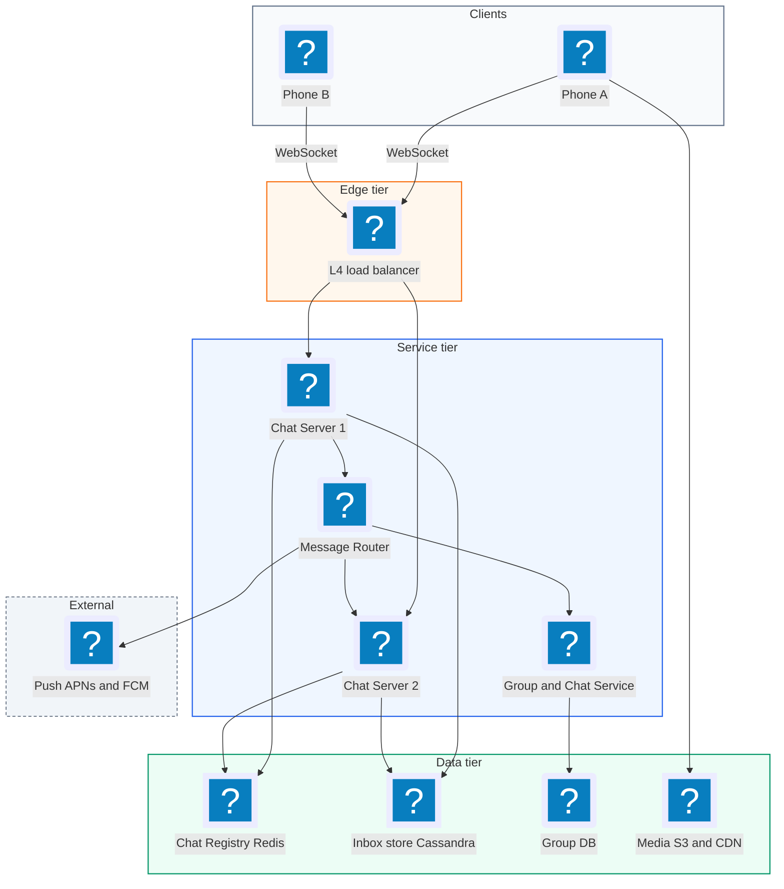
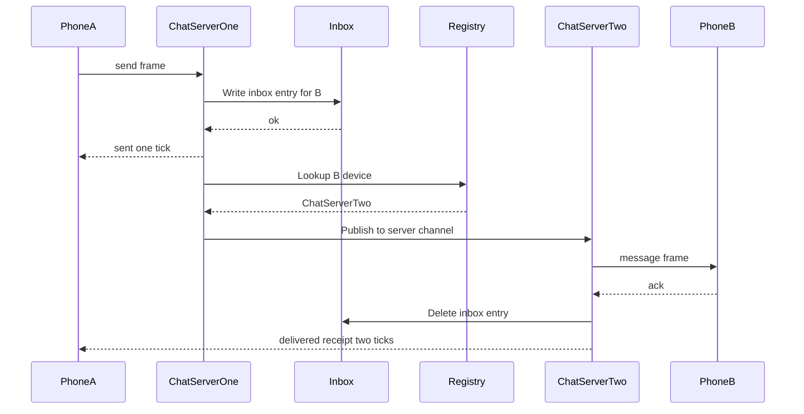
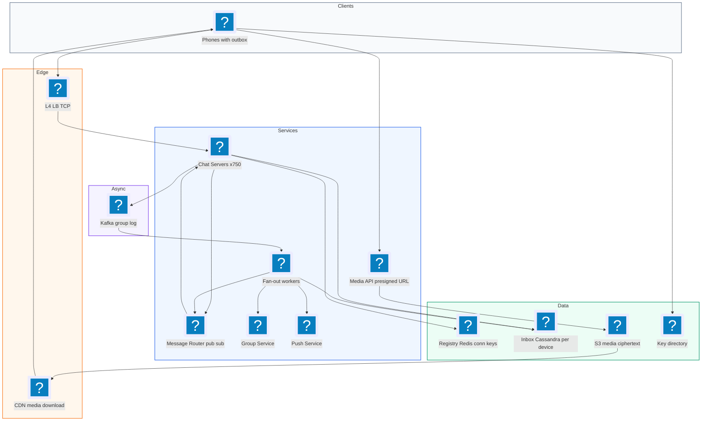

# 10. WhatsApp (1:1 and Group Chat)  (Medium)

> WhatsApp is a messaging app. You can send text and media to one person or to a group of up to about 1,000 people. Messages arrive in real time when the other person is online, and are waiting for them when they come back online. You see one tick when a message is sent, two ticks when it is delivered, and blue ticks when it is read. The interviewer is really testing how you keep millions of live connections open, how you route a message to the right server, how you make sure no message is lost when someone is offline, and how you fan out a message to a group.

## 1. Functional requirements

Core (must have):

1. Users can send and receive 1:1 messages in real time.
2. Users can create a group chat and send messages to all members.
3. Users who were offline receive all missed messages when they reconnect.
4. Users see delivery and read receipts.
5. Users can send media (photos, videos, files).

Below the line (out of scope):

1. Voice and video calls. Real-time media (WebRTC) is a different system.
2. Status / stories. Ephemeral broadcast content.
3. Contact discovery from the phone book. A hashing and lookup problem on its own.
4. Full end-to-end encryption protocol details. We note how it affects the design but do not design the Signal protocol.

## 2. Non-functional requirements

1. Low latency: p99 under 500 ms from send to delivery when both users are online.
2. Guaranteed delivery: a message accepted by the server is never lost, and is delivered at least once. The client removes duplicates, so the user sees it exactly once.
3. Ordering: messages within one chat appear in the order they were sent.
4. Scale: 2B users, 500M concurrently connected, 100B messages per day.
5. Availability: 99.99% for sending. Prefer accepting a message and delivering slightly later over refusing it.
6. Storage: the server is a relay, not an archive. Messages are deleted from the server after delivery (or after 30 days undelivered). History lives on devices.
7. CAP choice: AP for delivery (keep accepting messages during partitions), with per-chat ordering provided by a sequence number from a single owner per chat.

## 3. Back-of-the-envelope estimates

| Assumption | Number |
|---|---|
| Daily active users | 1B |
| Concurrent connections at peak | 500M |
| Messages per day | 100B |
| Average message size (text + metadata) | 200 bytes |
| Share of messages to groups | 30% |
| Average group size | 20 |
| Connections per chat server | 1M (tuned, epoll) |
| Media messages | 5% of messages, 200 KB average |

```text
Message rate:
  100B / 86,400 s ~= 1.16M messages/s average, peak (x2) ~= 2.3M/s

Deliveries (group fan-out):
  70B 1:1 deliveries + 30B group msgs * 20 members = 670B deliveries/day
  ~= 7.8M deliveries/s average

Chat servers:
  500M connections / 1M per server = 500 servers (+50% headroom ~= 750)

Inbox storage (undelivered messages only):
  assume 10% sit undelivered for 1 day on average
  100B * 0.1 * 200 B = 2 TB live in the inbox at any time

Media:
  100B * 5% * 200 KB = 1 PB/day uploaded to blob storage
  (kept 30 days on server -> ~30 PB, served via CDN)

Bandwidth for text:
  7.8M deliveries/s * 200 B ~= 1.6 GB/s
```

The key insights: connections, not storage, dominate the server count, and media is huge, so it must never pass through chat servers.

## 4. Core entities

- User: `user_id`, `phone`, `public_key`, `last_seen`.
- Device / Client: one phone or laptop with its own connection. `device_id`, `user_id`, `push_token`.
- Chat: a 1:1 conversation or group. `chat_id`, `type`, `created_at`.
- ChatParticipant: membership. `chat_id`, `user_id`, `role`.
- Message: `message_id`, `chat_id`, `sender_id`, `seq`, `body` (encrypted), `media_url`, `created_at`.
- Inbox entry: a message waiting for one device. `device_id`, `message_id`.
- Receipt: `message_id`, `user_id`, `status` (delivered or read), `at`.

```sql
-- Cassandra / DynamoDB style tables.
CREATE TABLE inbox (
  device_id  bigint,
  message_id timeuuid,        -- time ordered
  chat_id    bigint,
  sender_id  bigint,
  payload    blob,            -- encrypted body or media pointer
  PRIMARY KEY ((device_id), message_id)
) WITH default_time_to_live = 2592000;   -- 30 days

CREATE TABLE chat_participants (
  chat_id bigint,
  user_id bigint,
  role    text,
  PRIMARY KEY ((chat_id), user_id)
);
```

```json
{
  "type": "message",
  "client_msg_id": "c-7f3a",
  "chat_id": 9001,
  "body": "<ciphertext base64>",
  "media": null
}
```

`client_msg_id` is made by the sender's phone. It lets the server and the receiver drop duplicates when the phone retries.

## 5. API design

Chat uses one long-lived WebSocket per device, because the server must push messages to the client. A WebSocket is a two-way connection that stays open over a single TCP socket. REST is used only for setup and media.

`WS /ws` -- open a connection (auth token in the first frame or header).

Client to server frames:

```json
{ "type": "send", "client_msg_id": "c-7f3a", "chat_id": 9001, "body": "..." }
{ "type": "ack",  "message_ids": ["m-1", "m-2"] }
{ "type": "read", "chat_id": 9001, "up_to_seq": 512 }
```

Server to client frames:

```json
{ "type": "sent",     "client_msg_id": "c-7f3a", "message_id": "m-9", "seq": 513 }
{ "type": "message",  "message_id": "m-9", "chat_id": 9001, "sender": 42,
  "seq": 513, "body": "..." }
{ "type": "receipt",  "message_id": "m-9", "status": "read", "by": 77 }
```

`POST /chats` -- create a group.

```json
// request
{ "name": "Family", "members": [42, 77, 88] }
// response 201
{ "chat_id": 9001 }
```

`POST /chats/{chat_id}/members` and `DELETE /chats/{chat_id}/members/{user_id}` -- manage group members. Status codes 200, 403 not an admin, 404 not found.

`POST /media/upload-url` -- get a presigned upload URL.

```json
// request
{ "content_type": "image/jpeg", "size": 2400000 }
// response 200
{ "upload_url": "https://media.s3.../abc?X-Amz-Signature=...",
  "media_id": "abc", "expires_in": 600 }
```

All endpoints require a device auth token.

## 6. High-level design



### How will users send a 1:1 message?

1. Phone A sends a `send` frame over its WebSocket to Chat Server 1.
2. Chat Server 1 assigns a `message_id` and the next `seq` for this chat, and writes the message to B's inbox in Cassandra. This write is what makes it durable.
3. It sends `sent` back to A (one tick).
4. It looks up B's device in the Chat Registry: "B is on Chat Server 2."
5. It publishes the message to Chat Server 2's channel. Chat Server 2 pushes it down B's WebSocket.
6. B's phone replies with `ack`. Chat Server 2 deletes the inbox entry and sends a `delivered` receipt back to A (two ticks).



### How will users receive messages sent while they were offline?

1. While B is offline, step 4 finds no live connection. The message stays in B's inbox, and a push notification is sent through APNs or FCM.
2. When B reconnects, the chat server registers B in the registry, then reads B's inbox in `message_id` order and streams it down.
3. B acks in batches; acked entries are deleted.

### How will users send a group message?

1. A sends to `chat_id` 9001.
2. The chat server asks the Group Service for the member list (cached).
3. It writes one inbox entry per member device, then routes to each online member's chat server (see deep dive).

### How will users see delivery and read receipts?

1. Receipts are just small messages flowing the other way: B's device sends `ack` (delivered) and `read`.
2. They are routed back to A the same way as a message, and stored in A's inbox if A is offline.

### How will users send media?

1. A asks for a presigned upload URL and uploads the file directly to blob storage.
2. A sends a normal message whose payload contains the `media_id` (and the encryption key, inside the encrypted body).
3. B downloads the file directly from the CDN.

## 7. Deep dives

### How do we manage millions of WebSocket connections and route to the right server?

The problem: 500M devices are each connected to one of about 750 chat servers. When A on server 1 messages B, server 1 needs to find B's server fast, and connections drop and move all the time.

| Option | How | Trade-off |
|---|---|---|
| Broadcast to all servers | Every server checks if it holds B | 750x wasted work, does not scale |
| Consistent hash user to server | Load balancer sends B always to one server | Rebalancing moves many users, hot servers |
| Central registry plus pub/sub (recommended) | Redis map `device -> server`, per-server channel | One extra lookup, registry must be highly available |

Recommended: a Chat Registry. When a device connects, its server writes `conn:{device_id} = server_id` with a short TTL, and refreshes it with each heartbeat (a small ping every 30 seconds). To deliver, look up the server and publish to that server's channel. Each chat server subscribes to its own channel only.

```python
HEARTBEAT_TTL = 90  # seconds, 3 missed pings = gone

def on_connect(device_id, ws):
    local_conns[device_id] = ws
    redis.set(f"conn:{device_id}", SERVER_ID, ex=HEARTBEAT_TTL)
    drain_inbox(device_id, ws)

def on_heartbeat(device_id):
    redis.expire(f"conn:{device_id}", HEARTBEAT_TTL)

def on_disconnect(device_id):
    local_conns.pop(device_id, None)
    # Only delete if it still points at us (device may have reconnected elsewhere).
    redis.eval("if redis.call('GET',KEYS[1])==ARGV[1] then "
               "return redis.call('DEL',KEYS[1]) end return 0",
               1, f"conn:{device_id}", SERVER_ID)

def deliver(device_id, msg):
    server = redis.get(f"conn:{device_id}")
    if server is None:
        push_notify(device_id, msg)       # offline; inbox already has it
    else:
        redis.publish(f"server:{server.decode()}", json.dumps(
            {"device_id": device_id, "msg": msg}))
```

Tuning tips worth saying: use an event loop (epoll / Erlang VM; WhatsApp famously ran on Erlang with very high connections per box), small per-connection buffers, and an L4 (TCP) load balancer so sockets are not terminated twice. When deploying, drain servers slowly so clients reconnect in waves, not all at once.

### How do we guarantee delivery when the user is offline?

The problem: the receiver may be offline, the network may drop the frame, or a chat server may crash after accepting a message. The message must still arrive, exactly once from the user's point of view.

| Option | Durability | Cost | Notes |
|---|---|---|---|
| Keep undelivered messages in chat server memory | Lost on crash | Cheap | Not acceptable |
| Store every message forever in a chat history DB | Durable | Huge storage | Not needed; WhatsApp keeps history on devices |
| Per-device inbox, delete on ack (recommended) | Durable until delivered | ~2 TB live | Simple, matches "relay" model |

Recommended: write to the inbox before acknowledging the sender. Deliver at least once, and let the receiver drop duplicates by `message_id`.

```text
 A          Chat Srv 1        Inbox (Cassandra)     Chat Srv 2        B
 |--send---->|                     |                    |             |
 |           |---write entry------>|                    |             |
 |<--sent----| (1 tick, durable)   |                    |             |
 |           |---publish------------------------------->|---message-->|
 |           |                     |                    |<----ack-----|
 |           |                     |<---delete entry----|             |
 |<-----------------delivered receipt (2 ticks)---------|             |
```

Rules that make it correct:

- The sender keeps the message in its local outbox until it gets `sent`. On reconnect it resends with the same `client_msg_id`; the server checks a short-lived dedupe cache and returns the original `message_id`.
- The receiver keeps a set of recent `message_id`s and ignores repeats.
- Inbox rows have a 30-day TTL, so a phone that never comes back does not keep data forever.
- Ordering inside a chat uses `seq`. The receiver shows messages sorted by `seq`, and can ask for a gap to be resent.

### How do we fan out group messages?

The problem: a message to a 1,000-member group means 1,000 inbox writes and up to 1,000 routed deliveries. With 30B group messages a day, fan-out is most of our write load.

| Option | Write cost | Read cost | Notes |
|---|---|---|---|
| Fan-out on write to each member's inbox (recommended for groups up to ~1k) | N writes | 1 read per device | Simple; matches the 1:1 path |
| Store once per group, members pull | 1 write | Each device must check every group | Complex offline sync and receipts |
| Hybrid for very large broadcast channels | Store once, pull | Fine for read-mostly channels | Use for "channels" with 100k+ followers |

Recommended: fan-out on write, because WhatsApp caps group size (about 1,024), so the worst case is bounded. Do it asynchronously so the sender gets `sent` after one durable write:

1. Write the message once to a `group_messages` log (Kafka topic partitioned by `chat_id`, which also keeps per-group order).
2. Return `sent` to the sender.
3. Fan-out workers read the log, write one inbox entry per member device, and route to online members, grouping deliveries by destination chat server so one publish carries many devices.

```python
def fanout_group_message(msg):
    members = group_cache.members(msg["chat_id"])   # ~20 avg, <= 1024
    by_server = defaultdict(list)
    batch = cassandra_batch()
    for device_id in devices_of(members):
        if device_id == msg["sender_device"]:
            continue
        batch.insert_inbox(device_id, msg)
        server = registry.get(device_id)
        if server:
            by_server[server].append(device_id)
        else:
            push_queue.put(device_id, msg)
    batch.execute()
    for server, devices in by_server.items():
        pubsub.publish(f"server:{server}", {"devices": devices, "msg": msg})
```

With end-to-end encryption, the sender actually encrypts the message key for each member (Signal "sender keys" make this cheap for groups), but the server's fan-out shape is the same.

### How do delivery and read receipts work at scale?

The problem: every message creates up to two receipts per recipient. In a 500-member group that is 1,000 receipts for one message. Receipts can overwhelm the system if treated like full messages.

| Option | Volume | Notes |
|---|---|---|
| One receipt per message per recipient | Highest | Simple but noisy |
| Cumulative "read up to seq N" per chat (recommended) | One per chat open | Matches how people read |
| Batch acks every few hundred ms (recommended) | Lower | Small delay, big saving |

Recommended: receipts are cumulative and batched. When B opens the chat, B sends one `read up_to_seq 512` frame, which covers all earlier messages. Delivered acks are batched every 200 ms. For large groups, the sender's phone stores per-member state but the server sends aggregated receipts, and only on demand ("message info" screen) shows the full list. Receipts are best-effort: if one is lost, the next cumulative receipt fixes the state.

### How do we send media without overloading chat servers?

The problem: media is about 1 PB a day. If 200 KB files flow through WebSocket servers, those servers become bandwidth bottlenecks and their connection count collapses.

| Option | Chat server load | Notes |
|---|---|---|
| Send bytes over the WebSocket | Very high | Blocks other messages on the same socket |
| Upload to our API servers, then to storage | High | Double hop |
| Presigned URL straight to blob storage, CDN for download (recommended) | None | Chat message carries only a pointer |

A presigned URL is a temporary URL signed by the server that lets the client upload one object directly to S3 for a few minutes, without having storage credentials.

```python
def create_upload_url(user_id, content_type, size):
    if size > 2 * 1024**3:
        raise ValueError("file too large")
    media_id = uuid4().hex
    url = s3.generate_presigned_url(
        "put_object",
        Params={"Bucket": "wa-media", "Key": f"{media_id}",
                "ContentType": content_type},
        ExpiresIn=600)
    return {"upload_url": url, "media_id": media_id}
```

With end-to-end encryption, the phone encrypts the file with a random key before upload. The server stores only ciphertext, and the key travels inside the encrypted chat message. Set a lifecycle rule on the bucket to delete objects after 30 days.

### What about end-to-end encryption and failures?

End-to-end encryption (E2E) means only the sender and receiver devices can read the message. WhatsApp uses the Signal protocol. Effects on our design:

- The server cannot read, search, or filter content. It routes opaque blobs.
- Each device has its own keys, so a message to a user with a phone and a laptop is encrypted and delivered once per device. This is why the inbox is per device, not per user.
- The server stores public keys (a key directory) so senders can start a session with a new contact.

| Failure | Mitigation |
|---|---|
| Chat server crashes | Clients reconnect to another server via the load balancer; registry entry expires or is overwritten; inbox replays anything not acked |
| Registry (Redis) node fails | Replicas; on miss, treat device as offline: message is still in the inbox and a push is sent |
| Cassandra replica down | Write with quorum across 3 replicas; one node loss is invisible |
| Push provider slow | Push is best-effort; the inbox is the source of truth |
| Network flapping on phone | Exponential backoff with jitter on reconnect to avoid a thundering herd |

## 8. Final architecture



| Component | Job | Technology example |
|---|---|---|
| L4 load balancer | Spread TCP/WebSocket connections | AWS NLB, HAProxy |
| Chat servers | Hold connections, accept and push frames | Erlang/Elixir, Go, Netty |
| Chat Registry | Map device to server with TTL | Redis Cluster |
| Message router | Server-to-server delivery | Redis pub/sub, NATS |
| Inbox | Durable undelivered messages per device | Cassandra, DynamoDB |
| Group Service | Membership, admins | MySQL + cache |
| Group log + fan-out | Ordered group messages, async fan-out | Kafka + workers |
| Push Service | Wake offline phones | APNs, FCM |
| Media | Direct upload and download | S3 presigned URLs + CloudFront |
| Key directory | Public keys for E2E | Replicated KV store |

### Deployment map (AWS)

```mermaid
architecture-beta
    group internet(mdi:earth)[Internet]
    group edge(logos:aws-cloudfront)[Edge]
    group vpc(logos:aws-vpc)[AWS VPC]
    group app(logos:aws-ecs)[Service subnet] in vpc
    group data(logos:aws-rds)[Data subnet] in vpc

    service p(mdi:cellphone)[Phones with outbox] in internet
    service lb(logos:aws-elastic-load-balancing)[L4 LB TCP] in edge
    service cdn(logos:aws-cloudfront)[CDN media download] in edge
    service cs(logos:aws-ec2)[Chat Servers x750] in app
    service mr(logos:aws-elasticache)[Message Router pub sub] in app
    service fw(logos:aws-ecs)[Fan out workers] in app
    service reg(logos:aws-elasticache)[Registry Redis conn keys] in data
    service inb(logos:aws-dynamodb)[Inbox per device] in data
    service s3(logos:aws-s3)[S3 media ciphertext] in data
    service k(logos:kafka-icon)[Kafka group log] in data

    p:R --> L:lb
    lb:B --> T:cs
    cs:B --> T:reg
    cs:R --> L:mr
    cs:B --> T:inb
    cs:B --> T:k
    k:R --> L:fw
    fw:B --> T:inb
    fw:T --> B:mr
    p:B --> T:s3
    s3:R --> L:cdn
    cdn:L --> R:p
```



Long lived WebSockets terminate on chat servers behind an L4 load balancer, the registry, per device inbox and group log sit in the data subnet, and media bypasses the chat path entirely through S3 and the CDN.

## 9. Common mistakes and interviewer follow-ups

- Sending messages through REST polling. Wastes battery and adds seconds of latency. Say: "one WebSocket per device, push from server, push notification when offline."
- Acknowledging the sender before the message is durable. A crash loses it. Say: "write to the inbox first, then send the single tick."
- Broadcasting every message to every chat server. Does not scale past a few servers. Say: "registry lookup plus per-server pub/sub channel."
- Inbox per user instead of per device. With multiple devices and E2E keys, one device would steal the others' messages. Say: "inbox per device."
- Pushing media through chat servers. Kills their bandwidth. Say: "presigned upload to S3, pointer in the message, CDN download."
- Expecting exactly-once from the network. Say: "at-least-once delivery plus dedupe by `client_msg_id` and `message_id`."
- Follow-up: "How do you keep message order?" Per-chat `seq` assigned by one owner (the Kafka partition for the chat, or a per-chat counter), and the client sorts by `seq`.
- Follow-up: "What about last seen / online status?" Derived from the registry and heartbeats; send presence only to contacts who have the chat open, to avoid a storm of updates.

## 10. One-page cheat sheet

| Topic | Key point |
|---|---|
| Scale | 100B msgs/day, ~2.3M msgs/s peak, 500M live connections |
| Servers | ~1M connections per chat server, ~750 servers |
| Transport | WebSocket per device, heartbeat every 30 s |
| Routing | Redis registry `conn:{device}` with TTL + per-server pub/sub |
| Durability | Write per-device inbox before ack, delete on receiver ack |
| Delivery semantics | At-least-once, dedupe by client_msg_id / message_id |
| Ordering | Per-chat seq number |
| Groups | Fan-out on write via Kafka (cap ~1k members) |
| Receipts | Cumulative "read up to seq", batched acks |
| Media | Presigned S3 URL, CDN, client-side encrypted, 30-day TTL |
| E2E | Server sees ciphertext only, keys per device |
| CAP | AP: accept and store, deliver when possible |

## Sources

- [Hello Interview: Design WhatsApp](https://www.hellointerview.com/learn/system-design/problem-breakdowns/whatsapp)
- [High Scalability: The WhatsApp Architecture Facebook Bought for $19 Billion](http://highscalability.com/blog/2014/2/26/the-whatsapp-architecture-facebook-bought-for-19-billion.html)
- [WhatsApp Encryption Overview (technical white paper)](https://www.whatsapp.com/security/WhatsApp-Security-Whitepaper.pdf)
- [Signal: The Double Ratchet Algorithm](https://signal.org/docs/specifications/doubleratchet/)
- [AWS docs: Sharing objects with presigned URLs](https://docs.aws.amazon.com/AmazonS3/latest/userguide/ShareObjectPreSignedURL.html)
- [MDN: The WebSocket API](https://developer.mozilla.org/en-US/docs/Web/API/WebSockets_API)
