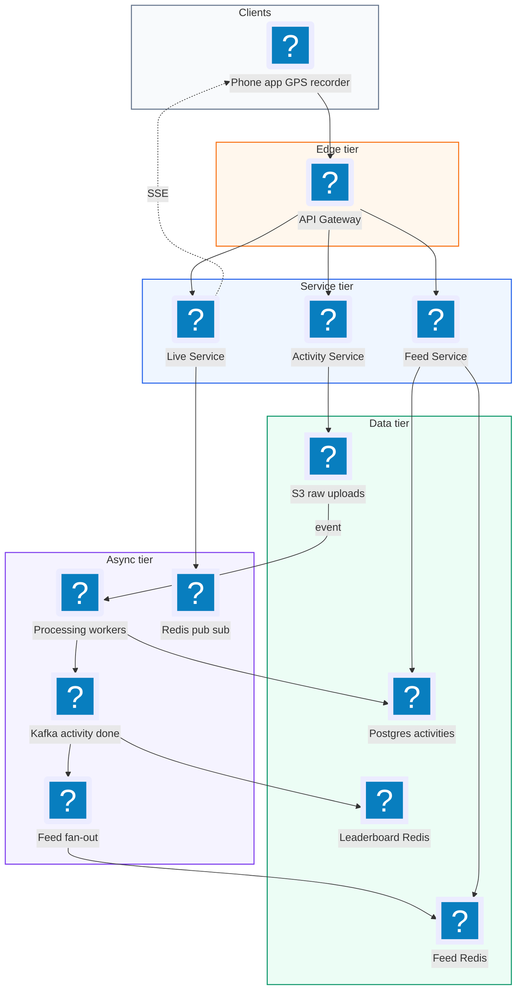
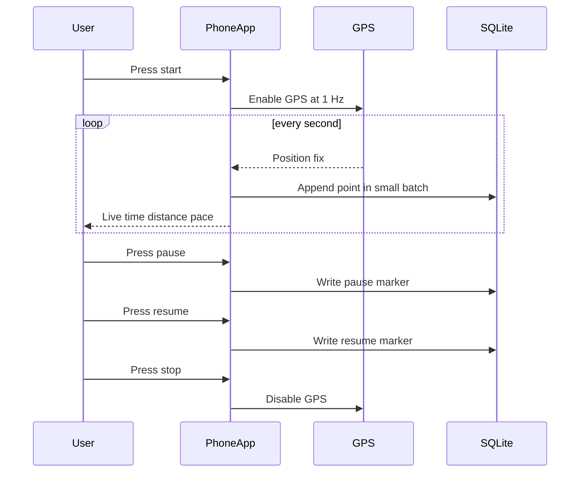
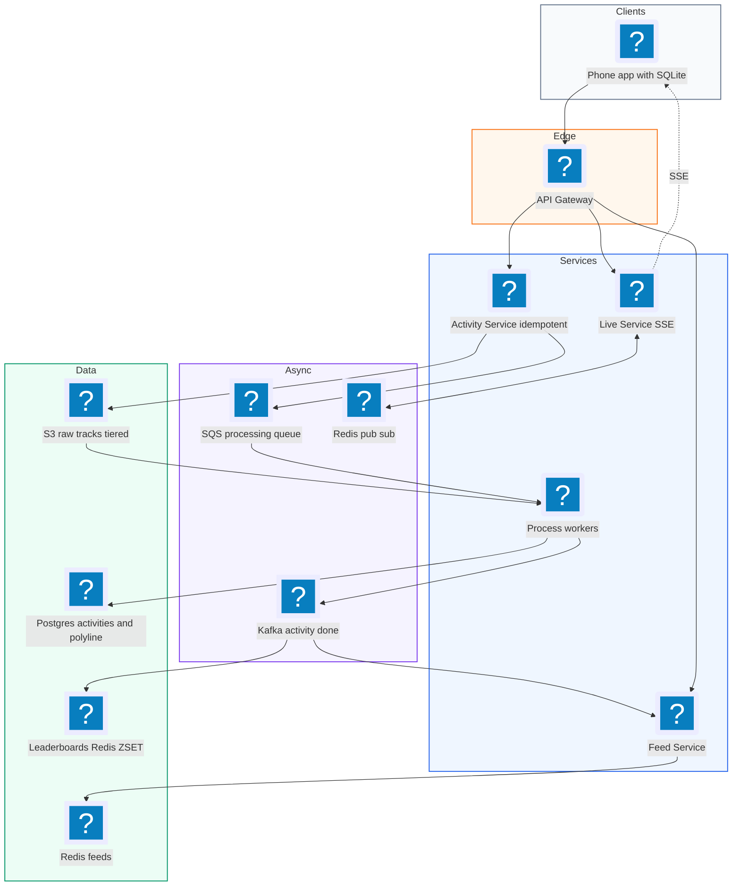

# 11. Strava (Activity Tracking with GPS)  (Medium)

> Strava is an app for runners and cyclists. You press start, go for a run or ride, and the phone records your GPS position every second or so. When you finish, the app shows your route on a map, your distance, pace, and elevation, and shares the activity with your friends. You can see friends' activities in a feed and compare times on popular stretches of road on leaderboards. The interviewer is really testing how you collect location data on a phone that may have no signal, how you store billions of GPS points efficiently, how you compute stats and leaderboards, and how you let friends follow you live.

## 1. Functional requirements

Core (must have):

1. Users can start, pause, resume, and stop recording an activity (run or ride).
2. While recording, users see live stats: elapsed time, distance, current pace.
3. Users can save an activity and view it later with its route on a map and summary stats.
4. Users can see a feed of their friends' recent activities.
5. Users can share their activity in real time so selected friends can follow along live.

Below the line (out of scope):

1. Segments with full leaderboards for every stretch of road. We cover a simplified leaderboard, since full segment matching is a geometry project.
2. Training plans, social clubs, challenges. Product features on top of the same data.
3. Wearable device sync (Garmin, Apple Watch). Same upload path, different client.
4. Routing and route suggestions. A maps problem.

## 2. Non-functional requirements

1. Offline first: recording must work with no network for hours, with no data loss. The phone is the source of truth during an activity.
2. Low battery use: sample GPS at about 1 point per second and batch network uploads.
3. Live tracking latency: friends see a position within 10 seconds when the athlete has signal.
4. Upload processing: a finished activity's stats and map are ready within 30 seconds of upload.
5. Scale: 10M daily active users, 10M activities per day, peak on weekend mornings.
6. Availability: 99.9% for upload and viewing. An upload that fails must be retried safely (idempotent).
7. Consistency: eventual for feeds and leaderboards (seconds to a minute is fine). Strong for "my activity was saved".
8. CAP choice: AP. Accept uploads and show slightly stale feeds rather than fail.

## 3. Back-of-the-envelope estimates

| Assumption | Number |
|---|---|
| Daily active users | 10M |
| Activities per day | 10M |
| Average activity length | 1 hour |
| GPS sample rate | 1 point per second |
| Raw point size (lat, lng, ele, time, accuracy) | ~32 bytes |
| Compressed point size (delta + varint) | ~6 bytes |
| Feed views per user per day | 5 |
| Users live sharing at peak | 1% of 2M concurrent = 20k |

```text
GPS points:
  1 hour * 3,600 points = 3,600 points per activity
  10M activities * 3,600 = 36B points/day

Raw storage:
  36B * 32 B ~= 1.15 TB/day -> ~420 TB/year

Compressed storage:
  36B * 6 B ~= 216 GB/day -> ~80 TB/year (about 5x smaller)

Activity uploads:
  10M / 86,400 ~= 115 uploads/s average
  weekend morning peak (x5) ~= 600 uploads/s
  each upload ~ 3,600 * 6 B ~= 22 KB compressed

Feed reads:
  10M * 5 = 50M/day ~= 580 reads/s, peak ~= 3,000/s

Live tracking:
  20k live athletes, 1 batch every 5 s = 4,000 location writes/s
  each viewed by ~3 friends = 12,000 pushes/s
```

The key insight: GPS points are the bulk of the data, and compressing them gives a 5x saving. Uploads themselves are not high QPS, so the hard parts are offline capture, storage format, and fan-out.

## 4. Core entities

- User / Athlete: `user_id`, `name`, `privacy` settings.
- Friendship / Follow: `follower_id`, `followee_id`.
- Activity: one run or ride. `activity_id`, `user_id`, `type`, `start_time`, `duration_s`, `distance_m`, `elevation_gain_m`, `avg_pace`, `route_uri`, `polyline` (small simplified route for maps).
- Route / Track: the full list of GPS points for an activity, stored as a compressed blob.
- Live session: an in-progress shared activity. `session_id`, `user_id`, `last_point`, `viewers`.
- Leaderboard entry: best time per user per segment or per weekly distance.

```sql
CREATE TABLE activities (
  activity_id      BIGINT PRIMARY KEY,
  user_id          BIGINT NOT NULL,
  client_id        UUID NOT NULL,          -- made on phone, for idempotency
  type             TEXT NOT NULL,          -- run | ride
  start_time       TIMESTAMPTZ NOT NULL,
  duration_s       INT,
  distance_m       INT,
  elevation_gain_m INT,
  polyline         TEXT,                   -- simplified route, ~1-2 KB
  route_uri        TEXT,                   -- s3://tracks/...
  UNIQUE (user_id, client_id)
);
CREATE INDEX activities_by_user ON activities (user_id, start_time DESC);
```

```json
{
  "client_id": "5f1c...",
  "type": "run",
  "points": [
    { "t": 1730620800, "lat": 37.77490, "lng": -122.41940, "ele": 16.2 },
    { "t": 1730620801, "lat": 37.77492, "lng": -122.41936, "ele": 16.3 }
  ]
}
```

## 5. API design

`POST /activities` -- upload a finished activity (sent as a compressed file).

```json
// request: multipart with metadata + gzip or FIT/GPX file
{ "client_id": "5f1c...", "type": "run", "start_time": "2026-11-01T07:00:00Z" }
// response 202
{ "activity_id": "88812", "status": "processing" }
```

Status codes: 202 accepted, 200 if the same `client_id` was already uploaded (returns the existing ID), 400 bad file, 413 too large.

`GET /activities/{activity_id}` -- view an activity: stats, polyline, splits.

```json
{ "activity_id": "88812", "type": "run", "distance_m": 10012,
  "duration_s": 2950, "avg_pace_s_per_km": 295,
  "polyline": "a~l~Fjk~uOwHJy@P", "splits": [298, 294, 293] }
```

`GET /feed?cursor=...` -- friends' recent activities, newest first, cursor paginated.

`POST /live-sessions` -- start sharing live. Returns `session_id`.
`POST /live-sessions/{session_id}/points` -- send a batch of recent points.

```json
{ "points": [ { "t": 1730620805, "lat": 37.7750, "lng": -122.4190 } ] }
```

`GET /live-sessions/{session_id}/stream` -- Server-Sent Events (a one-way stream from server to browser over HTTP) of positions for an allowed viewer.

All endpoints need a bearer token. Live viewers must be on the athlete's allow list.

## 6. High-level design



### How will users record an activity?

1. User presses start. The app turns on GPS at 1 Hz and writes every point to a local database on the phone (SQLite).
2. The app computes live stats on the phone from those points: elapsed time, distance, pace. No server is involved, so it works with no signal.
3. Pause and resume just write marker events into the same local log.



### How will users save and view an activity?

1. On stop, the app compresses the points and calls `POST /activities` with a `client_id` it generated at start.
2. Activity Service stores the raw file in S3, creates an `activities` row with status `processing`, and emits an event.
3. Processing workers parse the file, clean noisy points, compute distance, elevation gain, splits, and a simplified polyline, then update the row.
4. When the user opens the activity, `GET /activities/{id}` returns stats and the polyline from Postgres; the map draws the polyline.

### How will users see their friends' activities?

1. When processing finishes, an `activity-done` event goes to Kafka.
2. A feed fan-out worker adds the activity ID to each follower's feed list in Redis (most athletes have few followers; pros are pulled at read time).
3. `GET /feed` reads the list, hydrates activity summaries, and returns a page with a cursor.

### How will users share an activity live?

1. The athlete starts a live session. Every 5 seconds, when there is signal, the app posts a small batch of points.
2. Live Service stores the latest point in Redis and publishes to the session's channel.
3. Friends watching hold an SSE connection to a Live Service node subscribed to that channel and receive positions as they arrive.

## 7. Deep dives

### How do we record reliably when the phone is offline?

The problem: runners go through tunnels, forests, and mountains. The network can be gone for the whole activity. The app may also be killed by the OS to save memory, or the phone may die.

| Option | Data safety | Battery | Notes |
|---|---|---|---|
| Stream every point to the server | Lost with no signal | Poor, radio always on | Not acceptable |
| Keep points in memory, upload at end | Lost if app is killed | Good | Risky |
| Write-ahead to local DB, upload on finish with retries (recommended) | Survives kill and reboot | Good | The phone is the source of truth |

Recommended: append each point to a local SQLite table in small transactions (every 5-10 points), so a crash loses at most a few seconds. Upload when finished, and keep the local copy until the server confirms. The `client_id` makes retries safe: uploading twice returns the same activity.

```python
# Pseudocode for the phone-side recorder and upload queue.
def on_gps_fix(fix):
    if fix.accuracy_m > 30:
        return                          # drop very noisy fixes
    buffer.append((fix.t, fix.lat, fix.lng, fix.ele))
    if len(buffer) >= 10:
        db.executemany("INSERT INTO points VALUES (?,?,?,?,?)",
                       [(activity_id, *p) for p in buffer])
        db.commit()
        buffer.clear()

def upload_pending():
    for act in db.query("SELECT * FROM activities WHERE uploaded = 0"):
        try:
            resp = api.post("/activities", client_id=act.client_id,
                            file=compress(load_points(act.id)))
            if resp.status in (200, 202):
                db.execute("UPDATE activities SET uploaded=1 WHERE id=?",
                           (act.id,))
        except NetworkError:
            schedule_retry(backoff_with_jitter())
```

On the server, idempotency is a unique constraint:

```sql
INSERT INTO activities (activity_id, user_id, client_id, type, start_time)
VALUES (:id, :uid, :cid, :type, :start)
ON CONFLICT (user_id, client_id) DO NOTHING
RETURNING activity_id;
```

If nothing is returned, look up and return the existing ID with 200.

### How do we store GPS routes efficiently?

The problem: 36B points a day. Storing each point as a database row would mean 36B rows a day and very slow queries. And most screens only need a rough shape of the route.

| Option | Size per activity | Query pattern | Notes |
|---|---|---|---|
| One DB row per point | ~3,600 rows, ~200 KB with indexes | Slow, huge tables | Avoid |
| Time-series DB (TimescaleDB, InfluxDB) | Medium | Good for range queries | Overkill: we read a route as a whole |
| Compressed blob in S3 + simplified polyline in DB (recommended) | ~22 KB blob + ~1.5 KB polyline | Read whole route at once | Cheap, simple |

Recommended: two forms of each route.

1. Full track: delta-encode points (store the difference from the previous point, which is tiny), pack as variable-length integers, gzip, and store in S3. About 6 bytes per point.
2. Display polyline: simplify the route with the Ramer-Douglas-Peucker algorithm (drop points that lie almost on a straight line), then encode with the Google polyline format. A 3,600 point run becomes about 200-400 points, about 1.5 KB, stored directly in the `activities` row. Map screens and feed cards only ever load this.

```python
def delta_encode(points, scale=1e5):
    # points: list of (t, lat, lng). Returns small ints, easy to compress.
    out, prev = [], (0, 0, 0)
    for t, lat, lng in points:
        cur = (int(t), round(lat * scale), round(lng * scale))
        out.append(tuple(c - p for c, p in zip(cur, prev)))
        prev = cur
    return out   # mostly values like (1, 2, -3) -> 1 byte each as varints

def rdp(points, eps):
    # Ramer-Douglas-Peucker: keep points that bend the line more than eps.
    if len(points) < 3:
        return points
    a, b = points[0], points[-1]
    idx, dmax = 0, 0.0
    for i in range(1, len(points) - 1):
        d = perpendicular_distance(points[i], a, b)
        if d > dmax:
            idx, dmax = i, d
    if dmax <= eps:
        return [a, b]
    return rdp(points[:idx + 1], eps)[:-1] + rdp(points[idx:], eps)
```

Move tracks older than a year to a cheaper storage class (S3 Infrequent Access or Glacier Instant Retrieval). Users rarely reopen old runs.

### How do we compute activity stats and leaderboards?

The problem: raw GPS is noisy. A naive sum of distances between points overstates distance by several percent because the points jitter. Leaderboards must be correct and fast to read.

Stats pipeline in the processing worker:

1. Filter points with bad accuracy and impossible speeds (for example, a run faster than 12 m/s).
2. Smooth with a small moving average or Kalman filter (a filter that blends a predicted position with the measured one).
3. Distance: sum of haversine distances (the great-circle distance on a sphere) between smoothed points, skipping paused spans.
4. Elevation gain: use a digital elevation model lookup instead of phone GPS altitude, which is noisy.

```python
from math import radians, sin, cos, asin, sqrt

def haversine_m(lat1, lng1, lat2, lng2):
    r = 6_371_000
    p1, p2 = radians(lat1), radians(lat2)
    dp, dl = p2 - p1, radians(lng2 - lng1)
    h = sin(dp / 2) ** 2 + cos(p1) * cos(p2) * sin(dl / 2) ** 2
    return 2 * r * asin(sqrt(h))
```

Leaderboards:

| Option | Read speed | Freshness | Notes |
|---|---|---|---|
| SQL `ORDER BY` over all efforts | Slow at scale | Fresh | Fine for small segments |
| Nightly batch | Fast | Up to a day stale | Users expect to see their PR now |
| Redis sorted set per leaderboard, updated on activity-done (recommended) | O(log n) | Seconds | Rebuildable from Postgres |

Recommended: keep two kinds of board in Redis sorted sets. Weekly distance per club or among friends (`ZINCRBY lb:week:2026-45:club:7 10012 user_123`), and best time per segment (`ZADD lb:seg:991 LT 2950 user_123`, where `LT` only updates if the new time is lower). Segment matching itself (does this route pass over segment 991?) runs in the processing worker: index segments by geohash, find candidate segments whose cells the route touches, then check start and end points are passed in order.

### How does the friends feed work?

The problem: show friends' recent activities, newest first, for 3,000 reads/s at peak. Most users have 50-500 followers; some pro athletes have millions.

| Option | Read cost | Write cost | Fit |
|---|---|---|---|
| Fan-out on read | Query N friends, merge | 1 | OK for few friends, slow beyond |
| Fan-out on write | One Redis read | 1 write per follower | Good for typical users |
| Hybrid (recommended) | One read + merge a few pros | Bounded | Handles pros with millions of followers |

Recommended: the same hybrid as a social feed. On `activity-done`, push the activity ID into each follower's Redis sorted set `feed:{uid}` (score = start time), unless the athlete has more than 50k followers. Those pro accounts are pulled at read time and merged. Respect privacy at write time: if an activity is "only me" or "followers only", fan out only to the allowed set. Use a cursor on `(start_time, activity_id)` for pages. Feed cards render from the stored polyline and summary, so no S3 reads are needed.

### How does real-time sharing work, and what happens on failure?

The problem: 20k athletes stream positions every 5 seconds, each watched by a few friends on different servers. Signal is patchy, so updates arrive late or in bursts.

| Option | Latency | Server cost | Notes |
|---|---|---|---|
| Viewers poll every 5 s | 0-5 s extra | Many empty requests | Simple fallback |
| WebSockets both ways | Lowest | Stateful connections | Overkill: viewers only receive |
| Athlete posts batches, viewers on SSE fed by Redis pub/sub (recommended) | Seconds | Light | SSE reconnects automatically |

```text
 athlete phone --POST batch (every 5 s)--> Live Service A
                                             | SET live:{sid}:last
                                             | PUBLISH live:{sid}
                                             v
                                       Redis pub/sub
                                             |
                     +-----------------------+---------------+
                     v                                       v
              Live Service B (SSE)                   Live Service C (SSE)
                     |                                       |
                  friend 1                               friend 2
```

When a viewer connects, the server first sends `live:{sid}:last` (and the last few minutes of trail from a capped Redis list), then streams new points. When the athlete loses signal, the app buffers and sends the backlog on reconnect; the server forwards points with their original timestamps so the viewer's map fills in the gap. Live points are short-lived (TTL of a few hours); the full activity still arrives through the normal upload.

Failure handling summary:

| Failure | Mitigation |
|---|---|
| Upload fails mid-way | Retry with the same `client_id`; S3 multipart upload resumes |
| Processing worker crashes | Event is redelivered; processing is idempotent (overwrites the same row) |
| Bad GPS data (spikes, teleporting) | Accuracy and speed filters before stats |
| Redis feed or leaderboard lost | Rebuild from Postgres; feed falls back to fan-out on read |
| Live Service node dies | SSE clients reconnect to another node and re-fetch last point |

## 8. Final architecture



| Component | Job | Technology example |
|---|---|---|
| Phone recorder | Capture GPS, local WAL, live stats | iOS/Android, SQLite |
| API Gateway | Auth, rate limits | Envoy, AWS API Gateway |
| Activity Service | Accept uploads idempotently | Stateless service |
| Raw track storage | Compressed full tracks | S3 with lifecycle tiers |
| Processing workers | Clean, stats, polyline, segment match | Queue consumers (SQS/Kafka) |
| Activity DB | Summaries and polylines | Postgres (sharded by user) |
| Event bus | activity-done events | Kafka |
| Feed Service | Hybrid fan-out, cursor paging | Redis sorted sets |
| Leaderboards | Weekly and segment boards | Redis sorted sets |
| Live Service | Live positions to viewers | SSE + Redis pub/sub |

### Deployment map (AWS)

```mermaid
architecture-beta
    group internet(mdi:earth)[Internet]
    group edge(logos:aws-cloudfront)[Edge]
    group vpc(logos:aws-vpc)[AWS VPC]
    group app(logos:aws-ecs)[Service subnet] in vpc
    group data(logos:aws-rds)[Data subnet] in vpc

    service p(mdi:cellphone)[Phone app with SQLite] in internet
    service gw(logos:aws-api-gateway)[API Gateway] in edge
    service act(logos:aws-ecs)[Activity Service] in app
    service pw(logos:aws-lambda)[Process workers] in app
    service fs(logos:aws-ecs)[Feed Service] in app
    service ls(logos:aws-ecs)[Live Service SSE] in app
    service s3(logos:aws-s3)[S3 raw tracks tiered] in data
    service pg(logos:aws-rds)[Postgres activities] in data
    service fr(logos:aws-elasticache)[Redis feeds] in data
    service rp(logos:aws-elasticache)[Redis pub sub] in data

    p:R --> L:gw
    gw:B --> T:act
    act:B --> T:s3
    s3:R --> L:pw
    pw:B --> T:pg
    gw:B --> T:fs
    fs:B --> T:fr
    gw:B --> T:ls
    ls:B --> T:rp
    ls:L --> R:p
```



Uploads land in S3 and are processed by workers in the service subnet, while the feed and live services read from their own Redis clusters next to Postgres in the data subnet.

## 9. Common mistakes and interviewer follow-ups

- Streaming every GPS point to the server live. Fails with no signal and drains the battery. Say: "phone is the source of truth, local write-ahead log, upload on finish."
- Non-idempotent uploads. Retries create duplicate runs. Say: "client-generated `client_id` with a unique constraint."
- One database row per GPS point. Billions of rows a day. Say: "compressed blob in S3 plus a simplified polyline in the activity row."
- Summing raw point distances. Jitter inflates distance. Say: "filter by accuracy and speed, smooth, then haversine."
- Loading the full track for feed cards. Wasteful. Say: "feed and maps use the 1-2 KB polyline only."
- Forgetting privacy zones. Showing where someone's run starts reveals their home. Say: "trim the first and last few hundred metres near saved private locations before fan-out."
- Follow-up: "How do you scale segment matching?" Index segments by geohash, check only segments in cells the route crosses, run it async in workers.
- Follow-up: "Why SSE over WebSockets for live viewers?" Viewers only receive, SSE works over plain HTTP, reconnects automatically, and is easier to load balance.

## 10. One-page cheat sheet

| Topic | Key point |
|---|---|
| Scale | 10M activities/day, 36B GPS points/day, ~600 uploads/s peak |
| Storage | Raw ~420 TB/yr, compressed ~80 TB/yr (delta + varint + gzip) |
| Offline | SQLite write-ahead on phone, upload on finish, retry with backoff |
| Idempotency | client_id + UNIQUE (user_id, client_id) |
| Route forms | Full track blob in S3; RDP-simplified polyline (~1.5 KB) in DB |
| Stats | Filter, smooth, haversine distance, DEM for elevation |
| Leaderboards | Redis ZSET: ZINCRBY for weekly distance, ZADD LT for best time |
| Feed | Hybrid fan-out, pros pulled at read, cursor paging |
| Live | Batches every 5 s, Redis pub/sub, SSE to viewers, last point cached |
| CAP | AP; strong only for "activity saved" |

## Sources

- [Hello Interview: Design Strava](https://www.hellointerview.com/learn/system-design/problem-breakdowns/strava)
- [Strava Engineering blog](https://medium.com/strava-engineering)
- [Google: Encoded Polyline Algorithm Format](https://developers.google.com/maps/documentation/utilities/polylinealgorithm)
- [Wikipedia: Ramer-Douglas-Peucker algorithm](https://en.wikipedia.org/wiki/Ramer%E2%80%93Douglas%E2%80%93Peucker_algorithm)
- [Wikipedia: Haversine formula](https://en.wikipedia.org/wiki/Haversine_formula)
- [MDN: Using server-sent events](https://developer.mozilla.org/en-US/docs/Web/API/Server-sent_events/Using_server-sent_events)
- [Redis docs: Sorted sets](https://redis.io/docs/latest/develop/data-types/sorted-sets/)
