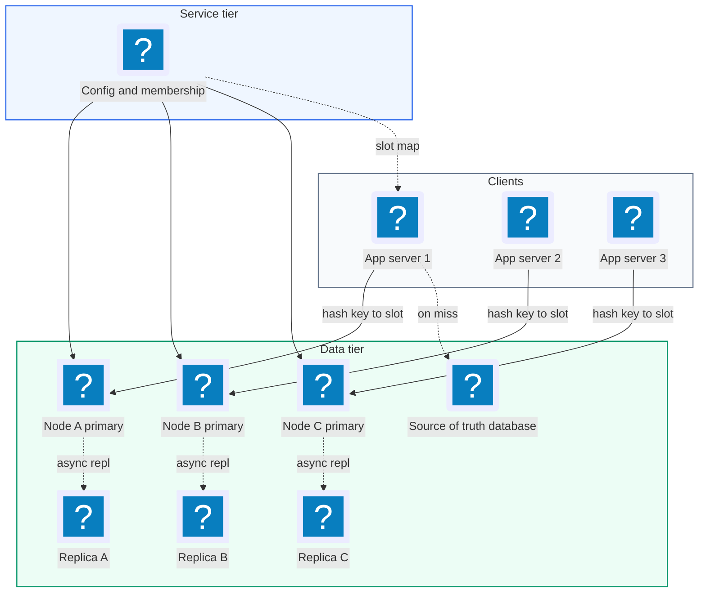
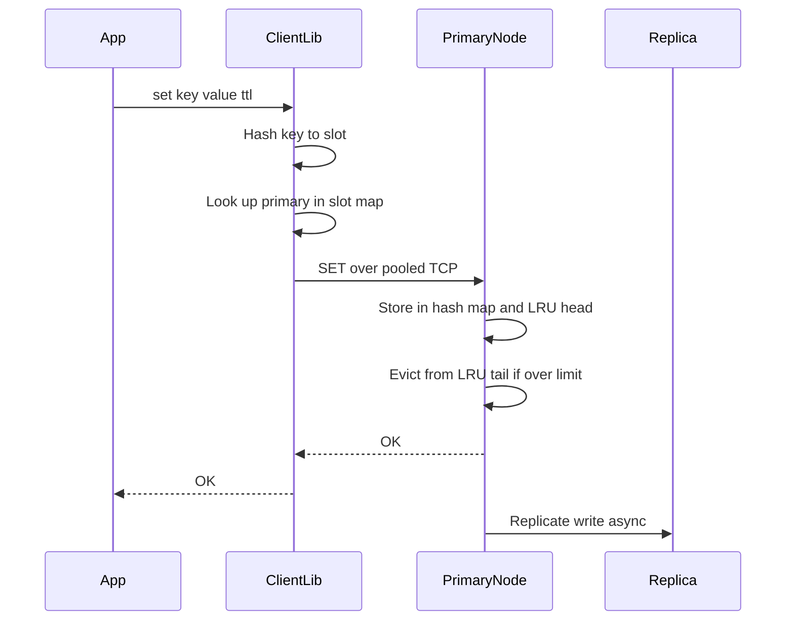
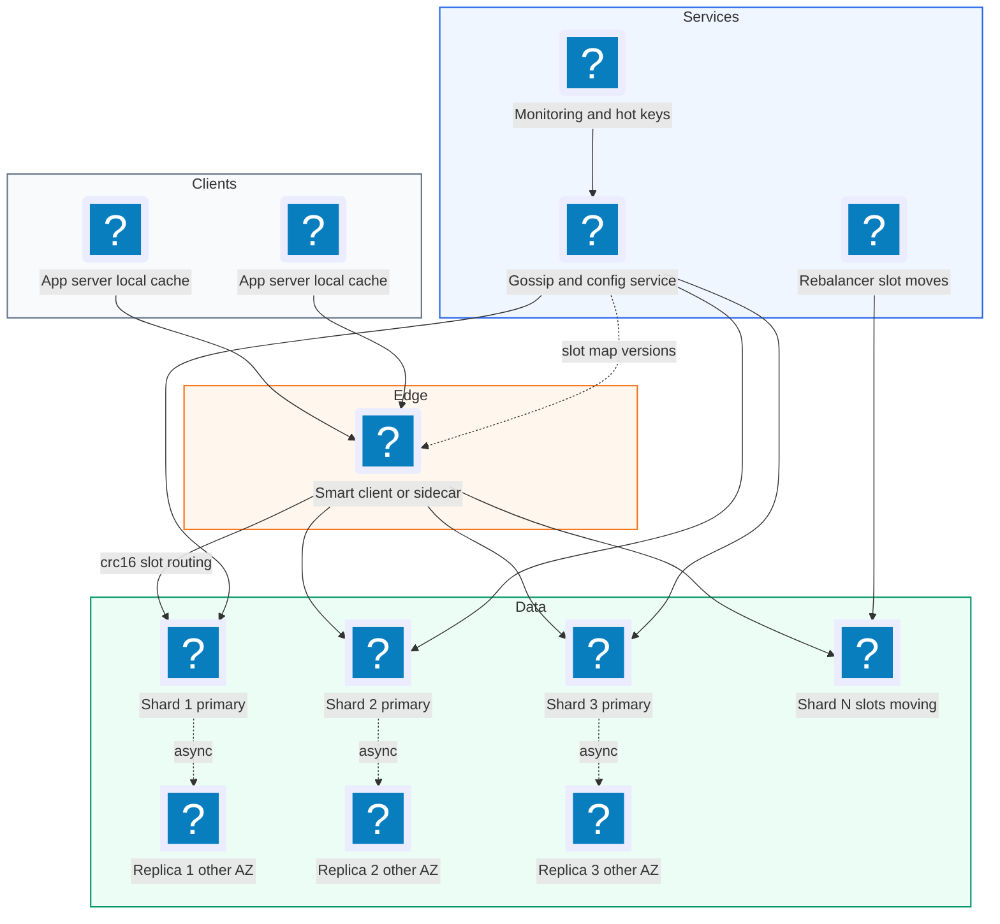

# 12. Distributed Cache (Redis / Memcached Like)  (Medium)

> A distributed cache is a fast key-value store that keeps data in memory across many machines. Applications put the results of slow work (database queries, API calls, rendered pages) into it, so the next request can read them in under a millisecond instead of hitting the slow system again. Think Redis or Memcached. The interviewer is really testing how you spread keys across nodes and add or remove nodes without losing most of the cache, how you evict old data when memory is full, how you keep serving when a node dies, and how you deal with one key that gets far more traffic than the rest.

## 1. Functional requirements

Core (must have):

1. Clients can `set(key, value, ttl)` to store a value with an optional time-to-live (TTL, how long the value stays valid).
2. Clients can `get(key)` to read a value, or get a miss if it is absent or expired.
3. Clients can `delete(key)`.
4. When memory is full, the cache evicts entries using a policy (LRU: least recently used first).

Below the line (out of scope):

1. Rich data types (lists, sorted sets, streams) like Redis has. They change the value format, not the distribution design.
2. Persistence to disk (snapshots, append-only file). A cache can be rebuilt from the source of truth; we mention it as an option only.
3. Transactions and multi-key atomic operations across nodes. Hard in a sharded system and rarely needed for a cache.
4. Pub/sub messaging.

## 2. Non-functional requirements

1. Low latency: p99 under 1 ms for get and set inside a data centre (network round trip included, about 0.2-0.5 ms).
2. High throughput: 1M+ operations per second overall, about 100k per node.
3. Scale: 1 TB of hot data, growing; add nodes without downtime.
4. Availability: 99.99%. A node failure should affect only a small slice of keys, and only briefly.
5. Consistency: eventual. A read right after a write may return the old value from a replica for a few milliseconds. The cache is not the source of truth.
6. Elasticity: adding or removing a node moves only about 1/N of the keys.
7. CAP choice: AP. During a partition, keep serving reads and writes, even if a replica is slightly stale. Correctness belongs to the database behind the cache.

## 3. Back-of-the-envelope estimates

| Assumption | Number |
|---|---|
| Total peak operations | 1M ops/s |
| Read to write ratio | 9:1 |
| Hot data size | 1 TB |
| Average key + value size | 1 KB |
| Usable RAM per node (of 64 GB) | 50 GB |
| Per-entry overhead (pointers, hash slot, TTL) | ~70 bytes |
| Throughput per node | 100k ops/s |
| Replication factor | 2 (1 primary + 1 replica) |

```text
Entries:
  1 TB / 1 KB = 1 billion entries

Memory with overhead:
  1B * (1,024 + 70) B ~= 1.1 TB

Nodes for memory:
  1.1 TB / 50 GB ~= 22 primaries

Nodes for throughput:
  1M ops/s / 100k ops/s = 10 nodes  -> memory is the limit, so 22

With one replica each:
  22 primaries + 22 replicas = 44 nodes (round to 48 for headroom)

Network per node:
  1M ops/s / 22 nodes ~= 45k ops/s * 1 KB ~= 45 MB/s (~360 Mbps)
  that is fine on a 10 Gbps network card
```

The key insight: for a cache, memory usually sets the node count, not CPU. And 1 TB fits in a few dozen commodity machines.

## 4. Core entities

- Key: a string up to 250 bytes, for example `user:123:profile`.
- Value: bytes (up to 1 MB in Memcached, 512 MB in Redis; we cap at 1 MB).
- Entry: key, value, `expires_at`, and LRU links (`prev`, `next`).
- Node: one cache server. `node_id`, `address`, `role` (primary or replica), `status`.
- Ring / Slot map: which node owns which part of the key space.
- Client: an application library that knows the slot map, or talks to a proxy.

```json
{
  "cluster": "cache-prod",
  "version": 42,
  "slots": [
    { "range": [0, 5460],     "primary": "10.0.1.11:7000",
      "replicas": ["10.0.2.11:7000"] },
    { "range": [5461, 10922], "primary": "10.0.1.12:7000",
      "replicas": ["10.0.2.12:7000"] },
    { "range": [10923, 16383],"primary": "10.0.1.13:7000",
      "replicas": ["10.0.2.13:7000"] }
  ]
}
```

```python
from dataclasses import dataclass

@dataclass
class Entry:
    key: str
    value: bytes
    expires_at: float | None   # epoch seconds, None = never
    prev: "Entry | None" = None
    next: "Entry | None" = None
```

## 5. API design

A cache uses a compact binary or text protocol over TCP, not REST, because HTTP overhead would dominate a 1 ms budget. Here it is shown as operations.

`SET key value [EX seconds] [NX|XX]` -- store a value. `NX` = only if absent, `XX` = only if present.

```text
> SET user:123:profile "{...json...}" EX 300
OK
```

`GET key` -- read a value.

```text
> GET user:123:profile
"{...json...}"        (or nil on miss)
```

`DEL key` -- delete. Returns the number of keys removed.

`MGET key1 key2 ...` -- batch read. The client library splits it per node and sends in parallel.

Errors: `MOVED <slot> <node>` when the client sent a key to the wrong node (its slot map is stale), `OOM` if the node is out of memory and the policy is "no eviction", `TIMEOUT` on the client side.

A client library API might look like:

```python
cache = CacheClient(seeds=["10.0.1.11:7000"], timeout_ms=5)
cache.set("user:123:profile", payload, ttl=300)
value = cache.get("user:123:profile")      # bytes or None
cache.delete("user:123:profile")
```

Auth: TLS plus a password or ACL per client, and the cluster sits in a private network. Never expose it to the internet.

## 6. High-level design



### How will clients set a value?

1. The app calls `cache.set(key, value, ttl)`.
2. The client library hashes the key to a slot and looks up the owning primary in its local slot map.
3. It sends `SET` over a pooled TCP connection.
4. The node stores the entry in its hash map, links it at the front of its LRU list, records `expires_at`, and evicts from the tail if memory is over the limit.
5. It replies `OK`, then sends the write to its replica asynchronously.



### How will clients get a value?

1. The client hashes the key to the same slot and node.
2. The node looks the key up in its hash map. If found and not expired, it moves the entry to the front of the LRU list and returns the value.
3. If missing or expired, it returns nil. The app then reads the database and calls `set` (this pattern is called cache-aside).

### How will clients delete a value?

1. Same routing. The node removes the entry from the hash map and the LRU list, and replicates the delete.

### How does eviction happen?

1. Each node has a memory limit (for example 50 GB).
2. On any write that pushes memory over the limit, the node removes entries from the LRU tail until it is back under the limit.

## 7. Deep dives

### How do we spread keys across nodes and rebalance when nodes change?

The problem: with 22 nodes, the simple rule `node = hash(key) % 22` works until we add a 23rd node. Then almost every key maps to a different node, the cache is effectively empty, and the database gets flooded (a "cache stampede").

| Option | Keys moved when N -> N+1 | Notes |
|---|---|---|
| `hash(key) % N` | ~ N/(N+1), about 96% at N = 22 | Do not use |
| Consistent hashing with virtual nodes (recommended, Memcached style) | ~ 1/(N+1), about 4% | Ring of points, walk clockwise |
| Fixed hash slots, e.g. 16,384, mapped to nodes (recommended, Redis Cluster style) | Only the slots you choose to move | Explicit, easy to reason about |

Consistent hashing places each node at many points on a ring of hash values (these are "virtual nodes", say 150 per physical node, which evens out the load). A key goes to the first node point clockwise from its own hash. Adding a node takes over small arcs from its neighbours only.

```python
import bisect, hashlib

def h(s: str) -> int:
    return int.from_bytes(hashlib.md5(s.encode()).digest()[:8], "big")

class HashRing:
    def __init__(self, nodes, vnodes=150):
        self.vnodes = vnodes
        self.ring = []          # sorted list of (hash, node)
        for n in nodes:
            self.add(n)

    def add(self, node):
        for i in range(self.vnodes):
            bisect.insort(self.ring, (h(f"{node}#{i}"), node))

    def remove(self, node):
        self.ring = [(k, n) for k, n in self.ring if n != node]

    def node_for(self, key):
        i = bisect.bisect(self.ring, (h(key), ""))
        return self.ring[i % len(self.ring)][1]
```

Hash slots work the same way but with a fixed number of buckets: `slot = crc16(key) % 16384`, and a table maps slots to nodes. To add a node, move a chosen set of slots to it. During the move, the old node answers `ASK` (try the new node for this key) for keys already migrated, and once the slot is fully moved, clients get `MOVED` and refresh their map.

Rebalancing safely:

1. Add the new node empty.
2. Move slots (or let the ring take over arcs) a few at a time, throttled, so the database does not see a wave of misses.
3. Optionally warm the new node by copying entries for moving slots from the old owner instead of starting cold.

### How do we implement LRU eviction efficiently?

The problem: when memory is full we must find the least recently used entry instantly, and every `get` must mark an entry as recently used. Both must be O(1), because a node handles 100k ops/s.

| Option | Get | Evict | Memory | Notes |
|---|---|---|---|---|
| Scan all entries for oldest timestamp | O(1) | O(n) | Low | Too slow |
| Min-heap on last access time | O(log n) | O(log n) | Medium | Every get reorders the heap |
| Hash map + doubly linked list (recommended, exact LRU) | O(1) | O(1) | 2 pointers per entry | Classic answer |
| Sampled LRU (Redis approach) | O(1) | O(k) samples | Lowest | Approximate, saves pointer memory |

Recommended: hash map plus doubly linked list. The hash map finds an entry by key in O(1). The list keeps entries in recency order: most recent at the head, least recent at the tail. On access, unlink the node and move it to the head (O(1) because each node knows its neighbours). To evict, remove the tail. Sentinel head and tail nodes remove edge cases.

```python
import threading, time

class Node:
    __slots__ = ("key", "value", "expires_at", "size", "prev", "next")
    def __init__(self, key=None, value=b"", expires_at=None):
        self.key, self.value, self.expires_at = key, value, expires_at
        self.size = len(value) + (len(key) if key else 0)
        self.prev = self.next = None

class LRUCache:
    def __init__(self, max_bytes):
        self.max_bytes, self.used = max_bytes, 0
        self.map = {}
        self.head, self.tail = Node(), Node()   # sentinels
        self.head.next, self.tail.prev = self.tail, self.head
        self.lock = threading.Lock()

    def _unlink(self, n):
        n.prev.next, n.next.prev = n.next, n.prev

    def _push_front(self, n):
        n.prev, n.next = self.head, self.head.next
        self.head.next.prev = n
        self.head.next = n

    def _remove(self, n):
        self._unlink(n)
        del self.map[n.key]
        self.used -= n.size

    def get(self, key):
        with self.lock:
            n = self.map.get(key)
            if n is None:
                return None
            if n.expires_at is not None and n.expires_at <= time.time():
                self._remove(n)            # lazy expiry
                return None
            self._unlink(n)
            self._push_front(n)            # mark as most recently used
            return n.value

    def set(self, key, value, ttl=None):
        with self.lock:
            if key in self.map:
                self._remove(self.map[key])
            exp = time.time() + ttl if ttl else None
            n = Node(key, value, exp)
            self.map[key] = n
            self._push_front(n)
            self.used += n.size
            while self.used > self.max_bytes and self.tail.prev is not self.head:
                self._remove(self.tail.prev)   # evict least recently used

    def delete(self, key):
        with self.lock:
            n = self.map.get(key)
            if n:
                self._remove(n)
```

Production notes worth mentioning: Redis uses approximate LRU (sample 5 keys, evict the oldest) to save the two pointers per key, and also offers LFU (least frequently used), which resists one-off scans pushing out popular keys. Real servers avoid one global lock by sharding the map into many segments, or by running one single-threaded event loop per core (Redis, and Memcached's per-thread design).

### How do we replicate and fail over when a node dies?

The problem: if a node with 50 GB of hot data dies, all its keys miss at once and that traffic hits the database. We want a standby ready to take over within seconds.

| Option | Write latency | Data loss on failover | Notes |
|---|---|---|---|
| No replication | Lowest | Whole node's data | Acceptable only for tiny caches |
| Async primary-replica (recommended) | Lowest | Last few ms of writes | Fine: the cache is not the source of truth |
| Sync replication / quorum writes | Higher (extra round trip) | None | Too costly for a cache |

Recommended: each primary streams writes asynchronously to one replica in a different availability zone. A membership service (or the nodes themselves via gossip, as in Redis Cluster) health-checks every node.

```text
 1. Node B misses heartbeats for 3 s  -> marked "suspect" by peers
 2. Majority of primaries agree       -> marked "failed"
 3. Replica B' is promoted            -> slot map version 43 published
 4. Clients get MOVED or refresh map  -> traffic goes to B'
 5. New empty replica is attached     -> full sync from B'
```

Pitfalls to name:

- Split brain: the old primary is only cut off, not dead, and keeps taking writes. Require a majority vote to promote and have a primary stop accepting writes when it cannot reach a majority.
- Read from replicas only if stale reads are OK. Default to reading from primaries for simpler consistency; use replicas to scale reads for hot keys.
- Keep TTLs in absolute time on replicas, so expiry is the same after failover.

### How do we handle hot keys?

The problem: one key (a celebrity profile, a flash-sale item, a config blob) can get 200k reads/s. That is more than one node can serve, and the node holding it overloads while others are idle. Consistent hashing does not help, because one key always maps to one node.

| Option | How | Trade-off |
|---|---|---|
| Local in-process cache on app servers (recommended first step) | Keep hot keys in app memory for 1-5 s | Slightly stale, uses app RAM |
| Read from replicas | Spread reads across primary + replicas | Only 2-3x more capacity |
| Key splitting / replication across nodes (recommended for extreme cases) | Store `key#0..key#9` on different nodes, read a random copy | Writes must update all copies |
| Request coalescing (single flight) | One miss fetches, others wait | Fixes stampedes, not steady hot reads |

Recommended: detect hot keys (sample request counts per key on the server, or count in the client), then:

1. Serve them from a small local cache in each app server with a short TTL (a few seconds). This alone often removes over 90% of the load.
2. For extreme keys, write N copies with suffixes so they land on different nodes, and read a random copy.

```python
import random

HOT_COPIES = 10

def get_hot(cache, key):
    v = local_cache.get(key)               # in-process, TTL 2 s
    if v is not None:
        return v
    v = cache.get(f"{key}#{random.randrange(HOT_COPIES)}")
    if v is not None:
        local_cache.set(key, v, ttl=2)
    return v

def set_hot(cache, key, value, ttl):
    for i in range(HOT_COPIES):            # same value on 10 nodes
        cache.set(f"{key}#{i}", value, ttl=ttl)
```

Also protect against stampedes on popular keys that expire: when a hot key misses, let one request rebuild it (a short `SET lock:key NX EX 5`) while others briefly serve the stale value or wait.

### How do TTL and expiry work without wasting CPU?

The problem: a billion keys each have their own TTL. Checking every key every second is impossible, but expired keys must not be served and should not use memory for long.

| Option | CPU | Memory reclaimed | Notes |
|---|---|---|---|
| Timer per key | Huge | Exact | Millions of timers, not practical |
| Lazy expiry only (check on read) | None | Never for keys nobody reads | Leaks memory |
| Lazy + periodic sampling (recommended, Redis approach) | Small, bounded | Most expired keys within seconds | Simple and effective |

Recommended: both.

1. Lazy: on every `get`, if `expires_at` has passed, delete and return a miss (shown in the LRU code above).
2. Active sampling: about 10 times a second, sample 20 keys from the set of keys that have a TTL, delete the expired ones, and if more than 25% were expired, repeat at once. This keeps expired keys under roughly 25% of memory without scanning everything.

```python
def active_expire_cycle(store, sample=20, max_ms=25):
    start = time.monotonic()
    while True:
        keys = store.random_keys_with_ttl(sample)
        expired = [k for k in keys if store.is_expired(k)]
        for k in expired:
            store.delete(k)
        if len(expired) <= sample // 4:
            break                          # few expired, stop for now
        if (time.monotonic() - start) * 1000 > max_ms:
            break                          # cap CPU per cycle
```

Add a small random jitter to TTLs (for example 300 s plus or minus 10%) so keys written at the same time do not all expire together and stampede the database.

### Should clients route directly or go through a proxy?

The problem: something must turn a key into a node address. That logic can live in every client or in a proxy tier.

| Option | Latency | Client complexity | Operations |
|---|---|---|---|
| Smart client with slot map (recommended for latency) | 1 hop | Needs a library per language, handles MOVED | No extra tier |
| Proxy tier (Twemproxy, Envoy, mcrouter) | 2 hops (+0.1-0.3 ms) | Dumb clients, any language | Proxies must scale and be HA |
| Sidecar proxy on each app host | ~1 hop (localhost) | Dumb clients | One proxy per host to deploy |

Recommended: smart clients when you control the languages (lowest latency, as in Redis Cluster clients). Use a proxy or sidecar (Facebook's mcrouter is the famous example) when many languages or teams share the cache, or when you need central features like connection pooling, routing rules, and shadow traffic. Either way, the client must cache the slot map, refresh it on `MOVED`, and use short timeouts (a few ms) with a circuit breaker, so a sick cache degrades to "go to the database" rather than hanging app threads.

## 8. Final architecture



| Component | Job | Technology example |
|---|---|---|
| Client library / sidecar | Hash key to slot, route, pool, retry on MOVED | Redis Cluster clients, mcrouter, Envoy |
| Local hot-key cache | Absorb extreme read traffic | Caffeine (Java), in-process dict with TTL |
| Cache node | In-memory hash map, LRU list, TTL | Redis, Memcached, KeyDB |
| Replica | Standby copy in another AZ | Redis replica |
| Membership / config | Health checks, failover votes, slot map | Redis Cluster gossip, ZooKeeper, etcd |
| Rebalancer | Move slots gradually | redis-cli cluster rebalance, custom job |
| Monitoring | Hit rate, evictions, hot keys, memory | Prometheus + Grafana |

### Deployment map (AWS)

```mermaid
architecture-beta
    group internet(mdi:earth)[Internet]
    group edge(logos:aws-cloudfront)[Edge]
    group vpc(logos:aws-vpc)[AWS VPC]
    group app(logos:aws-ecs)[Service subnet] in vpc
    group data(logos:aws-rds)[Data subnet] in vpc

    service app1(logos:aws-ec2)[App server local cache] in internet
    service sc(logos:aws-ecs)[Smart client or sidecar] in edge
    service cfg(logos:aws-ecs)[Gossip and config service] in app
    service mon(logos:aws-cloudwatch)[Monitoring and hot keys] in app
    service sh1(logos:aws-elasticache)[Shard 1 primary] in data
    service sh2(logos:aws-elasticache)[Shard 2 primary] in data
    service sh3(logos:aws-elasticache)[Shard 3 primary] in data
    service rep1(logos:aws-elasticache)[Replica 1 other AZ] in data
    service rep2(logos:aws-elasticache)[Replica 2 other AZ] in data
    service rep3(logos:aws-elasticache)[Replica 3 other AZ] in data

    app1:R --> L:sc
    sc:B --> T:sh1
    sc:B --> T:sh2
    sc:B --> T:sh3
    sh1:R --> L:rep1
    sh2:R --> L:rep2
    sh3:R --> L:rep3
    cfg:B --> T:sh1
    cfg:L --> R:sc
    mon:L --> R:cfg
```



The callers here are app servers rather than end users, so the internet and edge groups stand for the calling tier, and every shard and its cross AZ replica stays in the private data subnet.

## 9. Common mistakes and interviewer follow-ups

- Using `hash(key) % N`. Adding one node remaps almost every key and floods the database. Say: "consistent hashing with virtual nodes, or fixed hash slots."
- LRU with a timestamp scan or a heap. Too slow at 100k ops/s. Say: "hash map plus doubly linked list, O(1) get and evict."
- Synchronous replication for a cache. Doubles write latency for data you can rebuild. Say: "async replication, the database is the source of truth."
- Ignoring hot keys. One node melts while others idle. Say: "local short-TTL cache on app servers, then split the key into copies."
- Same TTL for everything written at once. Mass expiry causes a stampede. Say: "add TTL jitter and single-flight rebuilds."
- No client timeouts. A slow cache node hangs every app thread. Say: "few-ms timeouts, circuit breaker, fall back to the database."
- Follow-up: "How do you keep the cache consistent with the database?" Cache-aside: update the DB, then delete the cache key (not set it), so the next read reloads fresh data; keep TTLs as a safety net.
- Follow-up: "LRU or LFU?" LRU is simple and good for recency-heavy workloads; LFU protects popular keys from being pushed out by one-time scans.

## 10. One-page cheat sheet

| Topic | Key point |
|---|---|
| Sizing | 1B entries * ~1.1 KB = 1.1 TB, 50 GB per node -> 22 primaries + 22 replicas |
| Throughput | ~100k ops/s per node, p99 < 1 ms |
| Partitioning | Consistent hashing (150 vnodes) or 16,384 hash slots |
| Rebalance | Move ~1/N of keys, throttled, MOVED / ASK redirects |
| Eviction | Hash map + doubly linked list, O(1); Redis samples approx LRU / LFU |
| Expiry | Lazy on read + active sampling (20 keys, repeat if > 25% expired) |
| Replication | Async primary -> replica in another AZ |
| Failover | Majority vote, promote replica, bump slot map version |
| Hot keys | Local 2 s cache, split into key#0..#9, single-flight on miss |
| Routing | Smart client (1 hop) or proxy/sidecar (mcrouter, Envoy) |
| CAP | AP; database is the source of truth |

## Sources

- [Hello Interview: Design a Distributed Cache](https://www.hellointerview.com/learn/system-design/problem-breakdowns/distributed-cache)
- [Redis docs: Scale with Redis Cluster](https://redis.io/docs/latest/operate/oss_and_stack/management/scaling/)
- [Redis docs: Key eviction](https://redis.io/docs/latest/develop/reference/eviction/)
- [Redis docs: EXPIRE and how keys expire](https://redis.io/docs/latest/commands/expire/)
- [Facebook Engineering: Introducing mcrouter](https://engineering.fb.com/2014/09/15/web/introducing-mcrouter-a-memcached-protocol-router-for-scaling-memcached-deployments/)
- [Scaling Memcache at Facebook (NSDI 2013 paper)](https://www.usenix.org/system/files/conference/nsdi13/nsdi13-final170_update.pdf)
- [Karger et al.: Consistent Hashing and Random Trees](https://dl.acm.org/doi/10.1145/258533.258660)
