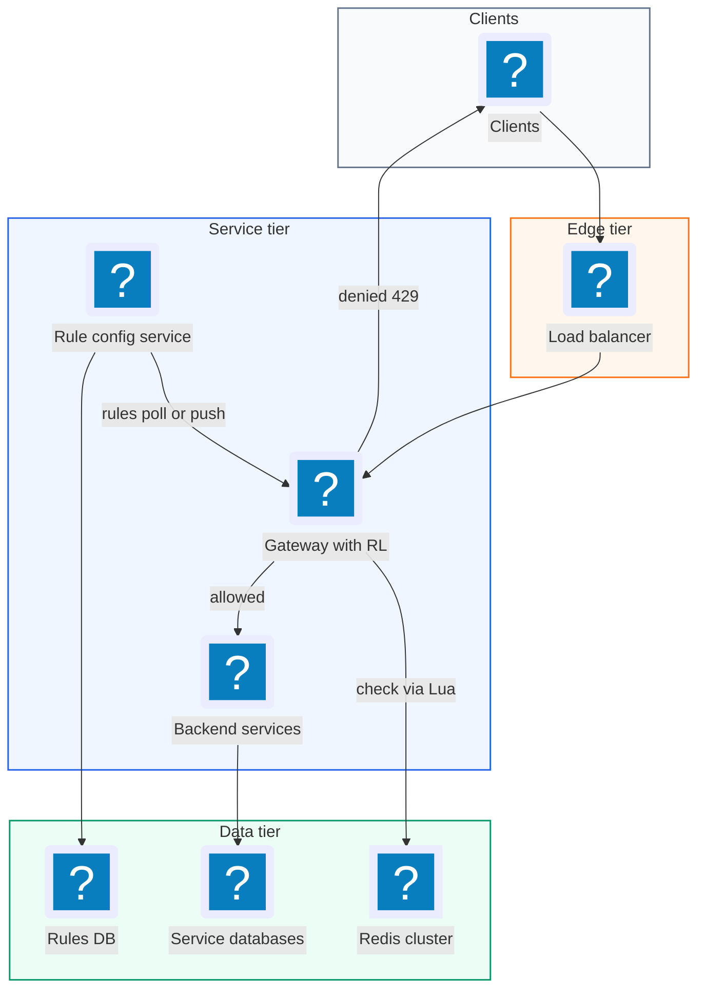
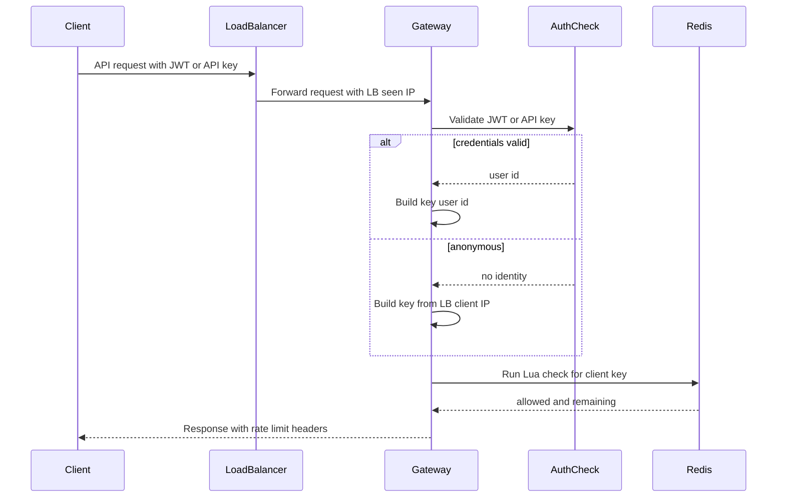
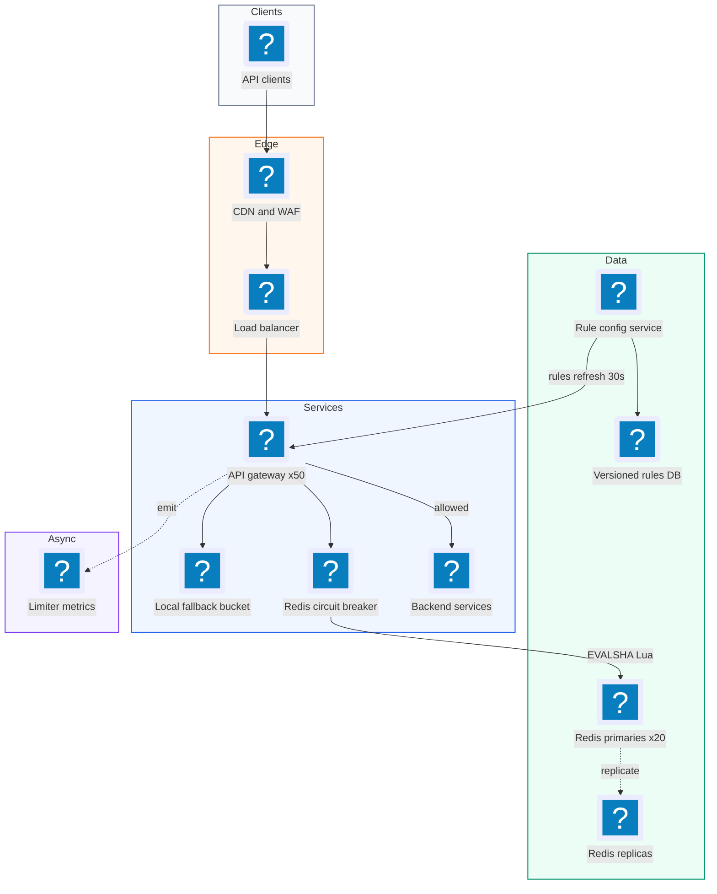

# 13. Rate Limiter  (Medium)

> A rate limiter decides, for every incoming API request, "is this client allowed to make one more call right now?" If yes, the request goes through. If no, the server answers with HTTP 429 Too Many Requests. It protects services from abuse, runaway scripts, and traffic bursts, and keeps usage fair between customers. The interviewer is really testing three things: do you know the classic algorithms and their trade-offs, can you make the counting correct when many servers share one counter (race conditions), and do you know what to do when the limiter itself breaks.

## 1. Functional requirements

Core (must have):

1. Identify the client by user ID, API key, or IP address.
2. Apply configurable rules, for example "100 requests per minute per user" or "10 searches per second per IP".
3. Reject requests over the limit with HTTP 429 and return helpful headers: limit, remaining, and when the window resets.
4. Support different rules per endpoint and per customer tier (free vs paid).

Below the line (out of scope):

1. Analytics dashboards on who got limited. Useful, but it is a separate reporting pipeline.
2. Long-term storage of counters. Counters only matter for seconds or minutes.
3. Billing and quotas per month. That is a metering system with different accuracy needs.

## 2. Non-functional requirements

1. Low overhead: the limit check adds less than 10 ms at p99, ideally 1-2 ms.
2. Scale: 1 million requests per second across 100 million daily active users.
3. High availability: 99.99%. If the limiter is down, the API must not go down with it.
4. Accuracy: a client may overshoot its limit by a small amount (say under 1%) during races or failover. We do not need perfect global accuracy.
5. CAP choice: we pick availability over strong consistency (AP). A few extra requests slipping through is much cheaper than blocking all traffic because one counter node is unreachable.
6. Rule changes take effect within about 1 minute.

## 3. Back-of-the-envelope estimates

| Assumption | Number |
|---|---|
| Peak requests per second | 1,000,000 |
| Daily active users | 100,000,000 |
| Active clients in any one minute | 10,000,000 |
| Bytes per counter in Redis (key + value + overhead) | ~100 B |
| Rules per client checked per request | 1-3 |

```text
Redis operations:
  1M req/s x 1 check each        = 1M Redis ops/s
  one Redis node handles ~100k simple ops/s
  1M / 100k                      = 10 shards minimum
  add 2x headroom                = ~20 shards (plus replicas)

Memory for token bucket state (2 fields per key):
  10M active clients x 100 B     = 1 GB
  x 3 rules                      = 3 GB total  -> fits in memory easily

Network:
  each check ~200 B round trip
  1M/s x 200 B                   = 200 MB/s across the cluster
```

The lesson: memory is small, but operations per second force us to shard.

## 4. Core entities

- Rule: the policy. Fields: rule_id, match (endpoint, tier), key_type (user, ip, api_key), algorithm, limit, window_seconds or refill_rate.
- Client: the thing being limited. Identified by a key such as `user:42` or `ip:1.2.3.4`.
- Counter / Bucket state: the live numbers for one client and one rule, for example tokens left and last refill time.
- Request: the incoming call, with headers and path, used to pick the rule and the client key.
- Decision: allow or deny, plus remaining and reset time.

```yaml
# rules.yaml - stored in a config service, cached in every gateway
- rule_id: search_per_ip
  match: { path: "/v1/search", method: GET }
  key: ip
  algorithm: token_bucket
  capacity: 20          # max burst
  refill_per_sec: 10    # steady rate
- rule_id: free_tier_user
  match: { tier: free }
  key: user_id
  algorithm: sliding_window_counter
  limit: 1000
  window_seconds: 3600
```

```json
{
  "key": "rl:search_per_ip:ip:203.0.113.7",
  "tokens": 13.5,
  "last_refill_ms": 1762205400123
}
```

## 5. API design

A rate limiter is mostly internal, so its "API" is a check call plus the response headers clients see.

`POST /internal/ratelimit/check` -- ask whether one request is allowed.

```json
// request
{ "rule_ids": ["search_per_ip"], "client_key": "ip:203.0.113.7", "cost": 1 }
// response 200
{ "allowed": true, "limit": 20, "remaining": 12, "reset_ms": 800 }
```

Auth: mTLS between gateway and limiter; never exposed to the internet.

Client-facing behavior on a denied request:

```text
HTTP/1.1 429 Too Many Requests
X-RateLimit-Limit: 20
X-RateLimit-Remaining: 0
X-RateLimit-Reset: 1762205401
Retry-After: 1
```

`PUT /admin/rules/{rule_id}` -- create or update a rule. Body is one rule (as in the YAML above). Returns 200, or 400 on invalid config. Admin auth only.

`GET /admin/rules` -- list rules, used by gateways to refresh their local cache. Returns 200 with a version number so gateways can skip unchanged data.

## 6. High-level design



### How will the system identify the client?

1. The request reaches the gateway.
2. The gateway validates the JWT or API key. If valid, the key is `user:<id>` or `key:<api_key>`.
3. If the request is anonymous, it uses the client IP from the load balancer (the `X-Forwarded-For` header set by our own LB, never one the client sent).
4. The gateway now has a client key and the request path.



### How will the system apply configurable rules?

1. The gateway keeps all rules in memory, refreshed from the Rule Config Service every 30 seconds.
2. It matches the request (path, method, tier) to 1-3 rules.
3. For each rule it builds a Redis key like `rl:<rule_id>:<client_key>`.
4. It runs one atomic Lua script on Redis per rule (details in the deep dives). The script returns allowed and remaining.

### How will the system reject requests with helpful headers?

1. If any rule says "deny", the gateway returns 429 with the headers shown above. The backend never sees the request.
2. If all rules allow, the gateway forwards the request and still adds `X-RateLimit-Remaining` to the response so good clients can slow down on their own.

## 7. Deep dives

### Which rate limiting algorithm should we use?

There are five classic algorithms. You should be able to explain each in one sentence and write it.

| Algorithm | Idea | Memory per key | Bursts | Accuracy |
|---|---|---|---|---|
| Fixed window counter | Count per clock minute | 1 int | 2x burst at window edge | Low |
| Sliding window log | Store every timestamp | O(limit) | None | Exact |
| Sliding window counter | Weighted mix of current and previous window | 2 ints | Small | Very good (approx) |
| Token bucket | Tokens refill at rate r, cap c | 2 numbers | Allows bursts up to c | Good |
| Leaky bucket | Queue drained at fixed rate | queue | Smooths all bursts | Good, adds delay |

Fixed window counter. Simple, but a client can send 100 at 12:00:59 and 100 more at 12:01:00, so 200 in two seconds.

```python
import time
counters = {}  # (key, window) -> count

def fixed_window(key, limit, window_s):
    window = int(time.time() // window_s)
    k = (key, window)
    counters[k] = counters.get(k, 0) + 1
    return counters[k] <= limit
```

Sliding window log. Keep a list of timestamps. Exact, but 1,000 requests per hour means storing 1,000 timestamps per user.

```python
from collections import deque
logs = {}

def sliding_log(key, limit, window_s):
    now = time.time()
    q = logs.setdefault(key, deque())
    while q and q[0] <= now - window_s:
        q.popleft()             # drop old timestamps
    if len(q) < limit:
        q.append(now)
        return True
    return False
```

Sliding window counter. Keep counts for the current and previous fixed windows. Estimate the last full window as `prev * (overlap fraction) + curr`. Cloudflare reported this approach was within about 0.003% of exact in their traffic.

```python
def sliding_counter(key, limit, window_s):
    now = time.time()
    curr_w = int(now // window_s)
    elapsed = (now % window_s) / window_s      # 0.0 .. 1.0
    prev = counters.get((key, curr_w - 1), 0)
    curr = counters.get((key, curr_w), 0)
    estimate = prev * (1 - elapsed) + curr
    if estimate < limit:
        counters[(key, curr_w)] = curr + 1
        return True
    return False
```

Token bucket. Each client has a bucket holding up to `capacity` tokens. Tokens refill at `rate` per second. Each request takes one token. Allows short bursts but enforces the average rate. Used by AWS API Gateway and Stripe.

```python
buckets = {}  # key -> (tokens, last_ts)

def token_bucket(key, capacity, rate):
    now = time.time()
    tokens, last = buckets.get(key, (capacity, now))
    tokens = min(capacity, tokens + (now - last) * rate)  # refill
    if tokens >= 1:
        buckets[key] = (tokens - 1, now)
        return True
    buckets[key] = (tokens, now)
    return False
```

Leaky bucket. Requests enter a queue; a worker drains it at a fixed rate. Output is perfectly smooth, which is great for protecting a fragile downstream (like a payment provider), but requests wait.

```python
import queue, threading
q = queue.Queue(maxsize=100)    # bucket size

def leaky_submit(req):
    try:
        q.put_nowait(req)       # full bucket = reject
        return True
    except queue.Full:
        return False

def drain(rate_per_s, handle):
    while True:
        handle(q.get())
        time.sleep(1 / rate_per_s)
```

Recommendation: token bucket as the default for user-facing APIs (it is cheap, two numbers per key, and burst-friendly). Use sliding window counter when the product says "1,000 per hour" and customers will complain about edge bursts. Use leaky bucket only in front of a downstream that cannot take bursts.

### How do we make the counter atomic across many gateways?

The problem: 50 gateway servers check the same Redis key. A naive "GET tokens, compute, SET tokens" has a race. Two gateways both read `tokens=1`, both allow, both write `0`. The client got 2 requests for 1 token.

| Option | How | Problem |
|---|---|---|
| GET then SET from gateway | Two round trips | Race condition, double spend |
| WATCH / MULTI / EXEC | Optimistic transaction | Retries under contention, slow |
| INCR + EXPIRE (fixed window) | Single atomic op | Only works for fixed window |
| Lua script on Redis | Whole read-modify-write runs atomically | Script must stay tiny and fast |

Redis runs one Lua script at a time on a shard, so the script is atomic. Recommended token bucket script:

```lua
-- KEYS[1] = bucket key
-- ARGV: capacity, refill_per_ms, now_ms, cost
local cap   = tonumber(ARGV[1])
local rate  = tonumber(ARGV[2])
local now   = tonumber(ARGV[3])
local cost  = tonumber(ARGV[4])

local b = redis.call('HMGET', KEYS[1], 'tokens', 'ts')
local tokens = tonumber(b[1]) or cap
local ts     = tonumber(b[2]) or now

tokens = math.min(cap, tokens + (now - ts) * rate)
local allowed = 0
if tokens >= cost then
  tokens = tokens - cost
  allowed = 1
end
redis.call('HSET', KEYS[1], 'tokens', tokens, 'ts', now)
-- expire idle buckets: time to refill fully, plus margin
redis.call('PEXPIRE', KEYS[1], math.ceil(cap / rate) + 1000)
return { allowed, math.floor(tokens) }
```

```python
# gateway side (redis-py); script is loaded once, called by SHA
lua = r.register_script(TOKEN_BUCKET_LUA)

def allow(key, cap, rate_per_s):
    now_ms = int(time.time() * 1000)
    allowed, remaining = lua(keys=[key],
                             args=[cap, rate_per_s / 1000, now_ms, 1])
    return allowed == 1, remaining
```

A detail interviewers like: clock skew. If 50 gateways send their own `now_ms`, a gateway with a fast clock can over-refill. Fix it by calling `redis.call('TIME')` inside the script so Redis is the single clock.

### How does the system scale to 1M requests per second?

1. Shard Redis by key. Redis Cluster hashes each key to one of 16,384 slots spread over ~20 primaries. All state for one client and rule lives on one shard, so the Lua script never crosses shards.
2. Keep connections warm. Each gateway uses a connection pool and pipelines when a request matches several rules.
3. Hot keys. One abusive IP at 100k req/s hits one shard. Add a local, in-process pre-check on each gateway: if the gateway already denied this key in the last second, deny locally without calling Redis. This caps the damage from a single attacker.
4. Optional local batching. For very high-volume keys, each gateway can take a "lease" of 10 tokens at once from Redis and spend them locally. This cuts Redis traffic 10x at the cost of small overshoot.

```text
 Gateway A ---\                 +---------+ slot 0-5460
 Gateway B ----+-- hash(key) -->| Redis 1 |
 Gateway C ---/       |         +---------+
                      +-------->| Redis 2 | slot 5461-10922
                      |         +---------+
                      +-------->| Redis 3 | slot 10923-16383
                                +---------+
```

### What happens when Redis is slow or down: fail open or fail closed?

| Choice | Behavior when limiter is unreachable | Good for | Risk |
|---|---|---|---|
| Fail open | Allow the request | Normal APIs, revenue paths | Abuse slips through during outage |
| Fail closed | Reject with 429 or 503 | Login, password reset, SMS sending, costly APIs | Your own outage takes the API down |
| Fail to local | Use an in-memory limiter per gateway at limit / N | Most systems | Approximate limits |

Recommended: fail open by default with a strict timeout (for example 5 ms), but fall back to a local in-memory token bucket set to `limit / number_of_gateways`. For security-sensitive rules (login attempts), fail closed. Make this a per-rule flag.

```python
def check(rule, key):
    try:
        return redis_allow(rule, key, timeout_ms=5)
    except (TimeoutError, ConnectionError):
        metrics.incr("ratelimit.redis_error")
        if rule.fail_mode == "closed":
            return False, 0
        return local_bucket(rule, key, share=1 / NUM_GATEWAYS)
```

Also add a circuit breaker: after many Redis errors in a row, stop calling Redis for 10 seconds so you do not add timeout latency to every request. Redis replicas with automatic failover (Sentinel or Cluster) shorten outages; losing a few seconds of counters on failover is fine because counters are short-lived.

### Where should the rate limiter live, and how are rules configured?

| Placement | Pros | Cons |
|---|---|---|
| Client side | Saves network | Cannot be trusted, easy to bypass |
| API gateway / edge | One place, blocks bad traffic early, language neutral | Gateway must know user identity and rules |
| Middleware in each service | Fine-grained, knows business context | Duplicated logic across services and languages |
| Sidecar (Envoy + rate limit service) | Language neutral, per-service | Extra hop, more ops work |

Recommended: put the global limits in the API gateway (Envoy, Kong, or AWS API Gateway style), and allow a service to add its own in-process limit for business rules like "5 password resets per hour".

Rules: store them in a config service or database with a version number. Gateways poll every 30 seconds (or get a push via a watch on etcd/ZooKeeper) and swap the in-memory rule table atomically. Never read rules from a database on the hot path.

## 8. Final architecture



| Component | Job | Technology example |
|---|---|---|
| Edge / CDN | Drop obvious floods by IP | Cloudflare, AWS WAF |
| API Gateway | Identify client, run checks, add headers | Envoy, Kong, NGINX |
| Counter store | Atomic shared counters | Redis Cluster, ElastiCache |
| Lua script | Atomic token bucket logic | Redis EVALSHA |
| Rule config | Store and version rules | Postgres + etcd, DynamoDB |
| Local fallback | Keep limiting when Redis is down | In-process token bucket |
| Monitoring | Track 429 rate and limiter health | Prometheus, CloudWatch |

### Deployment map (AWS)

```mermaid
architecture-beta
    group internet(mdi:earth)[Internet]
    group edge(logos:aws-cloudfront)[Edge]
    group vpc(logos:aws-vpc)[AWS VPC]
    group app(logos:aws-ecs)[Service subnet] in vpc
    group data(logos:aws-rds)[Data subnet] in vpc

    service user(mdi:laptop)[API clients] in internet
    service cdn(logos:aws-waf)[CDN and WAF] in edge
    service alb(logos:aws-elastic-load-balancing)[Load balancer] in edge
    service gw(logos:aws-ecs)[API gateway x50] in app
    service be(logos:aws-ecs)[Backend services] in app
    service rc(logos:aws-ecs)[Rule config service] in app
    service metrics(logos:aws-cloudwatch)[Limiter metrics] in app
    service redis1(logos:aws-elasticache)[Redis primaries x20] in data
    service redis2(logos:aws-elasticache)[Redis replicas] in data
    service rdb(logos:aws-rds)[Versioned rules DB] in data

    user:R --> L:cdn
    cdn:R --> L:alb
    alb:B --> T:gw
    gw:R --> L:be
    rc:R --> L:gw
    gw:B --> T:redis1
    redis1:R --> L:redis2
    rc:B --> T:rdb
    gw:T --> B:metrics
```



The gateway fleet and rule config service run in the service subnet, while the sharded Redis counters and the rules database sit in the data subnet behind them.

## 9. Common mistakes and interviewer follow-ups

- Mistake: GET then SET from the gateway. It causes double spending under concurrency. Say instead: "the read-modify-write runs as one Lua script so it is atomic per key."
- Mistake: choosing fixed window without mentioning the edge burst. It hurts because the interviewer will ask about it. Say: "fixed window allows 2x at boundaries; sliding window counter fixes that with two integers."
- Mistake: storing counters in a SQL database. Disk writes at 1M/s are far too slow. Say: "in-memory store, data is short-lived, losing it on failover is acceptable."
- Mistake: no plan for limiter failure. Say: "fail open with a 5 ms timeout and a local fallback, fail closed only for security rules."
- Mistake: trusting the client's `X-Forwarded-For`. Attackers rotate it to dodge IP limits. Say: "use the IP our own load balancer saw."
- Mistake: using gateway clocks inside the algorithm. Clock skew breaks refills. Say: "use Redis TIME inside the script."
- Follow-up: "How would you rate limit by cost, not count?" Answer: pass `cost` to the script, for example an expensive search costs 5 tokens.
- Follow-up: "How do you limit across regions?" Answer: limit per region with `limit / regions` as the share, and accept small global overshoot; strong global counters would add 100 ms of cross-region latency.

## 10. One-page cheat sheet

| Topic | Key point |
|---|---|
| Goal | Allow or deny each request, 429 on deny |
| Scale | 1M req/s, 100M DAU, ~20 Redis shards |
| Latency budget | < 10 ms p99, aim for 1-2 ms |
| Default algorithm | Token bucket (capacity + refill rate) |
| No edge bursts | Sliding window counter (prev * overlap + curr) |
| Smooth output | Leaky bucket (queue, fixed drain) |
| Atomicity | One Redis Lua script per check, Redis TIME as clock |
| Sharding | Redis Cluster by key, all client state on one shard |
| Hot keys | Local deny cache, token leases |
| Failure | Fail open + local fallback; fail closed for login/SMS |
| Placement | API gateway for global, service middleware for business |
| Rules | Config service, cached in gateway, refresh 30 s |
| Headers | X-RateLimit-Limit, -Remaining, -Reset, Retry-After |
| CAP | AP: small overshoot is OK, outages are not |

## Sources

- [Hello Interview: Design a Distributed Rate Limiter](https://www.hellointerview.com/learn/system-design/problem-breakdowns/distributed-rate-limiter)
- [Cloudflare: How we built rate limiting capable of scaling to millions of domains](https://blog.cloudflare.com/counting-things-a-lot-of-different-things/)
- [Stripe: Scaling your API with rate limiters](https://stripe.com/blog/rate-limiters)
- [Redis docs: Scripting with Lua](https://redis.io/docs/latest/develop/interact/programmability/eval-intro/)
- [Envoy: Global rate limiting](https://www.envoyproxy.io/docs/envoy/latest/intro/arch_overview/other_features/global_rate_limiting)
- [AWS API Gateway: Throttle requests](https://docs.aws.amazon.com/apigateway/latest/developerguide/api-gateway-request-throttling.html)
