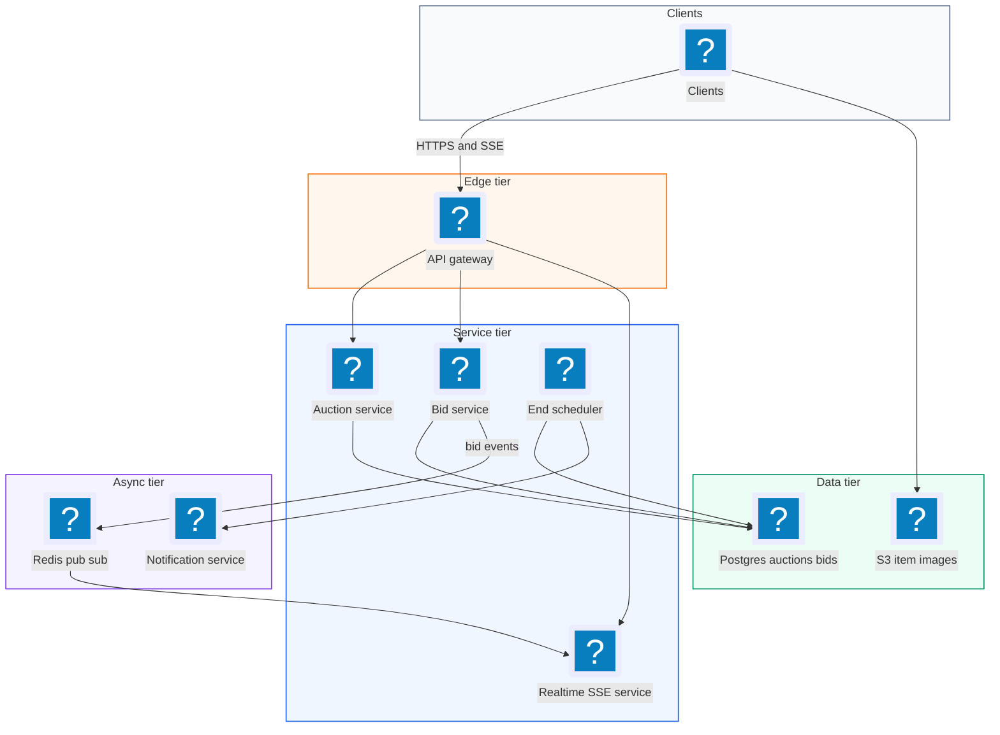
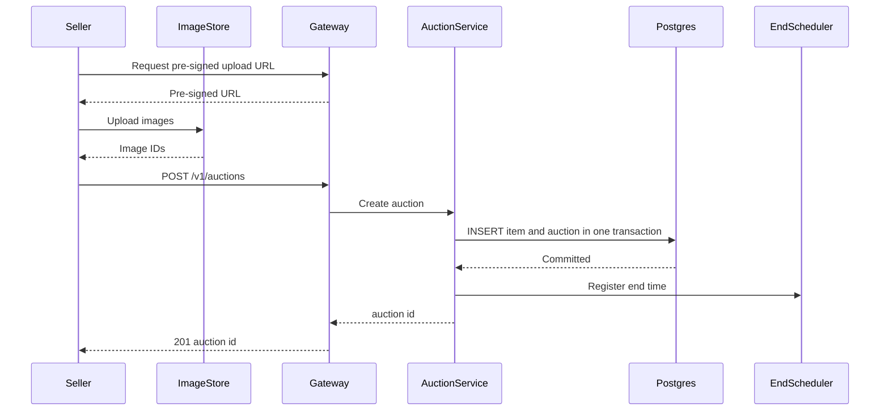
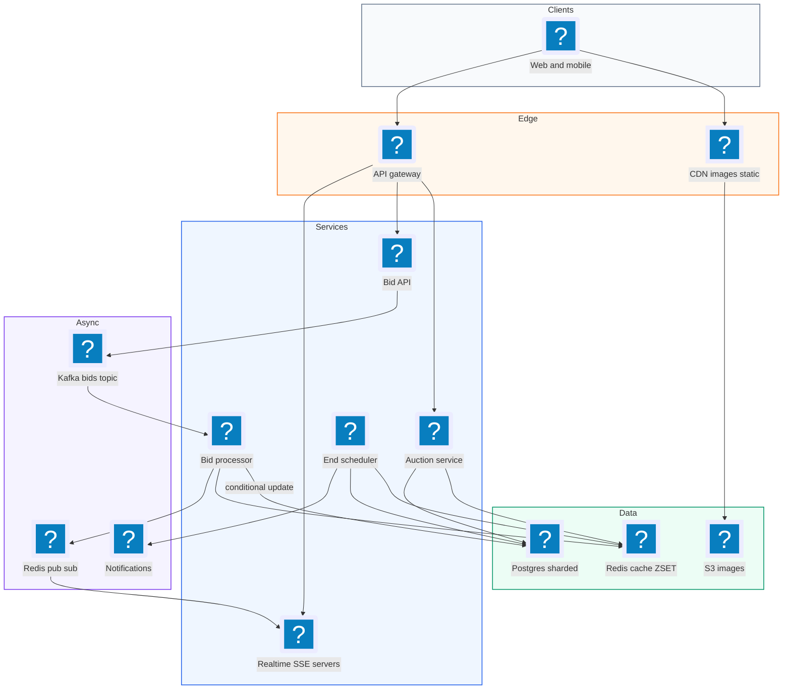

# 14. Online Auction  (Medium)

> An online auction site like eBay lets sellers list an item with a starting price and an end time. Buyers place bids, and each new bid must be higher than the current highest bid. When the clock runs out, the highest bidder wins. The interviewer is really testing one hard correctness problem (two people bid at the same moment, who wins, and do we ever accept a lower bid by mistake), one real-time problem (showing the new highest bid to thousands of watchers within a second), and how you end auctions exactly on time.

## 1. Functional requirements

Core (must have):

1. Sellers can create an auction for an item with a starting price and an end time.
2. Buyers can place a bid. A bid is accepted only if it is higher than the current highest bid (and at least the starting price).
3. Anyone can view an auction, including the current highest bid, and see it update in real time.
4. When an auction ends, the system picks the winner and notifies the winner and seller.

Below the line (out of scope):

1. Search, categories, and sorting. They are a separate search system (Elasticsearch) fed from the auction DB.
2. Payments and shipping. They start after the auction closes and belong to a checkout service.
3. Proxy bidding (eBay's "bid up to $X for me"). Nice extension, mention it if time allows.
4. Fraud and shill bidding detection. An offline ML pipeline.

## 2. Non-functional requirements

1. Strong consistency for bids: we must never accept a bid that is not higher than the true current highest bid, and never lose an accepted bid. This is the CP part.
2. Availability for viewing: browsing auctions should stay up (99.99%) even if the bidding path is degraded. Reads can be slightly stale (a second or two).
3. Low latency: place-bid p99 < 300 ms; new highest bid visible to watchers within 1 second.
4. Scale: 10 million concurrent auctions, about 100 bids per second on average, peaks of thousands of bids per second on one hot auction in its final minute.
5. Fairness: bids are judged in the order the server received them; ties go to the earlier bid.
6. Durability: every accepted bid is stored durably (audit trail, disputes).

CAP choice: per-auction bid acceptance is CP (correctness beats availability, we would rather reject a bid than accept a wrong one). Everything else is AP.

## 3. Back-of-the-envelope estimates

| Assumption | Number |
|---|---|
| Active auctions | 10,000,000 |
| New auctions per day | 1,000,000 |
| Average bids per auction | 100 |
| Bid size stored | 200 B |
| Auction row size (with metadata) | 2 KB |
| Views per bid | 100 |
| Hot auction final-minute peak | 1,000 bids/s |

```text
Writes:
  1M auctions/day x 100 bids  = 100M bids/day
  100M / 86,400 s             = ~1,150 bids/s average
  peak (5x)                   = ~6,000 bids/s globally

Reads:
  100 views per bid           = ~115k reads/s average, ~600k peak

Storage per year:
  bids:     100M/day x 200 B x 365   = ~7.3 TB
  auctions: 1M/day x 2 KB x 365      = ~730 GB
  images live in S3, not counted here

Real-time fanout:
  hot auction: 50k watchers x 1 update/s = 50k messages/s for one item
```

## 4. Core entities

- Auction: the listing. Fields: auction_id, seller_id, item_id, starting_price, end_time, status (active, ended), current_max_bid, current_winner_id, version.
- Item: what is sold. Fields: item_id, title, description, image_urls.
- Bid: one offer. Fields: bid_id, auction_id, bidder_id, amount, created_at, status (accepted, rejected).
- User: buyer or seller. Fields: user_id, name, rating.
- Notification: message to winner, seller, outbid users.

```sql
CREATE TABLE auctions (
  auction_id       BIGINT PRIMARY KEY,
  seller_id        BIGINT NOT NULL,
  item_id          BIGINT NOT NULL,
  starting_price   NUMERIC(12,2) NOT NULL,
  end_time         TIMESTAMPTZ NOT NULL,
  status           TEXT NOT NULL DEFAULT 'active',
  current_max_bid  NUMERIC(12,2),
  current_winner   BIGINT,
  version          BIGINT NOT NULL DEFAULT 0
);
CREATE INDEX ON auctions (status, end_time);

CREATE TABLE bids (
  bid_id      BIGINT PRIMARY KEY,
  auction_id  BIGINT NOT NULL REFERENCES auctions,
  bidder_id   BIGINT NOT NULL,
  amount      NUMERIC(12,2) NOT NULL,
  status      TEXT NOT NULL,          -- accepted / rejected
  created_at  TIMESTAMPTZ NOT NULL DEFAULT now()
);
CREATE INDEX ON bids (auction_id, amount DESC);
```

Use `NUMERIC` (or integer cents), never floats, for money.

## 5. API design

`POST /v1/auctions` -- create an auction.

```json
// request
{ "item": { "title": "Vintage camera", "description": "...",
            "image_ids": ["img_1"] },
  "starting_price": 50.00, "end_time": "2026-11-10T18:00:00Z" }
// 201
{ "auction_id": "a_123", "status": "active" }
```

Status: 201 created, 400 bad input (end time in the past). Auth: seller JWT.

`POST /v1/auctions/{auction_id}/bids` -- place a bid.

```json
// request (Idempotency-Key header to make retries safe)
{ "amount": 120.00 }
// 201 accepted
{ "bid_id": "b_987", "status": "accepted", "current_max_bid": 120.00 }
// 409 rejected
{ "status": "rejected", "reason": "bid_too_low", "current_max_bid": 125.00 }
```

Status: 201, 409 too low, 410 auction ended, 429 too many bids. Auth: buyer JWT; bidder_id comes from the token, never the body.

`GET /v1/auctions/{auction_id}` -- view the auction (item, current max bid, end time). 200 or 404. Public.

`GET /v1/auctions/{auction_id}/stream` -- Server-Sent Events stream of bid updates.

```text
event: bid
data: {"auction_id":"a_123","current_max_bid":130.00,"bid_count":42}
```

## 6. High-level design



### How will sellers create an auction?

1. Client uploads images to S3 with a pre-signed URL and gets image IDs.
2. Client calls `POST /v1/auctions`. Auction Service validates and inserts the item and auction rows in one transaction.
3. The service registers the end time with the End Scheduler (see deep dives).
4. Returns 201 with the auction ID.



### How will buyers place a bid?

1. Client calls `POST /bids` with an idempotency key.
2. Bid Service checks the auction is active and `now < end_time`.
3. Bid Service runs a conditional update so it only succeeds if the new amount is higher than the current max (details in deep dives).
4. On success, it inserts the bid row, commits, and publishes a `bid` event.
5. Returns 201. On failure returns 409 with the current max so the UI can refresh.

### How will users view an auction and see live updates?

1. Client calls `GET /auctions/{id}`. Auction Service reads from cache (Redis) or Postgres.
2. Client opens `GET /auctions/{id}/stream`. The Realtime Service subscribes to channel `auction:{id}` in Redis pub/sub.
3. Every accepted bid is published to that channel and pushed down all open SSE connections.

### How will the system end an auction?

1. At `end_time`, the End Scheduler marks the auction `ended` with a conditional update.
2. It reads the winning bid, then emits an `auction_ended` event.
3. Notification Service emails the winner and seller; Checkout starts.

## 7. Deep dives

### How do we guarantee the highest bid is correct under concurrency?

The problem: current max is $100. Alice bids $110 and Bob bids $105 at the same instant. Both read "max = 100", both think they are higher, both write. If Bob's write lands last, the auction shows $105 and Alice's higher bid is lost.

| Option | How it works | Pros | Cons |
|---|---|---|---|
| Read then write, no lock | Read max, compare in app, write | Simple | Wrong under races |
| Pessimistic lock (`SELECT ... FOR UPDATE`) | Lock the auction row while bidding | Correct, easy to reason | Lock waits on hot auctions |
| Optimistic locking (version column) | Update only if version unchanged, retry on conflict | No lock held, fast when low contention | Many retries at peak |
| Conditional atomic update | `UPDATE ... WHERE current_max_bid < :amount` | One statement, no retry needed | Only works for a single-row rule |
| SERIALIZABLE isolation | DB detects conflicts | Correct for complex logic | Aborts and retries, more expensive |

Recommended: a conditional atomic update. The rule "new bid beats current max" is checked and applied inside one statement, so the database's row lock serializes it. A losing bid simply updates zero rows. No retry loop.

```sql
BEGIN;
UPDATE auctions
   SET current_max_bid = :amount,
       current_winner  = :bidder_id,
       version         = version + 1
 WHERE auction_id = :auction_id
   AND status = 'active'
   AND end_time > now()
   AND :amount > COALESCE(current_max_bid, starting_price - 0.01)
RETURNING version;
-- 1 row  -> accepted: insert bid as accepted
-- 0 rows -> rejected: insert bid as rejected (audit)
INSERT INTO bids (bid_id, auction_id, bidder_id, amount, status)
VALUES (:bid_id, :auction_id, :bidder_id, :amount, :status);
COMMIT;
```

If you prefer optimistic locking (for example, more complex rules like minimum increments that depend on other tables), the pattern is:

```python
def place_bid(auction_id, bidder, amount, retries=3):
    for _ in range(retries):
        a = db.one("SELECT current_max_bid, version FROM auctions "
                   "WHERE auction_id=%s", auction_id)
        if amount <= a.current_max_bid:
            return "rejected"
        n = db.execute("UPDATE auctions SET current_max_bid=%s, "
                       "current_winner=%s, version=version+1 "
                       "WHERE auction_id=%s AND version=%s",
                       amount, bidder, auction_id, a.version)
        if n == 1:
            return "accepted"
    return "retry_later"
```

Why not SERIALIZABLE everywhere? It works, but at peak a hot auction would see many aborted transactions. The conditional update gives the same correctness for this single-row rule at lower cost.

### How do we keep bid ordering fair and survive spikes on hot auctions?

The problem: in the last 30 seconds a popular auction can get 1,000 bids per second ("sniping"). Every bid hits the same Postgres row, so they queue on the row lock. If the DB is slow, requests time out and users do not know if their bid counted.

| Option | How | Pros | Cons |
|---|---|---|---|
| Direct DB writes | Each request updates the row | Simple, immediate answer | Row lock contention, timeouts at peak |
| Kafka partitioned by auction_id | Bids are queued; one consumer per partition processes in order | Durable, strict per-auction order, absorbs spikes | Async, client waits for result |
| Redis per-auction Lua | Atomic compare-and-set in memory, then persist | Very fast | Must handle Redis loss carefully |

Recommended for large scale: write each bid to Kafka with key `auction_id`. Kafka guarantees order inside a partition, and all bids for one auction land in the same partition. A single consumer per partition processes bids one by one, so there is no lock contention at all, and the arrival order is the fairness order. The bid is durable the moment Kafka acks it, so a DB hiccup does not lose it.

```text
 Bid API --(key=auction_id)--> Kafka topic "bids" (64 partitions)
                                 | p0 | p1 | ... | p63 |
                                   |
                       Bid Processor (one per partition)
                         - compare with in-memory max
                         - conditional UPDATE in Postgres
                         - publish result
                                   |
                     +-------------+--------------+
                     v                            v
            Redis pub/sub (viewers)     result to bidder (SSE)
```

```python
# Bid processor loop, one consumer per partition
for msg in consumer:                     # ordered per auction
    bid = json.loads(msg.value)
    accepted = conditional_update(bid)   # SQL from previous deep dive
    publish(f"auction:{bid['auction_id']}", bid, accepted)
    consumer.commit()                    # after DB commit
```

The client gets a fast 202 Accepted with a bid ID, and the final accepted/rejected result arrives on its SSE stream, usually within 100 ms. Processing is at-least-once, so the bid ID is the primary key and a replayed message is ignored.

For a medium-scale interview answer, it is fine to start with direct conditional updates and say "if one auction gets hot, I put Kafka in front, partitioned by auction ID".

### How do viewers see new bids in real time?

| Option | How | Pros | Cons |
|---|---|---|---|
| Polling every 2 s | `GET /auction/{id}` repeatedly | Simple, cacheable | Wasteful, up to 2 s stale |
| Long polling | Request hangs until change | Fewer requests | Reconnect after each update |
| Server-Sent Events | One HTTP stream, server pushes | One-way is all we need, works through proxies, auto-reconnect | One direction only |
| WebSocket | Full duplex socket | Two-way | More complex, sticky connections |

Recommended: SSE. Viewers only need to receive updates; bids go through normal POST. Each Realtime server holds many SSE connections and subscribes to Redis pub/sub channels only for auctions its clients watch.

```python
# Realtime server (async)
async def stream(request, auction_id):
    sub = redis.pubsub()
    await sub.subscribe(f"auction:{auction_id}")
    async def events():
        async for m in sub.listen():
            if m["type"] == "message":
                yield f"event: bid\ndata: {m['data']}\n\n"
    return EventSourceResponse(events())
```

Scaling note: 50,000 watchers on one hot auction spread over 50 Realtime servers means the Bid Processor publishes once, Redis delivers to 50 subscribers, each server writes to 1,000 sockets. Coalesce updates (send at most 5 per second per auction) so a bidding war does not flood phones.

### How do we end auctions exactly on time?

The problem: 1 million auctions end per day, and the end must be precise. A bid at 17:59:59.900 must count; a bid at 18:00:00.100 must not.

| Option | How | Pros | Cons |
|---|---|---|---|
| Cron scanning the DB every minute | `WHERE end_time < now()` | Simple | Up to 60 s late, heavy query |
| Delayed message queue (SQS delay, Kafka timer) | Message delivered at end time | Precise, scalable | Delay limits (SQS max 15 min) |
| Redis sorted set by end time | Poller pops due auctions every 100 ms | Precise, cheap | Needs a durable backup |

Recommended: two layers. The truth is in the DB: every bid checks `end_time > now()` in its own SQL, so no late bid is ever accepted even if the closer is slow. The closer only does housekeeping (mark ended, notify), so a delay of a second there is harmless. A worker scans a Redis sorted set (score = end time) for auctions due in the next second; a slow DB sweep every few minutes catches anything missed.

```python
while True:
    now = time.time()
    due = r.zrangebyscore("auction_end", 0, now, start=0, num=500)
    for aid in due:
        if r.zrem("auction_end", aid):           # claim it
            close_auction(aid)                    # idempotent SQL
    time.sleep(0.1)
```

```sql
-- close_auction is idempotent
UPDATE auctions SET status = 'ended'
 WHERE auction_id = :id AND status = 'active' AND end_time <= now();
```

Many auction sites also add "soft close": a bid in the last 2 minutes extends the end time by 2 minutes, which kills sniping. If you support it, the bid update also bumps `end_time` and re-scores the sorted set.

### How do we handle read load with caching?

Reads are 100x writes. Cache the auction page (item, image URLs, current max) in Redis with key `auction:{id}`. The Bid Processor updates the cached `current_max_bid` right after a successful DB commit (write-through), so the cache is never far behind. Static parts (title, images) go to the CDN. Cache staleness of a second is fine for viewing because the authoritative check happens at bid time in the DB.

## 8. Final architecture



| Component | Job | Technology example |
|---|---|---|
| API Gateway | Auth, rate limiting, routing | Envoy, AWS API Gateway |
| Auction Service | Create and read auctions | Stateless service |
| Bid API + Kafka | Durable, ordered bid intake per auction | Kafka, partition key auction_id |
| Bid Processor | Apply conditional update, publish result | Kafka consumer group |
| Database | Source of truth for auctions and bids | Postgres, sharded by auction_id |
| Cache | Hot auction pages, current max | Redis |
| Realtime | Push bid updates to watchers | SSE servers + Redis pub/sub |
| End Scheduler | Close auctions on time | Redis sorted set + DB sweep |
| Notifications | Outbid, winner, seller emails | SNS/SQS, email/push |

### Deployment map (AWS)

```mermaid
architecture-beta
    group internet(mdi:earth)[Internet]
    group edge(logos:aws-cloudfront)[Edge]
    group vpc(logos:aws-vpc)[AWS VPC]
    group app(logos:aws-ecs)[Service subnet] in vpc
    group data(logos:aws-rds)[Data subnet] in vpc

    service user(mdi:cellphone)[Web and mobile] in internet
    service cdn(logos:aws-cloudfront)[CDN images static] in edge
    service apigw(logos:aws-api-gateway)[API gateway] in edge
    service auction(logos:aws-ecs)[Auction service] in app
    service bidapi(logos:aws-ecs)[Bid API] in app
    service bidproc(logos:aws-ecs)[Bid processor] in app
    service realtime(logos:aws-ecs)[Realtime SSE servers] in app
    service kafka(logos:kafka-icon)[Kafka bids topic] in data
    service pg(logos:aws-rds)[Postgres sharded] in data
    service cache(logos:aws-elasticache)[Redis cache ZSET] in data

    user:R --> L:cdn
    user:B --> T:apigw
    apigw:B --> T:auction
    apigw:R --> L:bidapi
    apigw:R --> L:realtime
    auction:B --> T:pg
    bidapi:B --> T:kafka
    kafka:R --> L:bidproc
    bidproc:B --> T:pg
    bidproc:B --> T:cache
```



Bid intake, processing and live SSE fan-out run as separate fleets in the service subnet, and the ordered Kafka bid log, sharded Postgres and Redis all sit in the data subnet.

## 9. Common mistakes and interviewer follow-ups

- Mistake: reading the max bid, comparing in code, then writing. Two bidders race and the lower bid can win. Say: "the comparison happens inside the UPDATE's WHERE clause, so the DB serializes it."
- Mistake: storing money as floats. Rounding errors create disputes. Say: "integer cents or NUMERIC."
- Mistake: relying only on the closer job to stop bids. If it is late, late bids get accepted. Say: "each bid checks `end_time > now()` itself; the closer is just cleanup."
- Mistake: polling every second for live updates. 50k watchers x 1 req/s is 50k QPS for one item. Say: "SSE plus pub/sub, publish once, fan out per server."
- Mistake: no idempotency on bid retries. A network retry could create duplicate bid rows. Say: "Idempotency-Key header, bid_id as primary key."
- Mistake: one global Kafka partition. It kills throughput. Say: "partition by auction_id; order only matters within one auction."
- Follow-up: "How would you add proxy (automatic) bidding?" Store each user's max secretly; on a new bid, the processor computes the result of all proxies and writes only the final price, still one ordered step per auction.
- Follow-up: "What about clock differences between servers?" Use the DB's `now()` (or the Kafka broker timestamp) as the single clock, never the client's.

## 10. One-page cheat sheet

| Topic | Key point |
|---|---|
| Scale | 10M active auctions, ~1.2k bids/s avg, 1k/s on one hot item |
| Reads vs writes | ~100:1, cache auction page in Redis + CDN |
| Correctness | `UPDATE ... WHERE :amount > current_max_bid` (one atomic statement) |
| Alternative | Optimistic locking with version column, retry on 0 rows |
| Hot auctions | Kafka keyed by auction_id, one consumer per partition, ordered |
| Fairness | Server arrival order (Kafka offset), DB clock |
| Real time | SSE + Redis pub/sub, coalesce to ~5 updates/s |
| Ending | Bid SQL checks end_time; Redis ZSET closer + DB sweep |
| Anti-sniping | Soft close: extend end by 2 min on late bids |
| Idempotency | Idempotency-Key, bid_id primary key |
| Money | Integer cents / NUMERIC |
| CAP | CP for bid acceptance, AP for viewing |

## Sources

- [Hello Interview: Design an Online Auction Platform Like eBay](https://www.hellointerview.com/learn/system-design/problem-breakdowns/online-auction)
- [PostgreSQL docs: Explicit locking and SELECT FOR UPDATE](https://www.postgresql.org/docs/current/explicit-locking.html)
- [PostgreSQL docs: Transaction isolation](https://www.postgresql.org/docs/current/transaction-iso.html)
- [Apache Kafka docs: Partitions and ordering](https://kafka.apache.org/documentation/#intro_concepts_and_terms)
- [MDN: Using server-sent events](https://developer.mozilla.org/en-US/docs/Web/API/Server-sent_events/Using_server-sent_events)
- [Martin Kleppmann: How to do distributed locking](https://martin.kleppmann.com/2016/02/08/how-to-do-distributed-locking.html)
