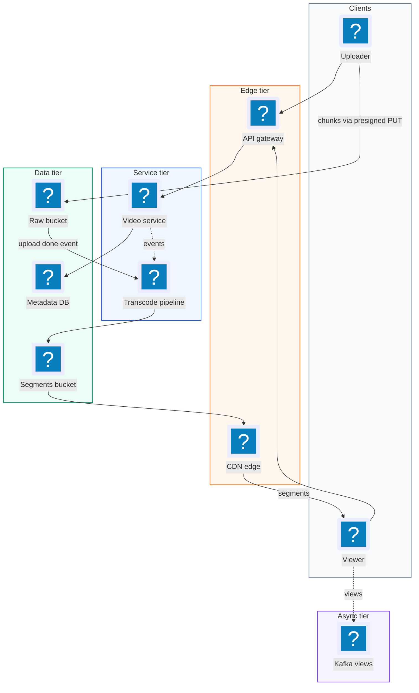
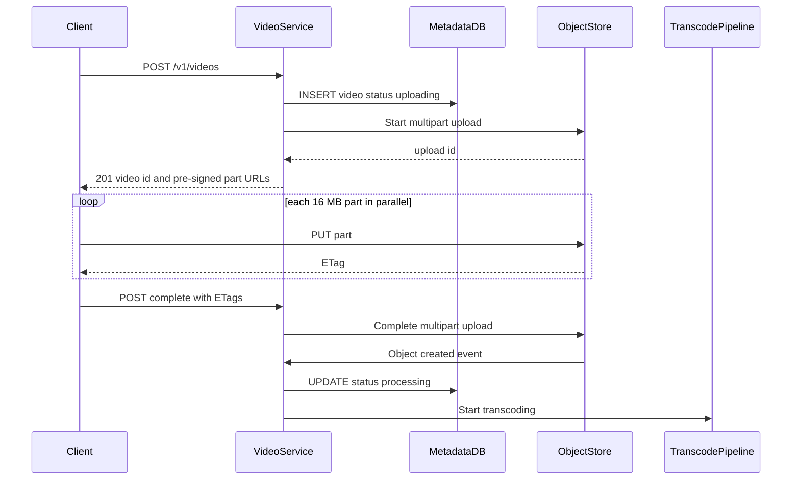
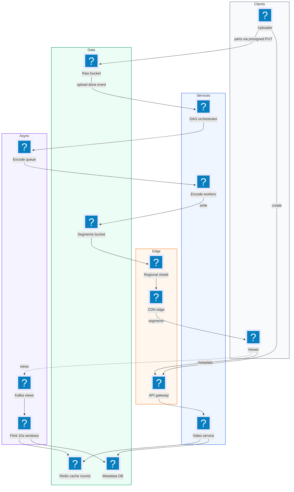

# 15. YouTube  (Medium)

> YouTube lets anyone upload a video and lets anyone else watch it, on any device, on any network speed. The two user actions sound simple, "upload" and "watch", but the files are huge (up to tens of gigabytes), uploads fail halfway, raw video does not play on every phone, and hundreds of millions of people watch every day. The interviewer is really testing whether you can design a large file upload pipeline, a transcoding (format conversion) pipeline, adaptive bitrate streaming so playback never stalls, and a CDN strategy to serve it all cheaply.

## 1. Functional requirements

Core (must have):

1. Users can upload a video (up to tens of GB) with a title and description.
2. Users can watch (stream) a video smoothly on web and mobile, even on slow networks.
3. Uploads can be resumed after a network failure without starting over.
4. Users see a view count on each video.

Below the line (out of scope):

1. Search, recommendations, comments, subscriptions. Each is its own system.
2. Live streaming. Different latency problem (seconds, not minutes, to publish).
3. Content moderation and copyright matching. Important, but an async ML side pipeline.
4. Monetization and ads.

## 2. Non-functional requirements

1. Availability over consistency (AP): watching must be up 99.99%. It is fine if a new video takes a few minutes to appear or a view count lags.
2. Large files: support uploads up to 50 GB.
3. Low latency playback: video starts in under 2 seconds (p95), and rebuffering stays under 1% of watch time.
4. Works on bad networks: quality adapts automatically from 144p to 4K.
5. Scale: 1 million uploads per day, 100 million videos watched per day (closer to billions in real YouTube).
6. Durability: an uploaded video is never lost (11 nines in object storage).
7. Processing time: a 10 minute video is watchable within about 10 minutes of upload finishing.

## 3. Back-of-the-envelope estimates

| Assumption | Number |
|---|---|
| Uploads per day | 1,000,000 |
| Average raw video size | 500 MB |
| Output renditions (144p ... 4K) total size vs raw | ~1.5x raw |
| Videos watched per day | 100,000,000 |
| Average watch time | 5 minutes |
| Average streaming bitrate | 3 Mbps |
| Metadata per video | 2 KB |

```text
Upload bandwidth:
  1M x 500 MB / 86,400 s     = ~5.8 GB/s = ~46 Gbps ingress

Storage per day:
  raw:         1M x 500 MB    = 500 TB
  renditions:  500 TB x 1.5   = 750 TB
  total                       = ~1.25 PB/day -> ~450 PB/year

Streaming egress:
  100M views x 300 s x 3 Mbps = 9e10 Mbit/day
  / 86,400 s                  = ~1 Tbps average (peak ~3 Tbps)
  -> only a CDN can serve this

Metadata:
  write QPS: 1M / 86,400       = ~12/s
  read QPS:  100M / 86,400     = ~1,200/s (x5 peak = 6k/s)
  storage:   1M x 2 KB x 365   = ~730 GB/year
```

The takeaways: metadata is small and easy; video bytes are enormous and must never pass through our app servers.

## 4. Core entities

- User: uploader or viewer. Fields: user_id, name.
- Video: the logical video. Fields: video_id, uploader_id, title, description, status (uploading, processing, ready, failed), duration.
- Upload: one in-progress upload. Fields: upload_id, video_id, total_size, chunk_size, chunks_done.
- Rendition: one encoded version. Fields: video_id, resolution, bitrate, codec, manifest_url.
- Segment: a 2-6 second piece of one rendition stored in object storage.
- ViewCount: aggregated views per video.

```sql
CREATE TABLE videos (
  video_id     TEXT PRIMARY KEY,
  uploader_id  BIGINT NOT NULL,
  title        TEXT NOT NULL,
  description  TEXT,
  status       TEXT NOT NULL,          -- uploading/processing/ready
  duration_s   INT,
  master_manifest_url TEXT,
  created_at   TIMESTAMPTZ DEFAULT now()
);

CREATE TABLE uploads (
  upload_id    TEXT PRIMARY KEY,       -- S3 multipart upload id
  video_id     TEXT REFERENCES videos,
  total_bytes  BIGINT,
  chunk_bytes  INT,                    -- e.g. 16 MB
  parts_done   INT[]                   -- list of completed part numbers
);
```

## 5. API design

`POST /v1/videos` -- start an upload, returns pre-signed chunk URLs.

```json
// request
{ "title": "My trip", "description": "...", "file_size": 2147483648,
  "content_type": "video/mp4" }
// 201
{ "video_id": "v_abc", "upload_id": "u_123", "chunk_size": 16777216,
  "part_urls": [{ "part": 1, "url": "https://s3.../part1?sig=..." }] }
```

Auth: uploader JWT. Status: 201, 400 too large or bad type, 401.

`GET /v1/uploads/{upload_id}` -- which parts are done (for resume).

```json
{ "upload_id": "u_123", "parts_done": [1, 2, 3, 5], "missing": [4, 6] }
```

`POST /v1/uploads/{upload_id}/complete` -- tell the server all parts are uploaded.

```json
// request
{ "parts": [{ "part": 1, "etag": "\"a1b2\"" }] }
// 202
{ "video_id": "v_abc", "status": "processing" }
```

`GET /v1/videos/{video_id}` -- metadata plus the playback manifest URL.

```json
{ "video_id": "v_abc", "title": "My trip", "status": "ready",
  "manifest_url": "https://cdn.example.com/v_abc/master.m3u8",
  "views": 10234 }
```

Public for public videos; 404 if missing, 409 if still processing.

`POST /v1/videos/{video_id}/views` -- record a view (fire and forget). Returns 202.

## 6. High-level design



### How will users upload a video?

1. Client calls `POST /v1/videos`. Video Service writes a `videos` row with status `uploading`, starts an S3 multipart upload, and returns pre-signed URLs for each 16 MB part.
2. Client PUTs parts directly to object storage, several in parallel. Our servers never touch the bytes.
3. Client calls `/complete` with each part's ETag (checksum). Video Service completes the multipart upload.
4. Storage emits an "object created" event. Video Service sets status `processing` and starts the transcoding pipeline.



### How will users watch a video?

1. Client calls `GET /v1/videos/{id}` and gets the master manifest URL on the CDN.
2. The player downloads the manifest, which lists the available qualities.
3. The player picks a quality based on measured bandwidth and downloads 4 second segments from the CDN.
4. It keeps measuring and switches quality between segments as the network changes.

### How will uploads resume after a failure?

1. The client stores `upload_id` locally.
2. After reconnecting, it calls `GET /v1/uploads/{upload_id}`, learns which parts are missing, and uploads only those.

### How will view counts work?

1. The player sends `POST /views` after a few seconds of playback.
2. Events go to Kafka and are counted in batches (deep dive below).

## 7. Deep dives

### How do we handle uploads of tens of GB reliably?

| Option | How | Pros | Cons |
|---|---|---|---|
| Single POST through app servers | Client streams file to our API | Simple | App servers become a bandwidth bottleneck; one failure restarts the whole file |
| Single pre-signed PUT to S3 | Client uploads straight to storage | Offloads servers | 5 GB S3 single PUT limit; no resume |
| Chunked multipart upload with pre-signed URLs | Split into 16 MB parts, upload in parallel, track parts | Resumable, parallel, no app bandwidth | Client logic is more complex |

Recommended: multipart upload. A 10 GB file at 16 MB parts is 640 parts. Losing the network costs at most one part. Uploading 4 parts in parallel uses the full uplink. Each part has an MD5 checksum so corruption is caught.

```python
# client side, simplified
CHUNK = 16 * 1024 * 1024

def upload(path, upload_id, part_urls, done):
    with open(path, "rb") as f:
        for p in part_urls:
            if p["part"] in done:
                continue                      # resume: skip finished
            f.seek((p["part"] - 1) * CHUNK)
            data = f.read(CHUNK)
            resp = http.put(p["url"], data=data, timeout=60)
            resp.raise_for_status()
            save_etag(upload_id, p["part"], resp.headers["ETag"])
```

A small trick: let the client fingerprint the file (hash of size + first and last MB) so a user re-uploading the same file after a crash finds the old `upload_id` automatically.

### How does the transcoding pipeline work?

The problem: a raw upload might be a 4K MOV from an iPhone. Phones on 3G need 240p H.264, smart TVs want 4K VP9 or AV1. Encoding a one hour 4K video on one machine can take hours. We need it in minutes.

The idea: split the video into short pieces, encode pieces in parallel, then stitch. This forms a DAG (directed acyclic graph) of jobs, where some steps depend on others.

```text
                     +--> encode seg1 @ 1080p --+
 raw.mp4 --> split --+--> encode seg1 @ 720p ---+
   |        (GOP-    +--> encode seg2 @ 1080p --+--> package --> manifests
   |         aligned)+--> ...  (N x M jobs)  ---+    (HLS/DASH)   + publish
   |                                            |
   +--> extract audio --> encode AAC/Opus ------+
   +--> thumbnails
   +--> moderation / copyright scan (async)
```

| Option | Pros | Cons |
|---|---|---|
| One worker encodes whole file | Simple | Very slow for long videos |
| Split into segments, parallel workers, DAG orchestrator | Minutes even for long videos, retries per piece | Need an orchestrator and segment alignment |
| Managed service (AWS Elemental MediaConvert) | No ops | Cost, less control |

Recommended: a DAG orchestrator (like Temporal, Airflow, or AWS Step Functions) fans out segment x resolution jobs to a pool of worker machines via a queue. Segments are cut on keyframe (GOP) boundaries so they can be encoded independently. Each job is idempotent: its output path is deterministic, so a retry just overwrites.

```python
# orchestrator sketch
def transcode(video_id, raw_key):
    segs = split_on_keyframes(raw_key, seconds=10)    # e.g. 360 for 1 h
    jobs = [enqueue("encode", video_id, s, r)
            for s in segs for r in ["240p","480p","720p","1080p"]]
    wait_all(jobs, retries=3)
    audio = enqueue("encode_audio", video_id, raw_key)
    wait_all([audio])
    package_hls_dash(video_id)                         # write manifests
    db.update_status(video_id, "ready")
```

Math: 1 hour video, 360 segments x 4 resolutions = 1,440 jobs. If each takes 30 seconds and we give it 200 workers, it finishes in about 1,440 / 200 x 30 s = 3.6 minutes.

### How does adaptive bitrate streaming keep playback smooth?

Adaptive bitrate (ABR) streaming means each quality is cut into small segments (2-6 s), and a text manifest lists them. The player picks the best quality the network can sustain right now, and can switch at every segment boundary. The two standard formats are HLS (Apple, `.m3u8`) and MPEG-DASH (`.mpd`). Both work over plain HTTP, so any CDN can cache them.

| Option | Pros | Cons |
|---|---|---|
| Progressive download of one MP4 | Simple | Stalls on slow networks, wastes data if user leaves |
| HLS | Plays natively on iOS/Safari, widely supported | Historically slightly higher latency |
| DASH | Codec-agnostic open standard, good on Android/web | Not native on Safari |
| CMAF segments + both manifests | One set of segment files, two small manifests | Slightly more packaging work |

Recommended: encode once into CMAF (fragmented MP4) segments and write both an HLS and a DASH manifest pointing to them.

```text
# master.m3u8 (HLS master playlist)
#EXTM3U
#EXT-X-STREAM-INF:BANDWIDTH=400000,RESOLUTION=426x240
240p/index.m3u8
#EXT-X-STREAM-INF:BANDWIDTH=1500000,RESOLUTION=854x480
480p/index.m3u8
#EXT-X-STREAM-INF:BANDWIDTH=3000000,RESOLUTION=1280x720
720p/index.m3u8
#EXT-X-STREAM-INF:BANDWIDTH=6000000,RESOLUTION=1920x1080
1080p/index.m3u8

# 720p/index.m3u8 (media playlist)
#EXTM3U
#EXT-X-TARGETDURATION:4
#EXTINF:4.0,
seg_00001.m4s
#EXTINF:4.0,
seg_00002.m4s
```

```python
# simplified player ABR rule (throughput based)
def pick_rendition(renditions, measured_bps, buffer_s):
    safety = 0.8 if buffer_s > 10 else 0.5     # be careful when buffer low
    ok = [r for r in renditions if r.bandwidth <= measured_bps * safety]
    return max(ok, key=lambda r: r.bandwidth) if ok else renditions[0]
```

### How do we serve 1+ Tbps of video cheaply with a CDN?

The problem: 1 Tbps average egress cannot come from one data center, and a viewer in Mumbai should not fetch bytes from Virginia.

| Option | Pros | Cons |
|---|---|---|
| Serve from origin object store | Simple | Expensive egress, high latency far away |
| Third-party CDN (CloudFront, Akamai) | Global, quick to adopt | Cost at YouTube scale |
| Own edge caches inside ISPs (Google Global Cache, Netflix Open Connect) | Cheapest per GB at huge scale, closest to user | Big investment |

Recommended: a CDN in front of the segment bucket, with a tiered cache (edge -> regional shield -> origin). Video views follow a long-tail pattern: a small set of popular videos makes most traffic, so edge hit ratios of 90%+ are common. For new viral videos, pre-warm the edge by pushing the first segments of the top renditions. Segment URLs are immutable (content never changes), so set `Cache-Control: max-age=31536000, immutable`. Long-tail old videos can be stored in cheaper storage classes and only a few renditions kept hot.

```text
 viewer -> Edge PoP (hit 90%) -> Regional shield (hit 8%) -> Origin S3 (2%)
```

### How do we count views at scale without hurting the database?

Viral videos get thousands of views per second. `UPDATE videos SET views = views + 1` would lock one row thousands of times per second.

| Option | Pros | Cons |
|---|---|---|
| Increment DB row per view | Exact, simple | Hot row, slow |
| Redis INCR per video | Fast | Memory only, lose on crash unless persisted |
| Kafka events + stream aggregation, batch write | Scales, durable, allows dedup and fraud filtering | Counts lag by seconds to minutes |

Recommended: send view events to Kafka, aggregate per video in a stream processor (Flink) every 10 seconds, and add the totals to the DB and a Redis cache. Real YouTube also validates views (bots, refresh spam), which this pipeline makes possible.

```python
# stream job: tumbling 10 s window
counts = defaultdict(int)
for ev in kafka.consume("views", window_s=10):
    if is_valid(ev):            # dedup by (user, video, 30 s)
        counts[ev.video_id] += 1
for vid, n in counts.items():
    db.execute("UPDATE videos SET views = views + %s WHERE video_id=%s",
               n, vid)
    redis.incrby(f"views:{vid}", n)
```

### What happens when transcoding workers fail?

Each job is a message on a queue with a visibility timeout. If a worker crashes, the message reappears and another worker picks it up. Jobs write to deterministic paths, so a duplicate run is harmless. After 3 failures a job goes to a dead letter queue, and the video is marked `failed` with an alert. The raw file stays in storage, so we can always re-run the whole DAG.

## 8. Final architecture



| Component | Job | Technology example |
|---|---|---|
| API Gateway | Auth, routing, rate limit | Envoy, AWS API Gateway |
| Video Service | Metadata, upload sessions, status | Stateless service |
| Metadata DB | Video rows, upload state | Postgres or Cassandra, + Redis cache |
| Raw storage | Original uploads | S3 / GCS multipart |
| Orchestrator | DAG of transcode steps | Temporal, Step Functions, Airflow |
| Encode workers | Split, encode, package | FFmpeg on autoscaled VMs / spot |
| Segment storage | CMAF segments, HLS/DASH manifests | S3 + lifecycle tiers |
| CDN | Serve segments near users | CloudFront, Akamai, own edge caches |
| View pipeline | Count views at scale | Kafka + Flink + Redis |

### Deployment map (AWS)

```mermaid
architecture-beta
    group internet(mdi:earth)[Internet]
    group edge(logos:aws-cloudfront)[Edge]
    group vpc(logos:aws-vpc)[AWS VPC]
    group app(logos:aws-ecs)[Service subnet] in vpc
    group data(logos:aws-rds)[Data subnet] in vpc

    service uploader(mdi:laptop)[Uploader] in internet
    service viewer(mdi:cellphone)[Viewer] in internet
    service cdn(logos:aws-cloudfront)[CDN edge] in edge
    service apigw(logos:aws-api-gateway)[API gateway] in edge
    service video(logos:aws-ecs)[Video service] in app
    service dag(logos:aws-step-functions)[DAG orchestrator] in app
    service encode(logos:aws-batch)[Encode workers] in app
    service metadb(logos:aws-rds)[Metadata DB] in data
    service raw(logos:aws-s3)[Raw bucket] in data
    service seg(logos:aws-s3)[Segments bucket] in data

    uploader:R --> L:apigw
    viewer:R --> L:apigw
    apigw:B --> T:video
    video:B --> T:metadb
    uploader:B --> T:raw
    raw:T --> B:dag
    dag:R --> L:encode
    encode:B --> T:seg
    seg:T --> B:cdn
    cdn:L --> R:viewer
```



Video bytes never touch the API path: uploads land in the raw bucket, encode workers write segments to a second bucket, and the CDN serves them to viewers.

## 9. Common mistakes and interviewer follow-ups

- Mistake: sending video bytes through API servers. 46 Gbps of uploads would need a huge fleet. Say: "pre-signed URLs, client uploads straight to object storage."
- Mistake: one huge upload request. A failure at 95% restarts from zero. Say: "multipart chunks, track finished parts, resume."
- Mistake: storing one MP4 and streaming it. It stalls on slow networks. Say: "ABR with HLS/DASH, 4 s segments, several renditions."
- Mistake: encoding the whole video on one machine. A 1 hour 4K video takes hours. Say: "split on keyframes, fan out to many workers, DAG with retries."
- Mistake: counting views with a DB update per view. Hot row locks. Say: "Kafka plus windowed aggregation, batch writes."
- Mistake: forgetting the CDN math. 1 Tbps from origin is impossible and expensive. Say: "edge + shield caches, immutable segment URLs, 90%+ hit ratio."
- Follow-up: "How do you save storage?" Answer: keep fewer renditions for rarely watched videos, move old raw files to cold storage, and re-encode popular videos with AV1 for 30% smaller files.
- Follow-up: "How do you make a video playable faster?" Answer: publish the low resolutions first, then add higher ones to the manifest as they finish.

## 10. One-page cheat sheet

| Topic | Key point |
|---|---|
| Scale | 1M uploads/day, 100M views/day |
| Upload ingress | ~46 Gbps; storage ~1.25 PB/day |
| Egress | ~1 Tbps avg, CDN required |
| Metadata | Tiny: ~12 writes/s, ~6k reads/s peak |
| Upload | Multipart, 16 MB parts, pre-signed URLs, resumable |
| Transcode | Split on keyframes, DAG, parallel workers, idempotent jobs |
| Formats | CMAF segments, HLS (.m3u8) + DASH (.mpd), 2-6 s segments |
| ABR | Player picks rendition by bandwidth and buffer |
| CDN | Edge -> shield -> origin, immutable URLs, pre-warm viral |
| Views | Kafka + Flink 10 s windows, batch DB updates |
| Failures | Queue retries, DLQ, raw kept for re-run |
| CAP | AP; new video can take minutes to appear |

## Sources

- [Hello Interview: Design a Video Streaming Platform Like YouTube](https://www.hellointerview.com/learn/system-design/problem-breakdowns/youtube)
- [AWS docs: Uploading objects using multipart upload](https://docs.aws.amazon.com/AmazonS3/latest/userguide/mpuoverview.html)
- [Apple: HTTP Live Streaming](https://developer.apple.com/streaming/)
- [Netflix Tech Blog: High quality video encoding at scale](https://netflixtechblog.com/high-quality-video-encoding-at-scale-d159db052746)
- [Netflix Open Connect overview](https://openconnect.netflix.com/en/)
- [System Design Primer (GitHub)](https://github.com/donnemartin/system-design-primer)
