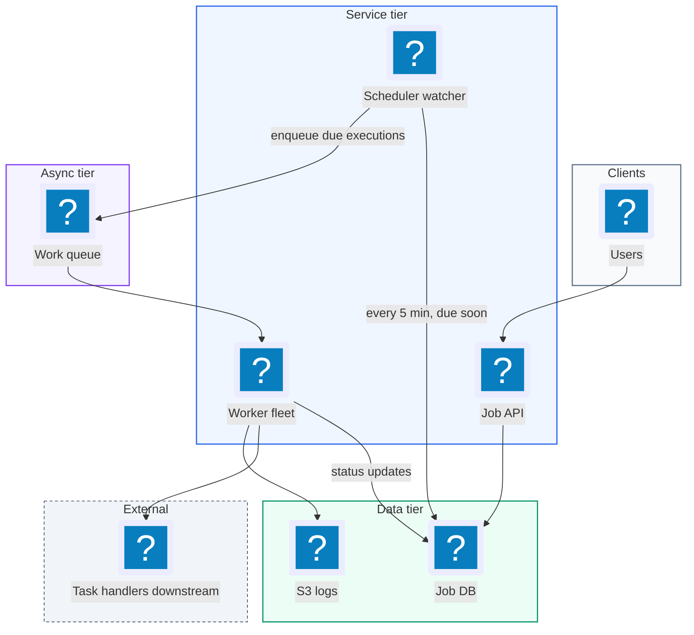
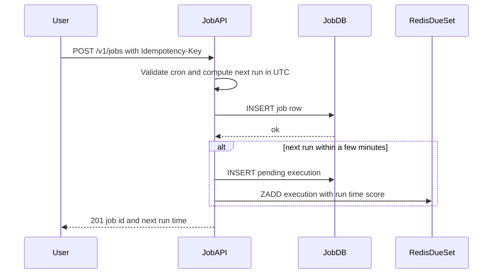
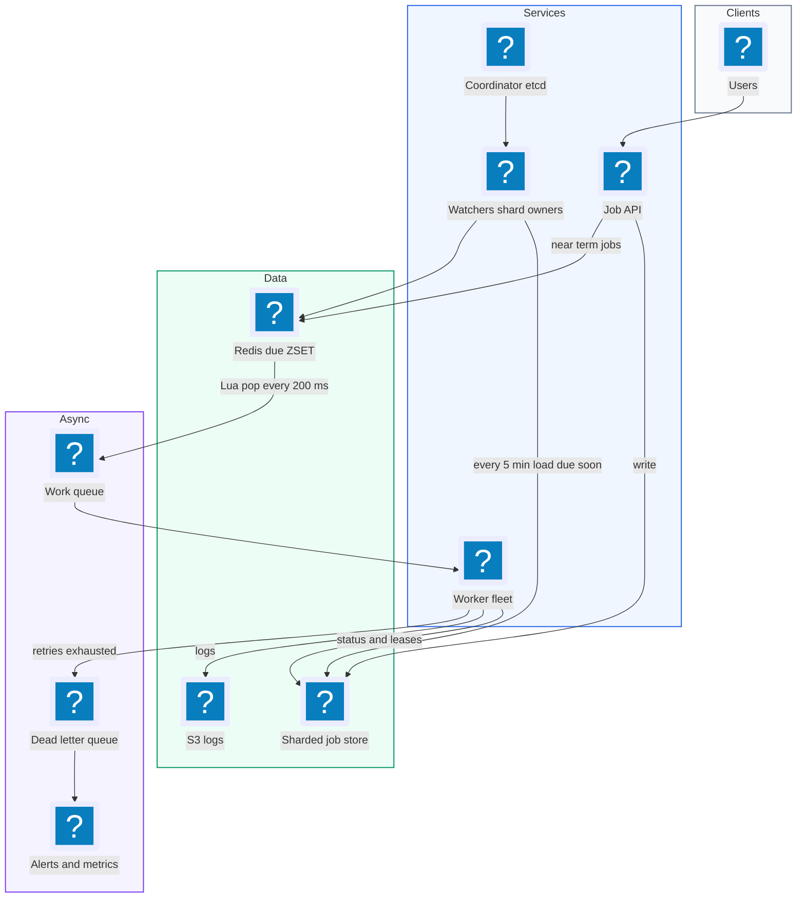

# 16. Job Scheduler  (Medium)

> A distributed job scheduler is "cron for a whole company". Users say "run this task now", "run it at 3 pm Friday", or "run it every day at 10 am", and the system makes sure it runs on time on some worker machine, records whether it worked, and retries if it failed. Think Airflow, AWS EventBridge Scheduler, or Kubernetes CronJobs at large scale. The interviewer is really testing scheduling precision (running jobs within a couple of seconds of their time when there are billions of future jobs), at-least-once execution without accidental double runs, and how workers fail and recover.

## 1. Functional requirements

Two terms first. A task is the reusable piece of work, like "send an email". A job is one scheduled instance of a task with parameters and a time, like "send an email to john@example.com at 10:00 Friday". Each actual run of a job is an execution.

Core (must have):

1. Users can schedule a job to run immediately, at a future time, or on a recurring schedule (a cron expression such as `0 10 * * *`).
2. Users can see the status of each job and its executions (pending, running, succeeded, failed) with logs.
3. Failed executions are retried with backoff, then moved to a dead letter queue.
4. Users can cancel a job.

Below the line (out of scope):

1. DAGs of dependent jobs (job B after job A). That is a workflow engine, a layer on top.
2. Resource-aware placement (GPUs, memory). Assume homogeneous workers.
3. Multi-tenant billing and quotas.

## 2. Non-functional requirements

1. Precision: a job starts within 2 seconds of its scheduled time (p99).
2. Throughput: 10,000 job executions per second at peak.
3. Reliability: at-least-once execution. A scheduled job is never silently skipped. Duplicate runs are rare and handled with idempotency.
4. Durability: once the API returns 201, the job survives any single machine or zone failure.
5. Availability: 99.9% for scheduling API; execution keeps going even if the API is down.
6. Status reads may be eventually consistent (a few seconds old).
7. CAP: the job store prefers consistency for claiming work (two workers must not both believe they own a job for long), while status views are AP.

## 3. Back-of-the-envelope estimates

| Assumption | Number |
|---|---|
| Peak executions per second | 10,000 |
| Average executions per second | 2,000 |
| Job definition size | 1 KB |
| Execution record size | 500 B |
| Average job runtime | 30 s |
| Retention of execution history | 1 year |

```text
Executions per day:
  2,000/s x 86,400              = ~173M per day

Storage for executions:
  173M x 500 B                  = ~86 GB/day
  x 365                         = ~31 TB/year  -> partition by time

Concurrent running jobs (Little's law: L = rate x time):
  10,000/s x 30 s               = 300,000 running at peak
  if one worker runs 50 jobs at once -> 6,000 workers at peak

Scheduler reads:
  every 1 s, fetch jobs due in next window
  10,000 due per second -> one indexed range query per second per shard
```

## 4. Core entities

- Task: the code to run. Fields: task_id, name, handler (container image or function), default timeout.
- Job: a schedule for a task. Fields: job_id, user_id, task_id, params, schedule (one-off time or cron), next_run_at, status (active, paused, cancelled).
- Execution: one run. Fields: execution_id, job_id, scheduled_at, status, attempt, worker_id, started_at, finished_at, error.
- Worker: a machine that runs executions. Fields: worker_id, heartbeat_at, capacity.
- Lease: a time-limited claim of an execution by a worker.

```sql
CREATE TABLE jobs (
  job_id       UUID PRIMARY KEY,
  user_id      BIGINT NOT NULL,
  task_id      TEXT NOT NULL,
  params       JSONB,
  cron_expr    TEXT,                  -- null for one-off jobs
  next_run_at  TIMESTAMPTZ NOT NULL,
  status       TEXT NOT NULL DEFAULT 'active'
);

CREATE TABLE executions (
  execution_id  UUID PRIMARY KEY,
  job_id        UUID NOT NULL,
  scheduled_at  TIMESTAMPTZ NOT NULL,
  status        TEXT NOT NULL,        -- pending/running/succeeded/failed
  attempt       INT NOT NULL DEFAULT 0,
  worker_id     TEXT,
  lease_until   TIMESTAMPTZ,
  error         TEXT,
  UNIQUE (job_id, scheduled_at)       -- one execution per tick
);
CREATE INDEX ON executions (status, scheduled_at);
```

The `UNIQUE (job_id, scheduled_at)` constraint is quietly important: it stops two schedulers from creating the same execution twice.

## 5. API design

`POST /v1/jobs` -- create a job.

```json
// request
{ "task_id": "send_email",
  "params": { "to": "john@example.com", "template": "weekly" },
  "schedule": { "type": "cron", "expr": "0 10 * * *",
                "tz": "America/New_York" },
  "max_retries": 3, "timeout_s": 300 }
// 201
{ "job_id": "j_42", "next_run_at": "2026-11-04T15:00:00Z" }
```

`schedule.type` can be `immediate`, `at` (with `run_at`), or `cron`. Status: 201, 400 bad cron, 401. Auth: user JWT; header `Idempotency-Key` makes retries of this call safe.

`GET /v1/jobs/{job_id}` -- job definition and next run. 200 / 404.

`GET /v1/jobs/{job_id}/executions?status=failed&cursor=...` -- execution history, newest first.

```json
{ "executions": [
    { "execution_id": "e_9", "scheduled_at": "2026-11-03T15:00:00Z",
      "status": "failed", "attempt": 3, "error": "SMTP timeout" } ],
  "next_cursor": "e_8" }
```

`DELETE /v1/jobs/{job_id}` -- cancel future runs. Returns 204.

## 6. High-level design



### How will users schedule a job?

1. Client calls `POST /v1/jobs`.
2. Job API validates the cron expression and computes `next_run_at` in UTC.
3. It inserts the job row. If `next_run_at` is within the next few minutes, it also creates the execution right away (see two-tier design below).
4. Returns 201 with the job ID.



### How will jobs actually run?

1. The Scheduler finds executions whose time has arrived.
2. It puts each one on a queue.
3. A free worker pulls a message, marks the execution `running` with a lease, and runs the task.
4. On success it marks `succeeded`. On failure it schedules a retry or marks `failed`.
5. For recurring jobs, after creating an execution, the Scheduler computes the next cron time and updates `jobs.next_run_at`.

### How will users monitor jobs?

1. Workers write status and a pointer to logs (stored in S3) on the execution row.
2. `GET /executions` reads from the DB, or a read replica, by `job_id`.

## 7. Deep dives

### How do we start jobs within 2 seconds of their scheduled time?

The problem: there might be billions of future jobs. Polling the database every second with `WHERE next_run_at <= now()` across all of them is heavy, and polling less often makes jobs late.

| Option | How | Pros | Cons |
|---|---|---|---|
| Poll DB every second | Range query on index | Simple | Heavy DB load at scale, lock contention between pollers |
| Poll DB every minute | Cheaper | Simple | Up to 60 s late |
| Two-tier: DB + in-memory/Redis sorted set | Every few min load jobs due soon into a fast timer store; fire from there | Precise and cheap | Two components to keep in sync |
| Delayed queue (SQS delay up to 15 min) | Message invisible until due | Managed, precise | 15 min max delay, so still needs a DB tier |

Recommended: two tiers.

- Tier 1 (durable): the database holds every job and execution. Every 5 minutes, a watcher queries "executions due in the next 5 minutes" and loads them into tier 2.
- Tier 2 (precise): a Redis sorted set where the score is the run time (epoch ms). A loop checks every 100-500 ms for items whose score is now or earlier and pushes them to the work queue.

```text
 Job DB  --(every 5 min: due in next 5 min)-->  Redis ZSET "due"
                                                 score = run_at ms
                                                     |
                               every 200 ms: ZRANGEBYSCORE 0 now
                                                     v
                                               Work queue -> workers
```

Popping must be atomic so two scheduler instances never both take the same item. A small Lua script does "get due items and remove them" in one step:

```lua
-- KEYS[1] = due zset, KEYS[2] = ready list
-- ARGV[1] = now_ms, ARGV[2] = batch size
local items = redis.call('ZRANGEBYSCORE', KEYS[1], 0, ARGV[1],
                         'LIMIT', 0, ARGV[2])
for _, id in ipairs(items) do
  redis.call('ZREM', KEYS[1], id)
  redis.call('LPUSH', KEYS[2], id)
end
return #items
```

A job created for "in 30 seconds" skips the 5 minute wait: the API inserts it into the DB and also directly into the Redis set. If Redis is lost, the next watcher pass reloads everything still `pending` from the DB, so nothing is skipped, just delayed by up to one pass.

An alternative Hello Interview mentions is replacing Redis with SQS delayed messages (delay up to 15 minutes), which removes the need to run Redis yourself.

### How do we guarantee at-least-once execution?

At-least-once means every job runs one or more times; never zero. The danger points are: the scheduler crashes after reading a job but before enqueuing it, or a worker crashes halfway through.

| Failure | Protection |
|---|---|
| Scheduler crashes before enqueue | Execution row stays `pending` in DB; next watcher pass re-adds it |
| Queue loses message | Use a durable queue (SQS, Kafka); DB sweep for old `pending` rows |
| Worker crashes mid-run | Lease expires, message becomes visible again, another worker retries |
| Worker hangs forever | Timeout per task; lease not renewed, so it is reclaimed |
| Task throws an error | Retry with exponential backoff, then dead letter |

Leases are the core idea. A worker does not own an execution forever; it owns it until `lease_until`, and it renews the lease with a heartbeat every few seconds while running.

```sql
-- claim: only succeeds if no one else holds a live lease
UPDATE executions
   SET status = 'running', worker_id = :me,
       lease_until = now() + interval '30 seconds',
       attempt = attempt + 1
 WHERE execution_id = :id
   AND (status = 'pending'
        OR (status = 'running' AND lease_until < now()))
RETURNING attempt;
```

```python
def run(execution_id):
    if not claim(execution_id):           # 0 rows -> someone else has it
        return
    stop = start_heartbeat(execution_id, every_s=10)  # extend lease
    try:
        execute_task(execution_id, timeout_s=300)
        mark(execution_id, "succeeded")
    except Exception as e:
        handle_failure(execution_id, e)
    finally:
        stop()
```

With SQS, the visibility timeout plays the same role: a message received but not deleted becomes visible again after the timeout. Workers extend it with `ChangeMessageVisibility` while working.

### How do we prevent duplicate execution, and what if it happens anyway?

At-least-once means duplicates are possible (a worker finishes the work but crashes before marking success, so the lease expires and someone runs it again). We reduce them and make them harmless.

| Layer | Technique |
|---|---|
| Creating executions | `UNIQUE (job_id, scheduled_at)` so two schedulers cannot create the same tick |
| Claiming | Conditional UPDATE / lease, so only one live owner |
| Stale owner | Fencing token: the `attempt` number. Side effects carry it, and old attempts are rejected |
| Side effects | Idempotency key = execution_id passed to downstream APIs |

```python
# task code: make side effects idempotent
def send_email(execution_id, to, template):
    # the email provider dedups on this key for 24 h
    provider.send(to=to, template=template,
                  idempotency_key=str(execution_id))
```

The honest answer to "can you guarantee exactly once?" is: not across a network with crashes. You get at-least-once delivery plus idempotent handlers, which is "effectively once".

### How do retries and the dead letter queue work?

| Option | Pros | Cons |
|---|---|---|
| Immediate retry | Fast recovery from blips | Hammers a broken dependency |
| Fixed delay | Simple | Many jobs retry at the same moment |
| Exponential backoff with jitter | Spreads load, gives systems time to recover | Slower recovery |

Recommended: exponential backoff with jitter (random spread). Retry is just scheduling a new attempt time back into the same sorted set.

```python
import random

def handle_failure(execution_id, err, max_retries=3, base_s=10):
    ex = load(execution_id)
    if ex.attempt >= max_retries:
        mark(execution_id, "failed", error=str(err))
        dlq.send(execution_id)                 # humans / alerts look here
        return
    delay = base_s * (2 ** (ex.attempt - 1))    # 10, 20, 40 s
    delay = random.uniform(0, delay)            # full jitter
    reschedule(execution_id, run_at=now() + delay, status="pending")
```

The dead letter queue holds executions that failed all attempts. Operators get an alert, can inspect the error, fix the bug, and re-drive (re-enqueue) them.

### How does the system scale to 10k executions per second?

1. Partition the job store. Shard the DB (or use DynamoDB) by `job_id`. Each watcher instance owns a set of shards, so range queries stay small. A DynamoDB-style design uses a partition key of time bucket (for example the minute) plus a random suffix, so "due this minute" is a few targeted queries.
2. Multiple scheduler instances. Each owns a subset of shards, assigned by a coordinator (ZooKeeper, etcd, or a simple lease table). If one dies, its shards move to another within seconds.
3. Queue in the middle. The queue decouples "it is time" from "a worker is free". Spikes (every job at midnight) just make the queue deeper for a minute.
4. Autoscale workers on queue depth. 300,000 concurrent runs at peak, about 6,000 workers at 50 slots each. Scale up when queue age passes a few seconds.
5. Spread hot times. Many users pick `0 0 * * *`. Allow users to opt into jitter ("run between 00:00 and 00:05") to flatten the midnight spike.

```text
 Watchers (one per shard group)
   W1: shards 0-31   W2: shards 32-63   W3: shards 64-95
       \                 |                  /
        +--> Redis ZSET (sharded) --> SQS --> autoscaled workers
```

## 8. Final architecture



| Component | Job | Technology example |
|---|---|---|
| Job API | Create, read, cancel jobs | Stateless REST service |
| Job store | Durable jobs and executions | Postgres (partitioned), DynamoDB |
| Watchers | Load jobs due soon into timer store | Service with shard leases via etcd |
| Timer store | Precise firing | Redis sorted set, or SQS delay |
| Work queue | Buffer between time and workers | SQS, Kafka, RabbitMQ |
| Workers | Run tasks with leases and timeouts | Containers on Kubernetes / ECS |
| DLQ | Hold permanently failed runs | SQS DLQ + alerting |
| Observability | Logs, metrics, status | S3, CloudWatch, Prometheus |

### Deployment map (AWS)

```mermaid
architecture-beta
    group internet(mdi:earth)[Internet]
    group edge(logos:aws-cloudfront)[Edge]
    group vpc(logos:aws-vpc)[AWS VPC]
    group app(logos:aws-ecs)[Service subnet] in vpc
    group data(logos:aws-rds)[Data subnet] in vpc

    service user(mdi:laptop)[Users] in internet
    service alb(logos:aws-elastic-load-balancing)[Load balancer] in edge
    service api(logos:aws-ecs)[Job API] in app
    service watchers(logos:aws-ecs)[Watchers shard owners] in app
    service workers(logos:aws-ecs)[Worker fleet] in app
    service jobstore(logos:aws-rds)[Sharded job store] in data
    service due(logos:aws-elasticache)[Redis due ZSET] in data
    service logs(logos:aws-s3)[S3 logs] in data
    service wq(logos:aws-sqs)[Work queue] in data
    service dlq(logos:aws-sqs)[Dead letter queue] in data

    user:R --> L:alb
    alb:B --> T:api
    api:B --> T:jobstore
    api:B --> T:due
    watchers:B --> T:jobstore
    watchers:B --> T:due
    due:R --> L:wq
    wq:T --> B:workers
    workers:B --> T:jobstore
    workers:B --> T:logs
    workers:B --> T:dlq
```



The Job API, watchers and worker fleet are stateless in the service subnet, while the durable job store, the Redis timer set and both queues live in the data subnet.

## 9. Common mistakes and interviewer follow-ups

- Mistake: polling the whole DB every second. At billions of rows it melts the DB. Say: "two tiers: DB for durability, sorted set for the next few minutes."
- Mistake: claiming "exactly once". It cannot be guaranteed with crashes. Say: "at-least-once plus idempotent tasks keyed by execution_id."
- Mistake: a worker deletes the queue message before running the job. A crash then loses the job. Say: "delete or ack only after success; use leases and visibility timeouts."
- Mistake: no lease expiry. A crashed worker's job is stuck "running" forever. Say: "lease_until plus heartbeats; expired leases are reclaimable."
- Mistake: storing cron times in local time. Daylight saving makes jobs skip or double. Say: "store the cron with a time zone, compute next_run_at in UTC."
- Mistake: retrying instantly forever. It floods a broken dependency. Say: "exponential backoff with jitter, max retries, DLQ."
- Follow-up: "What if the whole Redis tier is lost?" Answer: executions are still `pending` in the DB; the next watcher pass reloads them, so the worst case is a few minutes late, never skipped.
- Follow-up: "How do you support job dependencies?" Answer: a workflow layer marks a child job runnable only when parents succeed, then hands it to this same scheduler.

## 10. One-page cheat sheet

| Topic | Key point |
|---|---|
| Terms | Task = code, Job = schedule + params, Execution = one run |
| Scale | 10k exec/s peak, ~173M/day, ~31 TB/year history |
| Concurrency | 10k/s x 30 s = 300k running, ~6k workers |
| Precision | Two-tier: DB (5 min scan) + Redis ZSET (200 ms pop) |
| Atomic pop | Lua: ZRANGEBYSCORE + ZREM in one step |
| No dup ticks | UNIQUE (job_id, scheduled_at) |
| Ownership | Leases + heartbeats; conditional UPDATE to claim |
| Guarantee | At-least-once + idempotent handlers |
| Retries | Exponential backoff + jitter, max 3, then DLQ |
| Scaling | Shard store by job_id, watchers own shards, queue, autoscale |
| Time zones | Cron with tz, next_run_at in UTC |
| CAP | Consistent claims, eventually consistent status |

## Sources

- [Hello Interview: Design a Distributed Job Scheduler](https://www.hellointerview.com/learn/system-design/problem-breakdowns/job-scheduler)
- [AWS docs: Amazon SQS visibility timeout](https://docs.aws.amazon.com/AWSSimpleQueueService/latest/SQSDeveloperGuide/sqs-visibility-timeout.html)
- [AWS docs: Amazon SQS delay queues](https://docs.aws.amazon.com/AWSSimpleQueueService/latest/SQSDeveloperGuide/sqs-delay-queues.html)
- [AWS Architecture Blog: Exponential backoff and jitter](https://aws.amazon.com/blogs/architecture/exponential-backoff-and-jitter/)
- [Martin Kleppmann: How to do distributed locking (fencing tokens)](https://martin.kleppmann.com/2016/02/08/how-to-do-distributed-locking.html)
- [Apache Airflow: Scheduler architecture](https://airflow.apache.org/docs/apache-airflow/stable/administration-and-deployment/scheduler.html)
