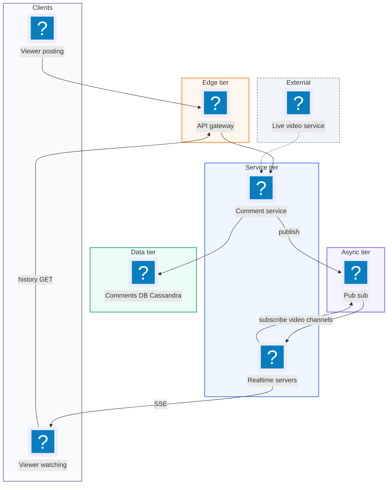
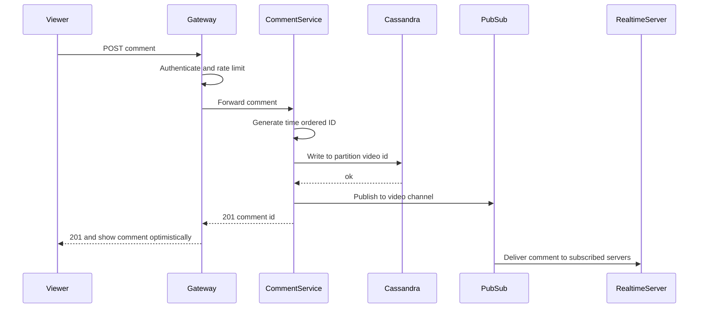
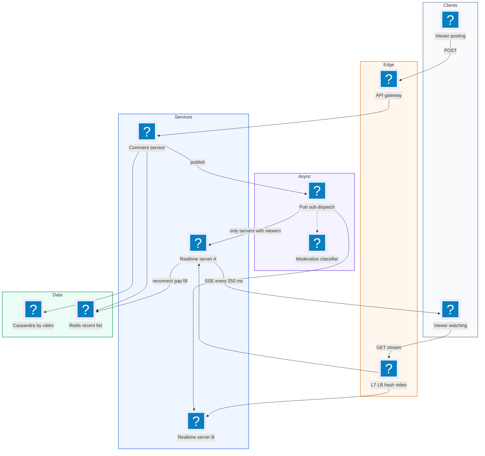

# 17. Facebook Live Comments  (Medium)

> While someone streams a live video on Facebook, viewers type comments and everyone watching sees those comments scroll by almost instantly. A new viewer who joins late can also scroll back to see earlier comments. The interviewer is really testing real-time push at large scale: how you deliver a comment to possibly millions of viewers of one video in under 200 ms, which transport you choose (polling, Server-Sent Events, WebSockets), how you route messages only to the servers that need them, and how you store and page through comments.

## 1. Functional requirements

Core (must have):

1. Viewers can post a comment on a live video.
2. Viewers see new comments in near real time while watching.
3. Viewers can load comments posted before they joined (scroll back).

Below the line (out of scope):

1. Replies and reactions on comments. Same pipeline, more event types.
2. Spam and hate speech moderation. An async classifier that can hide comments after the fact.
3. Comments on recorded (non-live) videos. A normal paginated read, much easier.
4. The live video stream itself. Owned by a separate video team.

## 2. Non-functional requirements

1. Low latency: a comment reaches other viewers within 200 ms p95 (humans perceive under 200 ms as instant).
2. Scale: millions of concurrent live videos, up to thousands of comments per second on one video, and millions of viewers on the most popular video.
3. Availability over consistency (AP): 99.99% for watching comments. It is fine if two viewers see a slightly different order or a comment arrives a second late.
4. Durability: a posted comment is stored and visible later (no loss after 201).
5. Read history fast: loading the last 50 comments takes under 100 ms.
6. Graceful degradation: on a giant video, it is acceptable to show a sample of comments rather than every single one.

## 3. Back-of-the-envelope estimates

| Assumption | Number |
|---|---|
| Concurrent live videos | 1,000,000 |
| Concurrent viewers total | 100,000,000 |
| Average comments per video per second | 1 |
| Hot video: viewers | 5,000,000 |
| Hot video: comments per second | 2,000 |
| Comment size | 200 B |
| Connections per realtime server | 100,000 |

```text
Write QPS:
  1M videos x 1 comment/s          = 1M comments/s total (peak)

Fanout (deliveries):
  average video: 100 viewers x 1/s  = 100 deliveries/s per video
  total: 100M viewers x ~1 msg/s    = ~100M deliveries/s
  hot video: 5M viewers x 2,000/s   = 10 BILLION deliveries/s  (!!)
    -> impossible to send all; we must sample/batch (deep dive)

Connections:
  100M viewers / 100k per server    = 1,000 realtime servers

Storage:
  1M/s x 200 B                      = 200 MB/s
  x 86,400                          = ~17 TB/day
```

The hot video line is the whole interview: you cannot push every comment to every viewer.

## 4. Core entities

- User: a viewer or broadcaster. Fields: user_id, name, avatar_url.
- LiveVideo: the stream being commented on. Fields: video_id, broadcaster_id, status (live, ended). Owned by another team.
- Comment: one message. Fields: comment_id, video_id, author_id, text, created_at.
- Connection: one viewer's open real-time stream. Fields: connection_id, user_id, video_id, server_id.

```sql
-- Cassandra / DynamoDB style: partition by video, cluster by time
CREATE TABLE comments (
  video_id    BIGINT,
  comment_id  TIMEUUID,          -- time-ordered unique id
  author_id   BIGINT,
  text        TEXT,
  PRIMARY KEY ((video_id), comment_id)
) WITH CLUSTERING ORDER BY (comment_id DESC);
```

```json
{
  "comment_id": "01JC8Z7Q5R9X2M3N4P5Q6R7S8T",
  "video_id": 123,
  "author": { "id": 42, "name": "Alice", "avatar": "https://cdn/.../42.jpg" },
  "text": "This is amazing",
  "created_at": "2026-11-03T21:40:00.123Z"
}
```

## 5. API design

`POST /v1/videos/{video_id}/comments` -- post a comment.

```json
// request
{ "text": "This is amazing" }
// 201
{ "comment_id": "01JC8Z7Q...", "created_at": "2026-11-03T21:40:00.123Z" }
```

Auth: session token or JWT; the author ID comes from the token, never the body. Status: 201, 400 empty or too long (over 500 chars), 404 video not live, 429 rate limited.

`GET /v1/videos/{video_id}/comments?before={comment_id}&limit=50` -- older comments (scroll back), newest first.

```json
{ "comments": [ { "comment_id": "01JC8Z...", "text": "..." } ],
  "next_cursor": "01JC8Y..." }
```

`GET /v1/videos/{video_id}/comments/stream` -- Server-Sent Events stream of new comments.

```text
id: 01JC8Z7Q5R9X2M3N4P5Q6R7S8T
event: comment
data: {"comment_id":"01JC8Z7Q...","author":{"name":"Alice"},"text":"Hi"}
```

The `id:` line lets the browser send `Last-Event-ID` on reconnect, so the server can fill the gap.

## 6. High-level design



### How will viewers post a comment?

1. Client calls `POST /comments`. Gateway authenticates and rate limits (for example 1 comment per 2 seconds per user).
2. Comment Service generates a time-ordered ID, writes the comment to Cassandra under partition `video_id`.
3. It publishes the comment to the pub/sub channel `video:{video_id}`.
4. Returns 201. The client shows its own comment immediately (optimistic UI).



### How will viewers see new comments in real time?

1. When a viewer opens the video, the client opens an SSE connection to a Realtime server.
2. That server records "connection C watches video V" in memory and subscribes to channel `video:V` if it is not already subscribed.
3. When a comment is published on `video:V`, the server receives it once and writes it to every local connection watching V.

### How will viewers see comments from before they joined?

1. On open, the client calls `GET /comments?limit=50` to fill the screen with the latest 50.
2. Scrolling up calls the same endpoint with `before=<oldest id on screen>`.
3. Cassandra reads one partition in clustering order, which is a fast sequential read.

## 7. Deep dives

### Which real-time transport should we use?

| Option | How | Latency | Cost | Fit |
|---|---|---|---|---|
| Short polling | Client GETs every 2-3 s | 0-3 s | Huge request volume, mostly empty | Poor |
| Long polling | Request waits until data or timeout | Low | Re-open after each message, header overhead | OK fallback |
| Server-Sent Events | One HTTP response stays open, server writes events | Low | One connection, plain HTTP, auto reconnect with Last-Event-ID | Great for one-way |
| WebSocket | Full duplex TCP channel | Low | Needs upgrade, sticky routing, custom reconnect | Great for two-way chat |

Recommended: SSE. Comments flow mostly from server to client: thousands of reads per write. Posting is rare, so a normal POST is fine. SSE runs over regular HTTP/2, passes through proxies and CDNs easily, and the browser handles reconnect. WebSocket is a fine answer too if you explain the choice; it shines when the client sends often (multiplayer games, collaborative editing).

```python
# Realtime server: one coroutine per connection (FastAPI style)
@app.get("/v1/videos/{vid}/comments/stream")
async def stream(vid: int, request: Request):
    q = asyncio.Queue(maxsize=200)
    local_subs[vid].add(q)
    await ensure_subscribed(vid)              # pub/sub channel once
    async def gen():
        try:
            while not await request.is_disconnected():
                c = await q.get()
                yield f"id: {c['comment_id']}\nevent: comment\n" \
                      f"data: {json.dumps(c)}\n\n"
        finally:
            local_subs[vid].discard(q)
    return StreamingResponse(gen(), media_type="text/event-stream")
```

### How do we route a comment only to the servers that need it?

The problem: 1,000 realtime servers. Viewers of video V are scattered across them. If every comment is broadcast to all 1,000 servers, each server processes 1M comments per second, almost all for videos it has no viewers for.

| Option | How | Pros | Cons |
|---|---|---|---|
| Broadcast to all servers | Every server gets every comment | Simple | 1,000x wasted work |
| Pub/sub channel per video | Server subscribes to `video:V` only when it has a viewer of V | Each server only gets relevant comments | Many channels; subscription churn |
| Partitioned pub/sub (N topics, hash(video) % N) | Server subscribes to topic partitions it needs | Bounded number of channels | Some extra messages per partition |
| Colocate viewers by video on the same servers | Load balancer routes by video_id | Each video touches few servers, fewer subscriptions | Hot video still needs many servers |

Recommended: pub/sub channel per video (Redis pub/sub or a partitioned Kafka/NATS layer), combined with routing viewers of the same video to a small set of servers. With colocation, a video with 300 viewers lives on 1 server instead of 300, so that comment is delivered to 1 server, not 300.

```text
 Without colocation:                With colocation (route by video_id):
 video V viewers on 300 servers     video V viewers on 1-3 servers

 pubsub --> S1 S2 S3 ... S300       pubsub --> S17
          (each sends to 1 viewer)            (sends to 300 viewers)
```

How to colocate: the client first asks a lightweight "which server?" endpoint, and a consistent hash ring maps `video_id` to a server group. Or the L7 load balancer hashes on the `video_id` in the path. For a video too big for one server, the ring assigns it a larger group (see next deep dive). Facebook's own engineering talk on live comments describes a similar idea: a dispatcher layer knows which edge servers have viewers for each video and forwards only there.

### How do we handle a hot video with millions of viewers?

The problem from the estimates: 5M viewers x 2,000 comments/s is 10 billion deliveries per second, and nobody can read 2,000 comments per second anyway. Phones would drown.

| Option | What it does | Pros | Cons |
|---|---|---|---|
| Deliver everything | Push all 2,000/s to everyone | Complete | Impossible bandwidth, useless UX |
| Batch | Server flushes every 200-500 ms as one message | 10-50x fewer network writes | Up to 500 ms extra delay |
| Sample / rank | Send each viewer at most ~10-20 comments/s, prefer friends and high-quality | Fits human reading speed | Viewers see different subsets |
| Fanout tree | Pub/sub -> regional relays -> edge servers | Spreads the fanout over layers | More hops (~10-20 ms each) |

Recommended: combine all three. A fanout tree spreads delivery to the ~50 servers hosting the video's viewers (5M / 100k). Each server batches messages every 250 ms. Each server also caps output at about 15 comments per second per connection, always keeping comments from the viewer's friends and the broadcaster, and sampling the rest.

```python
# per video, per realtime server: batch + sample every 250 ms
async def flush_loop(vid):
    while True:
        await asyncio.sleep(0.25)
        batch = buffers[vid].drain()           # all comments last 250 ms
        for q in local_subs[vid]:
            pick = [c for c in batch if c.author in q.friends][:4]
            rest = [c for c in batch if c not in pick]
            pick += random.sample(rest, min(len(rest), 4 - len(pick)))
            q.put_nowait({"type": "batch", "comments": pick})
```

Sampling is safe because all comments are stored; anyone can still scroll back through the full list. Also protect the write side: per-user rate limits and slow mode (one comment per 10 s per user) during huge events.

### How do we store comments and paginate them?

Writes are append-only, and reads are "latest N for one video, then older". That matches a wide-column store partitioned by `video_id` and clustered by time.

| Option | Pros | Cons |
|---|---|---|
| Postgres with index (video_id, created_at) | Familiar, transactions | 1M writes/s needs heavy sharding |
| Cassandra / DynamoDB (partition = video_id) | High write throughput, fast range reads | Hot partitions for giant videos |
| Redis list of last 1,000 + cold store | Very fast recent reads | Second system to maintain |

Recommended: Cassandra (or DynamoDB) as the source of truth, plus a Redis list of the latest 200 comments per live video for instant first page. For a giant video, split its partition by time bucket, for example `(video_id, minute)`, so one partition does not get every write.

Cursor pagination, not offset. With `OFFSET 1000`, new comments arriving at the top shift everything and the user sees duplicates. A cursor ("give me comments older than this ID") is stable and uses the index directly.

```sql
-- first page
SELECT * FROM comments WHERE video_id = ? LIMIT 50;
-- next page: strictly older than the last id we showed
SELECT * FROM comments WHERE video_id = ? AND comment_id < ? LIMIT 50;
```

### How do we order comments, and what if a viewer disconnects?

Ordering: we promise "roughly the order they were posted". Each comment gets a time-ordered ID at the Comment Service (TIMEUUID, ULID, or Snowflake: timestamp bits + machine bits + sequence). Clients insert by ID, so small network reordering is fixed on screen. Strict global order would require a single sequencer per video, adding latency for little user benefit.

Disconnects: phones lose signal constantly. On reconnect, the browser sends `Last-Event-ID`. The server reads comments newer than that ID from the Redis recent list (or Cassandra) and sends them before resuming live. If the gap is huge, it sends only the latest 50 and a "jump to live" marker.

```python
async def resume(vid, last_id, q):
    missed = await recent_after(vid, last_id, limit=50)   # Redis/Cassandra
    for c in missed:
        q.put_nowait(c)
```

If a realtime server dies, its 100k clients reconnect (with random backoff to avoid a thundering herd) to other servers, which subscribe to the needed channels. Nothing is lost because comments live in the database, not in the server.

## 8. Final architecture



| Component | Job | Technology example |
|---|---|---|
| API Gateway | Auth, rate limit, slow mode | Envoy, NGINX |
| Comment Service | Validate, assign time-ordered ID, store, publish | Stateless service |
| Comment store | Durable comments, cursor reads | Cassandra, DynamoDB |
| Recent cache | Latest 200 per live video, reconnect gap fill | Redis lists |
| Pub/sub dispatch | Route comment to servers that have viewers | Redis pub/sub, NATS, Kafka |
| Realtime servers | Hold SSE connections, batch, sample | Async servers (Go, Node, Python asyncio) |
| Load balancer | Colocate viewers by video | L7 LB with consistent hashing |
| Moderation | Async hide bad comments | ML classifier consuming the stream |

### Deployment map (AWS)

```mermaid
architecture-beta
    group internet(mdi:earth)[Internet]
    group edge(logos:aws-cloudfront)[Edge]
    group vpc(logos:aws-vpc)[AWS VPC]
    group app(logos:aws-ecs)[Service subnet] in vpc
    group data(logos:aws-rds)[Data subnet] in vpc

    service poster(mdi:cellphone)[Viewer posting] in internet
    service watcher(mdi:laptop)[Viewer watching] in internet
    service apigw(logos:aws-api-gateway)[API gateway] in edge
    service lb(logos:aws-elastic-load-balancing)[L7 LB hash video] in edge
    service comment(logos:aws-ecs)[Comment service] in app
    service rta(logos:aws-ecs)[Realtime server A] in app
    service rtb(logos:aws-ecs)[Realtime server B] in app
    service store(logos:aws-dynamodb)[Cassandra by video] in data
    service recent(logos:aws-elasticache)[Redis recent list] in data
    service pubsub(logos:aws-elasticache)[Pub sub dispatch] in data

    poster:R --> L:apigw
    apigw:B --> T:comment
    comment:B --> T:store
    comment:B --> T:recent
    comment:B --> T:pubsub
    pubsub:T --> B:rta
    pubsub:T --> B:rtb
    watcher:R --> L:lb
    lb:B --> T:rta
    lb:B --> T:rtb
    rta:B --> T:recent
```



Posts and SSE streams enter through separate edge paths, and the stateful comment store, recent list and pub sub layer sit together in the data subnet beneath the comment and realtime fleets.

## 9. Common mistakes and interviewer follow-ups

- Mistake: polling every second. 100M viewers means 100M requests per second, mostly empty. Say: "SSE, one long-lived connection per viewer."
- Mistake: broadcasting every comment to every realtime server. Each server drowns in irrelevant traffic. Say: "channel per video, subscribe only when you have a viewer."
- Mistake: trying to deliver all comments of a hot video to all viewers. 10 billion messages per second. Say: "batch every 250 ms, cap and sample per viewer, keep everything in storage."
- Mistake: offset pagination. New comments shift pages and cause duplicates. Say: "cursor on comment_id."
- Mistake: keeping comments only in server memory. A crash loses them. Say: "write to Cassandra first, then publish."
- Mistake: putting WebSocket in without explaining why. It is not wrong, but say why; SSE is simpler for one-way.
- Follow-up: "How do you scale the realtime tier?" Answer: it is stateless except for connections; add servers, and reconnecting clients spread out with jittered backoff.
- Follow-up: "Global users?" Answer: realtime servers in each region, pub/sub replicated between regions; cross-region adds ~100 ms but stays within budget.

## 10. One-page cheat sheet

| Topic | Key point |
|---|---|
| Latency target | < 200 ms post-to-screen |
| Scale | 1M live videos, 100M viewers, 1M comments/s |
| Connections | ~100k per server, ~1,000 realtime servers |
| Transport | SSE for receive, POST for send, Last-Event-ID on reconnect |
| Routing | Pub/sub channel per video, subscribe on first viewer |
| Colocation | Route viewers of one video to the same server group |
| Hot video | Fanout tree + 250 ms batching + per-viewer sampling |
| Storage | Cassandra, partition video_id, cluster by time-ordered id |
| Recent | Redis list of last 200 per live video |
| Pagination | Cursor (`comment_id < ?`), never offset |
| Ordering | Approximate, time-ordered IDs, client sorts |
| CAP | AP; eventual consistency is fine |

## Sources

- [Hello Interview: Design Facebook's Live Comments System](https://www.hellointerview.com/learn/system-design/problem-breakdowns/fb-live-comments)
- [Meta Engineering: Under the hood, broadcasting live video to millions](https://engineering.fb.com/2015/12/03/ios/under-the-hood-broadcasting-live-video-to-millions/)
- [MDN: Using server-sent events](https://developer.mozilla.org/en-US/docs/Web/API/Server-sent_events/Using_server-sent_events)
- [Redis docs: Pub/Sub](https://redis.io/docs/latest/develop/interact/pubsub/)
- [LinkedIn Engineering: Instant messaging at LinkedIn, scaling to hundreds of thousands of persistent connections](https://engineering.linkedin.com/blog/2016/10/instant-messaging-at-linkedin--scaling-to-hundreds-of-thousands-)
- [Apache Cassandra docs: Data modeling](https://cassandra.apache.org/doc/latest/cassandra/developing/data-modeling/index.html)
