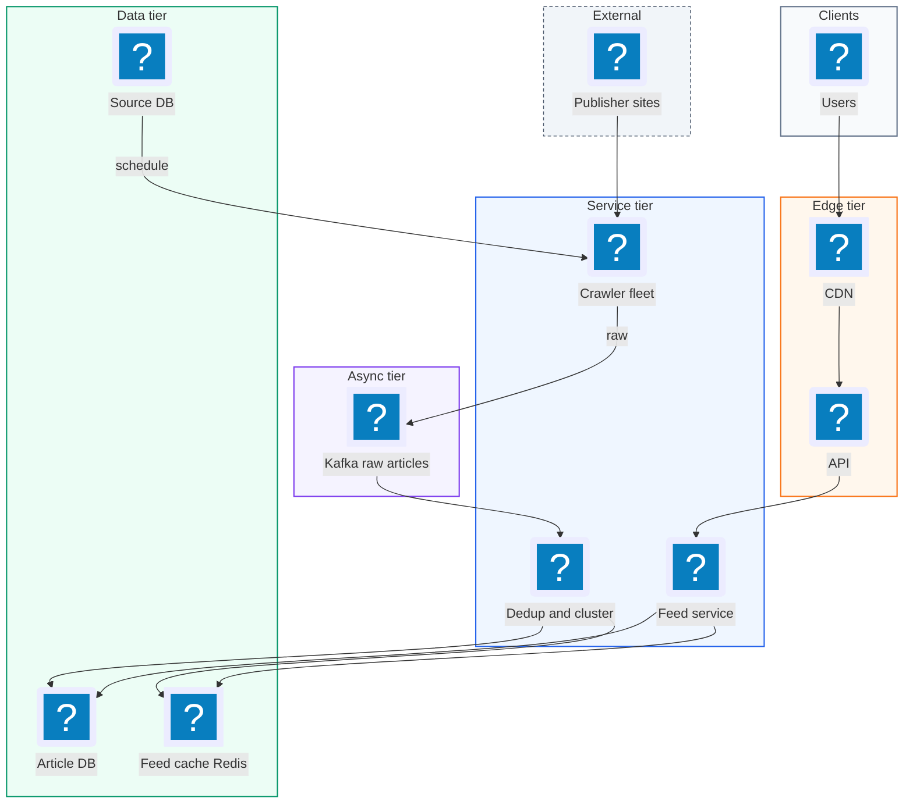
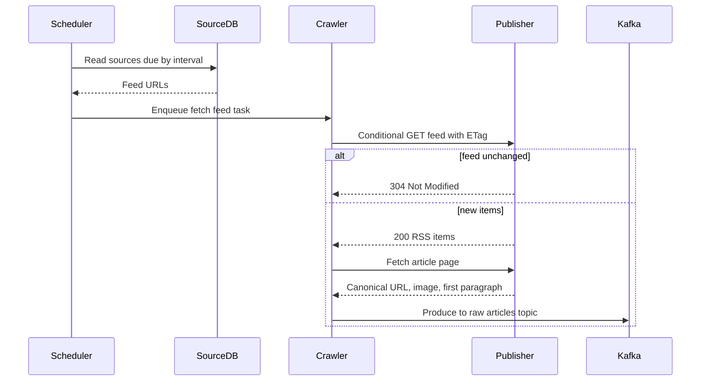
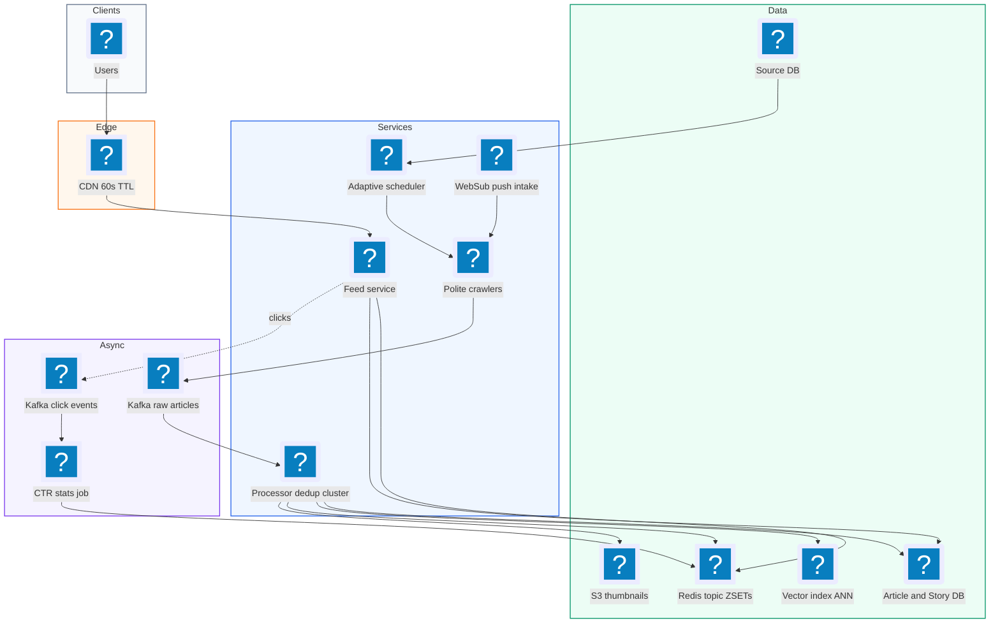

# 18. News Aggregator  (Medium)

> A news aggregator like Google News collects articles from thousands of publishers around the world, groups articles that describe the same story, and shows each user a fresh, ranked feed they can scroll forever. Clicking a headline sends the reader to the publisher's site. The interviewer is really testing four things: ingesting content from many sources on a schedule (crawling and RSS), detecting near-duplicate articles and clustering them into stories, ranking and personalizing the feed, and serving a feed with low latency while keeping it fresh, especially during breaking news spikes.

## 1. Functional requirements

Core (must have):

1. The system ingests articles from thousands of publishers (RSS feeds, sitemaps, and web pages).
2. Users see an aggregated feed of recent news, with duplicate articles about the same event grouped into one story.
3. Users can scroll the feed "infinitely" (paginated).
4. Clicking an article redirects the user to the publisher's site.
5. Users can view topic feeds (World, Sports, Tech) and a personalized "For you" feed.

Below the line (out of scope):

1. Full-text search over articles. A separate Elasticsearch system.
2. Hosting article bodies. We only keep title, snippet, image, and link (copyright and publisher traffic).
3. Comments, sharing, paywall handling.
4. Advanced misinformation detection. Important, but an ML pipeline of its own.

## 2. Non-functional requirements

1. Freshness: a new article appears in feeds within 30 minutes of publication (target 5 minutes for major publishers).
2. Low latency: feed requests p99 under 200 ms.
3. Scale: 100 million daily active users, read-heavy (about 1,000 reads per article write).
4. Spikes: breaking news can cause 10x traffic in minutes; the system must stay up.
5. Availability over consistency (AP): 99.99% for feed reads. Two users can see slightly different feeds; a story may take a minute to merge.
6. Politeness: never overload a publisher's site; obey robots.txt and rate limits per domain.

## 3. Back-of-the-envelope estimates

| Assumption | Number |
|---|---|
| Publishers (sources) | 50,000 |
| New articles per day | 2,000,000 |
| Article metadata size | 2 KB |
| DAU | 100,000,000 |
| Feed requests per user per day | 10 |
| Items per feed page | 20 |
| Feed response size | 20 KB |

```text
Ingestion:
  2M articles / 86,400 s          = ~23 new articles/s (peak ~100/s)
  polling: 50k sources every 5 min = 50,000 / 300 = ~170 fetches/s

Feed reads:
  100M x 10 / 86,400 s            = ~11,600 req/s average
  breaking news 10x               = ~120k req/s peak

Storage:
  2M x 2 KB                       = 4 GB/day
  x 365                           = ~1.5 TB/year (metadata only)
  thumbnails: 2M x 50 KB          = 100 GB/day in object storage

Bandwidth:
  11,600 x 20 KB                  = ~230 MB/s of feed JSON (CDN helps)
```

Reads dwarf writes, and writes are tiny. The hard parts are freshness, dedup, and caching, not raw storage.

## 4. Core entities

- Source (Publisher): where news comes from. Fields: source_id, domain, feed_urls, crawl_interval, authority_score.
- Article: one item from one publisher. Fields: article_id, source_id, url, title, snippet, image_url, published_at, simhash, category, cluster_id.
- Story (Cluster): a group of articles about the same event. Fields: cluster_id, lead_article_id, article_ids, first_seen, last_updated, score.
- User: a reader. Fields: user_id, followed_topics, interest vector.
- Feed: an ordered list of story IDs for a user or topic.

```sql
CREATE TABLE articles (
  article_id    BIGINT PRIMARY KEY,
  source_id     INT NOT NULL,
  url           TEXT UNIQUE NOT NULL,      -- canonical URL
  title         TEXT NOT NULL,
  snippet       TEXT,
  image_url     TEXT,
  category      TEXT,
  published_at  TIMESTAMPTZ NOT NULL,
  simhash       BIGINT,                    -- 64-bit fingerprint
  cluster_id    BIGINT
);
CREATE INDEX ON articles (category, published_at DESC);

CREATE TABLE stories (
  cluster_id      BIGINT PRIMARY KEY,
  lead_article_id BIGINT,
  article_count   INT,
  first_seen      TIMESTAMPTZ,
  last_updated    TIMESTAMPTZ,
  score           REAL
);
```

## 5. API design

`GET /v1/feed?topic=top&cursor=...&limit=20` -- a page of stories for a topic, or for the user when `topic=for_you`.

```json
{
  "stories": [
    { "cluster_id": 991,
      "lead": { "article_id": 5, "title": "Storm hits coast",
                "source": "Example Times", "image": "https://cdn/i/5.jpg",
                "published_at": "2026-11-03T20:55:00Z" },
      "more_coverage": 37 }
  ],
  "next_cursor": "eyJzY29yZSI6MC44MSwiaWQiOjk5MX0="
}
```

Auth: optional. Logged-out users get topic feeds; `for_you` needs a JWT. Status: 200, 400 bad cursor.

`GET /v1/stories/{cluster_id}` -- all articles in one story ("full coverage"). 200 / 404.

`GET /v1/articles/{article_id}/click` -- log the click and redirect.

```text
HTTP/1.1 302 Found
Location: https://publisher.example.com/2026/11/03/storm-hits-coast
```

`POST /v1/admin/sources` -- add a publisher (domain, feed URLs). Admin only. 201.

## 6. High-level design



### How will the system ingest articles from thousands of publishers?

1. A scheduler reads the Source DB and enqueues "fetch this feed" tasks based on each source's interval (popular sources every 1-5 min, small ones every 30-60 min).
2. Crawler workers fetch RSS/Atom feeds (and sitemaps) using conditional GET (`If-Modified-Since`, ETag) so unchanged feeds cost almost nothing.
3. For each new item, the crawler fetches the page to get the canonical URL, the main image, and the first paragraph.
4. Raw articles go onto Kafka topic `raw_articles`.



### How will users see an aggregated, de-duplicated feed?

1. A processing consumer normalizes the article (canonical URL, clean title), computes a fingerprint, and checks for duplicates.
2. It assigns the article to an existing story cluster or creates a new one.
3. It classifies the category (Sports, Tech) and updates the story score.
4. It updates per-topic ranked lists in Redis: `feed:topic:tech` is a sorted set of cluster IDs scored by rank.
5. `GET /feed` reads the top 20 from the sorted set and hydrates story details from cache.

### How will users scroll infinitely?

1. The response includes an opaque cursor encoding the last item's (score, id).
2. The next request asks for items after that cursor (deep dive on stable pagination).

### How will clicks redirect to publishers?

1. The story card links to `/articles/{id}/click`.
2. The service logs a click event to Kafka (used for ranking) and returns 302 to the publisher URL.

## 7. Deep dives

### How do we crawl and ingest at scale while staying fresh and polite?

The problem: 50,000 sources, some publish every minute, some once a week. Fetching all of them every minute is 830 requests per second of mostly "nothing new", and may get us blocked. Fetching all every hour misses the 30 minute freshness goal.

| Option | How | Pros | Cons |
|---|---|---|---|
| Fixed interval polling | Every source every N minutes | Simple | Too slow for big sources or too wasteful for small |
| Adaptive polling | Interval based on each source's recent publish rate | Fresh where it matters, cheap elsewhere | Needs tuning |
| Push (WebSub / PubSubHubbub, publisher APIs) | Publisher notifies us on new content | Near real time, no waste | Only some publishers support it |
| Full web crawl | Follow links across sites | Finds sources without feeds | Expensive, slow, complex |

Recommended: adaptive polling of RSS/sitemaps as the backbone, push (WebSub) where publishers support it, and a light page fetch per new item. Each domain gets a per-domain rate limit (for example at most 1 request per second) and a robots.txt cache.

```python
def next_interval(source):
    # aim to fetch about twice per expected new article,
    # clamped between 1 and 60 minutes
    per_hour = max(source.articles_last_24h / 24, 0.1)
    minutes = 60 / (2 * per_hour)
    return min(max(minutes, 1), 60)

def fetch_feed(source):
    r = http.get(source.feed_url, headers={
        "If-None-Match": source.etag or "",
        "If-Modified-Since": source.last_modified or ""}, timeout=10)
    if r.status_code == 304:
        return []                          # nothing new, very cheap
    source.etag = r.headers.get("ETag")
    return [i for i in parse_rss(r.text) if not seen(i.link)]
```

`seen(url)` is a check against a Bloom filter (a compact, probabilistic "have I seen this?" set) plus a lookup on the unique canonical URL in the DB. Canonical URL means stripping tracking parameters (`utm_*`), using the page's `<link rel="canonical">`, and lowercasing the host.

With 50k sources and adaptive intervals averaging 5 minutes, we need about 170 fetches per second, which a few dozen crawler workers handle easily.

### How do we detect duplicates and cluster articles into stories?

The problem: one event is covered by hundreds of outlets. Wire stories (AP, Reuters) are syndicated almost word for word. Other outlets rewrite them. Users want one card per story with "37 more sources", not 37 identical headlines.

Two separate steps:

1. Near-duplicate detection: is this text basically the same as one we have? (syndicated copies)
2. Story clustering: is this a different article about the same event?

| Technique | What it detects | How it works | Cost |
|---|---|---|---|
| Exact hash (SHA of text) | Identical copies | Hash of normalized text | Very cheap, misses small edits |
| SimHash | Near duplicates | 64-bit fingerprint; similar texts differ in few bits (Hamming distance) | Cheap, great for syndication |
| MinHash + LSH | Near duplicates by shingle overlap (Jaccard similarity) | Many hash minimums, banded into buckets | Moderate, tunable |
| Embeddings + nearest neighbors | Same event, different wording | Sentence embedding of title + lead, cosine similarity | Higher cost, best for clustering |

Recommended: SimHash on title + first paragraph for near duplicates (cheap, catches syndicated wire copy), then embedding similarity plus entity overlap (people, places) within a time window of 48 hours to attach the article to a story cluster.

SimHash in a few lines. Each word "votes" on each of 64 bits; the result flips only a few bits when the text changes slightly.

```python
import hashlib

def simhash(text, bits=64):
    v = [0] * bits
    for word in text.lower().split():
        h = int(hashlib.md5(word.encode()).hexdigest(), 16)
        for i in range(bits):
            v[i] += 1 if (h >> i) & 1 else -1
    return sum(1 << i for i in range(bits) if v[i] > 0)

def hamming(a, b):
    return bin(a ^ b).count("1")

# near-duplicate if fingerprints differ in <= 3 of 64 bits
is_dup = hamming(simhash(t1), simhash(t2)) <= 3
```

To find candidates fast without comparing against every article, split the 64 bits into 4 blocks of 16 and index each block. Two fingerprints within 3 bits must match exactly on at least one block (pigeonhole principle), so we look up only those buckets. MinHash with LSH (locality sensitive hashing) uses the same banding trick for Jaccard similarity.

Clustering sketch:

```python
def assign_cluster(article):
    vec = embed(article.title + " " + article.snippet)
    cands = ann_index.search(vec, k=20, max_age_hours=48)  # vector DB
    best = max(cands, key=lambda c: c.similarity, default=None)
    if best and best.similarity > 0.82 and shares_entities(article, best):
        return best.cluster_id
    return new_cluster(article)
```

Clustering is eventually consistent: two articles may briefly sit in separate clusters and be merged a few minutes later by a periodic re-clustering job.

### How do we rank and personalize the feed?

A story score combines a few understandable signals.

| Signal | Why | Example weight |
|---|---|---|
| Freshness (time decay) | News gets old fast | half-life of 6 hours |
| Coverage (cluster size, growth rate) | Many outlets covering it means it matters | log(sources) |
| Source authority | Trusted, original reporting | 0.5 to 1.5 |
| Engagement (CTR) | Users find it interesting | clicks / impressions, smoothed |
| Personal affinity | User's topics and past clicks | cosine(user, story) |

```python
import math, time

def story_score(s, now=None):
    now = now or time.time()
    age_h = (now - s.first_seen) / 3600
    decay = 0.5 ** (age_h / 6)                    # half-life 6 h
    coverage = math.log1p(s.source_count)
    ctr = (s.clicks + 1) / (s.impressions + 20)   # smoothed
    return decay * (1.0 * coverage + 0.6 * s.authority + 2.0 * ctr)

def personal_score(story, user):
    return story_score(story) * (1 + 0.5 * cosine(user.vec, story.vec))
```

| Personalization approach | Pros | Cons |
|---|---|---|
| Precompute a feed per user | Fastest reads | 100M feeds to update on every new story, heavy writes, wasted for inactive users |
| Compute on request from candidate lists | Fresh, no per-user storage | More CPU per request |
| Hybrid: shared topic lists + light per-user re-rank | Fast and fresh | Slightly less personal |

Recommended: hybrid. Keep global and per-topic ranked lists in Redis (a few hundred lists, not 100 million). On a `for_you` request, merge the user's top 3-5 topics' lists (about 500 candidates), re-rank with `personal_score`, and cache the result for that user for 5 minutes.

### How do we keep feeds fresh but still serve them from cache in under 200 ms?

| Option | Freshness | Latency | Cost |
|---|---|---|---|
| Compute from DB on every request | Perfect | Slow (heavy queries) | High |
| CDN cache whole feed for 10 min | Up to 10 min stale | Very fast | Low |
| Redis sorted sets updated on ingest + short CDN TTL | ~1 min stale | Fast | Low |

Recommended: precomputed ranked lists in Redis that the processing pipeline updates as articles arrive, so the data is fresh by construction. The logged-out topic feeds (the same for everyone) are cached at the CDN for 60 seconds, which absorbs breaking-news spikes: 120k requests per second turn into a few hundred origin requests. Scores decay with time, so a job re-scores the top 2,000 stories per topic every minute.

```python
# on ingest: update the topic list
r.zadd(f"feed:topic:{story.category}", {story.cluster_id: story_score(story)})
r.zremrangebyrank(f"feed:topic:{story.category}", 0, -2001)  # keep top 2000
```

```text
 120k req/s --> CDN (TTL 60 s, hit ~99%) --> ~1k req/s --> Feed Svc --> Redis
```

### How do we paginate an infinite feed when rankings keep changing?

The problem: with `?page=2`, if new stories are inserted at the top between requests, page 2 repeats items from page 1, or skips some.

| Option | Pros | Cons |
|---|---|---|
| Offset (`page=2`) | Simple | Duplicates and gaps when list changes |
| Cursor on (score, id) | Stable relative to last seen item | Scores change over time, items can still move |
| Snapshot the ranked list per session | Perfectly consistent scrolling | Memory per session |

Recommended: on the first request, snapshot the top 500 story IDs for that user into Redis with a 30 minute TTL and return a cursor that is (snapshot_id, position). Further pages read from the snapshot. Pull-to-refresh creates a new snapshot. This is what keeps "infinite scroll" free of duplicates.

```python
def get_feed(user, cursor=None, limit=20):
    if cursor is None:
        ids = rank_for(user)[:500]
        snap = f"snap:{uuid4()}"
        r.rpush(snap, *ids); r.expire(snap, 1800)
        pos = 0
    else:
        snap, pos = decode(cursor)
    page = r.lrange(snap, pos, pos + limit - 1)
    return hydrate(page), encode(snap, pos + limit)
```

### What happens when a publisher or the pipeline fails?

Crawler failures are isolated per source: a site that times out gets exponential backoff and a lower priority, not a retry storm. Kafka between crawling and processing means a processing outage only delays articles; when consumers return they catch up from the last committed offset. Processing is idempotent because the canonical URL is unique, so replays do not create duplicate articles. If Redis is lost, feeds are rebuilt from the Article DB by a backfill job in minutes, and the CDN keeps serving the last cached topic feeds meanwhile.

## 8. Final architecture



| Component | Job | Technology example |
|---|---|---|
| Source DB | Publishers, feed URLs, intervals | Postgres |
| Scheduler + crawlers | Adaptive polling, conditional GET, politeness | Python/Go workers, SQS |
| Push intake | Receive publisher notifications | WebSub hub subscriber |
| Raw queue | Buffer between crawl and processing | Kafka |
| Processor | Normalize, dedup, cluster, classify, score | Flink or consumer services |
| Dedup index | SimHash buckets, URL Bloom filter | Redis, RocksDB |
| Vector index | Similar recent articles for clustering | FAISS, OpenSearch k-NN |
| Article / Story DB | Durable metadata | Postgres or DynamoDB |
| Feed cache | Ranked lists, pagination snapshots | Redis sorted sets and lists |
| Edge cache | Absorb spikes on shared feeds | CloudFront, Fastly |
| Images | Thumbnails resized and cached | S3 + CDN |

### Deployment map (AWS)

```mermaid
architecture-beta
    group internet(mdi:earth)[Internet]
    group edge(logos:aws-cloudfront)[Edge]
    group vpc(logos:aws-vpc)[AWS VPC]
    group app(logos:aws-ecs)[Service subnet] in vpc
    group data(logos:aws-rds)[Data subnet] in vpc

    service user(mdi:cellphone)[Users] in internet
    service cdn(logos:aws-cloudfront)[CDN 60s TTL] in edge
    service scheduler(logos:aws-eventbridge)[Adaptive scheduler] in app
    service crawlers(logos:aws-ecs)[Polite crawlers] in app
    service processor(logos:aws-ecs)[Processor dedup cluster] in app
    service feed(logos:aws-ecs)[Feed service] in app
    service sourcedb(logos:aws-rds)[Source DB] in data
    service articledb(logos:aws-rds)[Article and Story DB] in data
    service topics(logos:aws-elasticache)[Redis topic ZSETs] in data
    service raw(logos:kafka-icon)[Kafka raw articles] in data

    user:R --> L:cdn
    cdn:R --> L:feed
    sourcedb:T --> B:scheduler
    scheduler:R --> L:crawlers
    crawlers:B --> T:raw
    raw:T --> B:processor
    processor:B --> T:articledb
    processor:B --> T:topics
    feed:B --> T:topics
    feed:B --> T:articledb
```



The ingest side and the read side share one VPC: crawlers and the processor fill the data subnet through Kafka, and the feed service reads ranked lists back out behind a short-TTL CDN.

## 9. Common mistakes and interviewer follow-ups

- Mistake: polling every source at the same fixed interval. Either stale or wasteful, and you may get banned. Say: "adaptive intervals from publish rate, conditional GET, push where available, per-domain limits."
- Mistake: dedup by exact URL only. Syndicated wire stories have different URLs and near-identical text. Say: "canonical URL plus SimHash or MinHash for near duplicates, embeddings for same-event clustering."
- Mistake: precomputing a feed for all 100M users. Huge write amplification for users who never open the app. Say: "shared topic lists in Redis, light per-user re-rank on request."
- Mistake: offset pagination. Duplicates when new stories arrive. Say: "snapshot plus cursor."
- Mistake: storing and serving full article text. Legal risk and takes traffic from publishers. Say: "title, snippet, thumbnail, and a redirect."
- Mistake: ignoring breaking-news spikes. Say: "CDN with 60 s TTL on shared feeds turns 120k req/s into ~1k at origin."
- Follow-up: "How do you get articles into feeds within 5 minutes?" Answer: shorter intervals for high-volume sources, WebSub push, and streaming processing (seconds per article) rather than batch jobs.
- Follow-up: "How would you avoid filter bubbles?" Answer: blend a share of top general stories into every personalized feed and diversify sources within a story.

## 10. One-page cheat sheet

| Topic | Key point |
|---|---|
| Scale | 50k sources, 2M articles/day, 100M DAU, ~12k feed req/s |
| Ratio | Reads ~1000x writes; metadata only ~1.5 TB/year |
| Freshness | < 30 min (target 5), adaptive polling + WebSub push |
| Polite crawling | robots.txt, per-domain rate limit, conditional GET |
| Dedup | Canonical URL + Bloom filter; SimHash (<= 3 bits of 64) |
| Clustering | Embeddings + entities, 48 h window, periodic re-merge |
| Ranking | Time decay (6 h half-life) x coverage, authority, CTR |
| Personalization | Topic ZSETs in Redis + per-user re-rank, 5 min cache |
| Latency | Precomputed lists in Redis, < 200 ms |
| Spikes | CDN 60 s TTL on shared feeds |
| Pagination | Snapshot of top 500 + cursor |
| CAP | AP; clusters and feeds eventually consistent |

## Sources

- [Hello Interview: Design a News Aggregator like Google News](https://www.hellointerview.com/learn/system-design/problem-breakdowns/google-news)
- [Google Research: Detecting near-duplicates for web crawling (SimHash)](https://research.google/pubs/detecting-near-duplicates-for-web-crawling/)
- [Stanford, Mining of Massive Datasets: Finding similar items (MinHash and LSH)](http://infolab.stanford.edu/~ullman/mmds/ch3.pdf)
- [Google Research: Google News personalization, scalable online collaborative filtering](https://research.google/pubs/google-news-personalization-scalable-online-collaborative-filtering/)
- [W3C: WebSub recommendation](https://www.w3.org/TR/websub/)
- [MDN: HTTP conditional requests](https://developer.mozilla.org/en-US/docs/Web/HTTP/Conditional_requests)
