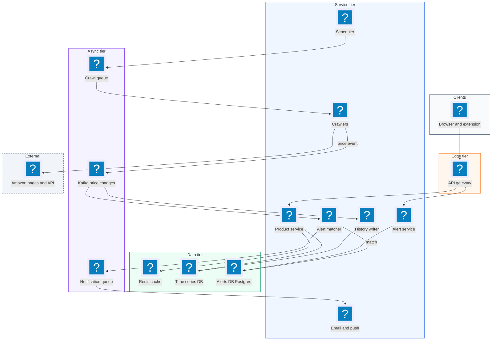
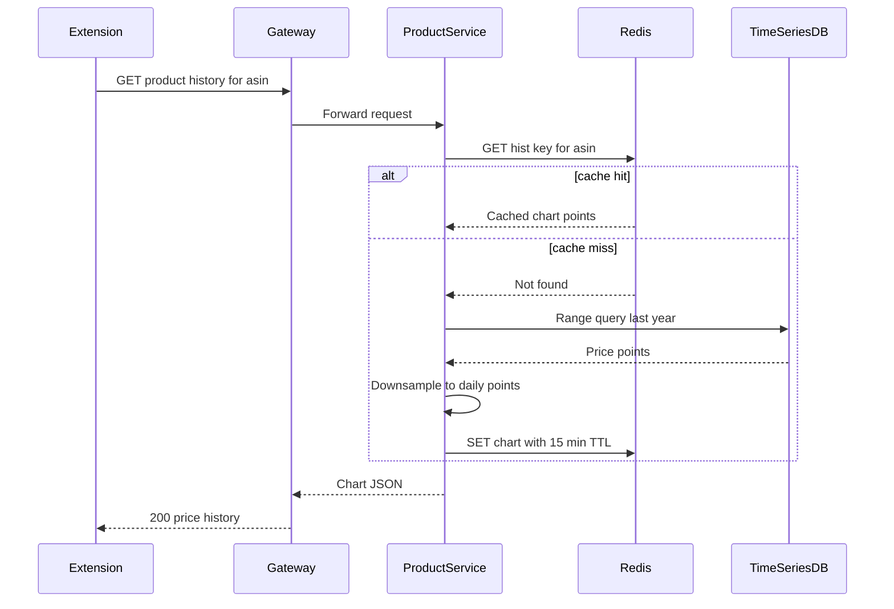
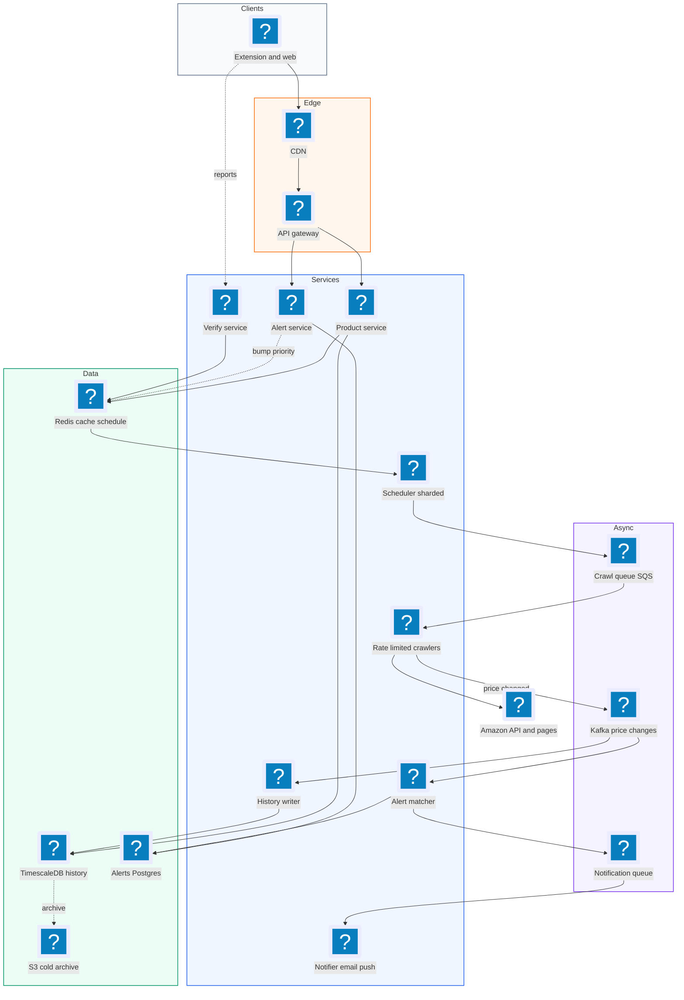

# 19. Price Tracking Service like CamelCamelCamel  (Medium)

> A price tracker watches the prices of Amazon products over time. Users can see a chart of a product's price history, and they can say "email me when this drops below $50." Services like CamelCamelCamel also ship a browser extension that shows the chart right on the Amazon page. The interviewer is really testing three things: how you collect data from a website you do not own without hammering it (crawling politely at a scale of hundreds of millions of products), how you store a huge amount of time-series data cheaply, and how you match a price change against millions of user alerts quickly without sending duplicate emails.

## 1. Functional requirements

Core (must have):

1. Users can view the price history of an Amazon product (website or browser extension).
2. Users can subscribe to a price drop alert with a target price ("tell me when it is below $X").
3. Users get a notification (email or push) when the price drops below their target.
4. Users can list and delete their alerts.

Below the line (out of scope):

1. Product search and discovery. It is a separate search problem (an inverted index) and not the core of this question.
2. Price comparison across many retailers. Same design, more crawlers; it adds breadth, not depth.
3. Reviews and ratings. Unrelated data.
4. Sub-minute "real time" prices. Amazon prices do not change that fast for most items, and chasing it would multiply crawl cost.

## 2. Non-functional requirements

1. Scale: track about 500 million products and 10 million alerts from a few million users.
2. Latency: price history chart loads with p99 < 500 ms. The extension is on the Amazon page, so slow means useless.
3. Freshness: a price drop should trigger a notification within 1 hour for popular products and within 24 hours for long-tail products.
4. Politeness: stay under a fixed request budget per second toward Amazon (for example 1,000 requests per second total) and respect rate limits and robots rules. Getting blocked kills the product.
5. Availability over consistency (AP in CAP terms). If a chart is a few minutes stale, nobody is hurt. Reads should be 99.9% available.
6. Correctness for alerts: each user gets at most one notification per price-drop event (no spam), and should not miss a drop that lasted longer than one crawl interval.
7. Durability: price history is the product's core asset. It must never be lost (replicated storage, 11 nines style object storage for cold data).

CAP choice: we choose availability. Price data is eventually consistent. The only place we want stronger guarantees is the "already notified" record, so we do not double-send, and that is handled with idempotent writes, not with a globally consistent database.

## 3. Back-of-the-envelope estimates

| Assumption | Number |
|---|---|
| Products tracked | 500 M |
| Hot products (tracked by alerts or viewed often) | 10 M |
| Crawl interval, hot | every 1 hour |
| Crawl interval, long tail | every 1 to 7 days |
| Active alerts | 10 M |
| Extension users (daily) | 1 M |
| Chart views per day | 20 M |
| Size of one price point | ~16 bytes (time 8, price 4, extras 4) |
| Price changes actually stored | only when price changes, ~1 per product per day avg |

```text
Crawl rate
  hot:  10M / 3600 s              ~= 2,800 req/s
  tail: 490M / (3 days * 86400 s) ~= 1,900 req/s
  total                           ~= 4,700 req/s  (above our 1,000 budget!)
  -> we cannot crawl everything directly; we need other data sources
     (extension crowd-sourcing, Amazon Product API, smart scheduling)

Read QPS (charts)
  20M / 86400 ~= 230 req/s average, peak x5 ~= 1,200 req/s

Alert writes
  say 200k new alerts/day -> ~2 writes/s (tiny)

Storage per year (change-only encoding)
  500M products * 365 changes * 16 B ~= 2.9 TB/year raw
  with compression (delta + varint)  ~= 1 TB/year
  10 years ~= 10 TB -> fits easily in a time-series DB + S3

Notification volume
  maybe 1% of alerts fire per day -> 100k notifications/day (~1/s)
```

The key insight from the math: crawling is the bottleneck, not storage or reads.

## 4. Core entities

- Product: an Amazon item. Fields: `asin` (Amazon's product id), title, url, current_price, last_crawled_at, crawl_priority.
- PricePoint: one observed price. Fields: asin, observed_at, price_cents, source (crawler, extension, API).
- Alert (subscription): a user's rule. Fields: alert_id, user_id, asin, target_price_cents, status (active, triggered, paused).
- User: account. Fields: user_id, email, push tokens, preferences.
- Notification: a record of something we sent. Fields: notification_id, alert_id, price_event_id, sent_at, channel.
- CrawlTask: a scheduled fetch. Fields: asin, next_run_at, priority.

```sql
CREATE TABLE products (
  asin             VARCHAR(16) PRIMARY KEY,
  title            TEXT,
  current_price    INT,           -- cents
  last_crawled_at  TIMESTAMP,
  next_crawl_at    TIMESTAMP,
  priority         SMALLINT       -- 0 = hottest
);

CREATE TABLE alerts (
  alert_id     BIGINT PRIMARY KEY,
  user_id      BIGINT NOT NULL,
  asin         VARCHAR(16) NOT NULL,
  target_cents INT NOT NULL,
  status       VARCHAR(12) DEFAULT 'active',
  last_fired_price INT
);
-- the most important index: find alerts for a product, cheapest first
CREATE INDEX alerts_by_product ON alerts (asin, target_cents)
  WHERE status = 'active';

-- price history in a time-series table (TimescaleDB style)
CREATE TABLE price_points (
  asin        VARCHAR(16),
  observed_at TIMESTAMPTZ,
  price_cents INT,
  PRIMARY KEY (asin, observed_at)
);
```

## 5. API design

`GET /products/{asin}/history?range=1y` -- price history for the chart.

```json
// response 200
{
  "asin": "B08N5WRWNW",
  "currency": "USD",
  "points": [[1730592000, 4999], [1730678400, 4599]],
  "low": 3999, "high": 5999
}
```

Status: 200, 404 if unknown asin (we may enqueue it for crawling and return 202). No auth needed; it is public and cacheable.

`POST /alerts` -- create a price drop alert. Auth: user token.

```json
// request
{ "asin": "B08N5WRWNW", "target_price_cents": 3999, "channel": "email" }
// response 201
{ "alert_id": 98765, "status": "active" }
```

Status: 201, 400 bad price, 401 not logged in, 409 duplicate alert for same asin.

`GET /alerts` -- list my alerts. Auth required. Response: list of alert objects. 200.

`DELETE /alerts/{alert_id}` -- remove an alert. Auth required, owner only. 204, 404.

`POST /extension/observations` -- the extension reports the price the user is seeing. Auth: extension install token, rate limited.

```json
{ "asin": "B08N5WRWNW", "price_cents": 4599, "seen_at": 1730678400 }
```

Response 202 Accepted (queued, verified later).

## 6. High-level design



### How will users view price history?

1. The extension sees the user is on an Amazon page and reads the asin from the URL.
2. It calls `GET /products/{asin}/history`.
3. The Product Service checks Redis (key `hist:{asin}:1y`). On a hit it returns in a few ms.
4. On a miss it queries the time-series database: `SELECT observed_at, price_cents FROM price_points WHERE asin = ? AND observed_at > now() - interval '1 year'`. It downsamples to about 365 points (one per day) since a chart cannot show more anyway, caches the result for 15 minutes, and returns it.



### How will users subscribe to an alert?

1. User clicks "alert me below $39.99" in the extension.
2. `POST /alerts` hits the Alert Service, which inserts a row in the alerts table.
3. The Alert Service also bumps the product's crawl priority, because someone now cares about it. A product with alerts goes into the hourly tier.
4. If the product is new to us, the service enqueues an immediate crawl.

### How do price changes get detected and turned into notifications?

1. The Scheduler picks products whose `next_crawl_at` has passed and pushes them to the crawl queue.
2. A crawler fetches the page (or the Product Advertising API), parses the price, and compares it with `current_price`.
3. If the price did not change, it just updates `last_crawled_at`. If it changed, it writes a `PriceChanged` event to Kafka.
4. The History Writer consumes the event and appends a row to the time-series DB.
5. The Alert Matcher consumes the same event, finds all active alerts for that asin with `target_cents >= new_price`, and pushes one notification job per alert.
6. The Notification workers send the email or push and record that it was sent.

## 7. Deep dives

### How do we crawl 500 million products without getting blocked?

The math said a naive crawl needs ~4,700 requests per second, but we only want to send about 1,000 per second to Amazon. We have to be smarter about which products we fetch and when.

| Option | How it works | Pros | Cons |
|---|---|---|---|
| Fixed round-robin crawl | Visit every product every N days | Simple | Wastes budget on dead products; popular items too stale |
| Priority scheduling | Crawl interval depends on demand and volatility | Spends budget where users care | Needs a scoring function and a scheduler |
| Crowd-sourced from extension + verify | Extension users report prices they see | Free, very fresh for popular items | Data can be wrong or malicious, must verify |

Recommended: priority scheduling plus extension crowd-sourcing. The score combines how many alerts a product has, how often it is viewed, and how often its price has changed in the past. A product with 5,000 alerts that changes price daily gets crawled hourly. A dusty item with no alerts gets crawled weekly.

```python
def next_interval_seconds(p):
    # demand: alerts + recent views; volatility: changes per week
    demand = p.alert_count * 10 + p.views_7d
    volatility = p.changes_last_30d / 30.0
    if demand > 1000 or volatility > 1:
        return 3600            # hourly
    if demand > 10:
        return 6 * 3600        # every 6 hours
    return 7 * 86400           # weekly

def schedule(p, now):
    p.next_crawl_at = now + next_interval_seconds(p)
```

Politeness rules for the crawler fleet:

- A global token bucket (stored in Redis) caps total requests per second. Every crawler takes a token before a fetch. If no token, it waits.
- Spread requests out over time (add jitter) so we never burst.
- Back off exponentially on HTTP 429 or 503, and pause the whole fleet if the error rate passes a threshold.
- Prefer the official Product Advertising API where allowed; it is cheaper and does not risk blocking.

Extension reports go to a verification step: if three independent users report the same new price within an hour, or one report disagrees with our last crawl, we schedule a priority re-crawl to confirm. That way the extension acts as a free "change detector," and crawlers only confirm.

### How should we store price history efficiently?

Prices are classic time-series data: (key, time, value), append-only, read by time range.

| Option | Pros | Cons |
|---|---|---|
| One row per crawl in Postgres | Simple, SQL | 500M x 24 rows/day is billions of rows of duplicates |
| Store only changes in a time-series DB (TimescaleDB, InfluxDB) | Compression, fast range scans, built-in downsampling | Another system to run |
| Wide-column (Cassandra), row per asin per month | Huge write scale, easy sharding | Less query flexibility |

Recommended: store only changes (a price point is written when the price differs from the last one) in a time-series store, partitioned by asin, with old data rolled into daily summaries. Change-only storage cuts volume by 10 to 50 times because most crawls see the same price.

```sql
-- TimescaleDB hypertable partitioned by time and hashed by asin
SELECT create_hypertable('price_points', 'observed_at',
       partitioning_column => 'asin', number_partitions => 64);

-- continuous aggregate for fast yearly charts
CREATE MATERIALIZED VIEW price_daily
WITH (timescaledb.continuous) AS
SELECT asin, time_bucket('1 day', observed_at) AS day,
       min(price_cents) AS low, max(price_cents) AS high,
       last(price_cents, observed_at) AS close
FROM price_points GROUP BY asin, day;
```

Data older than 2 years can be exported as compressed Parquet files to S3, with the daily summary staying in the hot DB. With ~1 TB per year after compression, storage is cheap. Charts read from `price_daily` and are cached in Redis, so a chart is a single fast lookup.

### When a price changes, how do we find matching alerts fast?

A naive approach scans all 10 million alerts on every price change. With thousands of changes per second, that is impossible.

| Option | How | Cost per price change |
|---|---|---|
| Full scan of alerts | Compare every alert | O(all alerts), far too slow |
| Index by asin | `WHERE asin = ?` then filter by price | O(alerts on that product) |
| Index by (asin, target) sorted | Range scan `target >= new_price` | O(matches), only touches alerts that fire |

Recommended: a composite index on `(asin, target_cents)`. When the price drops to P, we only read alerts whose target is at least P. Because the index is sorted, the database jumps straight to them.

```sql
SELECT alert_id, user_id
FROM alerts
WHERE asin = :asin
  AND status = 'active'
  AND target_cents >= :new_price
  AND (last_fired_price IS NULL OR last_fired_price > :new_price);
```

Hot products (a popular TV with 200,000 alerts on Black Friday) can produce a big result. The matcher pages through results in batches of 1,000 and pushes them to the notification queue, so one giant product does not block other events. Partition Kafka by asin so all events for one product are processed in order by one matcher.

Edge case: only fire when the price crosses the threshold downward. If the price goes $50 -> $38 -> $37, the user with target $40 should get one email, not two. That leads to the next deep dive.

### How do we avoid sending duplicate notifications?

Duplicates happen for three reasons: Kafka redelivers a message after a crash (at-least-once delivery), the price bounces around the threshold, and two crawlers observe the same change.

| Option | Pros | Cons |
|---|---|---|
| Hope it does not happen | Zero work | Users get spammed and unsubscribe |
| Idempotency key per (alert, price_event) | Retries become safe | Need a dedup store |
| Alert state machine (active -> triggered, re-arm on recovery) | Stops threshold flapping | Need re-arm rule |

Recommended: both. Each price change gets an `event_id`. The notifier writes `(alert_id, event_id)` with a unique constraint before sending. The alert itself moves to `triggered` and only re-arms if the price goes back above the target by some margin (say 5%) or after a cooldown of 7 days.

```python
def handle_match(alert, event):
    key = f"notif:{alert.id}:{event.id}"
    # SET NX = only set if not exists; 7 day TTL
    if not redis.set(key, 1, nx=True, ex=7 * 86400):
        return  # already handled this exact event
    db.execute("""UPDATE alerts SET status='triggered',
                  last_fired_price=%s WHERE alert_id=%s
                  AND status='active'""", (event.price, alert.id))
    if db.rowcount == 1:          # we won the race
        notify_queue.put({"alert": alert.id, "price": event.price,
                          "idempotency_key": key})
```

The conditional `UPDATE ... AND status='active'` acts as a compare-and-set. Even if two matchers race, only one sees `rowcount == 1`.

### How does the system scale to millions of tracked products and users?

- Crawlers are stateless workers pulling from a queue (SQS or Kafka). Add more workers up to the politeness budget; use many IP egress points only within the provider's terms.
- The scheduler should not scan a 500M-row table. Keep a Redis sorted set per shard with score = next_crawl_at, and pop due items with `ZRANGEBYSCORE key 0 now LIMIT 0 1000`.
- Alerts DB: 10M rows is small for Postgres. Shard by asin only when needed. Read replicas serve "list my alerts."
- Chart reads: CDN plus Redis caching. The top 1% of products get most views, so the hit rate is high.
- Notification fan-out: a separate notification service with its own queue and rate limits per email provider.

```text
Redis ZSET "crawl:due:shard7"
  score = next_crawl_at (unix), member = asin
Scheduler loop:
  due = ZRANGEBYSCORE crawl:due:shard7 0 NOW LIMIT 0 1000
  push due to crawl queue
  ZADD crawl:due:shard7 (NOW + interval) asin   # reschedule
```

Failure handling: if a crawler dies mid-task, the queue's visibility timeout returns the task. If the matcher dies, Kafka consumer offsets let it resume from the last committed event; the idempotency key makes replays safe. If Amazon blocks us, the circuit breaker pauses crawling and we rely on extension reports until we recover.

## 8. Final architecture



| Component | Job | Technology example |
|---|---|---|
| CDN + API Gateway | Cache public charts, auth, rate limit | CloudFront, Envoy |
| Product Service | Serve history and product info | Go/Java service |
| Cache | Hot charts, crawl schedule, dedup keys | Redis |
| Time-series DB | Price history, daily rollups | TimescaleDB |
| Alerts DB | Alert rows indexed by (asin, target) | PostgreSQL |
| Scheduler | Pick due products by priority | Redis sorted sets |
| Crawlers | Fetch prices politely | Python workers, token bucket |
| Event bus | Fan out price changes | Kafka |
| Alert Matcher | Range query on alerts, dedup | Stateless consumers |
| Notifier | Send email/push | SES, FCM, APNs |
| Archive | Old history | S3 + Parquet |

### Deployment map (AWS)

```mermaid
architecture-beta
    group internet(mdi:earth)[Internet]
    group edge(logos:aws-cloudfront)[Edge]
    group vpc(logos:aws-vpc)[AWS VPC]
    group app(logos:aws-ecs)[Service subnet] in vpc
    group data(logos:aws-rds)[Data subnet] in vpc
    group ext(mdi:earth)[Third parties]

    service user(mdi:laptop)[Extension and web] in internet
    service apigw(logos:aws-api-gateway)[API gateway] in edge
    service product(logos:aws-ecs)[Product service] in app
    service alertsvc(logos:aws-ecs)[Alert service] in app
    service crawlers(logos:aws-ecs)[Rate limited crawlers] in app
    service matcher(logos:aws-lambda)[Alert matcher] in app
    service history(logos:aws-rds)[TimescaleDB history] in data
    service alertsdb(logos:aws-rds)[Alerts Postgres] in data
    service changes(logos:kafka-icon)[Kafka price changes] in data
    service amazon(mdi:earth)[Amazon API and pages] in ext

    user:R --> L:apigw
    apigw:B --> T:product
    apigw:B --> T:alertsvc
    product:B --> T:history
    alertsvc:B --> T:alertsdb
    crawlers:R --> L:amazon
    crawlers:B --> T:changes
    changes:L --> R:history
    changes:R --> L:matcher
    matcher:B --> T:alertsdb
```



Crawlers are the only part of the VPC that talks to Amazon, and every price change flows through one Kafka topic in the data subnet to both the history store and the alert matcher.

## 9. Common mistakes and interviewer follow-ups

- Mistake: crawling every product every hour. Why it hurts: it is 140,000 requests per second and you will be blocked. Say instead: tier crawl frequency by demand and volatility, and use extension data as a change detector.
- Mistake: storing every crawl result. Why it hurts: billions of duplicate rows. Say instead: store only changes and keep daily rollups.
- Mistake: scanning all alerts per price change. Why it hurts: O(N) per event. Say instead: index alerts by (asin, target) and range scan.
- Mistake: ignoring duplicates. Why it hurts: at-least-once delivery plus price flapping spams users. Say instead: idempotency key per (alert, event) and a triggered/re-arm state machine.
- Mistake: trusting extension data blindly. Why it hurts: anyone can fake a $1 price. Say instead: verify with a crawl or multiple independent reports.
- Follow-up: "What if Amazon blocks your crawlers?" Answer: circuit breaker, back off, fall back to the official API and extension reports, alert the on-call.
- Follow-up: "How do you support other retailers?" Answer: a parser plugin per retailer and a per-domain token bucket; the rest of the pipeline is the same.
- Follow-up: "How do you guarantee the 1 hour freshness?" Answer: any product with an alert is in the hourly tier; monitor crawl lag as a metric.

## 10. One-page cheat sheet

| Topic | Key point |
|---|---|
| Scale | 500M products, 10M alerts, ~1k req/s crawl budget |
| Bottleneck | Crawling, not storage |
| Crawl | Priority tiers (hourly/6h/weekly), token bucket, backoff, extension as detector |
| Storage | Change-only time series, ~1 TB/year, daily rollups, S3 archive |
| Chart reads | Redis + CDN, p99 < 500 ms, downsample to ~365 points |
| Alert match | Index (asin, target_cents), range scan target >= price |
| Dedup | Redis SET NX on (alert, event) + triggered state, re-arm rule |
| Events | Kafka partitioned by asin |
| CAP | AP; eventual consistency for prices |
| Failure | Queue visibility timeout, Kafka offsets, idempotent replays, circuit breaker |

## Sources

- [Hello Interview: Design a Price Tracking Service like CamelCamelCamel](https://www.hellointerview.com/learn/system-design/problem-breakdowns/camelcamelcamel)
- [CamelCamelCamel](https://camelcamelcamel.com/)
- [Timescale docs: Continuous aggregates](https://docs.timescale.com/use-timescale/latest/continuous-aggregates/)
- [Google Search Central: Crawl budget management](https://developers.google.com/search/docs/crawling-indexing/large-site-managing-crawl-budget)
- [Amazon Product Advertising API](https://webservices.amazon.com/paapi5/documentation/)
- [Redis docs: Sorted sets](https://redis.io/docs/latest/develop/data-types/sorted-sets/)
