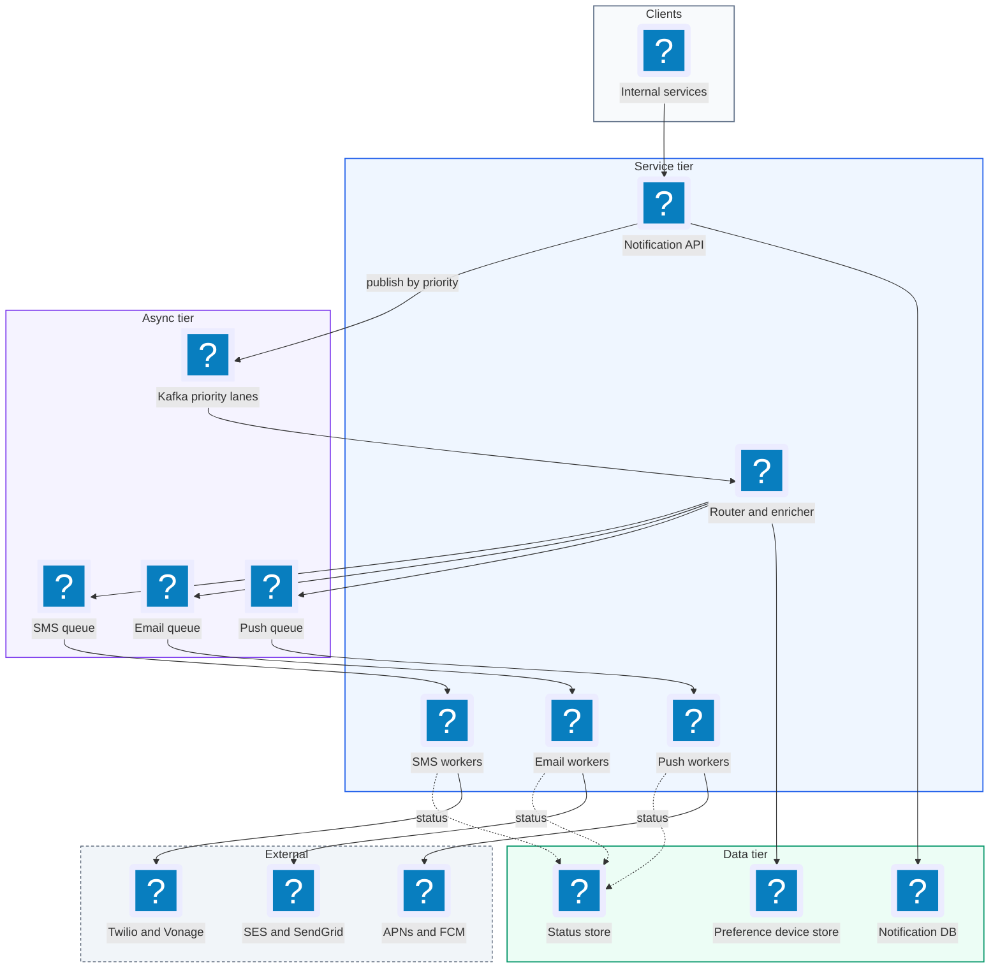
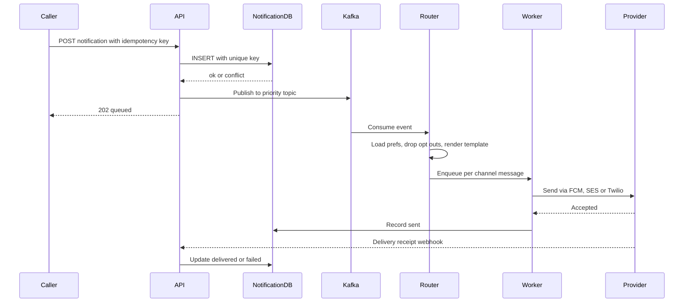
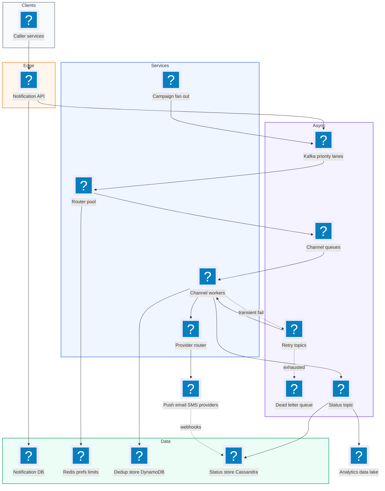

# 20. Notification System  (Medium)

> A notification system is an internal platform. Other teams (chat, orders, marketing) hand it a message and a recipient, and it delivers that message over push (iOS/Android), SMS, or email. The product teams never talk to Apple, Twilio, or SendGrid directly. The interviewer is testing whether you can build a reliable pipeline on top of unreliable third-party providers: fan-out through queues, at-least-once delivery without spamming users twice, per-user preferences and rate limits, retries with a dead letter queue, priority lanes so a password reset is never stuck behind a marketing blast, and failover when a provider goes down.

## 1. Functional requirements

Core (must have):

1. Internal services can send a notification to one user on one or more channels (push, SMS, email).
2. Internal services can send a bulk notification to a large audience (for example 50 million users for a campaign).
3. Users can set preferences: opt out of a channel or a category (for example "no marketing SMS"), and set quiet hours.
4. The system tracks delivery status of each notification (queued, sent, delivered, failed) and callers can query it.
5. Notifications support templates with variables (for example "Hi {name}, your order {id} shipped").

Below the line (out of scope):

- In-app notification inbox UI (it is a separate read-heavy feature, we can mention it as an extra consumer).
- Building our own SMS or push gateway. We use providers like APNs, FCM, Twilio, SES.
- Rich analytics dashboards on open rates. We emit events; analytics is another team.
- Content authoring tools for marketers.

## 2. Non-functional requirements

1. Scale: 1 billion notifications per day on average, peaks of 10x for campaigns.
2. Latency: critical (transactional) notifications such as OTP codes and chat messages reach the provider within p99 < 2 seconds of the API call. Promotional notifications can take minutes.
3. Reliability: at-least-once delivery. A notification accepted by the API is never silently lost (durability 99.999%).
4. No duplicates visible to the user: the same logical notification is delivered at most once per channel, even with retries. We achieve "effectively once" with idempotency keys.
5. Availability: 99.99% for the send API. If a downstream provider fails, we fail over or queue, we do not reject the caller.
6. Isolation: a 50M-user marketing blast must not delay an OTP. Priority lanes.
7. Respect user preferences and per-user rate limits (for example at most 3 marketing pushes per day).
8. CAP choice: we pick availability (AP) for the send path. Accept the message, store it, deliver eventually. Preferences can be eventually consistent (a few seconds stale is fine). Deduplication needs a strongly consistent check per key (a conditional write).

## 3. Back-of-the-envelope estimates

| Assumption | Number |
|---|---|
| Notifications per day | 1 billion |
| Split: push / email / SMS | 70% / 25% / 5% |
| Peak factor | 10x |
| Avg payload stored per notification | 1 KB |
| Status events per notification | 3 (queued, sent, delivered) |
| Retention of notification log | 30 days hot, 1 year cold |
| Users | 500 million |

```text
Average send QPS = 1e9 / 86,400       ~ 11,600 /s
Peak send QPS    = 11,600 * 10        ~ 116,000 /s

Per channel at peak:
  push  = 0.70 * 116k ~ 81,000 /s
  email = 0.25 * 116k ~ 29,000 /s
  SMS   = 0.05 * 116k ~  5,800 /s   (SMS costs money, often ~$0.0075 each)

Storage (notification log):
  1e9 * 1 KB = 1 TB per day
  30 days hot = 30 TB ; 1 year cold = 365 TB (compressed ~100 TB)

Status writes: 3 * 11,600 ~ 35,000 writes/s average, 350k/s peak

Bandwidth to providers at peak: 116k * 1 KB ~ 116 MB/s ~ 1 Gbps
SMS bill: 50M SMS/day * $0.0075 ~ $375k/day  -> rate limits matter!
```

The SMS line is a good thing to say out loud. It shows why dedup and rate limiting are money problems, not just user-experience problems.

## 4. Core entities

- Notification: one logical message to one user. Fields: notification_id, idempotency_key, user_id, category, priority, channels, template_id, variables, created_at.
- Delivery: one attempt to deliver a notification on one channel. Fields: delivery_id, notification_id, channel, provider, status, attempts, last_error.
- Template: a reusable message body per channel and locale. Fields: template_id, channel, locale, subject, body.
- UserPreference: what a user allows. Fields: user_id, category, channel, enabled, quiet_hours.
- DeviceToken / Contact: where to send. Fields: user_id, push tokens (per device), phone, email, verified flag.
- Campaign: a bulk send. Fields: campaign_id, audience query or segment id, template_id, schedule, status.

```sql
CREATE TABLE notification (
  notification_id   UUID PRIMARY KEY,
  idempotency_key   TEXT NOT NULL,
  caller_service    TEXT NOT NULL,
  user_id           BIGINT NOT NULL,
  category          TEXT NOT NULL,      -- 'otp', 'chat', 'marketing'
  priority          SMALLINT NOT NULL,  -- 0 = critical, 1 = normal, 2 = bulk
  template_id       TEXT NOT NULL,
  variables         JSONB,
  created_at        TIMESTAMPTZ NOT NULL,
  UNIQUE (caller_service, idempotency_key)
);

CREATE TABLE delivery (
  delivery_id     UUID PRIMARY KEY,
  notification_id UUID NOT NULL,
  channel         TEXT NOT NULL,        -- 'push', 'sms', 'email'
  provider        TEXT,                 -- 'apns', 'fcm', 'twilio', 'ses'
  status          TEXT NOT NULL,        -- queued/sent/delivered/failed/skipped
  attempts        INT DEFAULT 0,
  last_error      TEXT,
  updated_at      TIMESTAMPTZ
);
```

```json
{
  "user_id": 42,
  "preferences": {
    "marketing": {"push": true, "email": true, "sms": false},
    "security":  {"push": true, "email": true, "sms": true}
  },
  "quiet_hours": {"start": "22:00", "end": "07:00", "tz": "America/New_York"},
  "devices": [{"token": "fcm:abc...", "platform": "android", "last_seen": "2026-10-01"}]
}
```

## 5. API design

All endpoints are internal and authenticated with service-to-service auth (mTLS or signed tokens). Each caller service has a quota.

`POST /v1/notifications` -- send to one user.

```json
{
  "idempotency_key": "order-123-shipped",
  "user_id": 42,
  "category": "order_update",
  "priority": "normal",
  "channels": ["push", "email"],
  "template_id": "order_shipped_v2",
  "variables": {"name": "Ana", "order_id": "123"},
  "expires_at": "2026-11-06T00:00:00Z"
}
```

Response `202 Accepted`:

```json
{"notification_id": "9f1c...", "status": "queued"}
```

Status codes: 202 accepted, 200 with the same body if the idempotency key was already seen (duplicate request), 400 bad template or variables, 429 caller over quota.

`POST /v1/campaigns` -- bulk send to a segment.

```json
{
  "idempotency_key": "black-friday-2026",
  "segment_id": "active_us_users",
  "category": "marketing",
  "template_id": "bf_promo",
  "channels": ["push"],
  "send_at": "2026-11-27T14:00:00Z",
  "expires_at": "2026-11-28T00:00:00Z"
}
```

Response `202 Accepted` with `{"campaign_id": "c-77", "status": "scheduled"}`.

`GET /v1/notifications/{id}` -- delivery status per channel.

```json
{"notification_id": "9f1c...",
 "deliveries": [
   {"channel": "push", "status": "delivered", "attempts": 1},
   {"channel": "email", "status": "sent", "attempts": 2}]}
```

`PUT /v1/users/{user_id}/preferences` -- user (via the app backend) updates opt-outs and quiet hours. Auth: the user's session token, checked by the app gateway. Returns 200.

`POST /v1/users/{user_id}/devices` -- register or refresh a push token. Returns 201.

`POST /v1/providers/{provider}/callbacks` -- webhook for provider delivery receipts (Twilio, SES). Verified with the provider's signature. Returns 200.

## 6. High-level design



### How will a service send a notification to one user?

1. The caller sends `POST /v1/notifications` with an idempotency key.
2. The API validates the request and checks the caller's quota.
3. It inserts a row in the notification table. The unique constraint on `(caller_service, idempotency_key)` catches duplicate calls. If the insert conflicts, return the existing id with 200.
4. It publishes the notification id and payload to the Kafka topic for its priority. It returns 202. The caller is now done.
5. A router consumes the event. It loads the user's preferences and contacts (from a cache in front of the DB). It drops channels the user opted out of and writes `skipped` deliveries for them.
6. It renders the template per channel and locale, then enqueues one message per channel onto the channel queues.
7. Channel workers call the provider (FCM, SES, Twilio), record `sent`, and handle errors.
8. Providers later send delivery receipts via webhook. We update the delivery row to `delivered` or `failed`.



### How will a service send a bulk campaign?

1. Marketing calls `POST /v1/campaigns`. We store the campaign and schedule it.
2. At `send_at`, a campaign fan-out job reads the segment (a list of user ids, often from a data warehouse export or a segment service) in pages of 10,000.
3. For each page it creates notification records with deterministic idempotency keys like `campaign_id:user_id` and publishes them to the bulk topic.
4. From there the flow is the same as the single-user flow, on the bulk lane.

### How will users manage preferences?

1. The app backend calls `PUT /v1/users/{id}/preferences`.
2. We write to the preference DB (a key-value store keyed by user_id) and invalidate the cache entry.
3. The router reads preferences on every notification, so the change takes effect within seconds.

### How will callers see delivery status?

1. Workers and webhooks write status events to a status topic.
2. A consumer updates the delivery table (Cassandra or DynamoDB, keyed by notification_id).
3. `GET /v1/notifications/{id}` reads that table.

## 7. Deep dives

### How do we fan out to millions of users without melting anything?

The problem: one campaign call can mean 50 million notifications. If the API tried to do this inline, the request would time out and a crash halfway would leave us not knowing who got the message.

| Option | How it works | Pros | Cons |
|---|---|---|---|
| Loop in the API | API iterates users and calls providers | Simple | Times out, no recovery, no backpressure |
| One queue message per user, produced by a fan-out job | Job pages through segment, publishes per-user events | Resumable, parallel, backpressure | Fan-out job must checkpoint |
| Send one "campaign" event, let workers expand | Each worker expands a shard of the segment | Very parallel | Harder to reason about progress |

Recommended: a fan-out job that pages through the segment and checkpoints the last page it published. Kafka absorbs the burst. Workers drain at the rate providers allow.

```python
def fan_out(campaign):
    cursor = load_checkpoint(campaign.id)        # resume after crash
    while True:
        page, cursor = segment.read(campaign.segment_id, cursor, size=10_000)
        if not page:
            break
        events = [{
            "idempotency_key": f"{campaign.id}:{uid}",
            "user_id": uid,
            "template_id": campaign.template_id,
            "priority": "bulk",
            "expires_at": campaign.expires_at,
        } for uid in page]
        kafka.send_batch("notif.bulk", events, key=lambda e: e["user_id"])
        save_checkpoint(campaign.id, cursor)     # after publish succeeds
    mark_done(campaign.id)
```

If the job crashes between publish and checkpoint, it republishes one page. That is fine because the idempotency key `campaign:user` makes the duplicate harmless (next deep dive). 50M users at 10k per page is 5,000 pages, so with 20 parallel partitions the publish phase finishes in a few minutes.

### How do we get at-least-once delivery without sending duplicates?

The problem: queues give at-least-once delivery. A worker can call Twilio, succeed, then crash before committing the Kafka offset. Another worker picks up the same message and sends the SMS again. The user gets two OTPs and we pay twice.

Exactly-once across a network to a third party is not possible in general. What we can do is make our side idempotent: before sending, claim the delivery; after sending, record it. Many providers also accept an idempotency key.

| Option | Pros | Cons |
|---|---|---|
| No dedup, accept duplicates | Simplest | Users annoyed, extra SMS cost |
| Dedup table with conditional write (claim before send) | Strong per-key guarantee | One extra write per send |
| Redis SETNX with TTL | Very fast | Lost on Redis failure, needs persistence |

Recommended: a dedup record keyed by `notification_id:channel`, written with a conditional put (DynamoDB `attribute_not_exists` or Redis `SET NX` backed by the DB). States go `claimed -> sent`. A claim older than a timeout (for example 60 s) without `sent` can be retried.

```python
def deliver(msg):
    key = f"{msg.notification_id}:{msg.channel}"
    claimed = dedup.put_if_absent(key, state="claimed", ttl_s=7*86400,
                                  claim_ts=now())
    if not claimed:
        rec = dedup.get(key)
        if rec.state == "sent":
            return ack(msg)                     # duplicate, drop it
        if now() - rec.claim_ts < 60:
            return retry_later(msg)             # someone else is sending
        dedup.cas(key, expect=rec, new={"state": "claimed", "claim_ts": now()})
    resp = provider.send(msg, idempotency_key=key)  # pass key if supported
    dedup.update(key, state="sent", provider_id=resp.id)
    ack(msg)
```

There is still a tiny window: crash after `provider.send` returns but before `state=sent`. After 60 s someone retries and may send twice. We shrink that window by passing the key to providers that support it (many email APIs and some SMS APIs do). Say this honestly in the interview: "effectively once, with a small, bounded duplicate risk".

Idempotency also exists at the API edge: the unique constraint on `(caller_service, idempotency_key)` stops a caller's retry from creating a second notification.

### How do we apply user preferences and per-user rate limits?

The problem: users must never get a channel they opted out of, and must not be spammed (for example 10 marketing pushes in an hour). The check runs on every one of the 116k/s messages, so it must be cheap.

| Option | Pros | Cons |
|---|---|---|
| Read preference DB every time | Always fresh | 116k DB reads/s |
| Cache preferences in Redis with TTL + invalidate on write | Fast, fresh within seconds | Cache miss storms during campaigns |
| Embed preferences in the campaign segment | No lookups | Stale if user opts out after segment built |

Recommended: Redis cache in front of the preference store with invalidation on write. For rate limiting use a per-user, per-category counter in Redis with a fixed or sliding window.

```python
def allowed(user_id, category, channel):
    prefs = pref_cache.get(user_id) or load_and_cache(user_id)
    if not prefs.enabled(category, channel):
        return "skipped_optout"
    if category != "security" and prefs.in_quiet_hours(now()):
        return "defer"                          # re-enqueue for quiet_end
    limit = LIMITS.get((category, channel))     # e.g. marketing push: 3/day
    if limit:
        k = f"rl:{user_id}:{category}:{channel}:{today()}"
        n = redis.incr(k)
        if n == 1:
            redis.expire(k, 86400)
        if n > limit:
            return "skipped_ratelimit"
    return "ok"
```

Security and OTP categories bypass quiet hours and marketing limits but have their own abuse limit (for example 5 OTP SMS per phone per hour) to stop SMS pumping fraud.

### How do we handle retries, provider errors, and dead letters?

The problem: providers fail in different ways. A 503 from FCM is transient. An "invalid device token" is permanent. Retrying permanent failures wastes money; not retrying transient ones loses messages.

| Error type | Example | Action |
|---|---|---|
| Transient | 429, 503, timeout | Retry with exponential backoff and jitter |
| Permanent, user data | Invalid token, unsubscribed email, bad number | Do not retry. Mark failed. Clean up token. |
| Permanent, our bug | Template render error | Send to dead letter queue (DLQ), alert |
| Expired | Promo past `expires_at` | Drop, mark `expired` |

```text
channel queue --> worker --fail(transient)--> retry topic (delay 2^n s)
                     |                              |
                     | fail after 6 attempts        v
                     +-------------------------> DLQ --> alert + replay tool
```

Retry topics with delays (for example 5 s, 30 s, 2 min, 10 min, 1 h) keep the main queue moving. Never block a partition sleeping on one message. A DLQ holds messages that failed all attempts so an engineer can inspect and replay them after a fix. Always check `expires_at` before each retry: a "sale ends tonight" push sent tomorrow is worse than no push.

### How do we keep critical notifications fast during a huge campaign?

The problem: if OTPs and a 50M marketing blast share one queue, the OTP waits behind millions of messages.

| Option | Pros | Cons |
|---|---|---|
| Single queue with priority field | Simple | Head-of-line blocking, Kafka has no priority |
| Separate topics and worker pools per priority | Strong isolation | More infra to run |
| Separate topics plus provider quota reservation | Isolation all the way to the provider | Need quota accounting |

Recommended: three lanes (critical, normal, bulk), each with its own Kafka topic, its own consumer group, and its own worker pool. We also reserve provider throughput. If Twilio gives us 1,000 SMS/s, critical gets a guaranteed 300/s, and bulk uses only what is left.

```yaml
lanes:
  critical: {topic: notif.critical, workers: 200, provider_share: 0.3, max_lag_s: 2}
  normal:   {topic: notif.normal,   workers: 400, provider_share: 0.5}
  bulk:     {topic: notif.bulk,     workers: 400, provider_share: 0.2,
             borrow_unused: true}
```

Alert on consumer lag for the critical lane above 2 seconds.

### What happens when a provider goes down?

The problem: SendGrid has an outage, or Twilio is slow in one region. We promised 99.99% availability.

Recommended: keep at least two providers per channel (email: SES + SendGrid, SMS: Twilio + Vonage; push only has APNs for iOS and FCM for Android, so for push we can only retry and queue). Wrap each provider in a circuit breaker. When the error rate passes a threshold, the breaker opens and traffic shifts to the backup.

```python
class ProviderRouter:
    def __init__(self, providers):
        self.providers = providers               # ordered by preference/cost

    def send(self, msg):
        for p in self.providers:
            if p.breaker.is_open():
                continue
            try:
                r = p.client.send(msg, timeout=2.0)
                p.breaker.record_success()
                return r
            except TransientError:
                p.breaker.record_failure()       # opens at >50% errors / 30 s
        raise AllProvidersDown()                  # -> retry topic
```

Because the dedup key is ours, switching providers mid-retry does not cause our own double send, although the first provider might still deliver late. That is an acceptable rare duplicate.

## 8. Final architecture



| Component | Job | Technology example |
|---|---|---|
| Notification API | Validate, quota, idempotent insert, publish | Stateless service behind a load balancer |
| Notification DB | Idempotency and audit log | PostgreSQL (sharded by caller) or DynamoDB |
| Message bus | Durable buffer, priority lanes | Kafka, or SQS per lane |
| Campaign fan-out | Expand segment into per-user events | Batch job (Spark or a worker) with checkpoints |
| Router | Preferences, rate limits, templates | Stateless consumers |
| Preference store | Opt-outs, quiet hours, devices | DynamoDB + Redis cache |
| Dedup store | Claim-before-send | DynamoDB conditional writes or Redis |
| Channel workers | Call providers | Autoscaled consumers |
| Provider router | Failover, circuit breaking | Library inside workers |
| Retry + DLQ | Backoff and dead letters | Kafka delay topics, SQS DLQ |
| Status store | Delivery state per notification | Cassandra / DynamoDB |

### Deployment map (AWS)

```mermaid
architecture-beta
    group internet(mdi:earth)[Internet]
    group edge(logos:aws-cloudfront)[Edge]
    group vpc(logos:aws-vpc)[AWS VPC]
    group app(logos:aws-ecs)[Service subnet] in vpc
    group data(logos:aws-rds)[Data subnet] in vpc
    group ext(mdi:earth)[Third parties]

    service callers(logos:aws-ecs)[Caller services] in internet
    service api(logos:aws-api-gateway)[Notification API] in edge
    service fanout(logos:aws-batch)[Campaign fan out] in app
    service router(logos:aws-ecs)[Router pool] in app
    service workers(logos:aws-ecs)[Channel workers] in app
    service ndb(logos:aws-rds)[Notification DB] in data
    service prefs(logos:aws-elasticache)[Redis prefs limits] in data
    service dedup(logos:aws-dynamodb)[Dedup store DynamoDB] in data
    service lanes(logos:kafka-icon)[Kafka priority lanes] in data
    service providers(mdi:earth)[Push email SMS providers] in ext

    callers:R --> L:api
    api:B --> T:ndb
    api:B --> T:lanes
    fanout:B --> T:lanes
    lanes:T --> B:router
    router:B --> T:prefs
    router:R --> L:workers
    workers:B --> T:dedup
    workers:R --> L:providers
```



Only the channel workers leave the VPC to reach push, email and SMS providers; everything durable, from the idempotency log to the priority lanes and dedup claims, stays in the data subnet.

## 9. Common mistakes and interviewer follow-ups

- Mistake: calling providers synchronously from the API. It couples caller latency to Twilio's latency. Say instead: accept, persist, enqueue, return 202.
- Mistake: claiming "exactly once". The interviewer will push on the crash-after-send window. Say: at-least-once from the queue plus idempotent claims gives effectively once, with a small bounded duplicate risk.
- Mistake: one queue for everything. A campaign blocks OTPs. Say: separate lanes, separate worker pools, reserved provider quota.
- Mistake: retrying every error. Invalid tokens and unsubscribed emails are permanent. Say: classify errors, retry only transient ones, prune dead tokens.
- Mistake: ignoring expiry. Late promos hurt. Say: carry `expires_at` and check before every attempt.
- Mistake: reading preferences from the DB on every message. Say: cache with invalidation on write.
- Follow-up: "How do you build an in-app inbox?" Add a consumer that writes each notification to a per-user feed table (Cassandra, partition by user_id, sorted by time).
- Follow-up: "How do you stop SMS pumping fraud on OTP?" Per-phone and per-IP rate limits, country allowlists, and cost alarms.

## 10. One-page cheat sheet

| Topic | Key point |
|---|---|
| Scale | 1B/day, ~12k/s avg, ~116k/s peak |
| Storage | ~1 TB/day of logs, 30 days hot |
| API | `POST /notifications` returns 202, idempotency key required |
| Pipeline | API -> Kafka lanes -> router -> channel queues -> workers -> providers |
| Dedup | Unique key at API; conditional claim `notif_id:channel` before send |
| Delivery | At-least-once from queue, effectively once to user |
| Preferences | Redis cache, invalidate on write; quiet hours defer; security bypasses |
| Rate limit | Redis INCR per user/category/channel/day |
| Retries | Backoff topics 5s to 1h, classify errors, DLQ + replay |
| Priority | critical/normal/bulk topics, separate pools, reserved provider share |
| Failover | Two providers per channel, circuit breakers |
| CAP | AP for send path; strong only for dedup key writes |

## Sources

- [Hello Interview: Design a Notification System](https://www.hellointerview.com/learn/system-design/problem-breakdowns/notification-system)
- [Hello Interview community: Notification System at scale](https://images.hellointerview.com/community/questions/notification-system-scale/cm758vf17024kalw2qn7e57xs)
- [Hello Interview: Real-time Updates pattern](https://www.hellointerview.com/learn/system-design/deep-dives/realtime-updates)
- [Uber Engineering: Real-time push platform](https://www.uber.com/blog/real-time-push-platform/)
- [AWS: Amazon SQS dead-letter queues](https://docs.aws.amazon.com/AWSSimpleQueueService/latest/SQSDeveloperGuide/sqs-dead-letter-queues.html)
- [Stripe: Designing robust APIs with idempotency](https://stripe.com/blog/idempotency)
