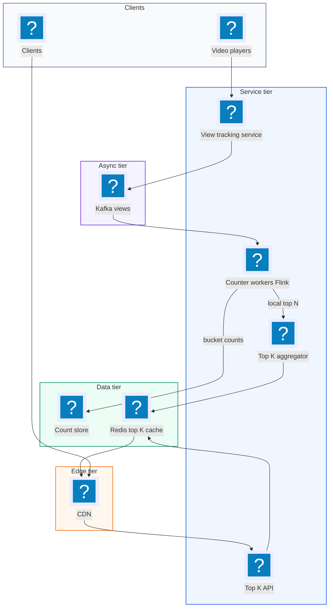
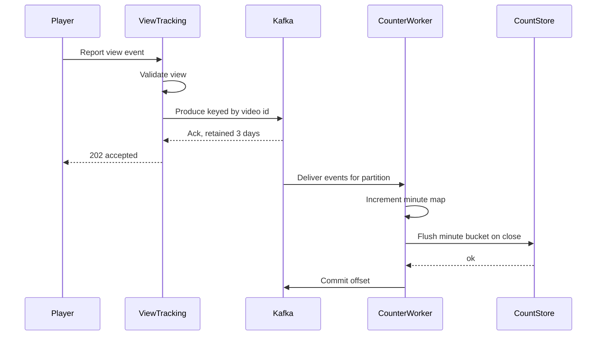
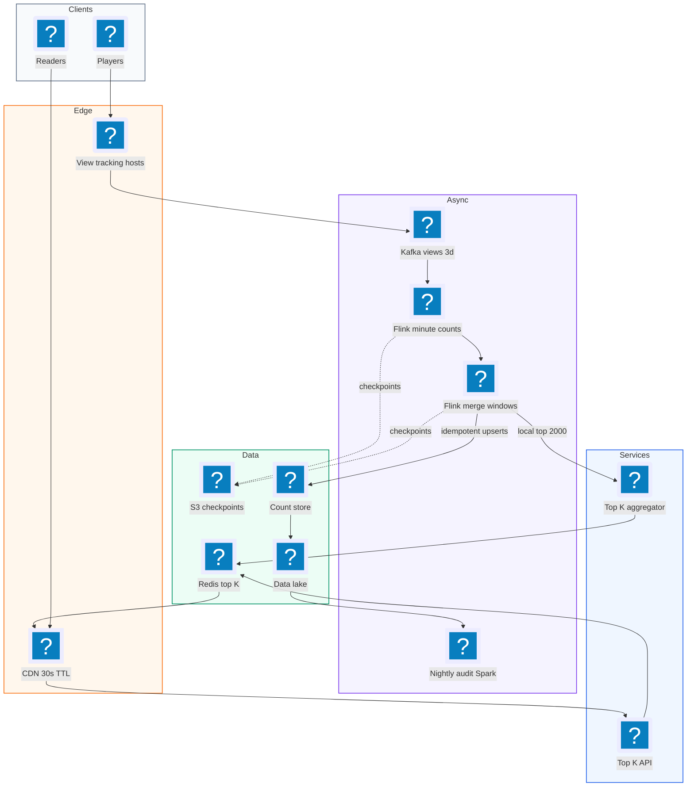

# 21. YouTube Top K  (Hard)

> We want to show the K most viewed YouTube videos (for example the top 100) over a few time windows: the last hour, the last day, the last month, and all time. Views arrive as a firehose of events from players all over the world. The product looks tiny, one list on a page, but the interviewer is testing data-intensive design: how to count billions of events per day, how to keep counts per time window without recounting everything, when approximate counting (count-min sketch) is good enough versus when you need exact numbers, how to deal with one viral video that gets a huge share of traffic, how to serve the list in milliseconds, and how to recover counts after a node dies.

## 1. Functional requirements

Core (must have):

1. Clients can query the top K videos (K up to 1,000) by view count.
2. Supported windows: last 1 hour, last 1 day, last 30 days, and all time.
3. The system ingests every view event emitted by video players.
4. Results are fresh: a view should be reflected in the ranking within about 1 minute.

Below the line (out of scope):

- Arbitrary time ranges like "March 3 to March 9". We support fixed windows only. Arbitrary ranges are a data warehouse query.
- Per-country or per-category top K. We can mention it as an extension (it multiplies the number of keys).
- Deciding what counts as a "valid" view (bot filtering, minimum watch time). Assume an upstream service emits only valid views.
- Personalized ranking. That is a recommendation system.

## 2. Non-functional requirements

1. Ingest: sustain ~700k view events per second on average and ~3.5M per second at peak.
2. Query latency: p99 < 50 ms for a top K read.
3. Freshness: results lag real views by at most 60 seconds.
4. Accuracy: exact counts are preferred for the published list (top K is shown publicly and creators care). Small approximation in the candidate selection step is acceptable if the final ranking is correct within a tiny error for the top 1,000.
5. Availability: 99.99% for reads. A stale result is better than an error.
6. Durability: counts must survive node failures. We must not double count or lose large chunks of views.
7. CAP choice: AP. Reads may be up to a minute stale, and different readers may briefly see different lists. Counting must be eventually exact.

## 3. Back-of-the-envelope estimates

| Assumption | Number |
|---|---|
| Views per day | 60 billion (roughly 700k/s) |
| Peak factor | 5x |
| Total videos | 4 billion (about 3.6 billion with at least one view) |
| Videos with a view in a given hour | ~200 million |
| View event size | ~100 bytes (video_id, user, ts, region) |
| K | up to 1,000 |
| Top K read QPS | ~10,000/s (cached heavily) |

```text
Ingest QPS:
  avg  = 60e9 / 86,400          ~ 700,000 events/s
  peak = 700k * 5               ~ 3.5 million events/s

Raw event volume:
  60e9 * 100 B = 6 TB/day   -> keep in Kafka 3 days ~ 18 TB (x3 replicas)

Counter state, exact, all time:
  4e9 videos * (8 B id + 8 B count) = 64 GB   -> fits in a sharded KV store

Counter state per minute bucket (videos active in that minute):
  ~20M videos * 16 B = 320 MB per minute bucket
  1 hour of minute buckets = 60 * 320 MB ~ 19 GB (too much to keep raw)
  -> keep minute buckets only for the last hour, hour buckets for 30 days

Hour buckets for 30 days:
  200M active videos/hour * 16 B = 3.2 GB/hour * 720 hours ~ 2.3 TB
  -> store on disk (time series / KV), not RAM

Count-min sketch per minute (width 2^20, depth 5, 4-byte cells):
  2^20 * 5 * 4 B = 20 MB  (vs 320 MB exact)

Read side: 4 windows * 1,000 entries * 16 B = 64 KB total. Trivially cached.
```

The key numbers to say out loud: 700k writes per second and a tiny 64 KB result. The whole problem is reducing a huge write stream to a tiny, frequently read answer.

## 4. Core entities

- ViewEvent: one view. Fields: video_id, event_id, timestamp, region.
- Counter: the number of views for a video in one bucket. Fields: video_id, bucket_start, granularity (minute, hour, day), count.
- Window: a named time range (1h, 1d, 30d, all). It is made of buckets.
- TopKList: the published ranking for one window. Fields: window, computed_at, entries (video_id, count).
- Checkpoint: the Kafka offset per partition that a counter has fully applied. Used for recovery.

```sql
-- Exact per-bucket counts, stored in a wide-column store
CREATE TABLE view_counts (
  video_id     BIGINT,
  granularity  TEXT,         -- 'min', 'hour', 'day'
  bucket_start TIMESTAMP,
  views        BIGINT,
  PRIMARY KEY ((granularity, bucket_start), video_id)
);

CREATE TABLE all_time_counts (
  video_id BIGINT PRIMARY KEY,
  views    BIGINT
);
```

```json
{
  "window": "1h",
  "computed_at": "2026-11-05T19:07:00Z",
  "entries": [
    {"video_id": "dQw4w9WgXcQ", "views": 1840221},
    {"video_id": "9bZkp7q19f0", "views": 1203117}
  ]
}
```

## 5. API design

`GET /v1/top-videos?window=1h&k=100` -- get the top K for a window.

Response 200:

```json
{
  "window": "1h",
  "as_of": "2026-11-05T19:07:00Z",
  "videos": [{"video_id": "dQw4w9WgXcQ", "views": 1840221, "rank": 1}]
}
```

Status codes: 200 OK, 400 for unknown window or k > 1000. Public read, no auth, but rate limited per IP at the edge.

`POST /v1/views` (internal) -- the player backend emits a view event. In practice this is a direct Kafka produce from the view-tracking service, not an HTTP call per view.

```json
{"event_id": "e-8f2a...", "video_id": "dQw4w9WgXcQ", "ts": 1793905620123}
```

Response 202. Auth: service-to-service only.

## 6. High-level design



### How will the system ingest views?

1. The player reports a view to the view-tracking service, which validates it.
2. The service produces the event to Kafka, keyed by `video_id`. Keying by video means all views of one video land on the same partition, so one worker owns that video's count.
3. Kafka keeps events for 3 days. That replay buffer is our safety net for recovery.



### How will the system keep counts?

1. Each counter worker consumes a set of partitions.
2. It keeps an in-memory map `video_id -> count` for the current minute.
3. When the minute closes (by event time, with a small allowed lateness), it flushes the minute bucket to the count store and adds the minute counts to its hour and all-time counters.
4. It commits the Kafka offset only after the flush succeeds.

### How will users get the top K?

1. Every worker computes its local top N (N a bit bigger than K, for example 2,000) for each window from its own videos.
2. The aggregator merges the local lists from all workers into a global top K per window.
3. It writes the result to Redis as a small JSON blob per window and pushes it to the CDN.
4. `GET /v1/top-videos` reads from the CDN or Redis. It never touches the count store.

The merge is correct because of partitioning by video: a video's full count lives on exactly one worker, so the global top K must be inside the union of the local top K lists. Say this explicitly, it is the main insight.

## 7. Deep dives

### Should we count exactly, or use a count-min sketch and a heap?

The problem: at 3.5M events per second, keeping a hash map of every active video per window is a lot of memory. A count-min sketch is a fixed-size probabilistic counter that answers "about how many times did I see X?" using far less memory, but it can overcount.

How a count-min sketch works: it is a small 2D array with `d` rows and `w` columns. Each row has its own hash function. To add an item, hash it with every row's function and increment one cell per row. To estimate a count, take the minimum of those d cells. Collisions only ever add, so the minimum is the closest to the truth and never undercounts.

```python
import mmh3, heapq

class CountMinSketch:
    def __init__(self, width=2**20, depth=5):
        self.w, self.d = width, depth
        self.t = [[0] * width for _ in range(depth)]

    def add(self, key, n=1):
        for i in range(self.d):
            self.t[i][mmh3.hash(key, i) % self.w] += n

    def estimate(self, key):
        return min(self.t[i][mmh3.hash(key, i) % self.w] for i in range(self.d))

class SketchTopK:
    """Sketch for counts + min-heap of size K for the current leaders."""
    def __init__(self, k):
        self.k, self.cms, self.heap, self.inheap = k, CountMinSketch(), [], {}

    def add(self, vid):
        self.cms.add(vid)
        c = self.cms.estimate(vid)
        if vid in self.inheap:
            self.inheap[vid] = c                  # lazy update, heap fixed later
        elif len(self.heap) < self.k or c > self.heap[0][0]:
            heapq.heappush(self.heap, (c, vid)); self.inheap[vid] = c
            if len(self.heap) > self.k:
                _, out = heapq.heappop(self.heap); self.inheap.pop(out, None)
```

Error bound: with width w, the overcount is at most about `(e / w) * total_events` with probability `1 - e^-d`. With w = 2^20 and 40M events in a minute, the max overcount is about 2.7 * 40M / 1M ~ 104 views. For the top 1,000 videos (each with tens of thousands of views per minute) that is noise.

| Approach | Memory per minute | Accuracy | Merge across nodes | Notes |
|---|---|---|---|---|
| Exact hash map | ~320 MB | Exact | Add maps | Simple, memory heavy |
| Count-min sketch + heap | ~20 MB | Overcounts slightly | Add sketches cell by cell | Cannot list keys, needs heap |
| Exact streaming + periodic batch | Map + batch job | Exact eventually | Batch recompute | Lambda architecture |

Recommended: exact counting per worker, because partitioning by video keeps each worker's map manageable (320 MB per minute spread across ~200 workers is ~1.6 MB each). Use the sketch if the interviewer removes partition-by-video (for example events arrive randomly to any node) or asks for a much larger key space like search queries. A strong hybrid: sketch to pick candidates fast, then fetch exact counts for those candidates from the count store before publishing.

### How do we maintain sliding windows without recounting?

The problem: "last hour" moves every minute. Recounting 60 minutes of raw events each minute is wasteful.

The trick: buckets. Keep counts in fixed-size buckets and keep a running window total. When a new bucket enters the window, add it. When the oldest bucket leaves, subtract it.

```text
 minute buckets for one video (last hour window):

  t-60 t-59 ...  t-2  t-1   t
  [ 5 ][ 7 ] ... [ 9 ][12 ][ 4 ]
     ^ leaves window          ^ enters window
  window_total = window_total + b[t] - b[t-60]
```

| Window | Bucket size | Buckets kept | Update rule each minute |
|---|---|---|---|
| 1 hour | 1 minute | 60 | +newest minute, -minute from 60 ago |
| 1 day | 1 hour | 24 (+ current partial hour) | +minute into current hour; on hour roll, -hour from 24 ago |
| 30 days | 1 day (or hour) | 30 | same idea at day granularity |
| All time | none | 1 | only add |

```python
def on_minute_close(minute_counts, t):
    for vid, c in minute_counts.items():
        h1[vid] += c; d1[vid] += c; d30[vid] += c; all_time[vid] += c
    expired = store.read_bucket("min", t - 60)       # leaves the 1h window
    for vid, c in expired.items():
        h1[vid] -= c
        if h1[vid] == 0: del h1[vid]
    if is_hour_boundary(t):
        for vid, c in store.read_bucket("hour", t - 24*60).items():
            d1[vid] -= c
    if is_day_boundary(t):
        for vid, c in store.read_bucket("day", t - 30*1440).items():
            d30[vid] -= c
```

The 1-day window is "hopping" at hour granularity: it is accurate to within the current hour. Mention this trade-off. If the interviewer wants minute accuracy on the daily window, keep 1,440 minute buckets, which costs more storage.

Late events: use event time, not arrival time. Allow a lateness of, say, 2 minutes. A minute bucket closes 2 minutes after its end. Events later than that go to the current bucket (slight misattribution) or are dropped and counted only in a nightly exact batch.

### How do we get exact results and still be fast?

The problem: interviewers often ask, "Is approximate OK?" Creators and press quote these numbers, so the published top 100 should be exact.

| Option | Freshness | Exactness | Cost |
|---|---|---|---|
| Streaming exact counters (above) | ~1 min | Exact if no data loss | Medium |
| Sketch only | Seconds | Approximate | Low |
| Lambda: fast approximate stream + nightly batch | Stream fresh, batch exact | Exact after batch | Two code paths |
| Kappa: one exact stream with replay | ~1 min | Exact | One code path |

Recommended: Kappa style. One streaming job with exact counts, exactly-once state via checkpoints (Flink checkpoints with Kafka offsets), and replay from Kafka for repair. Add a daily batch job over the raw events in the data lake as an audit that compares totals and alerts on drift above 0.1%.

### What about a hot video that gets a huge share of all views?

The problem: a viral video can get 200k views per second. Partitioning by video_id sends all of them to one Kafka partition and one worker. That worker falls behind and the whole window is delayed.

| Option | Pros | Cons |
|---|---|---|
| Do nothing | Simple | One hot partition lags |
| Pre-aggregate at the producer (batch per second) | Shrinks events 100x+ | Producers hold small state |
| Salt hot keys: `video_id#0..N` | Spreads load | Must merge salted counts before ranking |
| Two-stage aggregation: random partition, then by key | Fully balanced | Extra stage, more latency |

Recommended: pre-aggregate at the edge plus salting for known hot keys. The view-tracking service buffers for 1 second and emits `{video_id, count}` instead of one event per view. A viral video then produces one message per second per tracking host instead of 200k.

```python
# in each view-tracking host
buffer = Counter()
def on_view(video_id):
    buffer[video_id] += 1

def flush_every_second():
    for vid, n in buffer.items():
        key = vid
        if hot_keys.contains(vid):                 # detected by a sampler
            key = f"{vid}#{random.randrange(16)}"  # spread over 16 partitions
        kafka.send("views", key=key, value={"vid": vid, "n": n, "ts": now()})
    buffer.clear()
```

When we salt, the "one video lives on one worker" rule breaks. Fix it with a second, tiny merge stage keyed by the real `video_id` that sums the salted partial counts. The second stage sees only a few messages per second per hot video, so it is cheap.

### How do we serve top K in under 50 ms?

The problem: 10k reads per second, and computing a top K from billions of counters on read is impossible.

Recommended: precompute. The answer is 64 KB total for four windows. Recompute every 30 to 60 seconds and serve it from memory.

```text
 workers --local top 2000 per window--> aggregator
 aggregator: k-way merge (heap) -> global top 1000 per window
          -> Redis SET topk:1h <json> ; topk:1d ; topk:30d ; topk:all
          -> CDN purge or short TTL (30 s)
 API: read Redis -> slice first k -> return
```

```python
def merge_local_lists(lists, k=1000):
    # each list is already sorted desc by count; videos are disjoint
    return heapq.nlargest(k, itertools.chain.from_iterable(lists),
                          key=lambda e: e["views"])
```

Why N = 2,000 local and not 1,000? It costs little and protects against salted keys whose partial counts are split. With exact partitioning by video, local K is enough.

Serving numbers: a Redis GET of 16 KB takes well under 1 ms. The CDN absorbs nearly all public traffic with a 30-second TTL, which also matches our freshness goal.

### How do we recover if a counter node dies?

The problem: a worker holds in-memory counts for a minute or more. If it crashes, those counts are gone. If we simply restart from the last committed offset we may also double count events that were already flushed.

| Option | Pros | Cons |
|---|---|---|
| Restart from latest offset | Fast | Loses events in flight |
| Replay from last committed offset, idempotent bucket writes | No loss, no double count | Must make writes idempotent |
| Flink checkpoints (state + offsets snapshotted together) | Exactly-once state | Checkpoint overhead |

Recommended: snapshot state and offsets together, and make bucket writes idempotent by writing absolute values (`SET count = X` for a bucket) instead of increments.

```text
 every 30 s:
   checkpoint = {partition offsets, in-memory counters}  -> S3 / HDFS
 on crash:
   new worker loads latest checkpoint
   seeks Kafka to checkpointed offsets
   replays events since then (at most 30 s of data)
 bucket flush:
   UPSERT view_counts (bucket, video_id) = absolute_count   -- idempotent
```

Because the bucket write sets an absolute value, replaying the same minute twice writes the same number twice. No double count. The all-time counter is rebuilt from the checkpoint plus replay, never by "increment again".

The aggregator is stateless. If it dies, a standby takes over and rebuilds the top K from workers in one cycle. Redis keeps the last published list, so readers see a slightly stale list instead of an error.

## 8. Final architecture



| Component | Job | Technology example |
|---|---|---|
| View tracking | Validate, pre-aggregate per second, salt hot keys | Stateless service |
| Event log | Durable buffer, replay for recovery | Kafka (3-day retention) |
| Stream counters | Exact minute counts, window maintenance | Apache Flink with RocksDB state |
| Checkpoints | State + offsets snapshots | S3 / HDFS |
| Count store | Bucketed counts for window expiry and audits | Bigtable, Cassandra |
| Aggregator | Merge local top lists into global top K | Small service, leader-elected |
| Result cache | Serve 64 KB answer | Redis + CDN |
| Batch audit | Verify totals nightly | Spark on the data lake |

### Deployment map (AWS)

```mermaid
architecture-beta
    group internet(mdi:earth)[Internet]
    group edge(logos:aws-cloudfront)[Edge]
    group vpc(logos:aws-vpc)[AWS VPC]
    group app(logos:aws-ecs)[Service subnet] in vpc
    group data(logos:aws-rds)[Data subnet] in vpc

    service players(mdi:cellphone)[Players] in internet
    service readers(mdi:laptop)[Readers] in internet
    service tracking(logos:aws-ecs)[View tracking hosts] in edge
    service cdn(logos:aws-cloudfront)[CDN 30s TTL] in edge
    service merge(logos:flink)[Flink merge windows] in app
    service aggregator(logos:aws-ecs)[Top K aggregator] in app
    service api(logos:aws-ecs)[Top K API] in app
    service views(logos:kafka-icon)[Kafka views 3d] in data
    service counts(logos:aws-dynamodb)[Count store] in data
    service topk(logos:aws-elasticache)[Redis top K] in data

    players:R --> L:tracking
    tracking:B --> T:views
    views:T --> B:merge
    merge:B --> T:counts
    merge:R --> L:aggregator
    aggregator:B --> T:topk
    readers:R --> L:cdn
    cdn:B --> T:api
    api:B --> T:topk
```



The write firehose and the read path meet only at Redis: views flow from tracking hosts through Kafka and Flink into the count store, while readers only ever touch the CDN, the Top K API and one small Redis blob.

## 9. Common mistakes and interviewer follow-ups

- Mistake: querying a database with `ORDER BY views DESC LIMIT K` on every read. At 4B rows and 700k updates/s this cannot keep up. Say: precompute and cache, the answer is tiny.
- Mistake: random partitioning, then trying to merge local top K. A video's count is split across nodes, so local top K lists can miss the global winner. Say: partition by video_id, or add a merge stage.
- Mistake: using a sketch and claiming exact results. Say clearly that the sketch overcounts and give the error bound, then offer the exact path.
- Mistake: recomputing windows from raw events. Say: buckets plus add-new, subtract-expired.
- Mistake: increments on replay. Replaying `+1` double counts. Say: snapshot state with offsets, write absolute bucket values.
- Mistake: ignoring hot keys. Say: pre-aggregate at the edge and salt known hot keys.
- Follow-up: "Top K per country?" Add country to the key, counts grow by the number of countries but most videos are active in few countries. The top K blobs grow to about 200 x 64 KB, still tiny.
- Follow-up: "Arbitrary time range?" Sum hour buckets from the count store in a batch query, or use an OLAP store like Druid or Pinot.

## 10. One-page cheat sheet

| Topic | Key point |
|---|---|
| Scale | 60B views/day, ~700k/s avg, ~3.5M/s peak |
| Output | 4 windows x 1,000 entries ~ 64 KB, cache it |
| Partitioning | Kafka keyed by video_id so one worker owns a video |
| Counting | Exact per worker; count-min sketch (20 MB vs 320 MB) when keys are huge or unpartitioned |
| CMS error | about e/w * N overcount, never undercount |
| Windows | Minute buckets for 1h, hour buckets for 1d, day for 30d; add new, subtract expired |
| Merge | Local top N per worker, k-way heap merge for global top K |
| Hot keys | 1 s pre-aggregation at edge, salt `vid#0..15`, second merge stage |
| Serving | Recompute every 30-60 s, Redis + CDN, p99 < 50 ms |
| Recovery | Flink checkpoints (state + offsets), replay Kafka, idempotent absolute upserts |
| Correctness | Kappa stream + nightly batch audit |
| CAP | AP, up to 60 s stale |

## Sources

- [Hello Interview: Top-K YouTube Video Views](https://www.hellointerview.com/learn/system-design/problem-breakdowns/top-k)
- [Hello Interview community: Design a Top-K System](https://www.hellointerview.com/community/questions/top-k-counts/cm4t0twp0004pvszmvb2qeg0u)
- [Cormode and Muthukrishnan: An Improved Data Stream Summary, the Count-Min Sketch](http://dimacs.rutgers.edu/~graham/pubs/papers/cm-full.pdf)
- [Apache Flink: Stateful stream processing and checkpointing](https://nightlies.apache.org/flink/flink-docs-stable/docs/concepts/stateful-stream-processing/)
- [gemyago/top-k-system-go: exact top K example](https://github.com/gemyago/top-k-system-go)
- [Hello Interview: Design a Trending Hashtags System](https://images.hellointerview.com/community/questions/cm7honmgk0278imqn03o95rtg)
