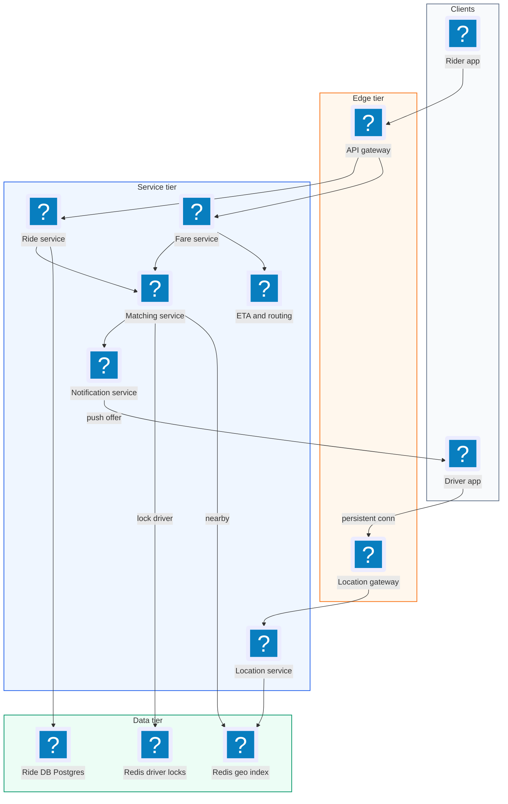
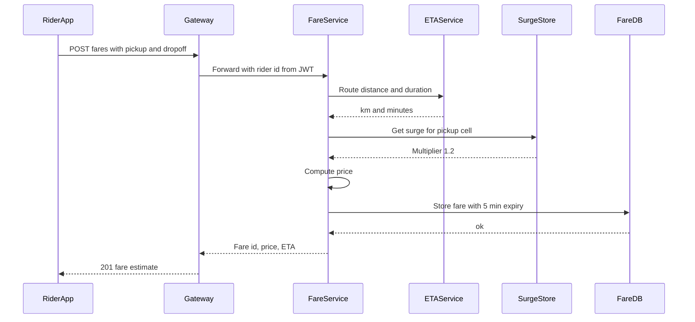
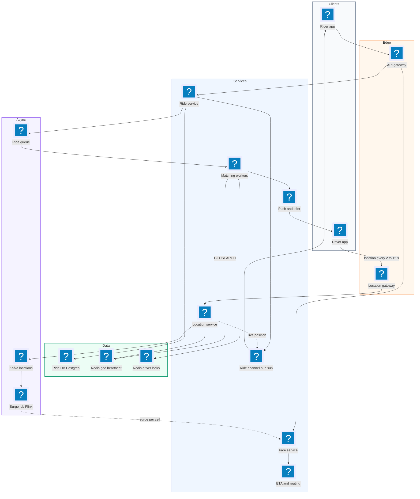

# 22. Uber  (Hard)

> Uber connects riders who need a trip with nearby drivers. A rider enters a destination, sees a fare estimate, and requests a ride. The system finds a close, available driver, offers them the trip, and once they accept, both sides track the trip until drop-off. The interviewer is testing real-time geospatial design: how to absorb millions of driver location updates per minute, how to find the nearest drivers fast, how to make sure one driver is never sent two rides at once (and a rider never gets two drivers), and how the system behaves when a matching server dies mid-request.

## 1. Functional requirements

Core (must have):

1. Riders can enter a pickup and destination and get a fare estimate (with ETA).
2. Riders can request a ride based on that estimate.
3. The system matches the rider with a nearby available driver. The driver can accept or decline. On decline or timeout, the next driver is tried.
4. Drivers send their location continuously while online.
5. Riders and drivers can follow the trip through its states (requested, matched, arriving, in progress, completed, cancelled), including the driver's live position.

Below the line (out of scope):

- Payments, tipping, and payouts (a separate payments system).
- Ratings and reviews.
- Ride types beyond a single standard type (pooling changes matching a lot).
- Scheduled rides in the future.
- Fraud detection and driver onboarding.

## 2. Non-functional requirements

1. Matching latency: a rider is matched (or told no drivers are available) within p99 < 1 minute. Finding candidate drivers takes < 100 ms.
2. Location ingestion: handle ~2.5M location updates per second at peak, with a driver's position at most ~5 seconds stale.
3. Strong consistency for dispatch: a driver is offered at most one ride at a time, and a ride is assigned to at most one driver.
4. Availability: 99.99% for requesting rides. Location tracking can briefly degrade (stale positions) without blocking new rides.
5. Durability: once a trip is accepted, its state is never lost.
6. Regional scale: millions of concurrent drivers worldwide; traffic is local, so we can shard by city or region.
7. CAP choice: CP for the ride and driver assignment (correctness over availability for that small piece), AP for location data (fast and approximately fresh is fine).

## 3. Back-of-the-envelope estimates

| Assumption | Number |
|---|---|
| Drivers online at peak (worldwide) | 10 million |
| Location update interval | every 4 seconds |
| Rides per day | 30 million |
| Peak factor for ride requests | 3x |
| Location update size | ~100 bytes |
| Fare estimates per ride | ~3 (people check before booking) |
| Trip record size | ~2 KB |

```text
Location writes:
  10M drivers / 4 s              = 2.5M updates/s at peak
  bandwidth = 2.5M * 100 B       = 250 MB/s ingest

Ride requests:
  avg = 30M / 86,400             ~ 350 rides/s
  peak = 350 * 3                 ~ 1,000 rides/s
Fare estimates:
  peak ~ 3,000 /s

Driver location index (only latest position):
  10M * ~100 B                   = 1 GB  -> fits in memory (Redis)

Trip storage:
  30M * 2 KB                     = 60 GB/day ~ 22 TB/year

Location history (if we keep it for trips, 1 point / 4 s):
  2.5M * 100 B * 86,400          ~ 21 TB/day raw -> sample, compress, cold store
```

Main takeaway: the write firehose is location updates (2.5M/s). Ride requests are tiny by comparison (1k/s), but each one needs strong correctness.

## 4. Core entities

- Rider: user who requests trips. Fields: rider_id, name, payment_method_id.
- Driver: user who drives. Fields: driver_id, vehicle, status (offline, available, offered, on_trip).
- Location: latest position of a driver. Fields: driver_id, lat, lng, heading, ts.
- Fare: a price quote. Fields: fare_id, rider_id, pickup, dropoff, price, eta, surge_multiplier, expires_at.
- Ride: one trip. Fields: ride_id, rider_id, driver_id, fare_id, status, timestamps.
- Offer: one attempt to give a ride to a driver. Fields: ride_id, driver_id, sent_at, expires_at, response.

```sql
CREATE TABLE ride (
  ride_id      UUID PRIMARY KEY,
  rider_id     BIGINT NOT NULL,
  driver_id    BIGINT,
  fare_id      UUID NOT NULL UNIQUE,     -- one ride per fare (idempotency)
  status       TEXT NOT NULL,            -- requested, matched, ...
  pickup       GEOGRAPHY(POINT),
  dropoff      GEOGRAPHY(POINT),
  price_cents  INT NOT NULL,
  version      INT NOT NULL DEFAULT 0,   -- optimistic concurrency
  created_at   TIMESTAMPTZ,
  updated_at   TIMESTAMPTZ
);

CREATE TABLE fare (
  fare_id     UUID PRIMARY KEY,
  rider_id    BIGINT,
  price_cents INT,
  surge       NUMERIC(3,2),
  eta_seconds INT,
  expires_at  TIMESTAMPTZ
);
```

```json
{"driver_id": 7781, "lat": 37.7749, "lng": -122.4194,
 "heading": 270, "speed_mps": 8.1, "ts": 1793905620}
```

## 5. API design

All rider and driver calls require a JWT session token from the auth service. The user id comes from the token, never from the request body.

`POST /v1/fares` -- get a fare estimate.

```json
{"pickup": {"lat": 37.77, "lng": -122.41}, "dropoff": {"lat": 37.80, "lng": -122.27}}
```

Response 201: `{"fare_id": "f-1", "price_cents": 2350, "surge": 1.2, "eta_seconds": 240, "expires_at": "..."}`

`POST /v1/rides` -- request a ride from a fare. The fare_id doubles as the idempotency key.

```json
{"fare_id": "f-1"}
```

Response 202: `{"ride_id": "r-9", "status": "requested"}`. Status 409 if the fare expired, 200 with the existing ride if the same fare was already booked.

`POST /v1/drivers/location` -- driver app sends location (batched, every ~4 s).

```json
{"lat": 37.7749, "lng": -122.4194, "heading": 270, "ts": 1793905620}
```

Response 204. (At scale, this is better over a persistent connection, see deep dives.)

`PATCH /v1/drivers/status` -- go online or offline. Body `{"status": "available"}`. Response 200.

`POST /v1/rides/{ride_id}/accept` and `/decline` -- driver responds to an offer. Response 200, or 409 if the offer expired or the ride was taken.

`PATCH /v1/rides/{ride_id}` -- driver advances state: `{"status": "arrived"}`, `"in_progress"`, `"completed"`. Rider can send `"cancelled"`. Response 200 or 409 for an invalid transition.

`GET /v1/rides/{ride_id}` and a WebSocket `/v1/rides/{ride_id}/stream` -- rider sees status and live driver position.

## 6. High-level design



### How will riders get a fare estimate?

1. The rider app calls `POST /v1/fares` with pickup and dropoff.
2. The fare service calls a routing/ETA service (map graph, see deep dives) for distance and duration.
3. It reads the current surge multiplier for the pickup area.
4. It computes `price = (base + per_km * km + per_min * min) * surge`, stores the fare with a short expiry (for example 5 minutes), and returns it.



### How will riders request a ride?

1. The app calls `POST /v1/rides` with the fare_id.
2. The ride service inserts a ride row with status `requested`. The unique constraint on `fare_id` makes the request idempotent: a double tap creates one ride.
3. It hands the ride to the matching service (via a queue so the request survives a crash, see deep dives) and returns 202.

### How will drivers report location?

1. The driver app sends a location every 4 seconds over a persistent connection.
2. The location service writes it to the Redis geo index with `GEOADD` and stores a heartbeat timestamp.
3. Drivers whose heartbeat is older than ~30 s are treated as offline.

### How will the system match a rider with a driver?

1. The matching service queries Redis for available drivers within a radius of the pickup, sorted by distance.
2. It re-ranks the top few by real ETA (road distance, not straight line).
3. For the best candidate it tries to take a short lock on that driver. If it gets the lock, it sends an offer push and waits up to 10 s.
4. On accept, it updates the ride (status `matched`, driver_id) in the DB with a conditional write. On decline or timeout, it releases the lock and tries the next driver.

### How will riders and drivers track the trip?

1. The driver app advances the state: arrived, in progress, completed.
2. The ride service validates each transition and writes it.
3. The rider's WebSocket subscribes to the ride channel. Driver location updates for that driver are forwarded to the rider every few seconds.

## 7. Deep dives

### How do we handle 2.5 million location updates per second?

The problem: a relational database cannot take 2.5M updates per second on one table, and we only care about the latest position for matching.

| Option | Write throughput | Proximity query | Notes |
|---|---|---|---|
| Postgres + PostGIS | Tens of thousands/s per node | Good (R-tree) | Index churn kills it at this rate |
| Redis GEO (geohash in a sorted set) | ~100k+/s per shard | `GEOSEARCH` radius | In-memory, shard by region |
| Custom in-memory grid (H3 cells) | Very high | Look up neighbor cells | What Uber built (H3) |

What is a geohash? It turns a (lat, lng) into a string by repeatedly splitting the world in half. Nearby points share a prefix. `9q8yy` is a cell of about 5 km x 5 km in San Francisco. Redis GEO stores each driver in a sorted set with a 52-bit geohash as the score, so a radius query becomes a few range scans.

Recommended: Redis GEO sharded by city (or by geohash prefix for huge cities), with the location service as the only writer. Batch updates on the client and use a persistent connection to cut per-request overhead.

```python
# location service: one update
def on_location(driver_id, lat, lng, ts):
    shard = shard_for(lat, lng)                 # e.g. city or geohash[:4]
    if shard != last_shard.get(driver_id):      # driver crossed a boundary
        redis_for(last_shard[driver_id]).zrem("drivers:geo", driver_id)
        last_shard[driver_id] = shard
    r = redis_for(shard)
    pipe = r.pipeline()
    pipe.geoadd("drivers:geo", (lng, lat, driver_id))
    pipe.set(f"drv:hb:{driver_id}", ts, ex=30)  # heartbeat with TTL
    pipe.execute()
```

```text
 2.5M/s total; each Redis shard ~100k writes/s comfortably
 -> 25-40 primary shards worldwide (+ replicas), split by city load
```

Further reduction: adaptive update rates. A parked driver can report every 15 s; a moving driver every 4 s; a driver on a trip every 2 s for smooth tracking. Only "available" drivers need to be in the matching index at all; drivers on a trip go to a separate tracking path.

### How do we find the nearest driver for a rider?

The problem: straight-line distance is a poor proxy. A driver 300 m away across a river may be 10 minutes out.

Recommended two-step: cheap filter, then accurate rank.

```python
def find_candidates(pickup, k=10):
    r = redis_for(shard_for(pickup.lat, pickup.lng))
    for radius_km in (1, 2, 5):                  # expand ring if empty
        ids = r.geosearch("drivers:geo", longitude=pickup.lng,
                          latitude=pickup.lat, radius=radius_km, unit="km",
                          sort="ASC", count=50)
        ids = [d for d in ids if is_available(d) and heartbeat_fresh(d)]
        if ids:
            break
    etas = eta_service.batch_eta(origins=ids, dest=pickup)   # road network
    return sorted(zip(ids, etas), key=lambda x: x[1])[:k]
```

The ETA service uses a road graph with live traffic. Uber's production system precomputes routes over a partitioned graph (contraction hierarchies style) so a one-to-many ETA call takes a few milliseconds. In the interview, it is enough to say "a routing service with a road graph and historical plus live speeds per road segment, cached by cell pair".

### How do we make sure a driver is never sent two rides at once?

The problem: two matching servers handle two riders near the same driver at the same moment. Both see the driver as available and both send an offer. The driver accepts both, or accepts one and the other rider waits.

| Option | Pros | Cons |
|---|---|---|
| Check status in DB, then send offer | Simple | Race between check and update |
| DB row lock / conditional update on driver status | Strong | DB on the hot path, lock held for 10 s offer |
| Distributed lock in Redis with TTL (`SET NX PX`) | Fast, auto-expires | Must handle lock expiry and fencing |
| Single owner per region (one matcher per city shard) | No cross-node race | Hot spot, failover needed |

Recommended: a Redis lock per driver with a TTL equal to the offer timeout plus a margin, and a final conditional write on the ride row as the source of truth.

```python
OFFER_TTL_MS = 12_000

def offer(ride_id, driver_id):
    token = str(uuid4())
    got = redis.set(f"lock:driver:{driver_id}", f"{ride_id}:{token}",
                    nx=True, px=OFFER_TTL_MS)
    if not got:
        return False                              # someone else is offering
    push.send(driver_id, {"type": "offer", "ride_id": ride_id,
                          "expires_in_s": 10})
    return token
```

```sql
-- on driver accept: only succeeds if ride is still unassigned
UPDATE ride
SET driver_id = :driver_id, status = 'matched', version = version + 1
WHERE ride_id = :ride_id AND status = 'requested' AND driver_id IS NULL;
-- 0 rows updated -> ride taken or cancelled, tell driver 409
```

Why TTL? If the matcher crashes after locking, the driver is not stuck forever. After 12 s the lock disappears and the driver is available again. Why the SQL guard too? Locks with TTL can expire early (GC pause, clock issues). The conditional update is the fencing check that guarantees one driver per ride. The driver's accept call must also verify that it still holds the lock value it was offered (compare the ride id in the lock).

Release on decline uses a compare-and-delete so we never delete someone else's lock:

```text
-- Lua script, atomic in Redis
if redis.call("GET", KEYS[1]) == ARGV[1] then
  return redis.call("DEL", KEYS[1])
end
return 0
```

### What if the matching service crashes in the middle of a request?

The problem: the rider is waiting. The matcher that owned their ride crashed after offering to driver 1. Nobody is trying driver 2. The rider sees a spinner forever.

| Option | Pros | Cons |
|---|---|---|
| Matching in the request thread | Simple | Crash loses the request |
| Durable queue of ride requests, consumer acks after match | Survives crashes, retries | Possible duplicate processing |
| Workflow engine (Temporal / Step Functions) with timers | Built-in retries and timeouts | Extra infra |

Recommended: put each ride on a durable queue (Kafka or SQS) and use a visibility timeout. The matcher processes one ride at a time and only acks after the ride is `matched` or `no_drivers`. If it dies, the message becomes visible again and another matcher takes it. Matching is idempotent because the ride row and driver locks hold the real state.

```python
def match_loop():
    for msg in queue.receive(visibility_timeout_s=30):
        ride = db.get_ride(msg.ride_id)
        if ride.status != "requested":
            queue.ack(msg); continue              # already done by someone
        tried = set(ride.tried_drivers or [])
        for driver_id, eta in find_candidates(ride.pickup):
            if driver_id in tried:
                continue
            db.append_tried(ride.ride_id, driver_id)   # persist progress
            if offer(ride.ride_id, driver_id) and wait_accept(ride, driver_id, 10):
                break
            queue.extend_visibility(msg, 30)      # heartbeat while working
        else:
            db.set_status(ride.ride_id, "no_drivers")
        queue.ack(msg)
```

The `tried_drivers` list stops a new matcher from re-offering to drivers who already declined. The rider app polls or listens on the ride channel, so it simply sees the status change.

### How do we model the trip so states never get out of sync?

The problem: driver taps "complete" while the rider taps "cancel". Network retries resend old transitions.

Recommended: an explicit state machine with allowed transitions, enforced with optimistic concurrency (a version column).

```text
 requested --match--> matched --arrive--> arriving --start--> in_progress
     |                   |                    |                    |
     +--cancel/no_drv-+  +------cancel--------+               complete
                      v                       v                    v
                  cancelled               cancelled            completed
```

```python
ALLOWED = {
    "requested":   {"matched", "cancelled", "no_drivers"},
    "matched":     {"arriving", "cancelled"},
    "arriving":    {"in_progress", "cancelled"},
    "in_progress": {"completed"},
}

def transition(ride_id, new_status, expected_version):
    ride = db.get(ride_id)
    if new_status not in ALLOWED.get(ride.status, set()):
        raise Conflict(f"{ride.status} -> {new_status} not allowed")
    n = db.execute("""UPDATE ride SET status=%s, version=version+1
                      WHERE ride_id=%s AND version=%s""",
                   (new_status, ride_id, expected_version))
    if n == 0:
        raise Conflict("stale version, reload")
    events.publish("ride.status", {"ride_id": ride_id, "status": new_status})
```

Each transition publishes an event that drives notifications, billing, and the driver's status (back to `available` on completion or cancel).

### How does surge pricing work, and how do we handle a demand spike?

The problem: a concert ends and 20,000 people open the app in one neighborhood. Demand is far higher than supply.

Surge: every 30-60 seconds, a stream job counts open requests and available drivers per cell (geohash or H3 cell) and sets a multiplier. Higher prices reduce demand and pull drivers in.

```python
def surge_for_cell(demand, supply):
    ratio = demand / max(supply, 1)
    if ratio < 1.2:
        return 1.0
    return min(round(1.0 + 0.5 * (ratio - 1.2), 1), 3.0)   # capped at 3x
```

The multiplier is stored in Redis per cell and locked into the fare quote (`fare.surge`), so a rider pays what they saw. For the request spike itself: matching is sharded by city, the ride queue buffers bursts, and fare estimates are cacheable per cell pair for a few seconds.

## 8. Final architecture



| Component | Job | Technology example |
|---|---|---|
| API gateway | Auth, routing, rate limit | Envoy, AWS API Gateway |
| Fare service | Price and ETA quotes | Stateless service |
| ETA / routing | Road-network travel time | Graph service with traffic data |
| Ride service | Ride lifecycle and state machine | Service + Postgres |
| Ride queue | Durable matching work | SQS or Kafka |
| Matching workers | Find, lock, offer, assign | Stateless consumers per city |
| Location gateway | Hold driver connections | WebSocket / gRPC stream servers |
| Location service | Ingest 2.5M updates/s | Redis GEO sharded by city |
| Driver locks | Prevent double dispatch | Redis `SET NX PX` + DB conditional update |
| Surge job | Demand/supply per cell | Flink over location and request streams |
| Ride channel | Live updates to rider | Redis pub/sub or a WebSocket fan-out tier |

### Deployment map (AWS)

```mermaid
architecture-beta
    group internet(mdi:earth)[Internet]
    group edge(logos:aws-cloudfront)[Edge]
    group vpc(logos:aws-vpc)[AWS VPC]
    group app(logos:aws-ecs)[Service subnet] in vpc
    group data(logos:aws-rds)[Data subnet] in vpc

    service rider(mdi:cellphone)[Rider app] in internet
    service driver(mdi:cellphone)[Driver app] in internet
    service apigw(logos:aws-api-gateway)[API gateway] in edge
    service locgw(logos:aws-elastic-load-balancing)[Location gateway] in edge
    service fare(logos:aws-ecs)[Fare service] in app
    service ride(logos:aws-ecs)[Ride service] in app
    service matching(logos:aws-ecs)[Matching workers] in app
    service location(logos:aws-ecs)[Location service] in app
    service ridedb(logos:aws-rds)[Ride DB Postgres] in data
    service geo(logos:aws-elasticache)[Redis geo heartbeat] in data

    rider:R --> L:apigw
    apigw:B --> T:fare
    apigw:B --> T:ride
    ride:B --> T:ridedb
    ride:R --> L:matching
    matching:B --> T:geo
    matching:L --> R:driver
    driver:R --> L:locgw
    locgw:B --> T:location
    location:B --> T:geo
```



Riders and drivers enter through separate edge doors, and the two paths meet at the Redis geo index in the data subnet, where location writes land and matching workers search.

## 9. Common mistakes and interviewer follow-ups

- Mistake: storing every location update in Postgres. 2.5M writes/s with index churn will not hold. Say: in-memory geo index for latest position, stream history to cold storage.
- Mistake: matching by straight-line distance only. Say: geo filter for candidates, then rank by road ETA.
- Mistake: "check driver is free, then assign" without atomicity. Say: Redis lock with TTL plus a conditional update as the fencing check.
- Mistake: no plan for a crashed matcher. Say: durable queue, visibility timeout, persisted list of tried drivers.
- Mistake: one global Redis. Say: shard by city or geohash prefix; rides are local.
- Mistake: free-form status updates. Say: explicit state machine with optimistic concurrency.
- Follow-up: "Driver crosses a shard boundary?" The location service moves the driver to the new shard and removes it from the old one. Matching near a border queries both shards.
- Follow-up: "How do you scale across regions?" Each region is independent (cells of cities). Global data like user profiles is replicated; rides stay in the region where they start.

## 10. One-page cheat sheet

| Topic | Key point |
|---|---|
| Scale | 10M drivers, 2.5M location writes/s, ~1k ride requests/s peak |
| Location index | Redis GEO (geohash sorted set), sharded by city, ~1 GB total |
| Freshness | Updates every 2-15 s adaptive, heartbeat TTL 30 s |
| Matching | GEOSEARCH radius ring 1/2/5 km, rank by road ETA |
| No double dispatch | `SET lock:driver NX PX 12000` + `UPDATE ride ... WHERE driver_id IS NULL` |
| Idempotency | fare_id unique per ride |
| Failure | Ride queue with visibility timeout, tried_drivers persisted |
| Trip | State machine + version column, events on each transition |
| Surge | Per-cell demand/supply every 30-60 s, locked into fare quote |
| CAP | CP for assignment, AP for locations |

## Sources

- [Hello Interview: Design a Ride-Sharing Service Like Uber](https://www.hellointerview.com/learn/system-design/problem-breakdowns/uber)
- [Uber Engineering: H3, Uber's Hexagonal Hierarchical Spatial Index](https://www.uber.com/blog/h3/)
- [Uber Engineering: How Uber computes ETA at half a million requests per second](https://www.uber.com/blog/engineering-routing-engine/)
- [Redis docs: GEOSEARCH](https://redis.io/docs/latest/commands/geosearch/)
- [Redis docs: Distributed locks with Redis](https://redis.io/docs/latest/develop/use/patterns/distributed-locks/)
- [System Design Handbook: Design Uber](https://www.systemdesignhandbook.com/guides/design-uber/)
