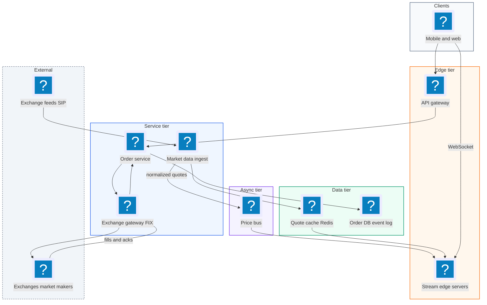
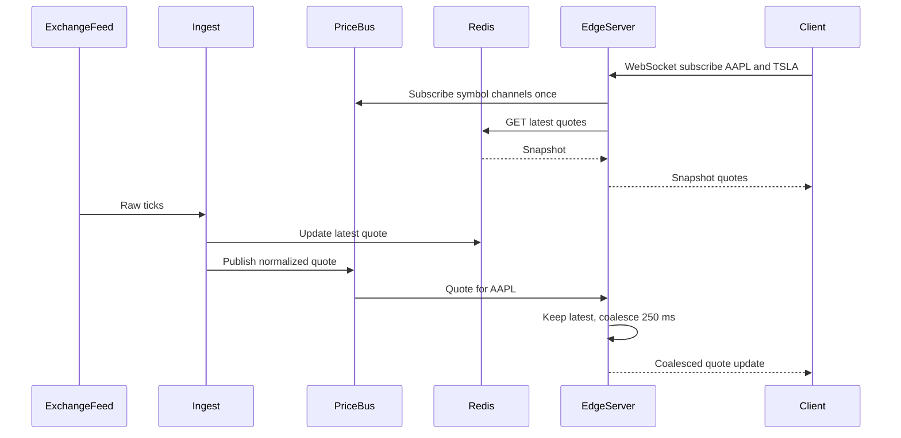
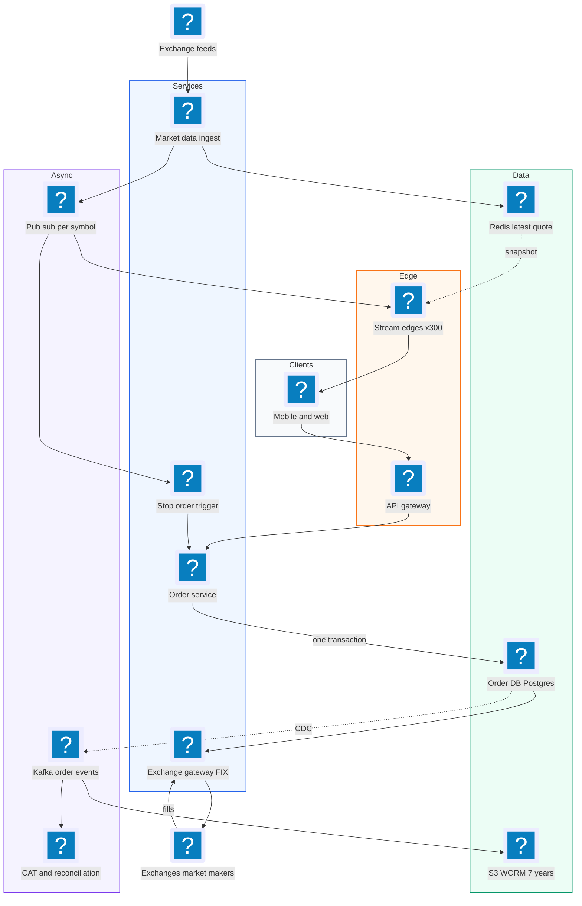

# 23. Robinhood  (Hard)

> Robinhood is a stock brokerage app. Users watch live prices, place market and limit orders, cancel them, and see their order status. Robinhood is not the stock exchange. It forwards orders to an exchange (or a market maker) and receives fills back. The interviewer is testing two very different systems in one design: a huge, loss-tolerant price stream to millions of phones, and a small but money-critical order path that must never lose, duplicate, or mis-state an order. Strong answers say this split out loud and give each side different guarantees.

## 1. Functional requirements

Core (must have):

1. Users can see live prices for stocks (a watchlist and a symbol detail page).
2. Users can place orders: market orders (buy now at the best price) and limit orders (buy only at or below a price, sell only at or above).
3. Users can cancel an open order.
4. Users can see their orders and their status (pending, open, partially filled, filled, cancelled, rejected).

Below the line (out of scope):

- Building the exchange or matching engine. Exchanges do this.
- Options, crypto, margin, short selling.
- Portfolio charts and tax documents (read models built from fills).
- Funding the account (bank transfers). Assume a buying-power service exists.
- Charting history (OHLC candles) beyond a mention.

## 2. Non-functional requirements

1. Price latency: a price change reaches a watching client within p99 < 500 ms of arriving from the market data feed.
2. Price fan-out scale: 10M concurrently connected clients during market open, each watching about 20 symbols.
3. Order correctness: no lost orders, no duplicate orders. Order status must be strongly consistent with what the exchange says.
4. Order latency: order submit to exchange in p99 < 200 ms inside our system.
5. Availability: 99.99% for order placement during market hours (9:30 to 16:00 ET). Price streaming can degrade (coalesce, slower updates) but should stay up.
6. Burst handling: 10x to 20x traffic spike in the first minutes after market open and on meme-stock days.
7. Auditability: every order event is kept immutable for at least 7 years (broker-dealer rules such as SEC 17a-4 and FINRA CAT reporting).
8. CAP choice: orders are CP (prefer to reject or delay than to be wrong). Prices are AP (stale by a second is better than an error).

## 3. Back-of-the-envelope estimates

| Assumption | Number |
|---|---|
| Daily active users | 20 million |
| Peak concurrent connected clients | 10 million |
| Symbols watched per client | 20 |
| US-listed symbols | ~10,000 |
| Market data updates (all symbols) | ~100k/s, peaks 1M/s |
| Orders per day | 10 million |
| Peak order rate (open, 30x average over trading hours) | ~13,000/s |
| Price message size | ~60 bytes |
| Order event size | ~500 bytes |

```text
Orders:
  trading day = 6.5 h = 23,400 s
  avg = 10M / 23,400            ~ 430 orders/s
  peak (30x at open)            ~ 13,000 orders/s
  order events (submit, ack, fills, cancel) ~ 4 per order -> 52k events/s peak

Price fan-out (naive: every tick to every watcher):
  subscriptions = 10M clients * 20 symbols = 200M subscriptions
  if each watched symbol ticks 5x/s -> 1 billion messages/s  (too much)
  coalesce to 1 update/s per symbol per client:
    10M * 20 * 1/s = 200M msgs/s * 60 B = 12 GB/s outbound
  only ~5 symbols visible on screen at a time:
    10M * 5 * 1/s = 50M msgs/s * 60 B = 3 GB/s (24 Gbps) across the edge fleet

Connections:
  10M WebSockets / 50k per server ~ 200 edge servers (+ headroom ~300)

Order storage:
  10M * 4 events * 500 B = 20 GB/day ~ 5 TB/year; 7 years ~ 35 TB (WORM storage)
```

The two lines to remember: price fan-out is tens of millions of messages per second and must be coalesced; orders are only ~13k per second but must be perfect.

## 4. Core entities

- User / Account: holder of cash and positions. Fields: account_id, buying_power, status.
- Symbol: a tradable stock. Fields: ticker, exchange, tick size, trading status (halted or not).
- Quote: latest price for a symbol. Fields: ticker, bid, ask, last, ts, seq.
- Order: a user's instruction. Fields: order_id, client_order_id, account_id, ticker, side, type, qty, limit_price, status, filled_qty, avg_price, exchange_order_id.
- Execution (fill): a trade confirmation from the exchange. Fields: exec_id, order_id, qty, price, ts.
- OrderEvent: immutable log row for each state change (for audit).

```sql
CREATE TABLE orders (
  order_id          UUID PRIMARY KEY,
  account_id        BIGINT NOT NULL,
  client_order_id   TEXT NOT NULL,          -- idempotency from the app
  ticker            TEXT NOT NULL,
  side              TEXT NOT NULL,          -- buy / sell
  type              TEXT NOT NULL,          -- market / limit
  qty               NUMERIC(18,6) NOT NULL,
  limit_price       NUMERIC(18,4),
  status            TEXT NOT NULL,
  filled_qty        NUMERIC(18,6) DEFAULT 0,
  exchange_order_id TEXT,
  version           INT NOT NULL DEFAULT 0,
  created_at        TIMESTAMPTZ NOT NULL,
  UNIQUE (account_id, client_order_id)
);

CREATE TABLE order_events (                 -- append-only audit log
  event_id   BIGSERIAL PRIMARY KEY,
  order_id   UUID NOT NULL,
  type       TEXT NOT NULL,                 -- created, sent, acked, fill, ...
  payload    JSONB NOT NULL,
  ts         TIMESTAMPTZ NOT NULL
);
```

```json
{"ticker": "AAPL", "bid": 227.41, "ask": 227.43, "last": 227.42,
 "ts": 1793905620123, "seq": 88123401}
```

## 5. API design

All endpoints require the user's OAuth access token. Account id comes from the token.

`GET /v1/quotes?symbols=AAPL,TSLA` -- snapshot of latest prices. Response 200 with a list of quotes.

`WS /v1/stream` -- live price stream. Client sends:

```json
{"action": "subscribe", "symbols": ["AAPL", "TSLA"]}
```

Server pushes `{"type": "quote", "ticker": "AAPL", "last": 227.42, "seq": 88123401}`. (SSE `GET /v1/stream?symbols=...` is an alternative for read-only streams.)

`POST /v1/orders` -- place an order.

```json
{"client_order_id": "c9a1-...", "ticker": "AAPL", "side": "buy",
 "type": "limit", "qty": 10, "limit_price": 225.00, "time_in_force": "gfd"}
```

Response 202: `{"order_id": "o-55", "status": "pending"}`. 200 with the same order if `client_order_id` was already used. 400 invalid, 403 insufficient buying power, 409 symbol halted, 429 rate limited.

`DELETE /v1/orders/{order_id}` -- request cancel. Response 202 `{"status": "cancel_pending"}`. Cancel is a request to the exchange; it is final only when the exchange confirms.

`GET /v1/orders?status=open` and `GET /v1/orders/{order_id}` -- order status and fills. Order updates are also pushed on the same WebSocket as `{"type": "order", ...}`.

## 6. High-level design



### How will users see live prices?

1. Market data ingest connects to exchange feeds (or a consolidated feed such as the SIP), normalizes messages, and publishes each quote to the price bus on a topic per symbol (or per symbol shard).
2. Ingest also updates the latest quote per symbol in Redis for snapshots.
3. A client opens a WebSocket to a stream edge server and subscribes to its symbols.
4. The edge server subscribes to those symbols on the bus (once per server, not per client) and forwards updates, coalesced to at most a few per second per symbol.
5. On subscribe, the edge first sends the Redis snapshot so the screen is filled instantly.



### How will users place an order?

1. The app generates a `client_order_id` (UUID) and calls `POST /v1/orders`.
2. The order service checks idempotency (unique `account_id, client_order_id`), validates the symbol and quantity, and reserves buying power.
3. In one DB transaction it inserts the order with status `pending` and appends an `created` event to the order events table (and an outbox row for publishing).
4. It returns 202. The exchange gateway picks the order up from the outbox, sends a FIX `NewOrderSingle` with our `order_id` as the FIX `ClOrdID`, and marks the order `sent`.
5. The exchange replies with an ack (order is open) and later fills. The gateway writes each into the DB and pushes updates to the user.

### How will users cancel an order?

1. `DELETE /v1/orders/{id}` sets `cancel_pending` if the order is open.
2. The gateway sends a FIX `OrderCancelRequest`.
3. The exchange replies with cancelled (or "too late to cancel" if it already filled). The order moves to its final state accordingly.

### How will users see order status?

1. Every state change is written to the order DB and the event log.
2. A publisher pushes order updates to the user's WebSocket channel.
3. `GET /v1/orders` reads from the order DB (or a read replica for history).

## 7. Deep dives

### How do we stream live prices to 10 million clients?

The problem: 200M symbol subscriptions and millions of ticks. Sending every tick to every client is impossible and useless (a human cannot read 20 updates per second).

Transport options:

| Option | Pros | Cons |
|---|---|---|
| Client polling every 1 s | Simple, cacheable | 10M req/s, wasted calls, latency up to 1 s |
| Server-Sent Events (SSE) | One-way, HTTP friendly, auto-reconnect | Server-to-client only (fine for prices) |
| WebSocket | Two-way: subscribe and unsubscribe on one connection | Stateful connections, needs sticky routing |

Recommended: WebSocket (SSE is a fine answer too). Three ideas make fan-out tractable:

1. Shard by symbol upstream. The bus has a topic or channel per symbol. An edge server subscribes to a symbol once and fans it out locally to all its clients who want it.
2. Coalesce. The edge keeps only the latest quote per symbol and flushes every 250 ms to 1 s. Ten ticks become one message.
3. Subscribe only to what is on screen. The app unsubscribes when a symbol scrolls off.

```python
class EdgeServer:
    def __init__(self):
        self.subs = defaultdict(set)      # ticker -> set of connections
        self.latest = {}                  # ticker -> newest quote
        self.dirty = set()

    def on_client_subscribe(self, conn, tickers):
        for t in tickers:
            if not self.subs[t]:
                bus.subscribe(f"quotes.{t}", self.on_quote)   # once per server
            self.subs[t].add(conn)
            conn.send(redis.get(f"quote:{t}"))                # snapshot first

    def on_quote(self, q):
        self.latest[q.ticker] = q          # overwrite, older ticks dropped
        self.dirty.add(q.ticker)

    async def flush_loop(self):
        while True:
            await asyncio.sleep(0.25)
            for t in self.dirty:
                msg = encode(self.latest[t])
                for conn in self.subs[t]:
                    conn.send_nowait(msg)  # drop if client buffer is full
            self.dirty.clear()
```

```text
 Market feed -> ingest -> pub/sub (channel per symbol, sharded)
                                |
          +---------------------+---------------------+
          v                     v                     v
     edge-1 (50k conns)    edge-2 (50k conns)  ...  edge-300
     subscribes AAPL,TSLA  subscribes AAPL,NVDA
          |                     |
       clients               clients
```

Hot symbols (TSLA on a news day) are subscribed by nearly every edge server. That is 300 subscribers per symbol at the bus, which Redis pub/sub or NATS handles easily. Clients connect through a load balancer; any edge can serve any client, so no client stickiness is needed beyond the connection itself. Slow clients get their messages dropped rather than buffered, since only the latest price matters. Sequence numbers let the client ignore out-of-order updates.

### How do we place orders with the exchange reliably?

The problem: the order service writes to its DB and also must send to the exchange. These are two systems. If we send first and crash before writing, we have a live order we do not know about. If we write first and crash before sending, the user's order never goes out.

| Option | Pros | Cons |
|---|---|---|
| Send to exchange, then write DB | Fast | Crash leaves unknown live order (worst case) |
| Write DB, then send in the same request | Simple | Crash after write leaves order stuck in pending |
| Write DB + outbox in one transaction, separate sender | Never lose an order | Sender must be idempotent |

Recommended: transactional outbox. The DB row is the source of truth. The exchange gateway reads pending outbox rows and sends them. Because we use our `order_id` as the FIX `ClOrdID`, and exchanges reject duplicate `ClOrdID`s per session/day, a resend after a crash is detected instead of creating a second order.

```python
def place_order(account_id, req):
    with db.transaction():
        existing = db.find_order(account_id, req.client_order_id)
        if existing:
            return existing                       # idempotent replay
        buying_power.reserve(account_id, estimate_cost(req))   # same txn/lock
        order = db.insert_order(account_id, req, status="pending")
        db.insert_event(order.id, "created", req)
        db.insert_outbox(topic="orders.new", key=order.id, payload=order)
    return order

def gateway_sender():
    for row in db.poll_outbox("orders.new", limit=500):
        fix.send_new_order_single(cl_ord_id=row.key, **row.payload)
        db.mark_order_sent(row.key)               # status pending -> sent
        db.delete_outbox(row.id)
```

Ambiguous case: we sent, then lost the connection before the ack. We do not know if the exchange has the order. Do not resend blindly. Send a FIX `OrderStatusRequest` with the `ClOrdID`, or wait for the exchange's resend on session recovery (FIX sessions have sequence numbers and replay missed messages on reconnect). Until resolved, the order shows `pending` to the user, and cancel is still allowed.

### How do we keep order state consistent and idempotent?

The problem: fills can arrive out of order, duplicated (FIX replay), or race with a user's cancel. A partially filled order can get a cancel and another fill at the same time.

Recommended: an explicit state machine, idempotency per exchange execution id, and optimistic concurrency on the order row.

```text
 pending -> sent -> open -> partially_filled -> filled
    |         |       |            |
    |         |       +--> cancel_pending --> cancelled
    |         |                    |              (or filled if too late)
    +-> rejected  <---------------+ rejected by exchange
```

```python
def on_execution_report(er):                       # from FIX gateway
    with db.transaction():
        if db.exists("executions", exec_id=er.exec_id):
            return                                 # duplicate fill, ignore
        o = db.lock_order(er.cl_ord_id)            # SELECT ... FOR UPDATE
        if er.type == "fill":
            db.insert_execution(er)
            o.filled_qty += er.last_qty
            o.status = "filled" if o.filled_qty == o.qty else "partially_filled"
            positions.apply(o.account_id, o.ticker, o.side, er.last_qty, er.last_px)
        elif er.type == "cancelled":
            o.status = "cancelled"
            buying_power.release_unfilled(o)
        elif er.type == "rejected":
            o.status = "rejected"; buying_power.release_unfilled(o)
        db.update_order(o)
        db.insert_event(o.id, er.type, er.raw)
        db.insert_outbox("orders.updates", o.account_id, o)  # push to user
```

The exchange is the source of truth for fills. Once a day we reconcile our orders and executions against the exchange's (and the clearing firm's) end-of-day files and alert on any mismatch.

Database choice: orders need transactions and strong consistency, so a relational database (Postgres, Aurora) sharded by account_id. At ~13k orders/s and ~52k events/s peak, 8 to 16 shards with headroom are enough.

### How do we support limit orders triggered by price?

The problem: "Sell AAPL if it reaches $240." There are two ways to do this, and the interviewer wants to hear the trade-off.

| Option | How | Pros | Cons |
|---|---|---|---|
| Send the limit order to the exchange right away | Exchange holds it in its book | Exchange does matching, fair priority, simplest | Supported only for real limit orders, not every order type |
| Hold it in our own trigger engine | We watch prices, send a market/limit order when triggered | Supports stop orders, conditional orders, extended features | We must watch every tick, latency and fairness on us |

Recommended: true limit orders go straight to the exchange (it is the exchange's job). For stop and stop-limit orders (which trigger on a price but are not on the book), run a trigger engine sharded by symbol.

```python
# one trigger worker owns a set of symbols
# per symbol: two sorted structures of resting triggers
buy_stops  = SortedList(key=lambda o: o.stop_price)   # trigger when price >= stop
sell_stops = SortedList(key=lambda o: o.stop_price)   # trigger when price <= stop

def on_trade(ticker, price):
    while buy_stops[ticker] and buy_stops[ticker][0].stop_price <= price:
        fire(buy_stops[ticker].pop(0))
    while sell_stops[ticker] and sell_stops[ticker][-1].stop_price >= price:
        fire(sell_stops[ticker].pop())

def fire(o):
    order_service.submit_child(o.id, type="market" if o.kind == "stop" else "limit")
```

Each check is O(log n) per tick. The trigger worker consumes the full-rate price stream (not the coalesced one). Its state lives in the order DB; on restart it reloads resting triggers for its symbols.

### How do we survive the market-open spike?

The problem: at 9:30 ET, orders that were queued overnight plus a rush of new ones hit at once. Meme-stock days add 10x more. Connections also spike as users open the app.

Recommended mix:

| Technique | What it does |
|---|---|
| Pre-scale before 9:30 | Scheduled autoscaling of edge, API, and order services; warm caches |
| Queue overnight orders | Orders placed when closed are stored and released to the exchange at a paced rate at open |
| Rate limits per user and per symbol | Stop a single client or bot from flooding |
| Admission control | If the order path is saturated, return 503 with retry-after fast rather than time out |
| Degrade prices, never orders | Raise the coalescing interval from 250 ms to 1-2 s under load |
| Connection jitter | Clients reconnect with random backoff to avoid a thundering herd |

```python
# token bucket in front of the exchange gateway per FIX session
class Pacer:
    def __init__(self, rate_per_s, burst):
        self.rate, self.tokens, self.burst, self.t = rate_per_s, burst, burst, time()

    def acquire(self):
        now = time()
        self.tokens = min(self.burst, self.tokens + (now - self.t) * self.rate)
        self.t = now
        if self.tokens >= 1:
            self.tokens -= 1
            return True
        return False                              # caller waits or queues
```

Exchanges limit messages per session, so we spread load across many FIX sessions and pace each.

### How do we keep an audit trail regulators accept?

The problem: broker-dealers must keep order records for years in a form that cannot be altered, and report order lifecycle events to regulators (for example the FINRA Consolidated Audit Trail).

Recommended: the `order_events` table is append-only (no UPDATE or DELETE grants). A change data capture (CDC) stream copies every event to Kafka and then to write-once storage, such as S3 Object Lock in compliance mode with a 7-year retention. A daily job builds the regulatory report from the same events.

```text
 Order DB (order_events, append-only)
        | CDC (Debezium)
        v
 Kafka "order-events" --> S3 (Object Lock, WORM, 7 yr) --> daily CAT report
                      \-> reconciliation job vs exchange/clearing files
```

Each event carries timestamps from our system and the exchange, plus the user and device ids, so we can reconstruct exactly who did what and when.

## 8. Final architecture



| Component | Job | Technology example |
|---|---|---|
| Market data ingest | Normalize exchange feeds | C++/Java feed handlers |
| Price pub/sub | Channel per symbol | Redis pub/sub, NATS, Kafka |
| Quote cache | Latest price snapshot | Redis |
| Stream edges | Hold 10M connections, coalesce | WebSocket servers (Go, Netty) |
| Order service | Validate, reserve buying power, state machine | Java/Go service |
| Order DB | Orders, fills, events, outbox | Postgres / Aurora, sharded by account |
| Exchange gateway | FIX sessions, pacing, recovery | QuickFIX-style engine |
| Trigger engine | Stop and conditional orders | In-memory sorted sets per symbol |
| Audit pipeline | Immutable retention and reporting | Debezium, Kafka, S3 Object Lock |

### Deployment map (AWS)

```mermaid
architecture-beta
    group internet(mdi:earth)[Internet]
    group edge(logos:aws-cloudfront)[Edge]
    group vpc(logos:aws-vpc)[AWS VPC]
    group app(logos:aws-ecs)[Service subnet] in vpc
    group data(logos:aws-rds)[Data subnet] in vpc
    group ext(mdi:earth)[Third parties]

    service user(mdi:cellphone)[Mobile and web] in internet
    service edges(logos:aws-ecs)[Stream edges x300] in edge
    service apigw(logos:aws-api-gateway)[API gateway] in edge
    service ingest(logos:aws-ecs)[Market data ingest] in app
    service order(logos:aws-ecs)[Order service] in app
    service fixgw(logos:aws-ec2)[Exchange gateway FIX] in app
    service pubsub(logos:aws-elasticache)[Pub sub per symbol] in data
    service orderdb(logos:aws-rds)[Order DB Postgres] in data
    service feeds(mdi:earth)[Exchange feeds] in ext
    service exchanges(mdi:earth)[Exchanges market makers] in ext

    feeds:L --> R:ingest
    ingest:B --> T:pubsub
    pubsub:T --> B:edges
    user:R --> L:edges
    user:R --> L:apigw
    apigw:B --> T:order
    order:B --> T:orderdb
    orderdb:T --> B:fixgw
    fixgw:R --> L:exchanges
```



The lossy price path and the exact order path share only the VPC: quotes flow from exchange feeds through ingest and per-symbol pub sub to the stream edges, while orders go through the API gateway and Postgres outbox to the FIX gateway.

## 9. Common mistakes and interviewer follow-ups

- Mistake: designing a matching engine. Robinhood is a broker. Say: we route orders to exchanges; we do not match them.
- Mistake: one system for prices and orders with the same guarantees. Say: prices are AP and coalesced; orders are CP and transactional.
- Mistake: sending every tick to every client. Say: per-symbol channels, one subscription per edge server, coalescing, only visible symbols.
- Mistake: no idempotency on order submit. A retry on a flaky phone network buys 20 shares instead of 10. Say: client_order_id unique per account, and order_id as FIX ClOrdID.
- Mistake: "send then save" to the exchange. Say: transactional outbox and FIX session recovery for ambiguous sends.
- Mistake: treating cancel as instant. Say: `cancel_pending` until the exchange confirms; a fill can still win.
- Follow-up: "Where does buying power live?" In the same transaction as the order on the account's shard, so reserve and insert succeed or fail together.
- Follow-up: "What about after-hours?" Same design, different trading sessions and order flags; overnight orders wait in our queue until the session opens.

## 10. One-page cheat sheet

| Topic | Key point |
|---|---|
| Two systems | Prices: AP, lossy, coalesced. Orders: CP, exact, audited |
| Price scale | 10M clients, 200M subs, coalesce to <= 4/s, ~300 edge servers |
| Fan-out | Channel per symbol, edge subscribes once, local fan-out, snapshot on subscribe |
| Order scale | ~430/s avg, ~13k/s at open |
| Idempotency | client_order_id unique per account; order_id = FIX ClOrdID; exec_id dedup |
| Exchange integration | Transactional outbox, FIX sessions with sequence replay |
| State | pending, sent, open, partial, filled, cancel_pending, cancelled, rejected |
| Limit orders | Real limits go to exchange; stops in trigger engine sharded by symbol |
| Open spike | Pre-scale, pace FIX sessions, rate limits, degrade prices not orders |
| Audit | Append-only events, CDC to S3 Object Lock 7 years, daily reconciliation |

## Sources

- [Hello Interview: Design a Stock Trading Platform Like Robinhood](https://www.hellointerview.com/learn/system-design/problem-breakdowns/robinhood)
- [Hello Interview: Real-time Updates pattern](https://www.hellointerview.com/learn/system-design/deep-dives/realtime-updates)
- [System Design Handbook: Robinhood System Design Interview](https://www.systemdesignhandbook.com/guides/robinhood-system-design-interview/)
- [microservices.io: Transactional outbox pattern](https://microservices.io/patterns/data/transactional-outbox.html)
- [FIX Trading Community: FIX protocol overview](https://www.fixtrading.org/standards/)
- [FINRA: Consolidated Audit Trail (CAT)](https://www.finra.org/rules-guidance/key-topics/consolidated-audit-trail-cat)
- [AWS: S3 Object Lock](https://docs.aws.amazon.com/AmazonS3/latest/userguide/object-lock.html)
