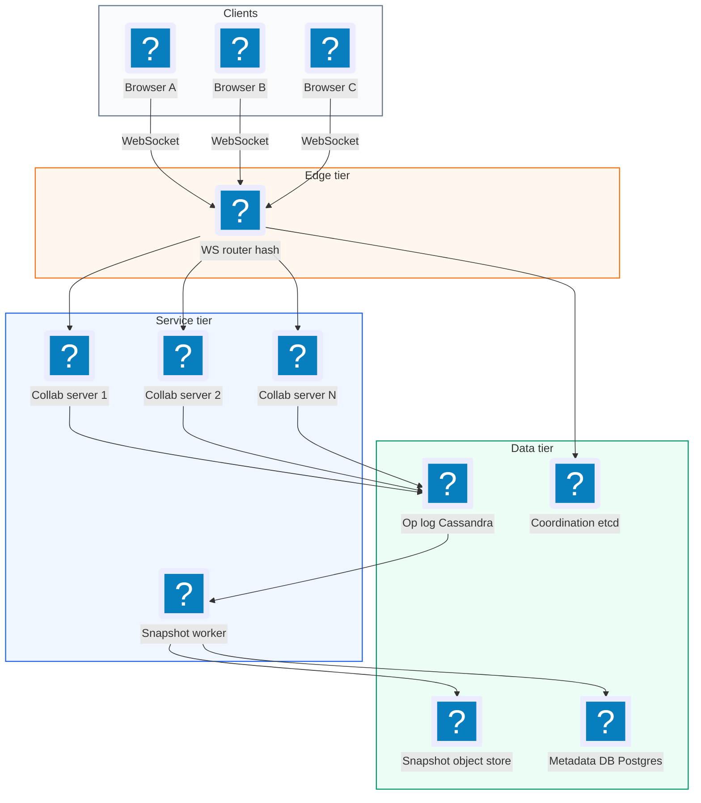
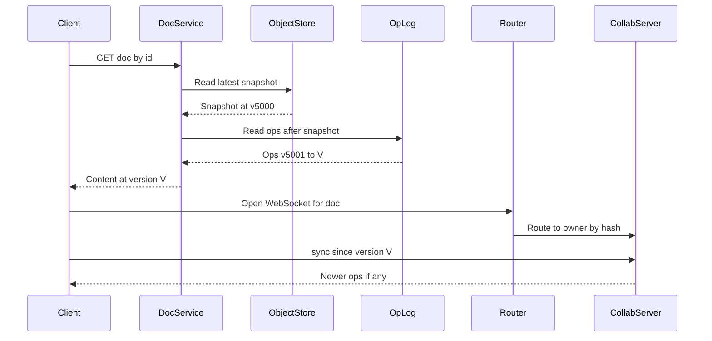
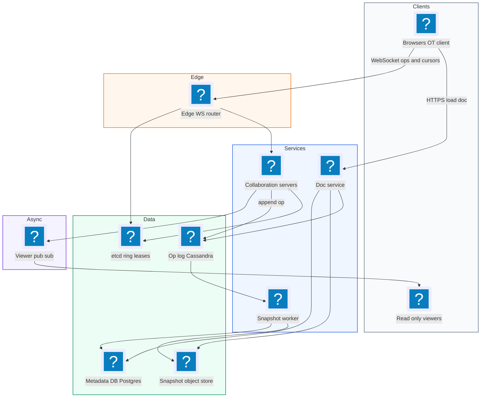

# 24. Google Docs  (Hard)

> Google Docs lets several people edit the same document at the same time from different browsers. Each person sees the others' typing within a fraction of a second, sees their cursors, and nobody's edit is lost even when two people type in the same sentence. The interviewer is testing whether you understand the core problem of concurrent edits: why "last write wins" destroys work, how Operational Transformation (OT) or CRDTs fix it, how to route every editor of a document to the same collaboration server, how to store a stream of tiny operations plus periodic snapshots, and how offline edits merge back in.

## 1. Functional requirements

Core (must have):

1. Users can create a document and open an existing one.
2. Multiple users can edit the same document at the same time, and all of them converge to the same content.
3. Users see other editors' changes in near real time.
4. Users see who else is in the document and where their cursors are (presence).
5. Users can keep editing while briefly offline; their edits merge when they reconnect.

Below the line (out of scope):

- Permissions and sharing UI (assume an access service answers "can user U edit doc D?").
- Comments, suggestions mode, and version history browsing (we mention history as a by-product of storing operations).
- Rich formatting details (bold, tables, images). We model plain text; formatting is attributes on ranges and uses the same machinery.
- Full-text search across documents.

## 2. Non-functional requirements

1. Latency: a keystroke shows locally instantly (optimistic) and reaches other editors within p99 < 200 ms in the same region.
2. Consistency: eventual consistency with strong convergence. After all edits are delivered, every replica has the identical text. No edit is silently lost.
3. Concurrency: up to 100 simultaneous editors per document (Google caps active editors around this size); unlimited viewers via a degraded path.
4. Scale: 1 billion documents, 10 million documents open concurrently.
5. Durability: an acknowledged edit is never lost (11 nines object storage for snapshots, replicated log for ops).
6. Availability: 99.99% for opening and editing. A collaboration server crash should cost at most a reconnect of a few seconds.
7. CAP choice: AP per document across regions, with a single ordering server per document to make OT simple. Inside a document we favor availability and convergence over a global lock.

## 3. Back-of-the-envelope estimates

| Assumption | Number |
|---|---|
| Total documents | 1 billion |
| Average document size | 50 KB |
| Concurrently open documents | 10 million |
| Average active editors per open doc | 2 |
| Typing rate of an active editor | ~3 operations/s (batched every ~100 ms) |
| Operation size | ~100 bytes with metadata |
| Snapshot every | 1,000 operations or 5 minutes |

```text
Concurrent editors = 10M docs * 2 = 20M WebSocket connections
  -> at 50k connections per server ~ 400 collaboration servers

Operation rate = 20M editors * 3 ops/s = 60M ops/s (peak, if all typing)
  realistic: ~20% typing at once -> ~12M ops/s
  each op is broadcast to the other editors (avg 1) -> ~12M msgs/s out

Op log storage:
  12M ops/s * 100 B = 1.2 GB/s ~ 100 TB/day raw
  ops are compacted into snapshots and old ops archived -> keep 30 days hot

Document storage:
  1B docs * 50 KB = 50 TB of current snapshots (object store)

Per-document load: 100 editors * 3 ops/s = 300 ops/s on one doc
  -> easily handled by one server holding the doc in memory
```

Two takeaways: total load is large but spread over millions of documents, and a single document is small enough to live in one server's memory. That is why we shard by document.

## 4. Core entities

- Document: metadata. Fields: doc_id, title, owner_id, created_at, latest_snapshot_version.
- Operation: one edit. Fields: doc_id, version (server sequence number), client_id, base_version, type (insert or delete), position, text or length.
- Snapshot: full document content at a version. Fields: doc_id, version, content (blob pointer).
- Session / Presence: an editor connected to a doc. Fields: doc_id, user_id, client_id, cursor position, selection, color, last_seen.
- Client: one browser tab. Fields: client_id, pending (unacknowledged) ops.

```sql
CREATE TABLE documents (
  doc_id            UUID PRIMARY KEY,
  owner_id          BIGINT NOT NULL,
  title             TEXT,
  snapshot_version  BIGINT NOT NULL DEFAULT 0,
  snapshot_uri      TEXT,                      -- s3://docs/<doc>/<ver>
  updated_at        TIMESTAMPTZ
);

-- wide-column store (Cassandra / Bigtable), one partition per doc
CREATE TABLE doc_ops (
  doc_id      UUID,
  version     BIGINT,                         -- assigned by server, 1,2,3...
  client_id   TEXT,
  client_seq  BIGINT,                         -- idempotency per client
  op          BLOB,                           -- encoded operation
  ts          TIMESTAMP,
  PRIMARY KEY ((doc_id), version)
);
```

```json
{"type": "op", "doc_id": "d-1", "client_id": "c-7", "client_seq": 42,
 "base_version": 1051, "ops": [{"retain": 12}, {"insert": "hello"}]}
```

## 5. API design

REST for document lifecycle, WebSocket for collaboration. All calls carry the user's session token; the server checks edit permission with the access service on connect.

`POST /v1/docs` -- create a document. Body `{"title": "Plan"}`. Response 201 `{"doc_id": "d-1"}`.

`GET /v1/docs/{doc_id}` -- load the latest snapshot plus ops since it.

```json
{"doc_id": "d-1", "version": 1051, "content": "Hello world...", "title": "Plan"}
```

Status 200, 403 no access, 404 missing.

`WS /v1/docs/{doc_id}/collab` -- the collaboration channel. Messages:

Client to server:

```json
{"type": "op", "client_seq": 42, "base_version": 1051,
 "ops": [{"retain": 5}, {"insert": "X"}]}
{"type": "cursor", "pos": 17, "sel_end": 17}
{"type": "sync", "since_version": 1040}
```

Server to client:

```json
{"type": "ack", "client_seq": 42, "version": 1052}
{"type": "op", "version": 1053, "client_id": "c-9", "ops": [{"retain": 3}, {"delete": 2}]}
{"type": "presence", "users": [{"user_id": 8, "name": "Bo", "pos": 30}]}
```

`GET /v1/docs/{doc_id}/ops?from=1000&to=1051` -- fetch missing operations (used for catch-up and history).

## 6. High-level design



### How will users open a document?

1. The client calls `GET /v1/docs/{id}`. The document service reads the latest snapshot from the object store and the ops after it from the op log, applies them, and returns the content at version V.
2. The client opens the WebSocket. The router sends it to the collaboration server that owns this document.
3. The client sends `sync since_version=V`. The server sends any ops newer than V.



### How will users edit together?

1. The user types. The client applies the edit locally right away (so typing feels instant) and sends it with `base_version` = the last server version it has seen.
2. The collaboration server holds the document in memory. If other ops were applied after `base_version`, it transforms the incoming op against them (OT, see deep dives).
3. It assigns the next version number, appends the op to the op log, and only then acks to the sender.
4. It broadcasts the transformed op to all other connected editors of that document.
5. Each receiving client transforms the incoming op against its own unacknowledged local ops and applies it.

### How will users see each other's cursors?

1. Clients send cursor updates (throttled to ~10/s) over the same WebSocket.
2. The server keeps presence in memory for the document and broadcasts it. Presence is not stored durably.
3. When an op is applied, every cursor position is shifted by the same transform rules, so cursors stay on the right character.

### How will offline edits work?

1. While offline, the client keeps queuing local ops with their base version.
2. On reconnect it sends `sync` to fetch missed server ops, rebases its queued ops on top, and sends them.
3. Details in the deep dives.

## 7. Deep dives

### How do we merge concurrent edits correctly: OT or CRDT?

The problem: Alice and Bob both start from the text `"abc"` (version 1).

- Alice inserts `"X"` at position 1 -> she sees `"aXbc"`.
- Bob deletes the character at position 2 (`"c"`) -> he sees `"ab"`.

If the server applies them naively in order, Alice's insert then Bob's raw "delete at 2" removes `"b"` instead of `"c"`. Result `"aXc"`. Wrong, Bob wanted to delete `"c"`. Last-write-wins on the whole document would instead throw away one person's work.

Operational Transformation (OT): when an op was made without seeing another concurrent op, adjust (transform) its position as if it had. Bob's delete at 2 is transformed against Alice's insert at 1: the insert happened before position 2, so shift Bob's delete to 3.

```text
 start "abc"                        (version 1)
 Alice: insert("X", 1)   -> v2      server applies first: "aXbc"
 Bob:   delete(2), base v1          arrives second, base is stale
 transform(delete(2), against insert(1)) = delete(3)
 apply delete(3) to "aXbc"          -> "aXb"
 Alice receives delete(3) -> "aXb"; Bob receives insert(1) -> "aXb"
 Both converge to "aXb". Correct.
```

```python
def transform(op, other):
    """Return op adjusted so it applies after `other` (both made on same base)."""
    if other.kind == "insert":
        if op.pos > other.pos or (op.pos == other.pos and op.client > other.client):
            return op.shift(len(other.text))
        return op
    if other.kind == "delete":
        if op.pos >= other.pos + other.length:
            return op.shift(-other.length)
        if op.kind == "insert" and op.pos > other.pos:
            return op.at(other.pos)                # insert inside deleted range
        if op.kind == "delete":
            return op.trim_overlap(other)          # avoid deleting twice
        return op
```

The tie-break on equal positions (by client id) is important: both sides must pick the same order, or they diverge.

CRDT (Conflict-free Replicated Data Type): give every character a unique, ordered id instead of an integer position. Inserts say "put X after character id (A,1)". Deletes mark a character id as removed (a tombstone). Because ids never change, ops commute: any order of application gives the same result, no central server needed.

```text
 "abc" as CRDT:  a(1,s)  b(2,s)  c(3,s)
 Alice: insert X with id (1,alice) after a(1,s)
 Bob:   delete id c(3,s)
 Apply in any order -> a  X  b  [c tombstone]  -> "aXb"
```

| Aspect | OT (central server) | CRDT (Yjs, Automerge) |
|---|---|---|
| Needs a central ordering server | Yes, simplest with one | No, peer to peer possible |
| Metadata overhead | Small (positions) | Larger (ids and tombstones per char) |
| Offline / long divergence | Harder, must rebase many ops | Natural, merge anytime |
| Implementation difficulty | Transform functions are tricky to get right | Data structure is tricky, but libraries exist |
| Used by | Google Docs | Figma (CRDT-like), many newer editors |

Recommended: OT with a single authoritative collaboration server per document, which is what Google Docs does. It keeps memory small and the server gives a total order. Mention that a CRDT is a strong alternative when offline-first or peer-to-peer matters. Either answer is fine if you explain the trade-off.

### How do we route all editors of a document to the same server?

The problem: OT with a central order requires one server to own each document. If Alice is on server 1 and Bob on server 2, they cannot agree on an order without another layer.

| Option | Pros | Cons |
|---|---|---|
| Any server + pub/sub between servers | Stateless servers | No single order, need distributed OT or locks |
| Consistent hashing on doc_id | Simple, no lookup | Rebalancing moves docs when servers join/leave |
| Directory service (doc -> server) in ZooKeeper/etcd | Explicit control, easy failover | Extra lookup on connect |

Recommended: consistent hashing of doc_id to a collaboration server, with the ring membership stored in ZooKeeper or etcd so all routers agree. When a server joins, only the documents that hash to it move.

```python
class Router:
    def __init__(self, ring):
        self.ring = ring                      # sorted list of (hash, server)

    def server_for(self, doc_id):
        h = mmh3.hash(doc_id)
        i = bisect.bisect(self.ring, (h,)) % len(self.ring)
        return self.ring[i][1]

# on WebSocket connect at the edge/load balancer
def on_connect(ws, doc_id):
    target = router.server_for(doc_id)
    proxy(ws, target)                         # sticky for the connection life
```

A single document at 100 editors and 300 ops/s is light, so one owner per doc never becomes a hot spot. A rare "celebrity doc" with 10,000 viewers: let only up to 100 people be editors; viewers get a read-only stream fed by a pub/sub fan-out from the owner server.

### How do we store operations and snapshots?

The problem: we need every op durably (so no acked edit is lost), fast load times (replaying a million ops on open is slow), and version history.

| Option | Pros | Cons |
|---|---|---|
| Store only the full document on each edit | Simple reads | 50 KB write per keystroke, no history |
| Store only the op log | Full history, tiny writes | Loading = replay all ops |
| Op log + periodic snapshots | Small writes, fast loads, history | Two stores, compaction job |

Recommended: append every op to an op log partitioned by doc_id (Cassandra or Bigtable, or Kafka plus a DB), then take a snapshot every 1,000 ops or 5 minutes.

```python
def apply_client_op(doc, msg):
    # idempotency: a reconnecting client may resend the same op
    if doc.seen(msg.client_id, msg.client_seq):
        return send_ack(msg, doc.version_of(msg.client_id, msg.client_seq))
    op = msg.op
    for past in doc.ops_since(msg.base_version):     # in-memory recent ops
        op = transform(op, past)
    new_version = doc.version + 1
    oplog.append(doc.id, new_version, msg.client_id, msg.client_seq, op)  # durable
    doc.apply(op, new_version)
    send_ack(msg, new_version)
    broadcast(doc, op, new_version, exclude=msg.client_id)
    if new_version - doc.snapshot_version >= 1000:
        snapshot_queue.put((doc.id, new_version))
```

```text
 load doc:
   snapshot @ v5000 (object store, 50 KB)  +  ops v5001..v5420 (op log)
   -> apply 420 ops in memory -> content @ v5420   (a few ms)
```

Write the op to the log before acking. If we ack first and crash, the client believes the edit is saved but it is gone. Old ops beyond 30 days can be archived to cold storage; history views use snapshots plus archived ops.

### How do we handle offline edits and reconnection?

The problem: Bob's laptop goes offline on a train for 20 minutes. He types 300 ops. Meanwhile Alice makes 500 ops. When Bob reconnects, both sets must merge.

Recommended: the client keeps two buffers: `inflight` (sent, not acked) and `pending` (not sent yet). On reconnect:

```python
def on_reconnect(client):
    missed = server.sync(since_version=client.last_server_version)  # Alice's 500
    for server_op in missed:
        # transform server op over my local unacked ops, and my ops over it
        for i, mine in enumerate(client.inflight + client.pending):
            server_op, mine_t = transform(server_op, mine), transform(mine, server_op)
            replace_local(client, i, mine_t)
        client.apply_remote(server_op)
        client.last_server_version = server_op.version
    client.resend(client.inflight + client.pending,
                  base_version=client.last_server_version)
```

Because each op carries `(client_id, client_seq)`, if the server already received some of Bob's ops before the drop, resending them is safe: the server acks the duplicate with its existing version and does not apply it twice.

For very long offline periods (days), rebasing thousands of ops is slow and the result can surprise users. That is the case where CRDTs shine, and where some products show a "your version vs theirs" warning instead.

### How do we show cursors and presence efficiently?

The problem: cursors change on every keystroke and mouse click. Storing them durably would be wasteful.

Recommended: presence is in-memory on the owner server only. Clients throttle cursor messages to about 10 per second. The server batches presence broadcasts every 50-100 ms. When a client disconnects (or misses heartbeats for 30 s), it is removed. Cursor positions are transformed by every applied op, the same way as pending text ops, so a cursor after `"abc"` stays after `"abc"` when someone inserts earlier.

| Data | Where | Durable? | Update rate |
|---|---|---|---|
| Text ops | Op log | Yes | Every edit |
| Snapshots | Object store | Yes | Every 1,000 ops |
| Cursors and presence | Owner server memory | No | Throttled ~10/s |

### What happens when a collaboration server crashes?

The problem: the owner server for 25,000 documents dies. Its in-memory state is gone.

Recommended: nothing in memory is the only copy. Every acked op is already in the op log. ZooKeeper/etcd notices the lost heartbeat (session expiry in a few seconds) and removes the server from the ring. Clients see their WebSocket close and reconnect with backoff; the router now sends them to the new owner. The new owner loads snapshot plus op log for each document on first connect, and clients `sync` and resend their unacked ops.

```text
 t=0    server 7 dies
 t=3s   etcd lease expires, ring updated, routers reload ring
 t=3-5s clients reconnect (jittered), new owner loads doc:
        snapshot + ops since snapshot -> in-memory state
        clients resend inflight ops (dedup by client_id, client_seq)
 result: no acked edit lost; un-acked edits are resent by clients
```

Split brain guard: before accepting writes, the new owner takes a lease (fencing token) for the document in etcd. The op log write includes the token, and the log rejects writes with an older token. This stops a zombie old server from appending ops after it lost ownership.

### How do we scale to many concurrent editors and documents?

The problem: 20M connections and 12M ops/s overall, plus the occasional document with very many people.

Recommendations:

- Horizontal: ~400+ collaboration servers, documents spread by consistent hashing. Add servers to grow; only a fraction of docs move.
- Batching: clients send ops every ~100 ms instead of every keystroke, which cuts message count 3-5x. The server also batches broadcasts.
- Edit cap: limit active editors per doc (for example 100). Extra people join as viewers who receive a delayed broadcast from a pub/sub topic.
- Idle docs: unload a document from memory after 10 minutes with no connections; it reloads from snapshot on demand.
- Regions: the owner server lives in one region. Users far away get slightly higher latency (100-200 ms) but local echo hides it.

## 8. Final architecture



| Component | Job | Technology example |
|---|---|---|
| Doc service | Create, load snapshot + ops, auth | Stateless REST service |
| WS router | Sticky routing by doc_id | Envoy / custom proxy with consistent hashing |
| Coordination | Ring membership, per-doc leases | etcd, ZooKeeper |
| Collaboration server | In-memory doc, OT, ordering, broadcast, presence | Go / Java / Node service |
| Op log | Durable ordered ops per doc | Cassandra, Bigtable, or Kafka + DB |
| Snapshot worker | Compact ops into snapshots | Background workers |
| Object store | Snapshots and archives | S3, GCS |
| Metadata DB | Document records | Postgres / Spanner |
| Viewer fan-out | Read-only stream for large audiences | Redis pub/sub, NATS |

### Deployment map (AWS)

```mermaid
architecture-beta
    group internet(mdi:earth)[Internet]
    group edge(logos:aws-cloudfront)[Edge]
    group vpc(logos:aws-vpc)[AWS VPC]
    group app(logos:aws-ecs)[Service subnet] in vpc
    group data(logos:aws-rds)[Data subnet] in vpc

    service browsers(mdi:laptop)[Browsers OT client] in internet
    service router(logos:aws-elastic-load-balancing)[Edge WS router] in edge
    service docsvc(logos:aws-ecs)[Doc service] in app
    service collab(logos:aws-ecs)[Collaboration servers] in app
    service worker(logos:aws-lambda)[Snapshot worker] in app
    service etcd(logos:aws-ec2)[etcd ring leases] in data
    service oplog(logos:aws-dynamodb)[Op log Cassandra] in data
    service snapshots(logos:aws-s3)[Snapshot object store] in data
    service metadb(logos:aws-rds)[Metadata DB Postgres] in data

    browsers:R --> L:router
    browsers:B --> T:docsvc
    router:B --> T:collab
    router:B --> T:etcd
    collab:B --> T:etcd
    collab:B --> T:oplog
    docsvc:B --> T:oplog
    docsvc:B --> T:snapshots
    docsvc:B --> T:metadb
    oplog:T --> B:worker
    worker:B --> T:snapshots
    worker:B --> T:metadb
```



The WS router pins each document to one collaboration server using the etcd ring, and every acked op lands in the op log in the data subnet before the snapshot worker compacts it into object storage.

## 9. Common mistakes and interviewer follow-ups

- Mistake: last write wins on the whole document. Concurrent typing loses work. Say: OT or CRDT so every edit survives and replicas converge.
- Mistake: locking the document or a paragraph while someone types. It feels broken and blocks collaboration. Say: optimistic local apply plus transformation.
- Mistake: stateless servers behind round-robin for OT. Editors of the same doc land on different servers. Say: one owner per doc via consistent hashing.
- Mistake: acking before the op is durable. Say: append to the op log, then ack.
- Mistake: saving the full document on every keystroke. Say: op log plus periodic snapshots.
- Mistake: forgetting to transform cursors. Say: cursors are positions and get the same transform as text ops.
- Follow-up: "Version history?" Snapshots every N ops plus the op log give any past version by loading the nearest snapshot and replaying.
- Follow-up: "Why not CRDT?" Valid choice, especially offline-first; costs more metadata per character and needs garbage collection of tombstones.

## 10. One-page cheat sheet

| Topic | Key point |
|---|---|
| Scale | 1B docs, 10M open, 20M connections, ~400 collab servers |
| Per doc | <= 100 editors, ~300 ops/s, fits in one server's memory |
| Merge | OT with a single owner server per doc; CRDT as offline-first alternative |
| OT core | transform(op, concurrent) shifts positions; deterministic tie-break |
| Routing | Consistent hash(doc_id), ring in etcd/ZK |
| Write path | transform, assign version, append op log, ack, broadcast |
| Storage | Op log (Cassandra) + snapshot every 1,000 ops (S3) |
| Idempotency | (client_id, client_seq) on every op |
| Offline | inflight + pending buffers, sync since version, rebase, resend |
| Presence | In memory only, throttled 10/s, transformed with ops |
| Failure | Lease/fencing per doc, clients reconnect and resend, no acked edit lost |
| CAP | Convergent eventual consistency, availability first |

## Sources

- [Hello Interview: Design Google Docs](https://www.hellointerview.com/community/questions/realtime-collaborative-docs/cm69gjz7n020be7bzjsf6a663)
- [Hello Interview: Common patterns (stateful servers on a hash ring, Google Docs)](https://www.hellointerview.com/learn/system-design/in-a-hurry/patterns)
- [Google Drive Blog: What's different about the new Google Docs (operational transformation)](https://drive.googleblog.com/2010/09/whats-different-about-new-google-docs_22.html)
- [Martin Kleppmann: CRDTs and the quest for distributed consistency](https://martin.kleppmann.com/2018/10/17/crdts-and-distributed-consistency.html)
- [Figma Engineering: How Figma's multiplayer technology works](https://www.figma.com/blog/how-figmas-multiplayer-technology-works/)
- [Yjs documentation](https://docs.yjs.dev/)
- [System Design Handbook: Google Docs System Design](https://www.systemdesignhandbook.com/guides/google-docs-system-design/)
