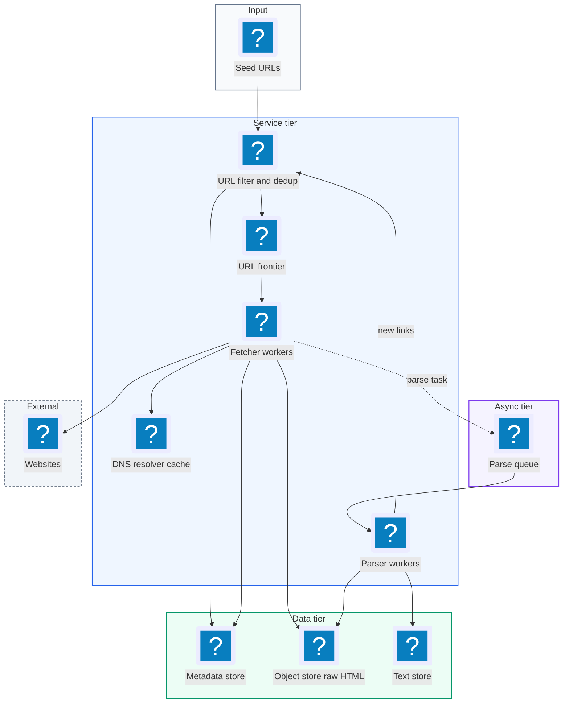
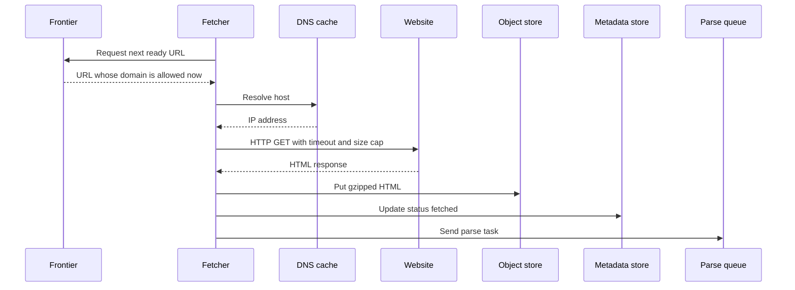
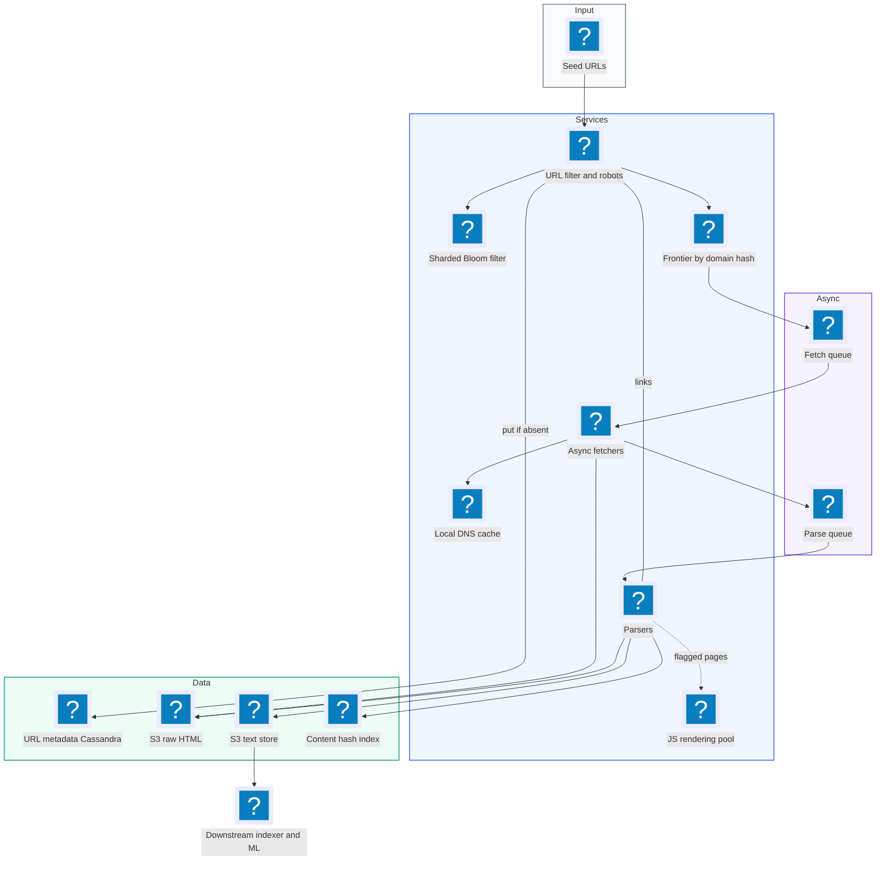

# 25. Web Crawler  (Hard)

> A web crawler starts from a few seed URLs, downloads each page, pulls out the links on it, and repeats for every new link, until it has fetched a large part of the web. The output (raw HTML and extracted text) feeds a search index or a machine learning dataset. The goal here is 10 billion pages in a few days. The interviewer is testing large-scale batch-style systems: a URL frontier that decides what to fetch next, politeness so we never hammer one website, deduplication of both URLs and page content, DNS as a hidden bottleneck, crawler traps, and how to resume after crashes without starting over.

## 1. Functional requirements

Core (must have):

1. Start from a list of seed URLs and crawl outward by following links.
2. Fetch the HTML of each page and store it.
3. Extract links from each page and add new ones to the set of URLs to crawl.
4. Extract the text content and store it for downstream use (indexing, LLM training).
5. Respect robots.txt and per-domain politeness.

Below the line (out of scope):

- Building the search index or ranking (a separate consumer of our output).
- Fetching images, video, or PDFs (we store HTML only, maybe note the extension).
- Continuous re-crawling and freshness scheduling (we mention it briefly).
- Logged-in pages and forms.

## 2. Non-functional requirements

1. Scale: crawl 10 billion pages within 5 days.
2. Politeness: at most 1 request per second per domain by default, and honor `Crawl-delay` and `Disallow` rules in robots.txt.
3. Fault tolerance: a crashed fetcher or parser loses no progress beyond a few seconds of work; the crawl resumes, it never restarts from zero.
4. No duplicate work: each URL is fetched at most once per crawl; pages with identical content are stored once.
5. Robustness: survive bad HTML, slow servers (timeouts), huge pages (size caps), and crawler traps (infinite URL spaces).
6. Efficiency: keep fetchers busy; DNS and slow sites must not stall the pipeline.
7. CAP choice: availability and partition tolerance. It is fine if two workers briefly race on the same URL (dedup will catch it), but the crawl must keep moving.

## 3. Back-of-the-envelope estimates

| Assumption | Number |
|---|---|
| Pages to crawl | 10 billion |
| Time budget | 5 days |
| Average page size (HTML) | ~100 KB compressed on the wire, ~500 KB uncompressed |
| Extracted text per page | ~20 KB |
| Links per page | ~50 (most already seen) |
| Unique domains | ~100 million (a few million with most pages) |
| Network per fetcher machine | ~1 Gbps usable |

```text
Fetch rate:
  10e9 pages / (5 * 86,400 s) = 10e9 / 432,000 ~ 23,000 pages/s

Bandwidth:
  23,000 * 100 KB (on the wire) = 2.3 GB/s ~ 18.4 Gbps
  at ~1 Gbps useful per machine (with overhead) -> ~20-30 fetcher machines
  network is not the hard limit; latency (wait time per request) is

Concurrency needed:
  avg page fetch ~ 1 s (DNS + connect + TLS + download)
  concurrent requests = 23,000 * 1 s = 23,000 in flight
  with async I/O at ~1,000-2,000 concurrent per machine -> ~15-25 machines
  plan for ~50 fetchers for headroom and slow sites

Storage:
  raw HTML (stored compressed ~100 KB) = 10e9 * 100 KB = 1 PB
  text = 10e9 * 20 KB = 200 TB
  URL metadata (URL ~100 B + state ~50 B) = 10e9 * 150 B = 1.5 TB

Links discovered:
  23,000 pages/s * 50 links = 1.15M links/s to dedup
  bloom filter for 10B URLs at 1% false positive:
    bits = -n ln(p) / (ln 2)^2 = 10e9 * 4.6 / 0.48 ~ 96e9 bits ~ 12 GB
```

The numbers to repeat: ~23k pages per second, ~1 PB of HTML, ~1M link checks per second, and a 12 GB Bloom filter.

## 4. Core entities

- URL record: one URL we know about. Fields: url_hash, url, domain, depth, priority, status (queued, fetched, failed, skipped), last_fetched, content_hash.
- Domain: per-site politeness state. Fields: domain, robots rules, crawl_delay, next_allowed_fetch_time, ip, error_count.
- Page: fetched content. Fields: url_hash, http_status, fetched_at, s3_key for HTML, s3_key for text, content_hash.
- Frontier entry: a URL waiting to be fetched. Fields: url, domain, priority, enqueue_time.
- Content fingerprint: hash (and optionally SimHash) of page text, used for duplicate detection.

```sql
-- URL metadata in a wide-column or key-value store (DynamoDB/Cassandra)
CREATE TABLE urls (
  url_hash      BINARY(16) PRIMARY KEY,     -- hash of normalized URL
  url           TEXT,
  domain        TEXT,
  depth         INT,
  status        TEXT,                        -- queued/fetched/failed/skipped
  attempts      INT,
  content_hash  BINARY(16),
  html_key      TEXT,                        -- s3://crawl/html/...
  fetched_at    TIMESTAMP
);

CREATE TABLE domains (
  domain             TEXT PRIMARY KEY,
  robots_txt         TEXT,
  robots_fetched_at  TIMESTAMP,
  crawl_delay_ms     INT DEFAULT 1000,
  next_fetch_at      TIMESTAMP,
  consecutive_errors INT DEFAULT 0
);
```

```json
{"url": "https://example.com/a/b?id=7", "domain": "example.com",
 "depth": 3, "priority": 0.62, "discovered_from": "https://example.com/"}
```

## 5. API design

A crawler is mostly an internal pipeline, but a small control API helps operators and shows the interviewer the system boundaries. All endpoints are internal, behind service auth.

`POST /v1/crawls` -- start a crawl.

```json
{"name": "web-2026-11", "seeds": ["https://en.wikipedia.org/", "https://www.bbc.com/"],
 "max_pages": 10000000000, "max_depth": 20, "default_crawl_delay_ms": 1000}
```

Response 201 `{"crawl_id": "cr-1", "status": "running"}`.

`GET /v1/crawls/{crawl_id}` -- progress.

```json
{"crawl_id": "cr-1", "fetched": 2140000000, "queued": 5300000000,
 "failed": 41000000, "pages_per_sec": 23400}
```

`POST /v1/crawls/{crawl_id}/pause` and `/resume` -- operator control. Response 202.

`POST /v1/domains/{domain}/block` -- stop crawling a site (owner complaint, trap). Response 200.

Internal message formats (queues):

```json
{"type": "fetch_task", "url": "https://example.com/x", "url_hash": "9a1f...", "attempt": 1}
{"type": "parse_task", "url_hash": "9a1f...", "html_key": "s3://crawl/html/9a/9a1f.gz"}
```

## 6. High-level design



### How will the crawler fetch pages?

1. The frontier hands a fetcher the next URL whose domain is allowed to be fetched now (politeness, see deep dives).
2. The fetcher resolves DNS through a local cache, opens a connection (reusing keep-alive connections per host), and downloads with a 10-second timeout and a 5 MB size cap.
3. It writes the raw HTML (gzip) to the object store, records status in the URL metadata store, and puts a parse task on a queue.



### How will the crawler extract links and text?

1. A parser worker takes the parse task and reads the HTML from the object store.
2. It extracts the visible text and stores it.
3. It computes a content hash. If the hash was seen before, it marks the page as a duplicate and does not follow its links again.
4. It extracts links, resolves relative links to absolute URLs, and sends them to the URL filter.

### How will new URLs get into the frontier?

1. The filter normalizes each URL (lowercase host, drop fragments, sort query params, strip tracking params like `utm_*`).
2. It checks the Bloom filter. If maybe-seen, it confirms in the metadata store; if new, it inserts the URL record and adds it to the frontier with a priority.
3. It checks robots.txt rules for the domain (cached) and drops disallowed URLs.

### How will the crawl respect politeness?

1. Each domain has its own queue in the frontier and a `next_fetch_at` time.
2. A fetcher only takes a URL from a domain whose `next_fetch_at` has passed, then sets `next_fetch_at = now + crawl_delay`.

## 7. Deep dives

### How do we design the URL frontier and prioritize what to crawl?

The problem: billions of URLs wait to be fetched. We want important pages first (a news homepage before page 900 of a forum), and we must not let a single domain dominate.

| Option | Pros | Cons |
|---|---|---|
| One FIFO queue (BFS) | Simple | No priority, one huge site floods the queue, impolite |
| Single priority queue | Important pages first | Still no per-domain politeness |
| Two-level: priority front queues + per-domain back queues (Mercator style) | Priority and politeness together | More moving parts |

Recommended: the Mercator design. Front queues hold URLs by priority bucket. Back queues hold one domain each. A min-heap orders back queues by the time they are next allowed to fetch.

```text
 incoming URLs
      |
      v
 [prioritizer] -> F1 (high)  F2  F3  ...  Fn (low)      front queues
                     \        |    |       /
                      v       v    v      v
                 [back-queue router: domain -> queue]
                  B(example.com) B(bbc.com) B(wiki) ...  back queues
                         \           |          /
                          v          v         v
                 [heap of (next_fetch_at, back_queue)]
                                |
                                v
                            fetchers
```

Priority signals: inverse depth, domain importance (for example a PageRank-like score from a previous crawl), freshness needs (news sites), and number of inbound links seen so far.

```python
def priority(url_rec, domain_score):
    depth_term   = 1.0 / (1 + url_rec.depth)
    inlink_term  = min(1.0, math.log1p(url_rec.inlinks) / 10)
    return 0.5 * domain_score + 0.3 * depth_term + 0.2 * inlink_term
```

At 10B URLs the frontier does not fit in RAM. Store the queues on disk with an in-memory buffer at the head and tail of each queue (Mercator did exactly this), or use a durable queue system. Partition the frontier across machines by `hash(domain)`, so all URLs of one domain live on one frontier node. That makes politeness a local decision on that node.

### How do we stay polite to each website?

The problem: 23k fetches per second spread badly could send 1,000 requests per second to one small site and knock it over. Site owners will block us, and it is the wrong thing to do.

Recommended: per-domain rate limiting from the back-queue heap, robots.txt honored and cached, and adaptive backoff.

```python
def next_task(frontier_node):
    while True:
        next_at, domain = heapq.heappop(frontier_node.heap)
        if next_at > now():
            sleep(next_at - now())
        url = frontier_node.back_queue[domain].pop()
        rules = robots_cache.get(domain) or fetch_robots(domain)   # cached 24 h
        delay = max(rules.crawl_delay_ms or 0, DEFAULT_DELAY_MS)
        if frontier_node.back_queue[domain]:
            heapq.heappush(frontier_node.heap, (now() + delay / 1000, domain))
        if rules.allowed(USER_AGENT, url):
            return url

def on_response(domain, status, latency_s):
    d = domains[domain]
    if status in (429, 503) or latency_s > 5:
        d.crawl_delay_ms = min(d.crawl_delay_ms * 2, 60_000)    # back off
    elif status == 200:
        d.crawl_delay_ms = max(DEFAULT_DELAY_MS, int(d.crawl_delay_ms * 0.9))
```

robots.txt is fetched once per domain and cached for about a day. If robots.txt returns 5xx, be conservative and treat the site as disallowed for a while. Identify the crawler with a clear User-Agent and contact URL. Also limit per IP address, not just per domain, because many small domains share one shared-hosting server.

Math check: at 1 request per second per domain, 23k pages per second needs at least 23k domains active at any moment. With millions of domains in the frontier that is easy, but it means the frontier must interleave domains, never drain one at a time.

### How do we avoid fetching the same URL or storing the same content twice?

The problem: about 1.15M discovered links per second, most already seen. And many different URLs return the same page (mirrors, `?sessionid=`, `http` vs `https`, printer versions).

URL dedup options:

| Option | Memory for 10B URLs | Exact? | Notes |
|---|---|---|---|
| Hash set in memory | ~160 GB (16 B hash each) | Yes | Needs sharding across machines |
| DB lookup per URL | Small RAM | Yes | 1.15M reads/s on the DB |
| Bloom filter + DB confirm on "maybe" | ~12 GB at 1% FP | No false negatives | Fast path in RAM |

A Bloom filter is a bit array plus k hash functions. To add a URL, set k bits. To check, see if all k bits are set. If any bit is 0, the URL is definitely new. If all are 1, it is probably seen (1% false positive at our sizing). It never says "new" for a URL we already added.

Recommended: normalize first, then a Bloom filter sharded by URL hash. For a crawler, a 1% false positive means we skip 1% of truly new URLs, which is often acceptable. If not, confirm "maybe seen" answers against the metadata store with a conditional insert.

```python
def normalize(url):
    p = urlsplit(url)
    host = p.hostname.lower().rstrip(".")
    query = "&".join(sorted(q for q in p.query.split("&")
                            if q and not q.startswith(("utm_", "sessionid="))))
    path = re.sub(r"/+", "/", p.path or "/")
    return f"{p.scheme.lower()}://{host}{path}" + (f"?{query}" if query else "")

def maybe_enqueue(url, depth):
    n = normalize(url)
    h = hash128(n)
    if bloom.might_contain(h):
        return                                  # seen (or 1% false positive)
    bloom.add(h)
    if metadata.put_if_absent(h, url=n, status="queued", depth=depth):
        frontier.add(n, depth)
```

Content dedup: compute a hash (for example SHA-256 or a 128-bit hash) of the extracted text. If it is already in the content-hash table, store a pointer instead of a second copy and do not re-extract links. For near-duplicates (same article with a different ad banner), use SimHash: similar documents produce fingerprints that differ in only a few bits.

```python
def handle_page(url_hash, text):
    ch = sha256(text.encode()).digest()[:16]
    if not content_index.put_if_absent(ch, url_hash):
        metadata.mark_duplicate(url_hash, of=content_index.get(ch))
        return False                            # skip link extraction
    return True
```

### Why is DNS a bottleneck, and how do we fix it?

The problem: every new domain needs a DNS lookup. Public resolvers often take 10 to 200 ms, can rate-limit us, and standard library resolvers are often blocking (one thread waits per lookup). At 23k fetches per second, slow DNS caps throughput.

| Option | Pros | Cons |
|---|---|---|
| OS resolver per request | No work | Blocking, slow, rate-limited |
| Local caching resolver on each fetcher (for example Unbound) | Cache hits in microseconds | Cache per machine |
| Shared DNS cache service + async resolver | High hit rate across fleet | Another service to run |

Recommended: run an async, caching resolver on every fetcher machine, pre-resolve domains when they enter the back queue (so the IP is ready when the fetch is due), and respect TTLs (cache at least a few minutes, at most the record's TTL or a cap of ~1 day).

```text
 back queue for domain X becomes non-empty
        |
        v
 prefetch DNS(X) async ---> local cache (TTL)  ---> fetch at next_fetch_at
                                 ^
            hit rate high because many URLs per domain
```

Because the frontier groups URLs by domain, one lookup serves hundreds or thousands of fetches.

### How do we handle failures and resume the crawl?

The problem: over 5 days with 50 fetchers and many parsers, machines will crash, and networks will fail. We cannot restart a 10B-page crawl.

Recommended: make every stage a consumer of a durable queue, store state in a durable store, and make each step idempotent.

| Stage | Durable state | Recovery |
|---|---|---|
| Frontier | Disk-backed queues + URL metadata status | Rebuild in-memory heads from disk; re-queue URLs left in `fetching` too long |
| Fetch | Task in queue with visibility timeout (SQS) or Kafka offset | Unacked task reappears; fetching twice is harmless |
| Parse | Parse task in queue; HTML already in S3 | Re-parse from S3, link inserts are idempotent (put_if_absent) |
| Bloom filter | Periodic snapshot to S3 | Reload snapshot; misses since snapshot caught by metadata conditional insert |

```python
def fetch_worker():
    for task in fetch_queue.receive(visibility_timeout_s=60):
        try:
            resp = http.get(task.url, timeout=10, max_bytes=5_000_000)
            key = f"html/{task.url_hash[:2]}/{task.url_hash}.gz"
            s3.put(key, gzip(resp.body))                 # same key -> idempotent
            metadata.update(task.url_hash, status="fetched", html_key=key)
            parse_queue.send({"url_hash": task.url_hash, "html_key": key})
            fetch_queue.ack(task)
        except TransientError:
            if task.attempt < 3:
                fetch_queue.retry(task, delay_s=30 * 2 ** task.attempt)
            else:
                metadata.update(task.url_hash, status="failed")
                fetch_queue.ack(task)
```

Retries use exponential backoff, and a domain that keeps failing gets its crawl delay raised or is paused, so we do not spend fetcher time on dead hosts.

### How do we handle crawler traps and dynamic pages?

The problem: some sites generate infinite URLs. A calendar with "next month" links forever, `/a/b/a/b/a/b/...` paths from relative-link bugs, or session ids in every URL. A trap can eat millions of fetches.

Defenses:

| Trap | Defense |
|---|---|
| Infinite depth (`/a/b/a/b/...`) | Max URL length (~2,000 chars), max path depth, detect repeated path segments |
| Calendars, infinite pagination | Max pages per domain per crawl, max depth from seed |
| Session ids in URLs | Normalization strips known session params |
| Many URLs, same content | Content hash dedup stops link expansion |
| Spider traps that slow-drip bytes | Read timeout and total download timeout |
| Huge pages | Size cap (5 MB) |

```python
def looks_like_trap(url, depth, domain_stats):
    path = urlsplit(url).path
    segs = [s for s in path.split("/") if s]
    if len(url) > 2000 or len(segs) > 15 or depth > 20:
        return True
    if any(segs.count(s) > 3 for s in set(segs)):      # /a/b/a/b/a/b
        return True
    if domain_stats.pages > domain_stats.budget:       # per-domain budget
        return True
    return False
```

Dynamic (JavaScript-rendered) pages: plain HTTP fetch returns an empty shell for some single-page apps. Rendering with a headless browser (Chromium) costs 10-100x more CPU per page. Recommended: fetch plain HTML for everything, detect pages with little text and heavy scripts, and send only those (and only for high-priority domains) to a separate, smaller rendering pool.

### How do we scale the fetchers?

The problem: we need ~23k pages per second with many slow servers, so most time is waiting.

Recommendations:

- Async I/O (asyncio, Netty, Go goroutines): one machine holds thousands of connections open while waiting. Threads per request do not scale this far.
- Partition by domain: route a domain's tasks to the fetcher co-located with its frontier partition so politeness, DNS cache, and keep-alive connections are all local.
- Connection reuse: HTTP keep-alive per host saves TCP and TLS handshakes (often 100+ ms each).
- Separate fast and slow lanes: domains that respond slowly go to a pool with longer timeouts so they do not block fast ones.
- Geographic placement: run fetchers in several regions and send a domain's fetches from the region nearest to its servers.
- Autoscale on frontier backlog of "ready now" URLs, not on CPU.

```text
 per fetcher: ~1,500 concurrent requests, ~1 s avg -> ~1,500 pages/s
 needed: 23,000 pages/s -> 16 fetchers minimum, run ~50 for slow sites,
         retries, and failures
```

## 8. Final architecture



| Component | Job | Technology example |
|---|---|---|
| URL filter | Normalize, trap check, robots, Bloom | Stateless service + sharded Bloom (Redis bitmap or in-process) |
| URL metadata | Exact URL state, conditional insert | Cassandra, DynamoDB |
| Frontier | Priority + per-domain queues, politeness heap | Custom disk-backed queues, or Kafka + Redis |
| Fetch queue | Durable tasks, retries | SQS (visibility timeout) or Kafka |
| Fetchers | Download pages | Async Python/Go/Java workers |
| DNS | Fast resolution | Local Unbound or async resolver with cache |
| Raw storage | HTML archive (~1 PB) | S3 / GCS |
| Parsers | Text, links, content fingerprints | Stateless workers |
| Content index | Exact and near-duplicate detection | Key-value store with SHA and SimHash |
| Renderer | JavaScript-heavy pages | Headless Chromium pool |

### Deployment map (AWS)

```mermaid
architecture-beta
    group internet(mdi:earth)[Internet]
    group edge(logos:aws-cloudfront)[Edge]
    group vpc(logos:aws-vpc)[AWS VPC]
    group app(logos:aws-ecs)[Service subnet] in vpc
    group data(logos:aws-rds)[Data subnet] in vpc

    service seed(mdi:laptop)[Seed URLs] in internet
    service dns(logos:aws-route53)[Local DNS cache] in edge
    service filter(logos:aws-ecs)[URL filter and robots] in app
    service frontier(logos:aws-ecs)[Frontier by domain hash] in app
    service fetcher(logos:aws-ecs)[Async fetchers] in app
    service parser(logos:aws-lambda)[Parsers] in app
    service meta(logos:aws-dynamodb)[URL metadata] in data
    service fetchq(logos:aws-sqs)[Fetch queue] in data
    service parseq(logos:aws-sqs)[Parse queue] in data
    service html(logos:aws-s3)[S3 raw HTML] in data

    seed:R --> L:filter
    filter:B --> T:meta
    filter:R --> L:frontier
    frontier:B --> T:fetchq
    fetchq:T --> B:fetcher
    fetcher:L --> R:dns
    fetcher:B --> T:html
    fetcher:B --> T:parseq
    parseq:T --> B:parser
    parser:B --> T:html
    parser:L --> R:filter
```



Seeds enter from outside and DNS resolves at the edge, while the filter, frontier, fetchers and parsers run in the service subnet on top of the queues, URL metadata and HTML archive in the data subnet.

## 9. Common mistakes and interviewer follow-ups

- Mistake: one global FIFO queue. It ignores priority and floods single domains. Say: Mercator-style front (priority) and back (per-domain) queues.
- Mistake: forgetting robots.txt and per-domain rate limits. Say: cached robots rules, crawl delay per domain and per IP, adaptive backoff on 429/503.
- Mistake: dedup with a plain DB lookup per link. 1M+ lookups per second. Say: normalize, Bloom filter first, conditional insert to confirm.
- Mistake: only URL dedup. Different URLs serve the same page. Say: content hash, plus SimHash for near duplicates.
- Mistake: ignoring DNS. Say: async caching resolver, prefetch per domain, respect TTL.
- Mistake: no story for crashes. Say: durable queues with visibility timeouts, HTML in S3 before parse, idempotent steps, Bloom snapshots.
- Mistake: rendering every page in a headless browser. 10-100x cost. Say: plain fetch first, render only flagged pages.
- Follow-up: "How do you recrawl for freshness?" Track change rate per URL; schedule next crawl sooner for pages that change often (news) and later for static ones. Use `If-Modified-Since` and `ETag` to save bandwidth.

## 10. One-page cheat sheet

| Topic | Key point |
|---|---|
| Scale | 10B pages / 5 days ~ 23k pages/s, ~18 Gbps, ~1 PB HTML |
| Concurrency | ~23k requests in flight; async fetchers, ~50 machines |
| Frontier | Front priority queues + per-domain back queues + next_fetch_at heap |
| Partitioning | hash(domain) -> frontier node + fetcher, politeness stays local |
| Politeness | 1 req/s/domain default, robots.txt cached 24 h, backoff on 429/503 |
| URL dedup | Normalize, Bloom filter (~12 GB at 1% FP), put_if_absent |
| Content dedup | SHA of text; SimHash for near duplicates |
| DNS | Local async caching resolver, prefetch per domain |
| Fault tolerance | Durable queues, visibility timeout, S3 before parse, idempotent writes |
| Traps | URL length/depth caps, repeated segments, per-domain budget, timeouts |
| Dynamic pages | Plain fetch first, headless render only when needed |
| CAP | AP: keep crawling, dedup cleans up races |

## Sources

- [Hello Interview: Design a Web Crawler](https://www.hellointerview.com/learn/system-design/problem-breakdowns/web-crawler)
- [Heydon and Najork: Mercator, A Scalable, Extensible Web Crawler](https://www.cs.cornell.edu/courses/cs685/2002fa/mercator.pdf)
- [Google Search Central: Introduction to robots.txt](https://developers.google.com/search/docs/crawling-indexing/robots/intro)
- [donnemartin/system-design-primer: Web crawler](https://github.com/donnemartin/system-design-primer/blob/master/solutions/system_design/web_crawler/README.md)
- [AlgoMaster: Designing a Web Crawler](https://blog.algomaster.io/p/design-a-web-crawler-system-design-interview)
- [Manku, Jain, Das Sarma: Detecting Near-Duplicates for Web Crawling (SimHash)](https://research.google/pubs/detecting-near-duplicates-for-web-crawling/)
