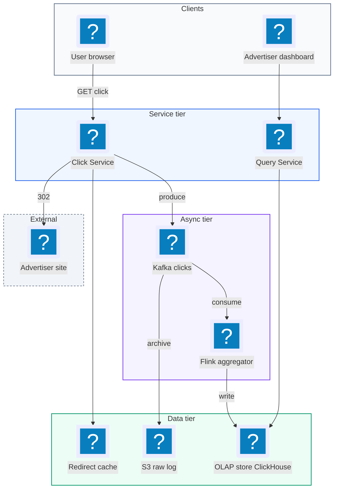
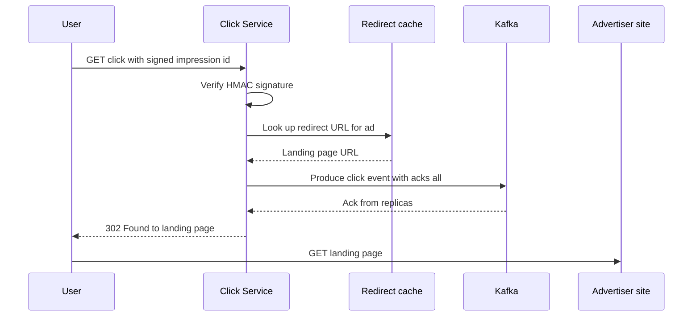
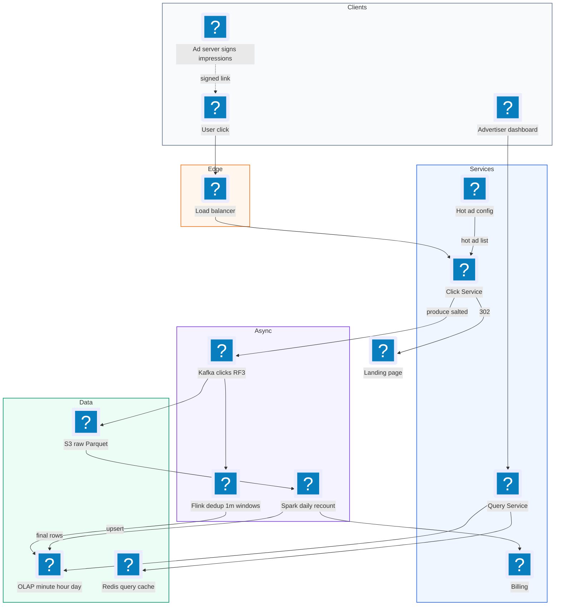

# 26. Ad Click Aggregator  (Hard)

> An ad click aggregator records every time a user clicks an ad, sends the user on to the advertiser's website, and counts those clicks so advertisers can see how each ad is doing, per minute, per hour, and per day. The counts also decide how much money the advertiser is billed, so they must be correct. The interviewer is really testing whether you can design a high-volume event pipeline: how you ingest a flood of tiny events without losing any, how you count them in near real time with stream processing, how you avoid counting the same click twice, and how you make the final numbers trustworthy enough to bill against.

## 1. Functional requirements

Core (must have):

1. When a user clicks an ad, the system records the click and redirects the user to the advertiser's landing page.
2. Advertisers can query click counts for their ads over a time range, at minute, hour, and day granularity (a "rollup" is a total over a bigger time bucket).
3. Advertisers can filter or group counts by a few dimensions, such as ad, campaign, country, and device.

Below the line (out of scope, and why):

- Ad serving and targeting (choosing which ad to show). That is a separate, very large system.
- Fraud detection with machine learning. We will do simple dedup and mention where a fraud model would plug in.
- Impressions and conversions. Same pipeline shape as clicks, so the design generalizes; we keep scope to clicks.
- The billing system itself. We produce the trusted daily numbers it consumes.

## 2. Non-functional requirements

1. Scale: peak 10,000 clicks per second, average about 2,000 per second (about 170 million clicks per day), 10 million active ads. We size for the peak.
2. Redirect latency: p99 under 100 ms from click to the 302 response. The user must never wait on the counting pipeline.
3. Freshness: aggregated counts visible to advertisers within 1 minute of the click (near real time).
4. Query latency: p99 under 1 second for a dashboard query over any range up to 1 year.
5. Correctness: no click lost after it is acknowledged (durability), and each unique click counted exactly once in the final billing numbers. Real-time numbers may be slightly off for a few minutes; the daily reconciled numbers must be exact.
6. Availability: 99.99% for click capture and redirect. Losing clicks loses money.
7. CAP choice: favor availability (AP) on the ingest path. Accept a click even during a partial outage and reconcile later. For billing we get correctness by recomputing from the raw log, not by blocking writes.

## 3. Back-of-the-envelope estimates

| Assumption | Number |
|---|---|
| Peak clicks per second | 10,000 |
| Average clicks per second | 2,000 |
| Clicks per day (average) | ~170 million |
| Raw click event size | ~200 bytes |
| Active ads | 10 million |
| Dimensions per aggregate row | ad, campaign, country, device |
| Dashboard query QPS | ~1,000 at peak |

```text
Write path
  Peak ingest            = 10,000 events/s
  Raw bytes/s at peak    = 10,000 * 200 B = 2 MB/s  (tiny for Kafka)
  Raw per day            = 170M * 200 B   = 34 GB/day
  Raw per year           = 34 GB * 365    = ~12 TB/year (S3, cheap)

Aggregates (minute buckets)
  Worst case rows/min    = ads clicked that minute, not all 10M.
  Say 1M distinct ads/min * 1 row each = 1M rows/min
  Row size ~ 50 B        = 50 MB/min = 72 GB/day of minute rows
  Keep minute rows 7 days, hour rows 1 year, day rows forever:
    minute: 72 GB * 7       = ~500 GB
    hour:   (1M rows/hr*50B)*24*365 = ~440 GB/year
    day:    much smaller, ~20 GB/year

Read path
  1,000 dashboard QPS, each scanning at most a few thousand
  pre-aggregated rows -> easy for an OLAP store.
```

The lesson from the math: ingest bandwidth is small, but the event count is high and every event matters. The design is about correctness and freshness, not raw bytes.

## 4. Core entities

- Click event: one raw click. Fields: click_id, impression_id, ad_id, user_id (or anonymous id), timestamp, country, device, ip.
- Ad: the thing being clicked. Fields: ad_id, campaign_id, advertiser_id, redirect_url.
- Impression: one showing of an ad to a user. Fields: impression_id, ad_id, user_id, shown_at, signature. It lets us tie a click to a real view.
- Aggregate (rollup row): a count for one ad over one time bucket. Fields: ad_id, bucket_start, granularity, country, device, clicks.
- Advertiser: owner of ads. Fields: advertiser_id, name.

```json
{
  "click_id": "c_9f2a1e",
  "impression_id": "imp_77b3",
  "ad_id": "ad_123",
  "user_id": "u_555",
  "event_time": "2026-11-05T19:01:12.345Z",
  "country": "US",
  "device": "ios"
}
```

```sql
-- OLAP table for aggregates (ClickHouse style)
CREATE TABLE ad_clicks_minute (
  ad_id        String,
  campaign_id  String,
  bucket_start DateTime,      -- start of the minute
  country      LowCardinality(String),
  device       LowCardinality(String),
  clicks       UInt64
) ENGINE = SummingMergeTree
PARTITION BY toDate(bucket_start)
ORDER BY (ad_id, bucket_start, country, device);
```

## 5. API design

`GET /click?impression_id=imp_77b3&ad_id=ad_123&sig=...` -- record a click and redirect.

```json
// response: no body, just a redirect
// 302 Found
// Location: https://advertiser.example.com/landing?utm=...
```

Status codes: 302 on success, 400 if the signature is invalid (we still redirect to a safe fallback page so users are not stranded), 404 if the ad does not exist. Auth: none for the user, but the impression id is signed by the ad server so it cannot be forged.

`GET /ads/{ad_id}/metrics?from=...&to=...&granularity=minute|hour|day&group_by=country` -- read aggregated counts.

```json
// response 200
{
  "ad_id": "ad_123",
  "granularity": "hour",
  "series": [
    {"bucket": "2026-11-05T18:00:00Z", "country": "US", "clicks": 1520},
    {"bucket": "2026-11-05T19:00:00Z", "country": "US", "clicks": 1733}
  ],
  "is_final": false
}
```

Status codes: 200, 400 (bad range), 403 (advertiser does not own the ad). Auth: advertiser OAuth token; the service checks the ad belongs to the caller.

`GET /campaigns/{campaign_id}/metrics?...` -- same shape, grouped at campaign level.

The `is_final` flag tells the client whether the numbers come from the reconciled batch (final) or the real-time stream (provisional).

## 6. High-level design



### How will users click an ad and get redirected?

1. The ad server renders the ad with a link to our Click Service that carries a signed impression id and the ad id.
2. The user clicks. The browser calls `GET /click?...`.
3. The Click Service verifies the signature (a quick HMAC check, no database).
4. It looks up the redirect URL for the ad from an in-memory cache (10 million ads * ~200 bytes = 2 GB, fits in a Redis cluster or local cache).
5. It builds the click event and produces it to Kafka with `acks=all`, so the event is durably stored on several brokers.
6. Once Kafka acknowledges, it returns `302 Found` with the landing page URL.



Why produce before redirecting? If we redirect first and the service crashes, we lose a billable click. The Kafka produce takes a few milliseconds, well under the 100 ms budget.

Why a server-side redirect rather than letting the browser go straight to the advertiser and send a beacon? Beacons get blocked by ad blockers and dropped when the page unloads. The server redirect guarantees we see every click.

### How will advertisers query click metrics?

1. Kafka holds every click, partitioned by ad_id.
2. A Flink job (Flink is a stream processing engine that runs continuous computations over event streams) reads the topic, groups events by ad and by one-minute window, and counts them.
3. When a minute window closes, Flink writes the count rows to the OLAP store (OLAP means Online Analytical Processing: a database built for fast aggregate queries over many rows, like ClickHouse, Druid, or Pinot).
4. The dashboard calls the Query Service, which runs a `SUM(clicks) ... GROUP BY` against the right rollup table and returns the series.

```sql
SELECT toStartOfHour(bucket_start) AS bucket, country, sum(clicks) AS clicks
FROM ad_clicks_minute
WHERE ad_id = 'ad_123'
  AND bucket_start >= '2026-11-05 00:00:00'
  AND bucket_start <  '2026-11-06 00:00:00'
GROUP BY bucket, country
ORDER BY bucket;
```

### How will advertisers get minute, hour, and day rollups?

We do not keep only minute rows and sum them at query time for a year range; that would scan 525,600 minutes per ad. Instead we keep three tables. Flink writes minute rows; the OLAP store builds hour and day rows using materialized views (a view that is stored and kept updated as new rows arrive). A query for a year at day granularity reads 365 rows.

## 7. Deep dives

### Should we use stream processing or batch processing to count clicks?

The problem: advertisers want counts within a minute, but batch jobs that run hourly or daily are slow. Stream processing is fast but historically harder to make exact.

| Option | Freshness | Correctness | Cost / complexity |
|---|---|---|---|
| Batch only (Spark over S3 every hour) | 1 hour+ | Exact, easy to rerun | Low |
| Stream only (Flink over Kafka) | Seconds | Good with checkpoints, but bugs and late data can drift | Medium |
| Stream + batch reconciliation (Lambda style) | Seconds for provisional, daily for final | Exact final numbers | Higher, two code paths |

Recommended: stream processing for the real-time view, plus a daily batch reconciliation job that recomputes the truth from the raw S3 log. This is the classic Lambda architecture (two paths: a fast "speed layer" and a slow, exact "batch layer"). Many teams simplify it toward Kappa (one streaming path, replay Kafka to fix mistakes), but for billing, a separate batch recount is the safer answer to give.

A minimal Flink job, written in Flink SQL:

```sql
-- Tumbling one-minute windows on event time
INSERT INTO ad_clicks_minute_sink
SELECT
  ad_id,
  campaign_id,
  TUMBLE_START(event_time, INTERVAL '1' MINUTE) AS bucket_start,
  country,
  device,
  COUNT(*) AS clicks
FROM clicks_dedup        -- stream after dedup, see next deep dive
GROUP BY
  ad_id, campaign_id, country, device,
  TUMBLE(event_time, INTERVAL '1' MINUTE);
```

A "tumbling window" is a fixed, non-overlapping time bucket: 19:00-19:01, 19:01-19:02, and so on.

### How do we make sure each click is counted exactly once?

The problem has two parts. First, duplicate events: a user double-clicks, a browser retries, or a bot hammers the link, so the same logical click arrives several times. Second, duplicate processing: a Flink worker crashes and replays events from Kafka, which could count them again.

For duplicate processing, Flink gives "exactly-once state" through checkpoints. A checkpoint is a consistent snapshot of every operator's state plus the Kafka offsets it has read. After a crash, Flink restores the snapshot and rereads Kafka from the saved offsets, so state is never double-updated. To make the output exactly-once too, the sink must either be transactional (Flink two-phase commit with Kafka) or idempotent (writing the same row twice gives the same result).

For duplicate events, we need a dedup key:

| Dedup approach | How | Pros | Cons |
|---|---|---|---|
| Client-generated click id | Browser sends a random UUID | Simple | Easy to forge, bots send fresh UUIDs |
| Signed impression id | Ad server signs impression; one click per impression counts | Hard to forge, ties click to a real view | Needs signing and key rotation |
| Heuristic (user + ad + 10 s window) | Drop repeat clicks in a short window | Catches double clicks | Fuzzy, may drop real repeats |

Recommended: the signed impression id. The ad server signs `impression_id|ad_id|timestamp` with HMAC. The Click Service rejects bad signatures. Downstream, we keep a dedup set keyed by impression id: only the first click for an impression is billable.

Where to keep the dedup set? At 10k/s with a 24-hour window, that is up to ~860 million ids. Two good places:

1. Flink keyed state with a TTL (time to live), keyed by impression id. It lives on local RocksDB disks and is checkpointed, so it is exactly-once with the rest of the job.
2. A Redis `SET NX` with expiry in the Click Service. Fast, but Redis is not checkpointed together with Flink, so it can drift on failures.

```python
# Flink-style dedup operator (pseudo-Python)
class DedupByImpression(KeyedProcessFunction):
    def open(self, ctx):
        desc = ValueStateDescriptor("seen", Types.BOOLEAN())
        desc.enable_time_to_live(StateTtlConfig.new_builder(Time.hours(24)).build())
        self.seen = ctx.get_state(desc)

    def process_element(self, click, ctx):
        # key = click.impression_id
        if self.seen.value():
            ctx.output(DUPLICATES_TAG, click)   # side output for audits
            return
        self.seen.update(True)
        yield click
```

On the write side, make the OLAP write idempotent by using a deterministic row key `(ad_id, bucket_start, country, device, flink_window_id)` and a table engine that replaces rows with the same key (for example ReplacingMergeTree), so a retried write overwrites instead of adding.

### How do we handle a hot ad that gets far more clicks than others?

The problem: Kafka and Flink partition by ad_id so all clicks for one ad land on one partition and one Flink task. A Super Bowl ad might get 5,000 clicks per second, half our peak, all on one worker. That worker falls behind while others sit idle.

| Option | How it works | Pros | Cons |
|---|---|---|---|
| Bigger machines | Vertical scale | Simple | Has a ceiling, wastes money |
| Key salting | Partition by `ad_id:N` with N in 0..K-1, then sum the K partial counts | Spreads load evenly | Extra merge step |
| Local pre-aggregation | Each Click Service host counts per ad for 1 s and emits one summary event | Cuts event volume a lot | Loses per-event dedup unless done carefully |

Recommended: key salting for ads known to be hot. The Click Service keeps a small list of hot ad ids (pushed from a config service or detected by a heavy-hitter counter). For those, it appends a random suffix 0-9 to the partition key. Flink counts per salted key, then a second, small aggregation step sums the 10 partials per ad and minute.

```python
HOT_ADS = load_hot_ads()          # refreshed every 30 s
SALT_BUCKETS = 10

def partition_key(click):
    if click.ad_id in HOT_ADS:
        return f"{click.ad_id}:{random.randrange(SALT_BUCKETS)}"
    return click.ad_id
```

Note that dedup must still be keyed by impression id, not by salted ad key, so run the dedup operator before the salted aggregation (dedup is keyed by impression id, which is already spread evenly).

### How do we reconcile real-time counts with the truth?

The problem: even with checkpoints, things go wrong. A bug in the Flink job, a misconfigured watermark, or a lost partition can make streaming counts drift. Billing cannot depend on that.

Recommended: a daily batch reconciliation job.

1. Kafka Connect (or Flink) continuously writes every raw click to S3 as Parquet files, partitioned by hour.
2. Once a day, after the late-data cutoff (say 2 hours past midnight UTC), a Spark job reads the whole day, applies the same dedup logic, and computes exact per-ad, per-minute counts.
3. It compares the batch counts with the streaming counts. If they differ beyond a tiny threshold, it raises an alert and overwrites the OLAP rows for that day with the batch numbers, marking them `is_final = true`.
4. The billing system reads only final rows.

```sql
-- Spark SQL: the recount
WITH dedup AS (
  SELECT *, ROW_NUMBER() OVER (PARTITION BY impression_id ORDER BY event_time) AS rn
  FROM raw_clicks
  WHERE dt = '2026-11-05' AND sig_valid = true
)
SELECT ad_id, date_trunc('minute', event_time) AS bucket_start,
       country, device, COUNT(*) AS clicks
FROM dedup
WHERE rn = 1
GROUP BY 1, 2, 3, 4;
```

```text
          real time path                      batch path
 Kafka --> Flink --> OLAP (is_final=false)
   |                                         daily Spark
   +--> S3 Parquet ----------------------->  recount ----> diff ---> alert
                                                |
                                                v
                                    OLAP overwrite (is_final=true)
                                                |
                                                v
                                             Billing
```

### How do we handle events that arrive late?

The problem: a click happens at 19:00:58 on a phone in a tunnel and arrives at 19:03:10. If our one-minute window for 19:00 already closed and wrote its count, the click is missed or lands in the wrong bucket.

Two kinds of time matter. Event time is when the click actually happened (from the event). Processing time is when Flink sees it. Advertisers care about event time.

A watermark is Flink's running estimate of "I have probably seen all events up to time T." A window closes when the watermark passes its end.

| Option | Behavior | Trade-off |
|---|---|---|
| Processing-time windows | Bucket by arrival time | Simple, but wrong buckets for late events |
| Event-time windows, short watermark delay (5 s) | Fast results | More events arrive after the window closes |
| Event-time windows, watermark delay + allowed lateness | Emit early, then update the window when late events come | Slightly more state, correct buckets |

Recommended: event time, a bounded-out-of-orderness watermark of about 10 seconds, plus allowed lateness of a few minutes. When a late event arrives within allowed lateness, Flink re-fires the window with an updated count, and our idempotent upsert overwrites the row. Events later than that go to a side output, are logged, and are picked up by the daily batch recount (which sees everything).

```java
WatermarkStrategy
  .<Click>forBoundedOutOfOrderness(Duration.ofSeconds(10))
  .withTimestampAssigner((c, ts) -> c.eventTimeMillis());

clicks
  .keyBy(Click::adId)
  .window(TumblingEventTimeWindows.of(Time.minutes(1)))
  .allowedLateness(Time.minutes(5))
  .sideOutputLateData(lateTag)
  .aggregate(new CountAgg());
```

Also guard against clients with bad clocks: if the event time is more than a few minutes in the future or more than a day in the past, replace it with the server receive time.

### How do we serve aggregated counts quickly, and what if parts fail?

Serving: the OLAP store holds pre-aggregated minute, hour, and day tables. Queries pick the coarsest table that covers the requested granularity. A popular dashboard can also be cached in Redis for 30 seconds keyed by the query parameters, which absorbs refresh storms.

| Store | Strength | Weakness |
|---|---|---|
| Postgres with rollup tables | Familiar | Struggles with billions of rows and wide group-bys |
| Cassandra with precomputed keys | Fast point reads | No ad-hoc group-by |
| ClickHouse / Druid / Pinot | Fast group-by on billions of rows, columnar | Another system to run |

Recommended: an OLAP store such as ClickHouse or Pinot.

Failure handling, component by component:

- Click Service host dies: stateless, load balancer routes around it. Clients retry; dedup by impression id absorbs retries.
- Kafka unreachable from a Click Service host: buffer events to a local disk queue and redirect anyway (availability first), then drain the buffer when Kafka returns. This trades a tiny risk of loss on host disk failure for never blocking users.
- Kafka broker dies: replication factor 3 with `min.insync.replicas=2` keeps writes going.
- Flink job crashes: restart from the last checkpoint (every 30-60 s); Kafka keeps 7 days of data so nothing is lost.
- OLAP store down: Flink sink retries with backoff; Kafka backs up; dashboards show stale data with a banner. Billing is unaffected because it uses the batch path.

## 8. Final architecture



| Component | Job | Technology example |
|---|---|---|
| Click Service | Verify signature, emit event, redirect | Go or Java service behind a load balancer |
| Redirect cache | ad_id to URL lookup | Redis or in-process cache |
| Event log | Durable buffer, replay | Kafka or Kinesis |
| Stream processor | Dedup, windowed counts, late data | Flink |
| Raw archive | Source of truth for recounts | S3 + Parquet |
| Batch recount | Exact daily numbers, drift alerts | Spark |
| Aggregate store | Fast group-by queries over rollups | ClickHouse, Pinot, Druid |
| Query cache | Absorb dashboard refresh storms | Redis |
| Billing feed | Reads final rows only | Internal billing service |

### Deployment map (AWS)

```mermaid
architecture-beta
    group internet(mdi:earth)[Internet]
    group edge(logos:aws-cloudfront)[Edge]
    group vpc(logos:aws-vpc)[AWS VPC]
    group app(logos:aws-ecs)[Service subnet] in vpc
    group data(logos:aws-rds)[Data subnet] in vpc

    service user(mdi:cellphone)[User click] in internet
    service dash(mdi:laptop)[Advertiser dashboard] in internet
    service lb(logos:aws-elastic-load-balancing)[Load balancer] in edge
    service click(logos:aws-ecs)[Click Service] in app
    service query(logos:aws-ecs)[Query Service] in app
    service flink(logos:flink)[Flink dedup 1m windows] in app
    service spark(logos:aws-emr)[Spark daily recount] in app
    service kafka(logos:kafka-icon)[Kafka clicks RF3] in data
    service raw(logos:aws-s3)[S3 raw Parquet] in data
    service olap(logos:aws-redshift)[OLAP minute hour day] in data

    user:R --> L:lb
    lb:R --> L:click
    click:B --> T:kafka
    kafka:R --> L:raw
    kafka:T --> B:flink
    flink:B --> T:olap
    raw:T --> B:spark
    spark:B --> T:olap
    dash:R --> L:query
    query:B --> T:olap
```



Clicks pass through the edge load balancer to the Click Service, and the Flink and Spark jobs in the service subnet both write into the OLAP store that sits beside Kafka and the S3 archive in the data subnet.

## 9. Common mistakes and interviewer follow-ups

- Writing every click straight into a relational database and running `COUNT(*)`. It melts at 10k writes per second and makes queries scan billions of rows. Say: log to Kafka, pre-aggregate with a stream job, query rollups in an OLAP store.
- Redirecting before the event is durable. A crash loses billable clicks. Say: produce to Kafka with `acks=all`, then redirect; or buffer to local disk if Kafka is down.
- Claiming "Flink is exactly-once, so we are done." Exactly-once state does not remove duplicate clicks from users or bots, and the sink must be idempotent too. Say: dedup on a signed impression id and use idempotent upserts.
- Bucketing by processing time. Late mobile events land in the wrong minute. Say: event-time windows with watermarks and allowed lateness, with the batch job as the final safety net.
- Ignoring hot ads. One partition becomes the bottleneck. Say: detect heavy hitters and salt their keys, then merge partial counts.
- No reconciliation. Billing on a stream with no audit is risky. Say: daily Spark recount from S3, compare, alert, and overwrite to produce final numbers.
- Follow-up: "How would you add fraud filtering?" Answer: a Flink operator or async ML scorer that tags suspicious clicks; tagged clicks are still stored but excluded from billable counts, and the batch job can apply an updated model.
- Follow-up: "Why not Kappa only?" Answer: Kappa (replay Kafka to fix mistakes) works and is simpler, but needs long Kafka retention and the same code for both paths; for money, a separate recount from cold storage gives an independent check.

## 10. One-page cheat sheet

| Topic | Key point |
|---|---|
| Scale | 10k clicks/s peak, 2 MB/s, ~34 GB raw/day, ~12 TB/year |
| Latency | Redirect p99 < 100 ms; counts visible < 1 min; query p99 < 1 s |
| Click path | Verify HMAC, produce to Kafka (acks=all), then 302 |
| Log | Kafka partitioned by ad_id, RF=3, 7-day retention |
| Counting | Flink event-time tumbling 1-minute windows |
| Dedup | Signed impression id; Flink keyed state with 24 h TTL |
| Exactly-once | Flink checkpoints + idempotent upsert keys in the sink |
| Late data | 10 s watermark, 5 min allowed lateness, side output, batch fix |
| Hot ads | Salt key into N buckets, merge partials |
| Rollups | Minute (7 days), hour (1 year), day (forever) via materialized views |
| Store | ClickHouse / Pinot / Druid for group-by queries |
| Truth | Raw clicks in S3 Parquet; daily Spark recount marks rows final |
| Billing | Reads only `is_final = true` rows |
| CAP | Availability on ingest, correctness via recompute |

## Sources

- [Hello Interview: Ad Click Aggregator breakdown](https://www.hellointerview.com/learn/system-design/problem-breakdowns/ad-click-aggregator)
- [System Design Handbook: Ad Click Aggregator](https://www.systemdesignhandbook.com/guides/ad-click-aggregator-system-design/)
- [PracHub: Streams, late events, and the billing-grade recount](https://prachub.com/resources/ad-click-aggregator-system-design)
- [System Design School: Ad Click Aggregator solution](https://systemdesignschool.io/problems/ad-click-aggregator/solution)
- [Apache Flink docs: Timely stream processing and watermarks](https://nightlies.apache.org/flink/flink-docs-stable/docs/concepts/time/)
- [Hello Interview blog: Netflix ad tracking launch](https://www.hellointerview.com/blog/system-design-trackers-from-netflix-ad-tracking-launch)
