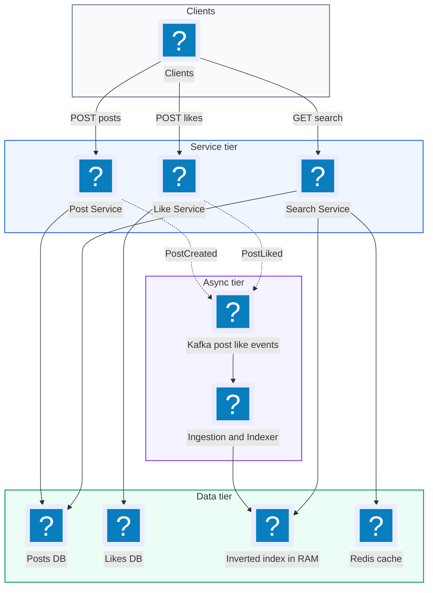
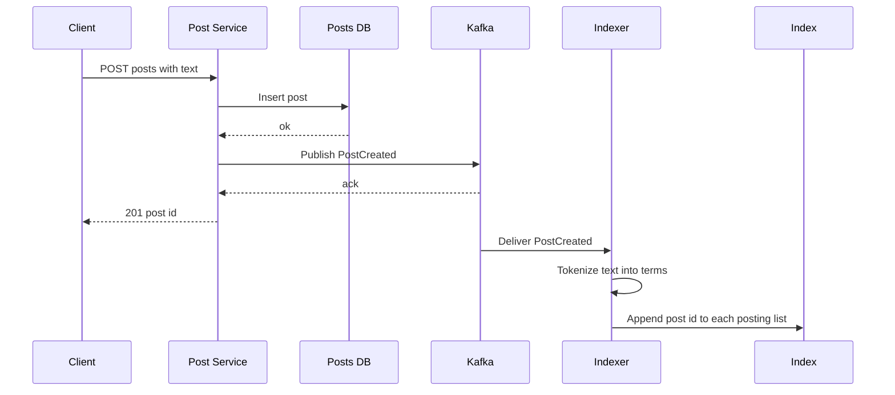
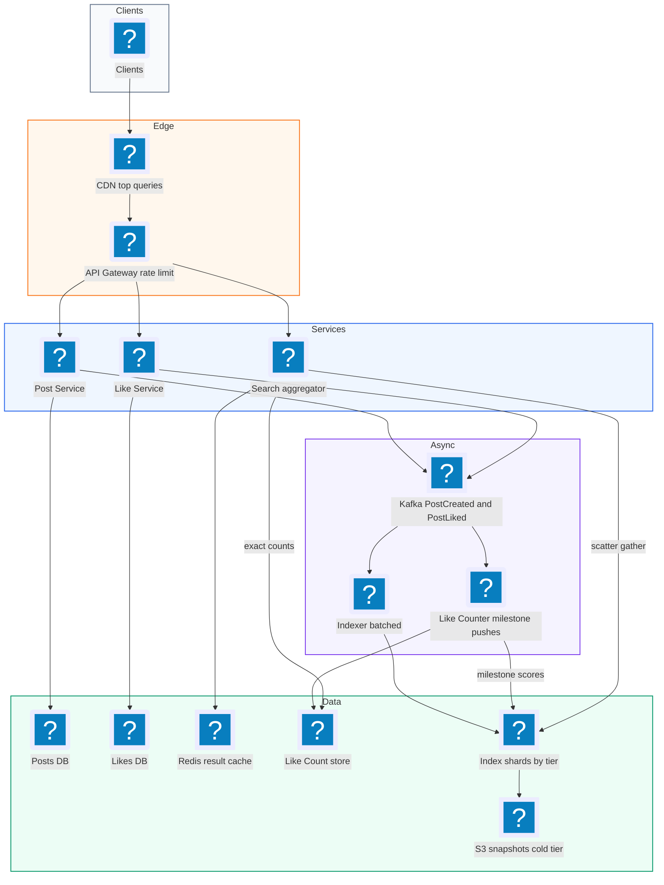

# 27. Facebook Post Search  (Hard)

> Facebook Post Search lets a user type one or more keywords and get back posts that contain them, sorted either by most recent or by most liked. The twist in the interview version is that you are not allowed to just say "use Elasticsearch." You must explain how a search index is built and kept fresh while billions of posts are being created and liked every day. The interviewer is really testing whether you understand inverted indexes, how to shard them, how to handle a very high write rate (new posts and, even more, new likes), how to rank cheaply, and how to keep storage cost under control.

## 1. Functional requirements

Core (must have):

1. Users can create posts and like posts (these are the writes that the search system must absorb).
2. Users can search posts by one or more keywords.
3. Users can sort search results by recency (newest first) or by like count (most liked first).
4. Results are paginated (the user can load more).

Below the line (out of scope, and why):

- Privacy filtering (friends-only posts). Real Facebook does it, but it is its own deep problem; we assume all posts are public.
- Fuzzy matching, typos, stemming, and synonyms. They change the tokenizer, not the architecture.
- Personalized ranking with machine learning. We do two simple sort orders.
- Searching images or videos. Text only.

## 2. Non-functional requirements

1. Query latency: p99 under 500 ms for a search.
2. Freshness: a new post is searchable within 1 minute of being created. Like counts used for sorting can be up to a few minutes stale.
3. Scale: 1 billion users, ~1 billion new posts per day, ~10 billion likes per day, ~10,000 search QPS average.
4. Availability: 99.99% for search. If an index shard is down, return partial results rather than an error.
5. Durability: the post store is the source of truth; the index can be rebuilt from it.
6. CAP choice: availability over consistency for search. Eventual consistency is fine: a just-liked post can rank slightly wrong for a minute. The post and like stores themselves are durable.
7. Recall: search must find every post (not a sample) that matches, at least for the recency sort. Old posts must still be reachable, even if slower.

## 3. Back-of-the-envelope estimates

| Assumption | Number |
|---|---|
| Daily active users | 1 billion |
| New posts per day | 1 billion |
| Likes per day | 10 billion |
| Searches per day | 1 billion (avg 1 per user) |
| Average post length | 100 words, ~60 unique terms after stop words |
| Post retention | 10 years |
| Posting list entry | 8 bytes (post id) |

```text
Writes
  Posts/s   = 1e9 / 86,400       = ~12,000/s  (peak ~3x = 36k/s)
  Likes/s   = 1e10 / 86,400      = ~115,000/s (peak ~350k/s)

Reads
  Search/s  = 1e9 / 86,400       = ~12,000/s  (peak ~36k/s)

Raw post storage
  1e9 posts/day * 1 KB           = 1 TB/day
  per year                       = 365 TB
  10 years                       = ~3.6 PB  (blob/KV store)

Index postings
  1e9 posts/day * 60 terms       = 6e10 postings/day
  * 8 B                          = 480 GB/day
  per year                       = ~175 TB, 10 years ~1.75 PB
  (two sort orders roughly doubles it; compression cuts 3-5x)
```

Two things jump out. First, likes outnumber posts 10 to 1, so updating like counts in the index on every like is the scariest write path. Second, the index for 10 years is petabytes, so keeping all of it in memory is not affordable. Both drive deep dives.

## 4. Core entities

- Post: the content. Fields: post_id, author_id, text, created_at.
- Like: one user liking one post. Fields: user_id, post_id, created_at.
- User: author or searcher. Fields: user_id, name.
- Keyword (term): a normalized word extracted from post text. It is the key of the index.
- Posting list: for one term, the list of post ids that contain it, kept in a chosen sort order.
- Like counter: aggregated like count per post, used for sorting.

```sql
-- Source-of-truth tables (could be a sharded KV store like Cassandra)
CREATE TABLE posts (
  post_id    BIGINT PRIMARY KEY,  -- Snowflake id, time ordered
  author_id  BIGINT,
  text       TEXT,
  created_at TIMESTAMP
);

CREATE TABLE likes (
  post_id    BIGINT,
  user_id    BIGINT,
  created_at TIMESTAMP,
  PRIMARY KEY (post_id, user_id)
);
```

```json
// Index entries, conceptually
{
  "term:pizza:recent": [9012, 9007, 8800, 8122],
  "term:pizza:likes":  [{"post": 8122, "score": 5401}, {"post": 9007, "score": 312}]
}
```

## 5. API design

`POST /posts` -- create a post.

```json
// request
{"text": "Best pizza in Chicago is deep dish"}
// response 201
{"post_id": "9012", "created_at": "2026-11-05T19:00:00Z"}
```

`POST /posts/{post_id}/likes` -- like a post. Response `204 No Content`; `409` if already liked (idempotent from the client's view).

`GET /search?q=pizza+chicago&sort=recent|likes&cursor=...&limit=25` -- search.

```json
// response 200
{
  "results": [
    {"post_id": "9012", "author_id": "77", "snippet": "Best pizza in Chicago...",
     "created_at": "2026-11-05T19:00:00Z", "likes": 41}
  ],
  "next_cursor": "eyJzaGFyZCI6Li4ufQ=="
}
```

Status codes: 200, 400 (empty query), 429 (rate limited). Auth: user session token on every endpoint; search is rate limited per user. The cursor is an opaque token that encodes where each shard left off, so the next page continues correctly.

## 6. High-level design



### How will users create and like posts?

1. The client calls `POST /posts`. The Post Service writes the post to the Posts DB (source of truth) and publishes a `PostCreated` event to Kafka.
2. The client calls `POST /posts/{id}/likes`. The Like Service inserts into the Likes DB (the primary key prevents double likes) and publishes a `PostLiked` event.
3. Both services return as soon as the DB write and Kafka publish succeed. Search indexing happens asynchronously, which is why freshness is "within 1 minute," not instant.



### How will users search by keyword?

The core structure is an inverted index. A normal ("forward") index maps a post to its words. An inverted index flips that: it maps each word to the list of posts that contain it.

1. The Indexer consumes `PostCreated`, tokenizes the text (lowercase, split on spaces and punctuation, drop stop words like "the"), and for each term appends the post id to that term's posting list.
2. The client calls `GET /search?q=pizza chicago&sort=recent`.
3. The Search Service tokenizes the query the same way, giving terms `pizza` and `chicago`.
4. It fetches both posting lists and intersects them (AND semantics: a post must contain both words).
5. It takes the top 25 by the chosen sort, hydrates them (fetches text and author from the Posts DB or a cache), and returns them.

```python
def tokenize(text: str) -> list[str]:
    words = re.findall(r"[a-z0-9#@']+", text.lower())
    return sorted({w for w in words if w not in STOP_WORDS})

def search_recent(terms, limit=25):
    # each list is sorted by post_id DESC; Snowflake ids are time ordered
    lists = [index.get(f"{t}:recent") for t in terms]
    lists.sort(key=len)                      # start with the rarest term
    result = set(lists[0])
    for lst in lists[1:]:
        result &= set(lst)
    return sorted(result, reverse=True)[:limit]
```

### How will users sort by recency or by likes?

We keep two posting lists per term. The recency list is ordered by post id (Snowflake ids embed the creation time, so higher id means newer). The likes list is ordered by like count. In Redis, a sorted set (ZSET) is a natural fit: each member has a numeric score and Redis keeps members ordered by score.

```text
ZADD term:pizza:recent  9012  9012      (score = post_id ~ time)
ZADD term:pizza:likes     41  9012      (score = like count)
ZREVRANGE term:pizza:likes 0 24         (top 25 by likes)
```

## 7. Deep dives

### How do we build and shard an inverted index this large?

The problem: a year of postings is ~175 TB before compression. No single machine holds it. We must split the index across many machines (shards), and the way we split decides how expensive each query is.

| Sharding option | How | Query cost | Write cost | Main risk |
|---|---|---|---|---|
| By term (term-partitioned) | All postings for "pizza" live on one shard | Touch only shards for the query terms (1-3) | A post with 60 terms writes to up to 60 shards | Hot terms ("the", trending hashtags) overload one shard; intersections need cross-shard data movement |
| By document (doc-partitioned) | Each shard owns a subset of posts and a full mini index for them | Fan out to every shard, each returns its top K, merge | A post writes to exactly one shard | Fan-out to all shards for every query; tail latency grows with shard count |
| Hybrid (doc-partitioned + time tiers) | Doc partition within a time range; recent tiers first | Fan out within the hot tier only for most queries | One shard | More moving parts |

Recommended: shard by document, grouped into time-based tiers. Doc partitioning keeps writes to one shard, makes intersections local (each shard has both "pizza" and "chicago" lists for its posts), and spreads hot terms evenly. The fan-out cost is real, so we bound it with tiers (next deep dives) and by scatter-gather with a timeout: each shard returns its local top K; the aggregator merges them; slow shards are dropped from the response and the answer is marked partial.

```python
async def scatter_gather(terms, sort, k=25, timeout_ms=200):
    tasks = [shard.search(terms, sort, k) for shard in hot_tier_shards()]
    done = await gather_with_timeout(tasks, timeout_ms)   # drop slow shards
    merged = heapq.nlargest(k, chain(*done), key=lambda r: r.score)
    return merged, len(done) < len(tasks)                 # results, is_partial
```

Inside each shard, postings are stored compressed. Because post ids in a recency list are sorted, we store the differences between neighbors (delta encoding), which are small numbers, then pack them with variable-byte encoding. That routinely gives 3-5x compression.

### How do we rank by recency and by likes without slow queries?

The problem: for "pizza," there may be 500 million matching posts. Sorting them all at query time is impossible within 500 ms.

| Option | How | Pros | Cons |
|---|---|---|---|
| Sort at query time | Fetch all matches, sort | Simple | Way too slow for common terms |
| One index, sort by recency, re-rank top N by likes | Read newest 10k matches, sort those by likes | One index | Misses old viral posts entirely |
| Two indexes per term (recency and likes) | Each posting list is pre-sorted | Top K is just "read the head" | Double storage, and likes keep reordering the likes list |

Recommended: two pre-sorted indexes. The recency index is append-only (new posts always go on top), so it is cheap. The likes index is the hard one because scores change. To keep it affordable, store only the top N (say 1,000) posts per term per shard in the likes index; a user scrolling past the 1,000th most-liked "pizza" post is rare. For multi-term queries sorted by likes, intersect the recency lists to find candidates and then sort by a like-count lookup, but cap the candidate set (for example, check the top 1,000 of the rarest term's likes list first, which usually yields enough matches).

```text
pizza:likes (capped ZSET, top 1000)
  8122 -> 5401
  7740 -> 4980
  ...
  1033 -> 120   <- lowest score kept; new entries below this are dropped
ZADD term:pizza:likes 130 9012 ; ZREMRANGEBYRANK term:pizza:likes 0 -1001
```

### How do we absorb 115,000 likes per second into the index?

The problem: each like changes a post's score. If a post has 60 terms, one like could mean 60 index updates. At 115k likes per second that is ~7 million index writes per second. Unworkable.

| Option | How | Pros | Cons |
|---|---|---|---|
| Update index on every like | 60 ZADDs per like | Always fresh | 7M writes/s |
| Batch likes per post | Count likes in a short window, update once | Cuts writes hugely | A few seconds to minutes stale |
| Update only at milestones | Re-index a post's score when its count crosses 1, 2, 4, 8, 16... (powers of 2) | Updates per post grow as log of likes | Score in index is approximate |
| Two-stage: approximate index + exact lookup | Index uses milestone score; at query time fetch exact counts for the top candidates and re-sort | Correct final order, cheap writes | Extra lookup at query time |

Recommended: combine batching, milestones, and two-stage ranking.

1. A Like Counter service (Kafka consumer) aggregates like events per post in 30-second windows and writes the exact count to a Like Count store (Redis or Cassandra).
2. It only pushes a score update to the search index when the count crosses a power of 2. A post with 1 million likes has been re-indexed only about 20 times.
3. At query time, the Search Service reads, say, the top 2K candidates by approximate score, fetches their exact like counts in one batched call, re-sorts, and returns the top K.

```python
def on_like_batch(post_id: int, new_count: int, old_count: int):
    like_store.set(post_id, new_count)                 # exact, always
    if new_count.bit_length() > old_count.bit_length():
        # crossed a power of two: refresh index score
        for term in post_terms(post_id):
            index.zadd(f"{term}:likes", {post_id: new_count})
```

```text
like events --> Kafka --> Like Counter (30 s windows)
                               |            |
                       exact   v            v  only at 2^n
                     +-------------+   +-----------------+
                     | Like Count  |   | Index likes ZSET|
                     | store       |   | (approx score)  |
                     +-------------+   +-----------------+
                               ^            |
                               +-- re-rank top 2K at query time
```

New posts follow a similar path: the Indexer batches writes per shard (for example, 500 ms micro-batches) so each shard gets a few large writes instead of thousands of small ones. That still meets the 1-minute freshness target.

### How do we keep popular searches fast?

The problem: search traffic is skewed. Trending topics and common words make up a big share of queries, and every one of them fans out to many shards.

| Option | How | Pros | Cons |
|---|---|---|---|
| No cache | Always query the index | Always fresh | Wasteful for repeated queries |
| Result cache in Redis | Key = normalized query + sort + page, TTL 30-60 s | Big hit rate on trending queries | Results up to a minute stale |
| CDN edge cache | Cache public search responses at the edge | Lowest latency, offloads backend | Only works if results are not personalized; harder invalidation |

Recommended: a Redis result cache keyed by the normalized query (terms sorted, lowercased) with a short TTL, plus a CDN cache for the first page of the most popular queries since posts are public in our scope. A 60-second TTL is acceptable because our freshness requirement is about 1 minute anyway.

```python
def cache_key(terms, sort, cursor):
    return f"search:{sort}:{'+'.join(sorted(terms))}:{cursor or 'p0'}"

def search(q, sort, cursor):
    terms = tokenize(q)
    key = cache_key(terms, sort, cursor)
    if (hit := redis.get(key)) is not None:
        return json.loads(hit)
    res = run_search(terms, sort, cursor)
    redis.setex(key, 60, json.dumps(res))
    return res
```

To avoid a thundering herd (many requests missing the cache at the same moment and all hitting the index), use request coalescing: the first miss takes a short lock and computes; others wait briefly for the result.

### How do we keep storage affordable with hot and cold index tiers?

The problem: 10 years of index is petabytes. Keeping it all in RAM would cost tens of millions of dollars per year. But most searches care about recent posts, and very old posts are searched rarely.

| Tier | Data | Storage | Latency | Cost |
|---|---|---|---|---|
| Hot | Last ~7-30 days | RAM (Redis or in-memory index) | ~10 ms | Highest |
| Warm | Last 1 year | SSD-backed index (Lucene segments) | ~50-100 ms | Medium |
| Cold | Older than 1 year | Compressed index files on S3, loaded on demand | Seconds | Lowest |

Recommended: tier the index by time, since doc partitioning plus Snowflake ids makes time ranges natural.

1. Recency queries read the hot tier first. If it returns at least K results, stop. Otherwise continue into warm, then cold. Most queries stop in the hot tier.
2. Likes queries read a small, separate "all-time top" likes index per term (capped at 1,000 entries) that lives in the hot tier, plus the hot tier's own likes lists. Old viral posts stay findable without scanning cold data.
3. A nightly job rolls a day of hot data into warm segments, and old warm segments into cold files on S3. Cold segments are immutable, which makes them cheap and easy to compress.

```text
 query "pizza" sort=recent
   |
   v
 [hot: 30 days, RAM] --enough? yes--> return
   | no
   v
 [warm: 1 year, SSD] --enough? yes--> return
   | no
   v
 [cold: S3 segments, lazy load + local cache] --> return (slower)
```

Rough cost picture: hot tier for 30 days at ~480 GB/day raw, compressed 4x, is ~3.6 TB per index type, about 7 TB with both, which fits on a few dozen memory-heavy hosts with replicas. The remaining petabytes live on SSD and S3 at a small fraction of the price.

### What happens when things fail?

- An index shard dies: each shard has 2-3 replicas; the aggregator routes to a healthy replica. If all replicas of a shard are down, return partial results with a flag.
- The Indexer falls behind: Kafka buffers events (retain 7 days). Freshness degrades but nothing is lost. Autoscale indexer consumers by Kafka lag.
- A shard's in-memory index is lost: rebuild it by replaying Kafka from the last snapshot offset. Snapshots of each shard are written to S3 every hour, so replay is at most an hour of events.
- Full rebuild (for example, a tokenizer change): run a batch job over the Posts DB to produce new segments offline, then swap aliases. The Posts DB, not the index, is the source of truth.

## 8. Final architecture



| Component | Job | Technology example |
|---|---|---|
| API Gateway | Auth, rate limit, routing | Envoy, AWS API Gateway |
| Post Service | Store posts, emit events | Stateless service + Cassandra/MySQL |
| Like Service | Store likes, enforce one like per user | Stateless service + Cassandra |
| Event bus | Durable stream for indexing | Kafka |
| Indexer | Tokenize, batch, write postings | Kafka consumers |
| Like Counter | Aggregate likes, push milestone scores | Kafka Streams or Flink |
| Like Count store | Exact counts for re-ranking | Redis cluster |
| Index shards | Doc-partitioned inverted index by time tier | Redis ZSETs (hot), Lucene/Elasticsearch (warm), S3 segments (cold) |
| Search aggregator | Scatter-gather, merge, re-rank, hydrate | Stateless service |
| Result cache | Popular query results, 60 s TTL | Redis, CDN |

### Deployment map (AWS)

```mermaid
architecture-beta
    group internet(mdi:earth)[Internet]
    group edge(logos:aws-cloudfront)[Edge]
    group vpc(logos:aws-vpc)[AWS VPC]
    group app(logos:aws-ecs)[Service subnet] in vpc
    group data(logos:aws-rds)[Data subnet] in vpc

    service user(mdi:cellphone)[Clients] in internet
    service cdn(logos:aws-cloudfront)[CDN top queries] in edge
    service gw(logos:aws-api-gateway)[API Gateway rate limit] in edge
    service post(logos:aws-ecs)[Post Service] in app
    service like(logos:aws-ecs)[Like Service] in app
    service search(logos:aws-ecs)[Search aggregator] in app
    service indexer(logos:aws-lambda)[Indexer batched] in app
    service kafka(logos:kafka-icon)[Kafka PostCreated and PostLiked] in data
    service posts(logos:aws-rds)[Posts DB] in data
    service shards(logos:aws-opensearch)[Index shards by tier] in data

    user:R --> L:cdn
    cdn:R --> L:gw
    gw:R --> L:post
    gw:R --> L:like
    gw:R --> L:search
    post:B --> T:posts
    post:B --> T:kafka
    like:B --> T:kafka
    kafka:T --> B:indexer
    indexer:B --> T:shards
    search:B --> T:shards
```



Searches and writes enter through the CDN and API gateway at the edge, while the post, like and search services plus the indexer run in the service subnet over Kafka, the Posts DB and the tiered index shards in the data subnet.

## 9. Common mistakes and interviewer follow-ups

- Saying "just use a LIKE query on the posts table." `LIKE '%pizza%'` scans every row; at billions of posts it never returns. Say: build an inverted index from term to posts.
- Updating every term's likes list on every like. That is millions of writes per second. Say: batch, only push score changes at power-of-2 milestones, and re-rank the final candidates with exact counts.
- Sharding by term without addressing hot terms. A trending hashtag pins one shard. Say: shard by document, intersect locally, and scatter-gather with timeouts.
- Keeping 10 years of index in RAM. It is petabytes and wildly expensive. Say: hot, warm, and cold tiers by time, with a capped all-time likes index.
- Forgetting that the index is derived data. If you lose it, can you rebuild? Say: the Posts DB and Kafka are the source of truth; shards snapshot to S3 and replay Kafka.
- Treating pagination as offset and limit. Deep offsets across shards are slow and unstable as new posts arrive. Say: cursor-based pagination that encodes the last seen score and post id per shard.
- Follow-up: "How would you add privacy?" Answer: index author ids alongside posts and filter candidates against the viewer's friend set (or pre-filter by visibility class), accepting some extra cost at query time.
- Follow-up: "How would you support phrase search?" Answer: store term positions in postings so you can check that words appear next to each other.

## 10. One-page cheat sheet

| Topic | Key point |
|---|---|
| Scale | 12k posts/s, 115k likes/s, 12k searches/s (3x at peak) |
| Latency / freshness | Search p99 < 500 ms; new posts searchable < 1 min |
| Core structure | Inverted index: term -> posting list of post ids |
| Two sort orders | Per term: recency list (by Snowflake id) and likes list (by count) |
| Sharding | By document, scatter-gather, merge top K, timeout -> partial results |
| Like writes | 30 s batches, index update only at 2^n counts, re-rank top 2K exact |
| Likes index | Capped to top 1,000 per term per shard |
| Caching | Redis result cache 60 s TTL, CDN for top queries, request coalescing |
| Tiers | Hot RAM (30 days), warm SSD (1 year), cold S3 (older) |
| Compression | Delta + varint encoding on sorted ids, 3-5x |
| Recovery | Posts DB + Kafka are truth; hourly shard snapshots to S3 |
| CAP | AP for search; eventual consistency of counts |

## Sources

- [Hello Interview: FB Post Search breakdown](https://www.hellointerview.com/learn/system-design/problem-breakdowns/fb-post-search)
- [Design FB Post Search with an ex-Meta interviewer (podcast summary)](https://www.deciphr.ai/podcast/system-design-interview-design-fb-post-search-w-ex-meta-interviewer)
- [Meta Engineering: Unicorn, a system for searching the social graph](https://engineering.fb.com/2013/03/14/core-infra/under-the-hood-indexing-and-ranking-in-graph-search/)
- [Twitter Engineering: Earlybird real-time search](https://blog.x.com/engineering/en_us/a/2011/the-engineering-behind-twitter-s-new-search-experience)
- [Elasticsearch guide: inverted index](https://www.elastic.co/guide/en/elasticsearch/reference/current/documents-indices.html)
- [Medium: Design Facebook Status Search](https://medium.com/the-interview-sage/design-facebook-status-search-twitter-search-system-design-architecture-e1e5d29837d3)
