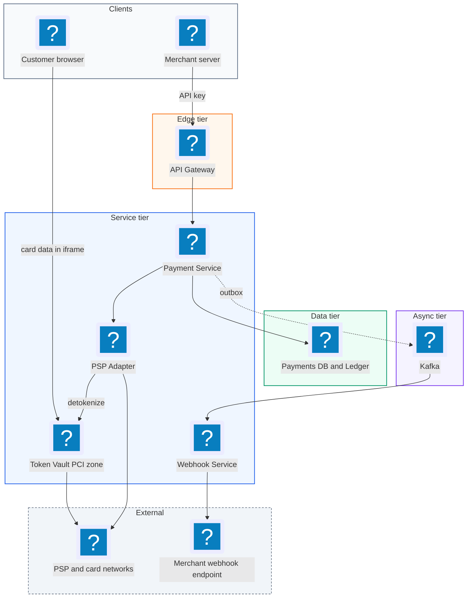
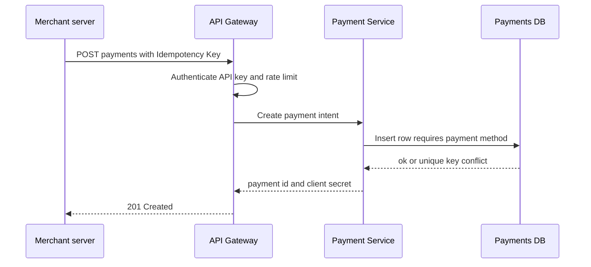
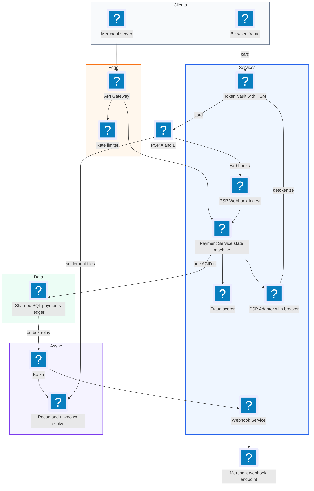

# 28. Payment System  (Hard)

> A payment system like Stripe lets online businesses (merchants) accept card payments without building their own card processing. The customer types card details into a checkout form, the payment system sends the charge to a payment service provider (PSP, the company that actually talks to the card networks and banks, such as Adyen or a card acquirer), and the merchant learns whether the payment succeeded. The interviewer is really testing correctness under failure: how you make sure a customer is never charged twice, how you keep a ledger that always balances, how you handle a PSP that times out or answers late, and how you shrink the security burden of handling raw card numbers.

## 1. Functional requirements

Core (must have):

1. Merchants can create a payment (a "payment intent": an amount, a currency, and an order reference) for a customer.
2. Customers can pay with a card through a hosted checkout or embedded form; the system charges the card via a PSP.
3. Merchants can query a payment's status (pending, succeeded, failed, refunded).
4. Merchants receive notifications (webhooks) when a payment's status changes.
5. Merchants can refund a payment, fully or partly.

Below the line (out of scope, and why):

- Payouts to merchant bank accounts. Important, but it is a second money-movement flow with the same ledger ideas.
- Fraud scoring with machine learning. We note where it plugs in.
- Multi-currency conversion and FX. Adds pricing logic, not new architecture.
- Disputes and chargebacks. Mentioned in reconciliation only.
- Subscriptions and invoicing. Built on top of single payments.

## 2. Non-functional requirements

1. Correctness: never charge a customer twice for one payment, and never lose a successful charge. This is the top requirement, above latency.
2. Consistency: strong consistency for payment state and the ledger (a payment must not appear succeeded in one place and failed in another). CAP choice: consistency over availability for the money path. If we cannot be sure, we return "pending" rather than guess.
3. Durability: every state change and ledger entry is stored durably and replicated across zones before we acknowledge it.
4. Latency: p99 under 2 seconds for a card charge end to end (PSP calls dominate), p99 under 200 ms for status reads.
5. Availability: 99.99% for accepting payments.
6. Scale: 10,000 payment attempts per second at peak (big sales events), ~100 million payments per day at peak days.
7. Security and compliance: PCI DSS (the card industry's security standard). Keep the set of systems that see raw card numbers as small as possible. Full audit trail of every change.

## 3. Back-of-the-envelope estimates

| Assumption | Number |
|---|---|
| Payments per day (average) | 30 million |
| Peak payments per second | 10,000 |
| Status reads per payment | ~5 (merchant polls, dashboard) |
| Ledger entries per payment | ~4 (two per movement, auth + capture) |
| Payment row size | ~1 KB |
| Ledger entry size | ~200 bytes |
| Webhooks per payment | ~2 |

```text
Writes
  Avg payments/s   = 30e6 / 86,400      = ~350/s
  Peak payments/s  = 10,000/s
  Ledger writes/s  = 10,000 * 4         = 40,000/s at peak
  Webhooks/s       = 10,000 * 2         = 20,000/s at peak

Reads
  Status reads/s   = 10,000 * 5         = 50,000/s at peak

Storage per year
  Payments: 30e6 * 365 * 1 KB          = ~11 TB/year
  Ledger:   30e6 * 365 * 4 * 200 B     = ~9 TB/year
  Keep 7+ years for audit              = ~140 TB total
```

The numbers are modest for modern databases. What makes this hard is not volume, it is that every write must be exact, and the PSP is a slow, unreliable external dependency.

## 4. Core entities

- Merchant: the business. Fields: merchant_id, api_key_hash, webhook_url, webhook_secret.
- Payment (payment intent): one attempt to collect money. Fields: payment_id, merchant_id, amount, currency, status, idempotency_key, psp_reference, created_at.
- Payment method token: a stand-in for a card. Fields: token, card_fingerprint, last4, brand, expiry. The real card number lives only in the vault.
- Transaction (PSP attempt): one call to a PSP for a payment. Fields: txn_id, payment_id, type (authorize, capture, refund), status, psp_request_id.
- Ledger entry: one side of a money movement. Fields: entry_id, account_id, payment_id, direction (debit/credit), amount.
- Refund: money returned. Fields: refund_id, payment_id, amount, status.
- Webhook event: a notification to a merchant. Fields: event_id, merchant_id, type, payload, attempts, next_retry_at.

```sql
CREATE TABLE payments (
  payment_id       UUID PRIMARY KEY,
  merchant_id      UUID NOT NULL,
  idempotency_key  TEXT NOT NULL,
  amount_minor     BIGINT NOT NULL,      -- cents, never floats
  currency         CHAR(3) NOT NULL,
  status           TEXT NOT NULL,        -- see state machine
  psp_reference    TEXT,
  version          INT NOT NULL DEFAULT 0,
  created_at       TIMESTAMPTZ NOT NULL DEFAULT now(),
  UNIQUE (merchant_id, idempotency_key)
);

CREATE TABLE ledger_entries (
  entry_id      BIGSERIAL PRIMARY KEY,
  journal_id    UUID NOT NULL,           -- groups the debit and credit
  account_id    TEXT NOT NULL,           -- e.g. customer_funds, merchant_balance
  payment_id    UUID NOT NULL,
  direction     CHAR(1) NOT NULL CHECK (direction IN ('D','C')),
  amount_minor  BIGINT NOT NULL CHECK (amount_minor > 0),
  created_at    TIMESTAMPTZ NOT NULL DEFAULT now()
);
-- ledger rows are append-only: no UPDATE, no DELETE
```

## 5. API design

`POST /v1/payments` -- create a payment intent. Header `Idempotency-Key: <uuid>` is required.

```json
// request
{"amount": 4999, "currency": "USD", "order_id": "ord_881", "capture": "automatic"}
// response 201
{"payment_id": "pay_3f9a", "status": "requires_payment_method", "client_secret": "pay_3f9a_secret_x"}
```

`POST /v1/payments/{payment_id}/confirm` -- attach a tokenized card and charge it. Called from the checkout page (using the client secret) or by the merchant server. Also needs `Idempotency-Key`.

```json
// request
{"payment_method": "tok_visa_8812"}
// response 200
{"payment_id": "pay_3f9a", "status": "succeeded"}
// or 202 if the PSP has not answered in time
{"payment_id": "pay_3f9a", "status": "processing"}
```

`GET /v1/payments/{payment_id}` -- get status. Response 200 with the payment object, 404 if not found.

`POST /v1/payments/{payment_id}/refunds` -- refund. With `Idempotency-Key`.

```json
// request
{"amount": 1000}
// response 201
{"refund_id": "re_71", "status": "pending"}
```

`POST /v1/tokens` -- the card form posts raw card data here (directly from the browser to the vault domain) and gets a token back.

```json
// request (sent from the browser iframe, never touches the merchant)
{"number": "4242424242424242", "exp_month": 12, "exp_year": 2028, "cvc": "123"}
// response 201
{"token": "tok_visa_8812", "last4": "4242", "brand": "visa"}
```

Webhook (outbound): `POST {merchant webhook_url}` with body `{"id": "evt_1", "type": "payment.succeeded", "data": {...}}` and header `Signature: t=...,v1=<hmac>`.

Status codes across the API: 200/201/202, 400 (validation), 401 (bad API key), 402 (card declined), 409 (idempotency key reused with a different body), 429 (rate limited). Auth: merchant secret API key on server calls; a publishable key plus client secret from the browser.

## 6. High-level design



### How will merchants create a payment?

1. The merchant server calls `POST /v1/payments` with an `Idempotency-Key`.
2. The API Gateway authenticates the API key and rate limits.
3. The Payment Service inserts a row with status `requires_payment_method`, guarded by the unique `(merchant_id, idempotency_key)` constraint.
4. It returns the payment id and a client secret the checkout page will use.



### How will customers pay with a card?

1. The checkout page loads a card form in an iframe served from our vault domain. The customer types the card number there, so the merchant page never sees it.
2. The iframe posts the card to `POST /v1/tokens`. The Token Vault encrypts and stores it and returns a token like `tok_visa_8812`.
3. The page calls `POST /v1/payments/{id}/confirm` with the token.
4. The Payment Service moves the payment to `processing`, records a transaction attempt, and calls the PSP Adapter.
5. The PSP Adapter asks the vault to send the real card to the PSP (the vault, not the Payment Service, holds the card number), with our own idempotency key for this attempt.
6. The PSP returns authorized or declined. The Payment Service, in one database transaction, updates status to `succeeded` or `failed`, writes ledger entries, and writes an outbox event.
7. It returns the result to the page. If the PSP did not answer within the timeout, it returns `processing` and finishes later.

### How will merchants check status and get notified?

1. `GET /v1/payments/{id}` reads the payments table (from a replica for low latency, or primary if the merchant asks for strong reads).
2. On each state change, an outbox row is written in the same transaction. A relay publishes it to Kafka. The Webhook Service delivers it to the merchant, signs it with HMAC, and retries with backoff until the merchant returns 2xx.

### How will merchants refund?

1. `POST /v1/payments/{id}/refunds` checks the payment is `succeeded` and that total refunds do not exceed the amount (done with a row lock or a version check).
2. It creates a refund in `pending`, calls the PSP refund API with an idempotency key, and on success writes reversing ledger entries and emits `refund.succeeded`.

## 7. Deep dives

### How do we make sure a customer is never charged twice?

The problem: networks fail. A merchant sends "confirm," our response is lost, and the merchant retries. Or our service calls the PSP, the PSP charges the card, and the response times out, so we retry. Without protection, either retry can double-charge.

An idempotency key is a unique id the caller attaches to a request so that sending it again has no extra effect. We need them at two boundaries: merchant to us, and us to the PSP.

| Option | How | Pros | Cons |
|---|---|---|---|
| No keys, rely on clients | Hope clients do not retry | Simple | Double charges |
| Idempotency table in the DB | Store key, request hash, and response; replay on retry | Exact, durable, transactional with the payment | One more write per request |
| Idempotency in Redis only | SETNX the key | Fast | Lost on Redis failover, not transactional with the payment |

Recommended: a durable idempotency table in the same database as payments, written in the same transaction, plus a per-attempt idempotency key passed to the PSP.

```python
def handle_confirm(merchant_id, idem_key, body):
    req_hash = sha256(canonical_json(body))
    with db.transaction():
        row = db.query_one("""
            INSERT INTO idempotency (merchant_id, key, req_hash, status)
            VALUES (%s, %s, %s, 'in_progress')
            ON CONFLICT (merchant_id, key) DO NOTHING
            RETURNING *""", merchant_id, idem_key, req_hash)
        if row is None:                                   # seen before
            prev = db.query_one("SELECT * FROM idempotency WHERE merchant_id=%s AND key=%s",
                                merchant_id, idem_key)
            if prev.req_hash != req_hash:
                return 409, {"error": "key reused with different body"}
            if prev.status == "in_progress":
                return 409, {"error": "request in progress, retry later"}
            return prev.response_code, prev.response_body  # replay
    resp_code, resp_body = do_confirm(body)               # PSP call, see below
    db.execute("""UPDATE idempotency SET status='done', response_code=%s,
                  response_body=%s WHERE merchant_id=%s AND key=%s""",
               resp_code, json.dumps(resp_body), merchant_id, idem_key)
    return resp_code, resp_body
```

End to end, the chain looks like this:

```text
merchant --Idempotency-Key K--> Payment Svc
  idempotency(K) row ensures one confirm per K
Payment Svc --attempt id A (derived from payment_id + attempt #)--> PSP
  PSP dedups on A, so a retried call returns the same charge
DB unique (payment_id) on succeeded charges
  last line of defense: a payment can succeed only once
```

Also keep a client-side safeguard: the checkout button disables after the first click, and the payment intent itself is single-use (once succeeded, a second confirm returns the same result).

### How do we track a payment's lifecycle safely?

The problem: a payment moves through many states, and events can arrive out of order (a webhook from the PSP can beat our own synchronous response, or arrive twice). If any code path can set any status, bugs will move a refunded payment back to succeeded.

A state machine lists the allowed states and the only allowed moves between them.

```text
 requires_payment_method
          | confirm
          v
     processing ---------------> failed
          |   \  timeout
          |    +--> unknown --(reconcile)--> succeeded / failed
          v
     authorized --(capture)--> succeeded --(refund)--> partially_refunded
          |                        |                         |
          +--(void)--> canceled     +--(full refund)--> refunded
```

| Approach | How | Risk |
|---|---|---|
| Free-form status updates | `UPDATE ... SET status = ?` | Illegal moves, lost updates |
| State machine in code + optimistic locking | Check allowed transition; `WHERE version = ?` | Safe; retry on conflict |
| Event-sourced payment | Store events, derive state | Great audit, more complex |

Recommended: an explicit transition table enforced in code, with optimistic concurrency (a version column) so two concurrent updates cannot both win. Keep every transition in an append-only `payment_events` table for audit.

```python
ALLOWED = {
    "requires_payment_method": {"processing", "canceled"},
    "processing": {"authorized", "succeeded", "failed", "unknown"},
    "unknown": {"succeeded", "failed"},
    "authorized": {"succeeded", "canceled"},
    "succeeded": {"partially_refunded", "refunded"},
    "partially_refunded": {"partially_refunded", "refunded"},
}

def transition(payment_id, from_state, to_state, version):
    if to_state not in ALLOWED.get(from_state, set()):
        raise IllegalTransition(from_state, to_state)
    n = db.execute("""UPDATE payments SET status=%s, version=version+1
                      WHERE payment_id=%s AND status=%s AND version=%s""",
                   to_state, payment_id, from_state, version)
    if n == 0:
        raise ConcurrentUpdate()   # reload and re-evaluate
```

### How do we keep the books correct with a double-entry ledger?

The problem: we need to know at any moment how much money we owe each merchant, how much is in flight, and how much we collected, and these numbers must add up exactly. Updating a single `balance` column is fragile: one bug and money appears or disappears with no trace.

Double-entry bookkeeping means every movement of money is recorded as two (or more) entries, a debit in one account and an equal credit in another. The sum of all debits always equals the sum of all credits. If it does not, there is a bug, and you can find it.

| Option | How | Pros | Cons |
|---|---|---|---|
| Mutable balance column | `UPDATE balance = balance + x` | Simple | No history, silent errors, lost updates |
| Single-entry log | Append one row per event | History | Cannot detect imbalance |
| Double-entry, append-only | Every journal has debits = credits | Self-checking, auditable, immutable | More rows, need a balance cache |

Recommended: append-only double-entry ledger in the same relational database as payments, written in the same transaction as the state change. Balances are computed from entries (or kept in a cached balance table that is updated in the same transaction and periodically verified).

A $49.99 card payment with a $1.75 fee:

| Journal | Account | Debit | Credit |
|---|---|---|---|
| capture | psp_receivable | 4999 | |
| capture | merchant_balance | | 4824 |
| capture | fee_revenue | | 175 |
| settle (later, PSP pays us) | cash | 4999 | |
| settle | psp_receivable | | 4999 |

```sql
-- Invariant check, run continuously
SELECT journal_id
FROM ledger_entries
GROUP BY journal_id
HAVING SUM(CASE WHEN direction='D' THEN amount_minor ELSE 0 END)
    <> SUM(CASE WHEN direction='C' THEN amount_minor ELSE 0 END);
-- must return zero rows
```

Refunds never delete or edit entries; they add new reversing entries. Money is always stored in integer minor units (cents), never floating point, because `0.1 + 0.2` is not exactly `0.3` in floats.

### What happens when the PSP times out or answers late?

The problem: we called the PSP, and after 10 seconds there is no answer. The card might have been charged or might not. If we mark the payment failed and the customer retries, they may be charged twice. If we mark it succeeded, we may ship goods for free. "Exactly once" across a network boundary is impossible in general; we get "effectively once" by combining at-least-once retries with idempotent receivers.

| Option | How | Pros | Cons |
|---|---|---|---|
| Treat timeout as failure | Mark failed, let customer retry | Simple | Double charges |
| Retry blindly | Call PSP again | Might succeed | Double charges unless PSP dedups |
| Retry with the same PSP idempotency key, then reconcile | Mark `unknown`, retry with same key, query PSP status, fall back to webhook and daily report | Correct | More states and background jobs |

Recommended: on timeout, mark the payment `unknown` (shown to merchants as `processing`), and let a recovery worker resolve it.

```python
def resolve_unknown(payment):
    attempt_key = f"{payment.payment_id}:{payment.attempt}"
    for delay in [1, 2, 4, 8, 16, 32]:            # exponential backoff
        try:
            r = psp.get_payment(idempotency_key=attempt_key)  # status lookup
            if r.status in ("authorized", "captured"):
                return finalize(payment, "succeeded", r)
            if r.status in ("declined", "not_found"):
                return finalize(payment, "failed", r)
        except PspUnavailable:
            pass
        sleep(delay + random.random())            # jitter
    alert_ops(payment)                            # still unknown, daily recon will settle it
```

Important rules: retries reuse the same PSP idempotency key so the PSP returns the original charge rather than creating a new one; the customer cannot start a second attempt on the same payment intent while it is `unknown`; and if the PSP has no lookup API, we "void if unsure" (cancel any authorization the PSP later reports) rather than leaving the customer charged for a payment we marked failed.

Also put a circuit breaker in front of each PSP: if error rates spike, stop sending to it and fail over to a secondary PSP for new payments only (never for a payment already in flight with the first PSP).

### How do we handle PSP webhooks and reconcile with the PSP?

The problem: PSPs tell us about final outcomes, disputes, and settlements by calling our webhook endpoint. Those calls can arrive late, twice, or out of order. And no matter how careful we are, our records and the PSP's records can drift.

Inbound webhook handling:

1. Verify the PSP signature. Reject unsigned or stale requests.
2. Store the raw event with a unique constraint on the PSP's event id (dedup). Return 200 fast.
3. A worker processes stored events and applies them through the same state machine. An illegal or older transition is ignored, which makes out-of-order delivery harmless.

```sql
INSERT INTO psp_events (psp_event_id, payload, received_at)
VALUES ($1, $2, now())
ON CONFLICT (psp_event_id) DO NOTHING;   -- duplicates are no-ops
```

Reconciliation (checking our books against the outside world):

| Check | Frequency | What it catches |
|---|---|---|
| Unknown payments resolver | Every minute | Timeouts not yet resolved |
| PSP settlement file vs ledger | Daily | Missing or extra charges, wrong amounts, fees |
| Bank statement vs cash account | Daily | Settlement money that never arrived |
| Ledger invariant (debits = credits) | Continuous | Code bugs |

```text
  PSP daily settlement file (SFTP / API)
              |
              v
     +-------------------+      match by psp_reference
     | Reconciliation job|<---- our payments + ledger
     +-------------------+
        |        |       |
     matched  missing  mismatched
        |     in ours   amount
        v        |       |
      done       +---+---+
                     v
              exceptions queue --> auto-fix (e.g. mark succeeded,
                                   add ledger entries) or ops review
```

Outbound webhooks to merchants follow the same reliability pattern in reverse: the transactional outbox (write the event in the same DB transaction as the state change, then a relay publishes it) guarantees no event is lost, and we retry delivery with exponential backoff for up to 3 days. Each event has an id so merchants can dedup.

### How do we reduce PCI scope with tokenization?

The problem: any system that stores, processes, or transmits raw card numbers falls under PCI DSS, with strict audits, network isolation, and key management. If the card number flows through the Payment Service, its databases, logs, and Kafka, all of it is in scope.

| Option | Who sees card numbers | PCI scope |
|---|---|---|
| Merchant collects card, sends to us | Merchant + all our services | Huge for both |
| Our services handle cards directly | All our services | Huge for us |
| Hosted iframe + token vault | Only the vault | Small, isolated |

Recommended: the browser posts card data directly to a small, isolated Token Vault from an iframe on our domain. The vault encrypts the card number with a key held in an HSM (hardware security module, tamper-resistant hardware that keeps keys) and returns a random token. Everything else (Payment Service, ledger, logs, Kafka) handles only tokens, last4, and brand. When a charge is needed, the vault forwards the card to the PSP itself (a "detokenizing proxy"), so even the PSP Adapter never sees the number.

```text
 Browser iframe --card--> [ Vault (PCI) ] --card--> PSP
                               |
                          token only
                               v
         Payment Svc, DB, Kafka, logs (out of PCI scope)
```

Extra rules: never log request bodies on the vault path; store the CVC never (PCI forbids storing it after authorization); and compute a card fingerprint (a keyed hash of the number) so we can detect the same card across tokens for fraud checks without storing the number elsewhere.

### How do we keep wallet balances, the ledger, and the PSP consistent?

The problem: a payment touches three places, our payment row, our ledger, and the PSP. The PSP is external, so we cannot put it in one database transaction with our tables. And if we added a stored-value wallet, it is a fourth balance to keep in sync.

| Approach | How | Pros | Cons |
|---|---|---|---|
| Two-phase commit across services | Distributed transaction | Atomic in theory | PSPs do not support it; blocks on failure |
| Saga with compensation | Sequence of local steps; undo on failure (void, refund) | Works with external systems | Must design every compensation |
| Single DB for payment + ledger + wallet, saga only for the PSP | Local ACID for our data, saga for the external step | Simple and strong locally | Needs one DB that scales (shard by merchant) |

Recommended: keep payment state, ledger entries, wallet balances, idempotency records, and the outbox in one relational database (Postgres or a distributed SQL database like CockroachDB/Spanner), sharded by merchant_id, so every local change is one ACID transaction. Treat the PSP call as a saga step: record intent first (`processing`), call the PSP, then record the outcome. If anything goes wrong after the PSP charged, compensate (void or refund) and record that too. Reconciliation is the final safety net.

```text
 T1 (local tx): payment -> processing, attempt row, outbox "attempt_started"
 Step: call PSP with attempt key
 T2 (local tx): payment -> succeeded, ledger entries, wallet update, outbox
 On failure after PSP success: T3 (local tx) record compensation; call PSP void/refund
```

Scaling note: 40,000 ledger rows per second at peak is fine when sharded by merchant across, say, 16-32 database shards with synchronous replicas in other availability zones. Very large merchants can get their own shard.

## 8. Final architecture



| Component | Job | Technology example |
|---|---|---|
| API Gateway | Auth, TLS, rate limits | Envoy, Kong |
| Token Vault | Store cards, issue tokens, detokenize to PSP | Isolated service + HSM (AWS CloudHSM) |
| Payment Service | State machine, idempotency, orchestration | Java/Go service |
| Payment DB | Payments, ledger, wallet, idempotency, outbox | Postgres (sharded) or CockroachDB/Spanner |
| PSP Adapter | Talk to PSPs, retries, circuit breaker, failover | Service with Resilience4j-style breakers |
| Outbox relay + bus | Reliable event publishing | Debezium + Kafka |
| Webhook Service | Signed, retried merchant notifications | Kafka consumers + delay queue |
| PSP Webhook Ingest | Verify, dedup, store inbound events | Small service + SQL table |
| Reconciliation | Daily match vs PSP and bank files, unknown resolver | Batch jobs (Spark or SQL) + workflow engine |
| Fraud scorer | Risk check before charging | ML service (out of scope) |

### Deployment map (AWS)

```mermaid
architecture-beta
    group internet(mdi:earth)[Internet]
    group edge(logos:aws-cloudfront)[Edge]
    group vpc(logos:aws-vpc)[AWS VPC]
    group app(logos:aws-ecs)[Service subnet] in vpc
    group data(logos:aws-rds)[Data subnet] in vpc
    group ext(mdi:earth)[Third parties]

    service browser(mdi:laptop)[Browser iframe] in internet
    service merchant(mdi:laptop)[Merchant server] in internet
    service gw(logos:aws-api-gateway)[API Gateway] in edge
    service vault(logos:aws-ecs)[Token Vault with HSM] in app
    service payment(logos:aws-ecs)[Payment Service state machine] in app
    service adapter(logos:aws-ecs)[PSP Adapter with breaker] in app
    service webhook(logos:aws-lambda)[Webhook Service] in app
    service sql(logos:aws-rds)[Sharded SQL payments ledger] in data
    service kafka(logos:kafka-icon)[Kafka] in data
    service psp(logos:stripe)[PSP A and B] in ext

    browser:R --> L:vault
    merchant:R --> L:gw
    gw:R --> L:payment
    payment:B --> T:sql
    payment:R --> L:adapter
    adapter:T --> B:vault
    vault:R --> L:psp
    sql:R --> L:kafka
    kafka:T --> B:webhook
```



Only the Token Vault in the service subnet talks to the PSP with real card numbers, while payments, the ledger and the outbox stream stay inside the data subnet.

## 9. Common mistakes and interviewer follow-ups

- Treating a PSP timeout as a failure. The card may have been charged, so the customer retries and pays twice. Say: mark it unknown, retry with the same PSP idempotency key, query status, and reconcile.
- Using an in-memory or Redis-only idempotency store. Failover loses keys and allows duplicates. Say: durable idempotency table in the same transaction as the payment.
- Storing balances as a mutable column with floats. Rounding errors and silent drift. Say: integer minor units, append-only double-entry ledger, invariant checks.
- Letting card numbers flow through the main services. That puts everything in PCI scope. Say: hosted iframe, token vault with HSM, detokenizing proxy to the PSP.
- Publishing events after the DB commit with a separate call. A crash between the two loses the webhook. Say: transactional outbox.
- Claiming exactly-once delivery across the network. Interviewers will push back. Say: at-least-once delivery plus idempotent receivers gives effectively-once outcomes.
- Skipping reconciliation. Every real payment company runs it daily. Say: match PSP settlement files and bank statements to the ledger, with an exceptions queue.
- Follow-up: "How do you fail over between PSPs?" Answer: only for new attempts, never mid-attempt; route by health, cost, and card type; each attempt has its own idempotency key and is reconciled with the PSP that handled it.

## 10. One-page cheat sheet

| Topic | Key point |
|---|---|
| Scale | 10k payments/s peak, 40k ledger writes/s, 50k status reads/s |
| Priorities | Correctness > availability > latency; CP for the money path |
| Idempotency | Merchant key in a DB table (same tx), attempt key to PSP, unique constraint on success |
| State machine | requires_pm -> processing -> (authorized) -> succeeded -> refunded; unknown on timeout |
| Concurrency | Optimistic locking with a version column |
| Ledger | Append-only double entry, integer cents, debits = credits check |
| PSP failure | Mark unknown, backoff retries with same key, status lookup, circuit breaker |
| Events | Transactional outbox -> Kafka -> signed webhooks, retry 3 days |
| Inbound webhooks | Verify signature, dedup by event id, apply via state machine |
| Reconciliation | Daily vs PSP settlement and bank files; exceptions queue |
| PCI | Iframe + token vault + HSM; only the vault sees card numbers |
| Consistency | One sharded SQL DB for local ACID; saga for the PSP step |

## Sources

- [Hello Interview: Payment System breakdown](https://www.hellointerview.com/learn/system-design/problem-breakdowns/payment-system)
- [Stripe Engineering: Designing robust and predictable APIs with idempotency](https://stripe.com/blog/idempotency)
- [Stripe docs: Idempotent requests](https://docs.stripe.com/api/idempotent_requests)
- [Uber Engineering: Gulfstream, Uber's payment platform](https://www.uber.com/blog/payments-platform/)
- [Square Engineering: Books, an immutable double-entry accounting database](https://developer.squareup.com/blog/books-an-immutable-double-entry-accounting-database-service/)
- [PCI Security Standards Council: Tokenization guidelines](https://www.pcisecuritystandards.org/documents/Tokenization_Guidelines_Info_Supplement.pdf)
- [microservices.io: Transactional outbox pattern](https://microservices.io/patterns/data/transactional-outbox.html)
