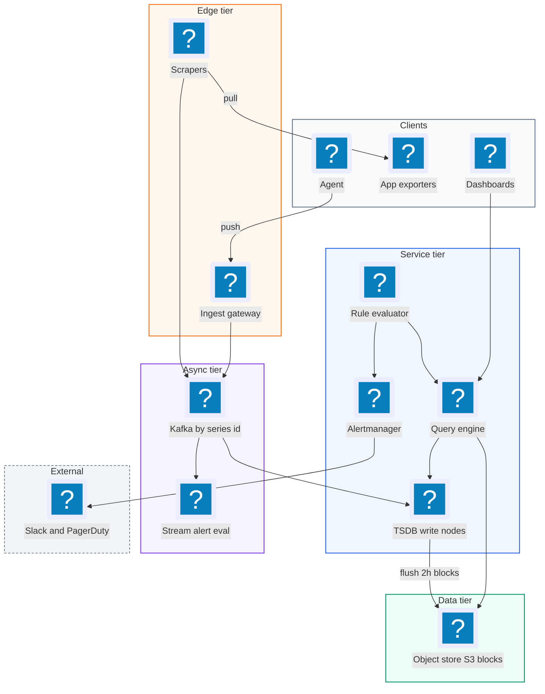
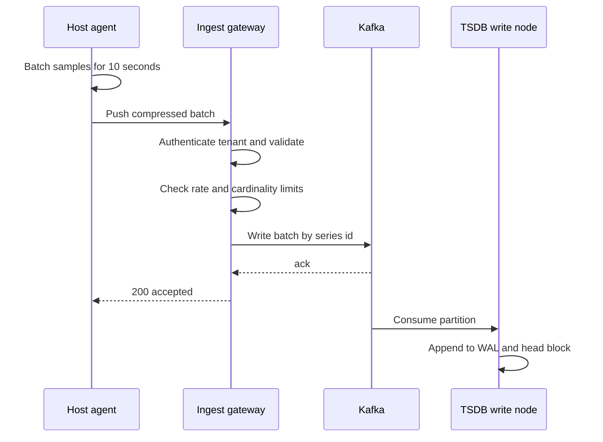
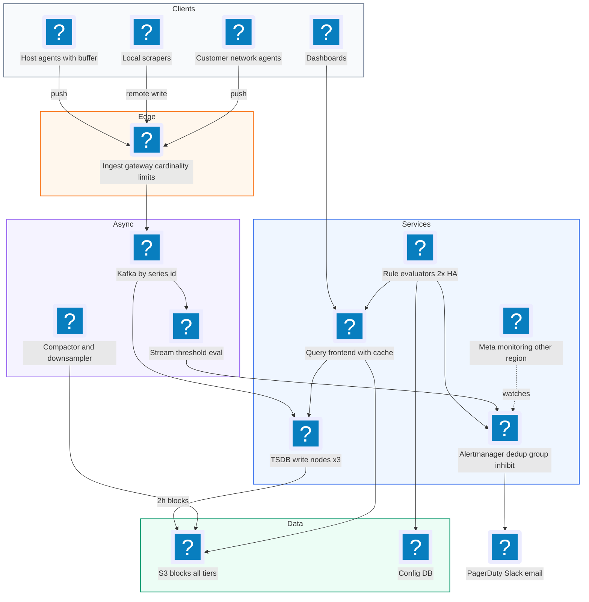

# 29. Metrics Monitoring and Alerting  (Hard)

> A metrics monitoring system like Datadog or Prometheus collects numbers from servers and applications every few seconds (CPU usage, request count, error rate, latency), stores them as time series, shows them on dashboards, and sends alerts when something looks wrong. A time series is just a sequence of (timestamp, value) points for one named metric with a fixed set of labels. The interviewer is really testing whether you can design a write-heavy pipeline that ingests millions of tiny data points per second, store them cheaply with compression and downsampling, keep label cardinality under control, answer dashboard queries fast, and evaluate alert rules reliably without spamming people.

## 1. Functional requirements

Core (must have):

1. Collect metrics from many hosts and services (system metrics like CPU and memory, plus application metrics like request counts and latencies).
2. Store metrics as time series with labels (also called tags), for example `http_requests_total{service="checkout", region="us-east-1", status="500"}`.
3. Query metrics over a time range with aggregation (sum, average, percentiles, rate) and grouping by labels, to power dashboards.
4. Define alert rules (for example "error rate above 5% for 5 minutes") and notify on-call engineers via email, Slack, or PagerDuty.

Below the line (out of scope, and why):

- Logs and distributed traces. Related "observability" signals, but different storage and query patterns.
- Anomaly detection with machine learning. A layer on top of the query engine.
- Building the dashboard UI itself. We provide the query API it uses.
- Billing and multi-tenant quotas in depth. We mention per-tenant limits for cardinality.

## 2. Non-functional requirements

1. Scale: 10 million active time series per large tenant cluster, 100 million series overall; ingest about 10 million data points per second.
2. Ingest latency: a data point is queryable within 10 seconds of being sent.
3. Query latency: p99 under 1 second for typical dashboard queries over the last 1-24 hours; under 5 seconds for 30-day queries.
4. Alerting latency: an alert fires within 1 minute of the condition becoming true.
5. Availability: 99.9% for queries, 99.99% for ingest and alerting. The monitoring system must be more reliable than what it monitors, and it must keep working during the outages it is meant to detect.
6. Retention: raw 10-second resolution for 15 days, 1-minute for 90 days, 1-hour for 2 years.
7. Durability and consistency: losing a few seconds of points during a failure is acceptable; losing hours is not. Eventual consistency is fine. CAP choice: availability over consistency (AP). A dashboard missing the last 10 seconds is better than a monitoring outage.

## 3. Back-of-the-envelope estimates

| Assumption | Number |
|---|---|
| Hosts | 1 million |
| Metrics per host (series) | 100 |
| Active series | 100 million |
| Scrape / push interval | 10 seconds |
| Raw point size uncompressed | 16 bytes (8 B timestamp + 8 B float) |
| Compressed point size (Gorilla) | ~1.4 bytes |
| Dashboard query QPS | ~5,000 |
| Alert rules | ~1 million, evaluated every 30-60 s |

```text
Ingest
  points/s = 100e6 series / 10 s          = 10 million points/s
  raw bytes/s = 10e6 * 16 B               = 160 MB/s uncompressed
  compressed  = 10e6 * 1.4 B              = 14 MB/s

Raw storage (10 s resolution, 15 days)
  per day  = 10e6 * 86,400 * 1.4 B        = ~1.2 TB/day
  15 days                                 = ~18 TB (x3 replicas = ~54 TB)

1-minute rollups, 90 days (6x fewer points, but store min/max/sum/count)
  ~1.2 TB / 6 * 4 values * 90 days        = ~72 TB (x3)  -> object storage

1-hour rollups, 2 years
  ~1.2 TB / 360 * 4 * 730                 = ~10 TB

Alert evaluation
  1e6 rules / 30 s                        = ~33,000 rule queries/s
```

Two lessons. Compression gives roughly 10x savings and is essential. And alert evaluation is itself a large, steady query load, roughly as big as dashboards, so it needs its own capacity.

## 4. Core entities

- Metric: a named measurement, like `cpu_usage` or `http_requests_total`. Has a type: counter (only goes up), gauge (goes up and down), or histogram (bucketed distribution for percentiles).
- Labels (tags): key-value pairs that identify one series of a metric, such as `host`, `service`, `region`.
- Time series: one metric plus one unique label set. Identified by a series id (a hash of the metric name and sorted labels).
- Data point (sample): one (timestamp, value) for a series.
- Alert rule: a query, a condition, a duration, and routing info.
- Alert (incident): a firing instance of a rule for a specific label set, with state (pending, firing, resolved).
- Notification channel: where alerts go (Slack, email, PagerDuty).

```json
{
  "metric": "http_requests_total",
  "labels": {"service": "checkout", "region": "us-east-1", "status": "500"},
  "series_id": "a91f3c...",
  "samples": [[1762369200, 18342], [1762369210, 18410]]
}
```

```yaml
# Alert rule (Prometheus-style)
- alert: CheckoutHighErrorRate
  expr: |
    sum(rate(http_requests_total{service="checkout",status=~"5.."}[5m]))
      / sum(rate(http_requests_total{service="checkout"}[5m])) > 0.05
  for: 5m
  labels: {severity: page, team: payments}
  annotations:
    summary: "Checkout 5xx rate above 5% for 5 minutes"
```

## 5. API design

`POST /v1/metrics` -- push a batch of samples (used by agents).

```json
// request (often protobuf + snappy compression in practice)
{
  "series": [
    {"metric": "cpu_usage", "labels": {"host": "web-17", "region": "us-east-1"},
     "samples": [[1762369200, 0.62], [1762369210, 0.65]]}
  ]
}
// response 202 Accepted
{"accepted": 2}
```

Status codes: 202, 400 (malformed), 401 (bad API key), 413 (batch too large), 429 (tenant over rate or cardinality limit). Auth: per-tenant API key.

`GET /v1/query?q=<expr>&start=...&end=...&step=60s` -- range query for dashboards.

```json
// response 200
{
  "result": [
    {"labels": {"service": "checkout"},
     "values": [[1762369200, 0.031], [1762369260, 0.029]]}
  ]
}
```

`POST /v1/alert-rules` -- create a rule. Body is the rule in JSON or YAML. Response `201 {"rule_id": "r_44"}`.

`GET /v1/alerts?state=firing` -- list current alerts.

`POST /v1/silences` -- mute alerts matching labels for a time window (for planned maintenance).

```json
{"matchers": {"service": "checkout"}, "starts_at": "...", "ends_at": "...", "comment": "deploy"}
```

Auth on all read and config endpoints: user tokens with per-team permissions.

## 6. High-level design



### How will metrics be collected from hosts and services?

1. Each host runs an agent that reads system metrics (CPU, memory, disk) and receives application metrics from client libraries.
2. The agent batches samples for 10 seconds, compresses them, and sends them to the ingest gateway (push), or exposes them on a `/metrics` HTTP endpoint for scrapers (pull). See the push vs pull deep dive.
3. The ingest gateway authenticates the tenant, validates, enforces rate and cardinality limits, and writes the batch to Kafka partitioned by series id.



### How will metrics be stored?

1. TSDB (time-series database) write nodes consume their Kafka partitions. Each series is owned by one node (plus replicas).
2. A node appends incoming points to a write-ahead log (WAL, an append-only file on disk used to recover after a crash) and to an in-memory "head block" with compressed chunks per series.
3. Every 2 hours, the head block is cut into an immutable block (chunks plus an index from labels to series) and uploaded to object storage like S3.
4. Background compaction merges small blocks into bigger ones and builds downsampled versions.

### How will users query metrics for dashboards?

1. The dashboard sends a query such as `sum by (region) (rate(http_requests_total[5m]))` for the last 6 hours.
2. The query engine parses it, uses the label index to find matching series ids, and fetches chunks from the write nodes (recent data) and from object storage (older data), choosing the coarsest resolution that fits the requested step.
3. It decompresses, applies functions (rate, sum, percentile), groups by labels, and returns the result.

### How will alerts be defined and delivered?

1. A user creates a rule. Rules are stored in a config DB and assigned to rule evaluator shards by hashing rule id.
2. Every 30 seconds, each evaluator runs its rules as queries against the query engine.
3. If a condition is true, the alert becomes "pending." If it stays true for the `for` duration, it becomes "firing" and is sent to Alertmanager.
4. Alertmanager dedups, groups related alerts, applies silences, and routes notifications to the right channels.

## 7. Deep dives

### Should agents push metrics, or should the system pull them?

The problem: there are two common collection models, and each has trade-offs at scale.

| Aspect | Pull (Prometheus scrape) | Push (Datadog agent, StatsD, OTLP) |
|---|---|---|
| Who starts the connection | Server scrapes `/metrics` on each target | Agent sends to an endpoint |
| Health detection | Failed scrape means the target is down (free "up" metric) | Need heartbeats to tell "down" from "quiet" |
| Short-lived jobs | Can be missed between scrapes | Natural fit |
| Network / firewalls | Server must reach every target | Targets only need outbound access |
| Service discovery | Server needs a list of targets (Kubernetes, Consul) | Agents just know one address |
| Load control | Server controls rate | Clients can flood; need rate limits |
| Multi-tenant SaaS | Hard (cannot reach customer networks) | Standard |

Recommended: support both, but normalize at the edge. For a SaaS product (Datadog-like), push from agents is the main path because we cannot reach into customer networks. Inside a company's own Kubernetes clusters, pull with local Prometheus-style scrapers that then forward ("remote write") to the central system works well. Either way, everything lands in the same Kafka topics.

```yaml
# Local scraper forwarding upstream (Prometheus remote_write style)
scrape_configs:
  - job_name: checkout
    scrape_interval: 10s
    kubernetes_sd_configs: [{role: pod}]
remote_write:
  - url: https://ingest.metrics.example.com/api/v1/push
    queue_config: {max_samples_per_send: 5000, capacity: 100000}
```

### How do we store billions of points cheaply? (time-series storage and Gorilla compression)

The problem: 10 million points per second at 16 bytes is 160 MB/s, about 14 TB per day before replication. A general database with one row per point adds even more overhead and cannot keep up.

| Option | How | Pros | Cons |
|---|---|---|---|
| Relational DB, one row per point | `INSERT (series, ts, value)` | Familiar | Huge index overhead, slow at this rate |
| Wide-column store (Cassandra) | Row key = series + day, columns = timestamps | Scales writes | Weak compression, no native rate/percentile |
| Purpose-built TSDB with per-series compressed chunks | Append to in-memory chunks, compress with Gorilla, flush immutable blocks | ~1.4 B/point, fast scans | Must build or adopt (Prometheus TSDB, M3, VictoriaMetrics) |

Recommended: a purpose-built TSDB with Gorilla compression. Gorilla is a compression scheme from Facebook built on two observations:

1. Timestamps arrive at regular intervals, so the "delta of deltas" is usually zero. If points come every 10 s, deltas are 10, 10, 10, and the delta-of-delta is 0, which can be stored in a single bit.
2. Consecutive values are often equal or close. XOR the new float with the previous one: if equal, the XOR is 0 (one bit). If close, the XOR has many leading and trailing zeros, so only the middle "meaningful bits" are stored.

```python
def encode_timestamps(ts):
    out = [("raw", ts[0])]
    prev, prev_delta = ts[0], 0
    for t in ts[1:]:
        delta = t - prev
        dod = delta - prev_delta          # delta of delta
        if dod == 0:
            out.append(("bit", 0))        # 1 bit
        elif -63 <= dod <= 64:
            out.append(("7bit", dod))     # '10' + 7 bits
        else:
            out.append(("big", dod))      # longer encodings
        prev, prev_delta = t, delta
    return out

def encode_values(vals):
    prev = float_bits(vals[0])
    out = [("raw", prev)]
    for v in vals[1:]:
        x = float_bits(v) ^ prev
        if x == 0:
            out.append(("bit", 0))        # same value: 1 bit
        else:
            lz, tz = leading_zeros(x), trailing_zeros(x)
            out.append(("xor", lz, tz, x >> tz))   # only meaningful bits
        prev = float_bits(v)
    return out
```

In Facebook's data this averaged about 1.37 bytes per point, a 12x saving. Each series keeps a chunk of ~120 points (20 minutes at 10 s) in memory; full chunks are sealed and written into 2-hour blocks.

```text
 Block (2 hours, immutable, on S3)
 +-----------------------------------------------+
 | chunks/  series 1: [gorilla bytes][gorilla..] |
 |          series 2: [...]                      |
 | index    label -> postings (series ids)       |
 |          series id -> chunk offsets           |
 | meta.json {min_time, max_time, resolution}    |
 +-----------------------------------------------+
```

### How do we keep years of data without huge cost? (downsampling and retention tiers)

The problem: nobody needs 10-second points from 18 months ago, and a 1-year dashboard over raw data would scan 3 million points per series.

Downsampling means replacing many fine points with fewer coarse ones. Averaging alone loses information (a short spike disappears), so store several aggregates per bucket: min, max, sum, and count. From these, you can rebuild average (sum/count), peaks, and totals.

| Tier | Resolution | Retention | Storage | Used for |
|---|---|---|---|---|
| Hot | 10 s raw | 15 days | Memory + local SSD + S3 | Incidents, last-day dashboards |
| Warm | 1 minute (min/max/sum/count) | 90 days | S3 | Weekly and monthly trends |
| Cold | 1 hour (min/max/sum/count) | 2 years | S3 (infrequent access) | Capacity planning, year-over-year |

Recommended: a compactor service that, after blocks age past each boundary, produces downsampled blocks and deletes the finer ones when their retention expires. The query engine picks the tier automatically from the query's step: a step of 1 hour reads hourly blocks.

```python
def downsample(points, bucket_s):
    out = {}
    for ts, v in points:
        b = ts - ts % bucket_s
        agg = out.setdefault(b, {"min": v, "max": v, "sum": 0.0, "count": 0})
        agg["min"] = min(agg["min"], v)
        agg["max"] = max(agg["max"], v)
        agg["sum"] += v
        agg["count"] += 1
    return out

def pick_resolution(step_s):
    if step_s >= 3600: return "1h"
    if step_s >= 60:   return "1m"
    return "raw"
```

Counters need care: when you downsample a counter, store the last value of each bucket too (and handle resets when a process restarts and the counter drops to zero), so `rate()` stays correct.

### How do we stop cardinality from exploding?

The problem: cardinality is the number of unique series. Every unique label combination is a new series with its own memory, index entries, and chunks. A developer who adds `user_id` or `request_id` as a label turns one metric into millions of series. This is the most common way real monitoring systems fall over: memory spikes on write nodes, the index bloats, and queries slow to a crawl.

```text
http_requests_total with labels service(50) x endpoint(200) x status(10)
  = 100,000 series      fine
... add user_id (10 million users)
  = 1,000,000,000,000 potential series   not fine
```

| Defense | How | Trade-off |
|---|---|---|
| Per-tenant and per-metric series limits | Ingest gateway tracks active series per tenant/metric (with HyperLogLog sketches for cheap counting) and rejects new series beyond the limit with 429 | Some data dropped, but the system survives |
| Label allowlists / denylists | Drop known-bad labels (user_id, request_id, raw URLs) at the agent or gateway | Needs configuration |
| Relabeling / normalization | Replace `/users/12345` with `/users/:id` | Loses detail, keeps usefulness |
| Usage visibility | Show teams their top series counts | Social pressure, not enforcement |
| Send high-cardinality data elsewhere | Use logs or traces for per-request detail | Different tool |

Recommended: all of the above, with hard limits enforced at the ingest gateway as the safety net.

```python
def admit(tenant, series_id, metric):
    key = f"card:{tenant}:{metric}"
    if not active_series.contains(key, series_id):        # bloom/hash set
        if active_series.estimate(key) >= limits.per_metric(tenant, metric):
            metrics.inc("rejected_new_series", tenant=tenant, metric=metric)
            return False                                    # 429 for this series
        active_series.add(key, series_id)
    return True
```

Existing series keep flowing even when the limit is hit; only new series are rejected. That way a cardinality bomb in one service does not blind every other dashboard.

### How do we make dashboard queries fast?

The problem: a query like `sum by (region) (rate(http_requests_total{service="checkout"}[5m]))` over 24 hours might touch thousands of series and millions of points, and 5,000 of these run per second.

The query engine has three main steps:

1. Series lookup: use the inverted index (label value to series ids) to find matching series. For `service="checkout"` and `__name__="http_requests_total"`, intersect two sorted posting lists, like a search engine.
2. Data fetch: read chunks for those series in the time range, from write nodes (last ~2 hours) and object storage (older), using the right resolution tier.
3. Evaluation: decompress and compute functions, then aggregate.

| Speed-up | What it does |
|---|---|
| Query splitting by time | Split a 7-day query into 24-hour pieces, run in parallel, cache each piece |
| Results cache | Cache finished, older time slices (they never change); only recompute the latest slice |
| Recording rules | Precompute expensive expressions (e.g. per-service error rate) every minute and store them as new series |
| Pushdown | Do partial aggregation on storage nodes, send only partial sums to the query frontend |
| Limits | Max series per query, max points, query timeouts, per-tenant concurrency |

```yaml
# Recording rule: precompute once, read cheaply on every dashboard load
- record: service:http_error_ratio:rate5m
  expr: |
    sum by (service) (rate(http_requests_total{status=~"5.."}[5m]))
      / sum by (service) (rate(http_requests_total[5m]))
```

```text
 Dashboard --> Query frontend --(split by day, cache hits)--> Queriers
                                                                |
                                     +--------------------------+------+
                                     v                                 v
                           Write nodes (last 2 h)            Store gateway (S3)
                           partial aggregates                partial aggregates
```

### How are alert rules evaluated reliably, without duplicate pages, even when parts fail?

The problem: about a million rules run every 30-60 seconds. The evaluator must not miss alerts if a node dies, must not page twice if two evaluators run the same rule, must not flap (fire and resolve repeatedly), and must still work when the thing being monitored (maybe even part of our own infrastructure) is broken.

| Option | How | Pros | Cons |
|---|---|---|---|
| Query-based polling | Evaluators run rule queries on a schedule against the query engine | Uses the same query language, simple | Load on query engine; latency = interval |
| Stream-based evaluation | Evaluate simple threshold rules on the ingest stream (Flink) | Sub-second, no query load | Hard for complex expressions across many series |
| Hybrid | Stream for simple thresholds on hot metrics, polling for the rest | Best of both | Two systems |

Recommended: query-based polling as the main path, with rules sharded across evaluators by consistent hashing on rule id, and each shard run by two replicas for high availability. Duplicates from the two replicas are harmless because Alertmanager dedups.

The alert lifecycle with `for` duration prevents flapping on a single bad sample:

```text
  condition false             condition true
 [inactive] ---------------> [pending] --- true for 5m ---> [firing]
     ^                           | false                       | false
     +---------------------------+                             v
     +------------------- resolve notification --------- [resolved]
```

Alertmanager handles the rest:

- Dedup: alerts are identified by a fingerprint (hash of rule name plus label set). Two evaluator replicas sending the same alert produce one notification. Alertmanager itself runs as a small cluster that gossips its notification log, so a failover does not re-send.
- Grouping: 300 hosts failing for the same reason become one page ("HighLatency, 300 instances, region=us-east-1"), using `group_by` labels and a short `group_wait`.
- Inhibition: if "datacenter down" is firing, suppress the thousands of downstream alerts it causes.
- Silences: users mute alerts for maintenance.
- Repeat interval: re-notify an unacknowledged firing alert every few hours, not every 30 seconds.

```yaml
route:
  group_by: [alertname, service, region]
  group_wait: 30s
  group_interval: 5m
  repeat_interval: 4h
  receiver: default-slack
  routes:
    - matchers: [severity="page"]
      receiver: pagerduty-oncall
inhibit_rules:
  - source_matchers: [alertname="RegionDown"]
    target_matchers: [severity="page"]
    equal: [region]
```

Failure handling for alerting itself:

- Missing data: a rule like `up == 0` or "no data for 10 minutes" (`absent()`) detects silent failures, where a dead host stops sending anything.
- Meta-monitoring: a separate, minimal monitoring stack (in another region or provider) watches the main one, and a "dead man's switch" alert that always fires must keep arriving at PagerDuty; if it stops, PagerDuty pages us because the alert pipeline itself is broken.
- Isolation: the alerting path has reserved query capacity so a dashboard storm during an incident cannot starve alert evaluation.

Failure handling for ingest and storage, so alerts have data to evaluate:

- Ingest gateway dies: stateless; agents retry to another instance. Agents buffer points locally (for a few minutes) when the gateway is unreachable.
- Kafka buffers: if write nodes fall behind or restart, Kafka holds the data (retain 24 hours) and nodes catch up.
- Write node dies: each series is replicated to 3 nodes (replication factor 3). Queries read from any healthy replica and dedup samples by timestamp. A replacement node replays its WAL or its Kafka partitions to rebuild the head block.
- Object storage outage: recent data is still served from write nodes; older queries fail or return partial results with a warning.
- Region outage: run independent monitoring stacks per region; global views federate across them.

## 8. Final architecture



| Component | Job | Technology example |
|---|---|---|
| Agent / scraper | Collect, batch, buffer, forward | Datadog agent, Prometheus, OpenTelemetry Collector |
| Ingest gateway | Auth, limits, relabel | Custom service, Cortex/Mimir distributor |
| Buffer | Decouple ingest from storage | Kafka |
| TSDB write nodes | WAL, in-memory compressed head, block cuts | Prometheus TSDB, Mimir ingester, M3DB, VictoriaMetrics |
| Long-term storage | Immutable blocks, cheap | S3 / GCS |
| Compactor | Merge blocks, downsample, delete expired | Thanos/Mimir compactor |
| Query engine | PromQL-style evaluation, caching | Thanos Query, Mimir query frontend |
| Rule evaluator | Alert and recording rules | Prometheus ruler, Mimir ruler |
| Alertmanager | Dedup, group, route, silence | Prometheus Alertmanager, PagerDuty |
| Config DB | Rules, dashboards, silences | Postgres |

### Deployment map (AWS)

```mermaid
architecture-beta
    group internet(mdi:earth)[Internet]
    group edge(logos:aws-cloudfront)[Edge]
    group vpc(logos:aws-vpc)[AWS VPC]
    group app(logos:aws-ecs)[Service subnet] in vpc
    group data(logos:aws-rds)[Data subnet] in vpc
    group ext(mdi:earth)[Third parties]

    service agents(mdi:laptop)[Host agents with buffer] in internet
    service dash(mdi:laptop)[Dashboards] in internet
    service ingest(logos:aws-api-gateway)[Ingest gateway cardinality limits] in edge
    service writer(logos:aws-ecs)[TSDB write nodes x3] in app
    service query(logos:aws-ecs)[Query frontend with cache] in app
    service rules(logos:aws-ecs)[Rule evaluators 2x HA] in app
    service am(logos:aws-sns)[Alertmanager dedup group inhibit] in app
    service kafka(logos:kafka-icon)[Kafka by series id] in data
    service blocks(logos:aws-s3)[S3 blocks all tiers] in data
    service notify(mdi:earth)[PagerDuty Slack email] in ext

    agents:R --> L:ingest
    ingest:R --> L:kafka
    kafka:T --> B:writer
    writer:B --> T:blocks
    dash:R --> L:query
    query:L --> R:writer
    query:B --> T:blocks
    rules:L --> R:query
    rules:R --> L:am
    am:R --> L:notify
```



Agents push through the ingest gateway at the edge into Kafka, the write nodes, query frontend, rule evaluators and Alertmanager run in the service subnet, and only Alertmanager reaches out to the paging providers.

## 9. Common mistakes and interviewer follow-ups

- Storing each point as a row in a general-purpose database. It cannot keep up with 10 million writes per second and costs 10x more. Say: purpose-built TSDB with per-series Gorilla-compressed chunks.
- Ignoring cardinality. One bad label can take down the whole cluster. Say: per-tenant and per-metric series limits at ingest, label denylists, and relabeling.
- Downsampling with averages only. Spikes vanish and alerts on old data mislead. Say: keep min, max, sum, and count per bucket.
- Paging on a single sample. Noise and flapping burn out on-call. Say: `for` duration, grouping, inhibition, and repeat intervals.
- Running alerting on the same capacity as dashboards. An incident creates a dashboard stampede that delays alerts. Say: reserved capacity or separate query paths for rule evaluation.
- Forgetting "who monitors the monitor." Say: meta-monitoring in another region plus a dead man's switch.
- Not handling missing data. A dead host sends nothing, so threshold rules never fire. Say: `up == 0` and `absent()` style rules.
- Follow-up: "Push or pull?" Answer: pull is great inside your own network for health detection and control; push is necessary for SaaS and short-lived jobs; support both and converge at the gateway.

## 10. One-page cheat sheet

| Topic | Key point |
|---|---|
| Scale | 100M series, 10s interval, 10M points/s, ~33k alert queries/s |
| Latency | Queryable in 10 s, dashboards p99 < 1 s, alerts within 1 min |
| CAP | AP: prefer availability; losing seconds OK, hours not OK |
| Collection | Push for SaaS and short jobs, pull for in-cluster; converge at gateway |
| Buffer | Kafka partitioned by series id |
| Storage | WAL + in-memory head, 2 h immutable blocks to S3 |
| Compression | Gorilla: delta-of-delta timestamps, XOR floats, ~1.4 B/point |
| Retention | Raw 15 d, 1 min 90 d, 1 h 2 y; store min/max/sum/count |
| Cardinality | Per-tenant/metric series limits, label denylist, relabel |
| Queries | Label inverted index, split by time, results cache, recording rules |
| Alerting | Sharded evaluators x2, pending -> firing with `for`, Alertmanager dedup/group/inhibit |
| Reliability | RF=3 write nodes, agent buffering, meta-monitoring, dead man's switch |

## Sources

- [Hello Interview: Metrics Monitoring breakdown](https://www.hellointerview.com/learn/system-design/problem-breakdowns/metrics-monitoring)
- [Gorilla: A Fast, Scalable, In-Memory Time Series Database (Facebook, VLDB 2015)](https://www.vldb.org/pvldb/vol8/p1816-teller.pdf)
- [Prometheus docs: Storage](https://prometheus.io/docs/prometheus/latest/storage/)
- [Prometheus docs: Alertmanager](https://prometheus.io/docs/alerting/latest/alertmanager/)
- [Grafana Mimir architecture](https://grafana.com/docs/mimir/latest/references/architecture/)
- [Thanos: Downsampling and compaction](https://thanos.io/tip/components/compact.md/)
- [Datadog blog: Pull vs push metrics collection](https://www.datadoghq.com/blog/monitoring-101-collecting-data/)
