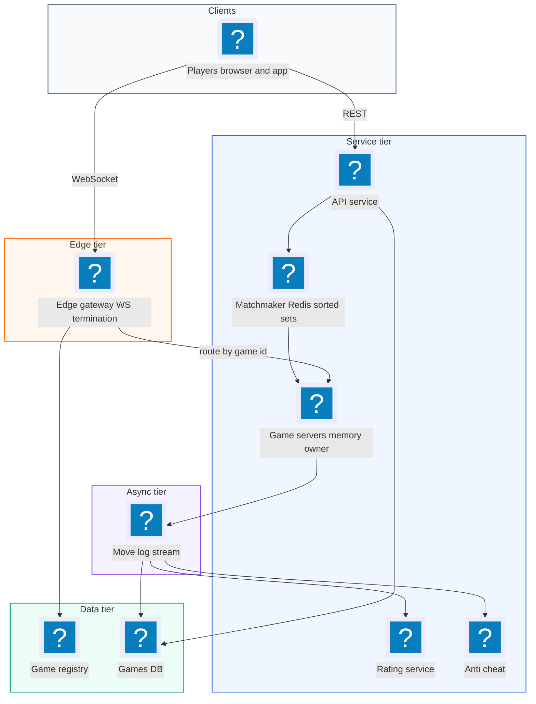
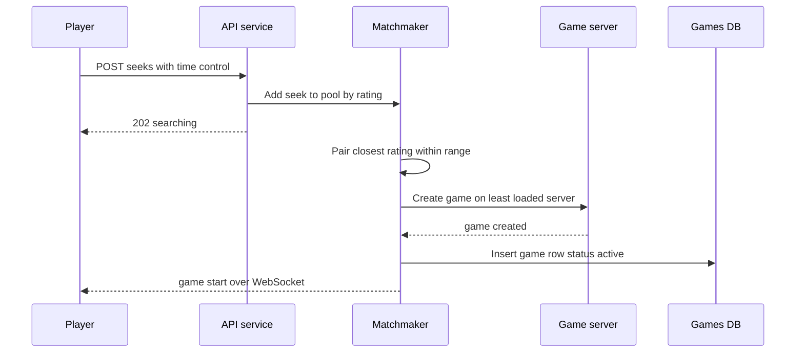
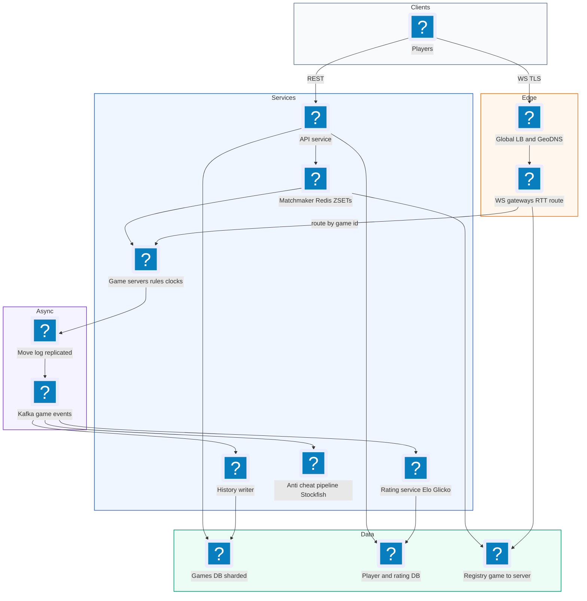

# 30. Online Chess  (Hard)

> An online chess platform like Chess.com or Lichess lets two players anywhere in the world find an opponent of similar skill, play a game in real time with a ticking clock, and review the game afterward. Moves must show up on the other player's screen almost instantly, the server must be the referee (no illegal moves, no cheating the clock), and a dropped connection must not lose the game. The interviewer is really testing real-time communication with WebSockets, keeping each game's state on one authoritative server, rating-based matchmaking, careful time handling, durable game storage, and at least an outline of cheat detection.

## 1. Functional requirements

Core (must have):

1. Players can request a game with a time control (for example 5+3: 5 minutes each plus 3 seconds added per move) and get matched with an opponent of similar rating.
2. Players can make moves in real time; the opponent sees each move within a fraction of a second.
3. The server validates every move and enforces chess rules, including check, checkmate, stalemate, and draws.
4. The server runs each player's clock; a player who runs out of time loses.
5. Players can resign, offer a draw, and reconnect to an in-progress game after a disconnect.
6. Finished games are stored and can be replayed move by move; ratings are updated after each game.

Below the line (out of scope, and why):

- Spectators and live broadcast of top games. Same fan-out idea as live comments; we mention it briefly.
- Chat between players. A small add-on.
- Puzzles, lessons, and engine analysis UI. Separate products.
- Tournaments. Built on matchmaking plus scheduling.

## 2. Non-functional requirements

1. Move latency: p99 under 200 ms from one player's move to the opponent's screen within the same region; under 300 ms cross-continent.
2. Correctness: the server is authoritative. No illegal move is ever accepted, and clocks are enforced fairly regardless of client tricks.
3. Consistency: strong consistency within a game (both players see the same sequence of moves, in the same order). Each game has a single writer, its game server. CAP choice: for a single game we choose consistency; if the game server is unreachable, the game pauses or recovers rather than letting two servers diverge. The rest of the platform (profiles, history) can be eventually consistent and highly available.
4. Durability: an in-progress game survives a game server crash with no lost moves.
5. Matchmaking: most players matched within 5 seconds at popular ratings and time controls.
6. Scale: 10 million daily active users, 1 million concurrent games at peak.
7. Availability: 99.95% for starting and playing games.

## 3. Back-of-the-envelope estimates

| Assumption | Number |
|---|---|
| Daily active users | 10 million |
| Games per user per day | 5 |
| Peak concurrent games | 1 million (2 million connected players) |
| Average moves per game | 80 half-moves (40 each) |
| Average game length | 10 minutes |
| Move message size | ~100 bytes |
| Stored game size (PGN text + metadata) | ~2 KB |

```text
Games per day
  10e6 users * 5 / 2 players          = 25 million games/day

Moves
  Peak moves/s = 1e6 games * 80 / 600 s = ~133,000 moves/s
  Each move: in from mover + out to opponent (+ spectators)
  Messages/s ~ 2 * 133k                 = ~270,000 msgs/s

WebSocket connections
  2 million concurrent; at ~50k connections per server = ~40 servers
  (plan ~100 for headroom and per-region spread)

Storage
  25e6 games * 2 KB                     = 50 GB/day
  per year                              = ~18 TB/year

Bandwidth
  270k msgs/s * 100 B                   = ~27 MB/s  (small)
```

The data volume is small. The hard parts are latency, keeping state for each game in exactly one place, and handling time fairly.

## 4. Core entities

- Player: a user. Fields: player_id, username, ratings per time control (bullet, blitz, rapid), rating deviation.
- Game: one match. Fields: game_id, white_id, black_id, time_control, status (active, finished), result, termination reason, created_at.
- Move: one half-move. Fields: game_id, ply (move number in half-moves), uci (like `e2e4`), san (like `e4`), clock_ms_after, server_ts.
- Clock state: remaining time for each side plus whose turn and when that turn started.
- Match request (seek): a player waiting for an opponent. Fields: player_id, rating, time_control, enqueued_at.
- Rating history: rating before and after each game.

```sql
CREATE TABLE games (
  game_id       UUID PRIMARY KEY,
  white_id      BIGINT NOT NULL,
  black_id      BIGINT NOT NULL,
  time_control  TEXT NOT NULL,        -- '300+3'
  status        TEXT NOT NULL,        -- 'active', 'finished'
  result        TEXT,                 -- '1-0', '0-1', '1/2-1/2'
  termination   TEXT,                 -- 'checkmate', 'timeout', 'resign', ...
  pgn           TEXT,                 -- full move list when finished
  started_at    TIMESTAMPTZ,
  ended_at      TIMESTAMPTZ
);

CREATE TABLE moves (
  game_id        UUID,
  ply            INT,
  uci            TEXT,
  clock_ms_after INT,
  server_ts      TIMESTAMPTZ,
  PRIMARY KEY (game_id, ply)
);
```

```json
// In-memory game state on the game server
{
  "game_id": "g_81f2",
  "fen": "rnbqkbnr/pppp1ppp/8/4p3/4P3/8/PPPP1PPP/RNBQKBNR w KQkq e6 0 2",
  "ply": 2,
  "turn": "white",
  "clock_ms": {"white": 297400, "black": 298900},
  "turn_started_at": 1762369212345,
  "increment_ms": 3000
}
```

FEN (Forsyth-Edwards Notation) is a one-line text format that fully describes a chess position.

## 5. API design

REST for setup and history, WebSocket for live play.

`POST /v1/matchmaking/seeks` -- ask to be matched.

```json
// request
{"time_control": "300+3", "rated": true}
// response 202
{"seek_id": "s_19", "status": "searching"}
```

`DELETE /v1/matchmaking/seeks/{seek_id}` -- cancel search. Response 204.

`GET /v1/games/{game_id}` -- game metadata and full move list (for replay or reconnect). Response 200 with game object.

`GET /v1/players/{player_id}/games?cursor=...` -- game history.

`WS /v1/play` -- persistent connection. Messages are JSON:

```json
// server -> client: match found
{"type": "game_start", "game_id": "g_81f2", "color": "white",
 "opponent": {"id": 77, "rating": 1512}, "time_control": "300+3",
 "game_server": "gs-use1-12"}

// client -> server: make a move
{"type": "move", "game_id": "g_81f2", "ply": 3, "uci": "g1f3", "client_ts": 1762369215000}

// server -> both clients: move accepted
{"type": "move_ack", "game_id": "g_81f2", "ply": 3, "uci": "g1f3",
 "clock_ms": {"white": 296100, "black": 298900}}

// server -> mover: rejected
{"type": "move_rejected", "ply": 3, "reason": "illegal_move"}

// other client messages
{"type": "resign", "game_id": "g_81f2"}
{"type": "offer_draw", "game_id": "g_81f2"}
{"type": "resync", "game_id": "g_81f2", "last_ply": 2}

// server -> both: game over
{"type": "game_over", "result": "1-0", "termination": "timeout",
 "rating_change": {"white": 8, "black": -8}}
```

Auth: session token on REST calls and on the WebSocket handshake. Every WebSocket message is checked against the player's identity (you can only move your own pieces in your own game). Errors on REST use 400, 401, 404, 409 (already in a game), 429.

## 6. High-level design



### How will players find an opponent?

1. The player calls `POST /v1/matchmaking/seeks` with a time control.
2. The API service adds the seek to the Matchmaker's pool for that time control, keyed by rating.
3. The Matchmaker repeatedly pairs the oldest waiting player with the closest rating within an allowed range (the range widens the longer they wait).
4. When a pair is found, it picks a game server (the least-loaded in the players' region), creates the game there, registers `game_id -> game server`, and writes a `games` row with status `active`.
5. It notifies both players over their WebSockets with a `game_start` message.



### How will players make moves and see the opponent's moves?

1. The client sends `{"type": "move", ...}` over its WebSocket.
2. The gateway looks up which game server owns the game (cached registry) and forwards the message.
3. The game server, which holds the game state in memory, checks it is the player's turn, validates the move with a chess rules library, updates the clocks, and appends the move to a durable move log.
4. It sends `move_ack` to both players, through their gateways.
5. The opponent's client draws the move and starts the opponent's clock display.

### How does the server enforce rules and the clock?

The game server owns the board (FEN) and both clocks. Clients only send intentions ("I move g1f3"). The server decides if it is legal and how much time was used. It also sets a timer for the current player's remaining time; if the timer fires before a move arrives, the server ends the game on time.

### How will players resign, draw, reconnect, and replay games?

1. Resign and draw offers are WebSocket messages handled by the same game server, which changes game state and broadcasts `game_over` or a draw offer.
2. On reconnect, the client opens a new WebSocket and sends `resync` with the last ply it knows; the server replies with any missed moves and current clocks.
3. When a game ends, the game server writes the final PGN (Portable Game Notation, the standard text format for a chess game's moves) and result to the Games DB, and emits a `game_finished` event for rating updates and anti-cheat.
4. Replay is `GET /v1/games/{id}`, which returns the move list; the client steps through it locally.

## 7. Deep dives

### How do we deliver moves in real time, and why does each game live on one server?

The problem: two players may be connected to different gateway machines. Moves must reach the opponent in well under 200 ms, and the game state must be updated by exactly one process to avoid two servers disagreeing about the board.

| Transport | How it works | Pros | Cons |
|---|---|---|---|
| HTTP polling | Client asks "any new move?" every second | Simple | Slow and wasteful |
| Long polling | Request stays open until a move arrives | Works everywhere | Reconnect per message, overhead |
| Server-Sent Events | Server streams to client; client posts moves | Simple, HTTP | One direction; moves still need POSTs |
| WebSocket | Full-duplex persistent connection | Lowest latency, both directions | Stateful connections to manage |

Recommended: WebSockets. For state ownership:

| Ownership model | How | Pros | Cons |
|---|---|---|---|
| Stateless servers, state in Redis | Any server loads state, updates with a transaction | Easy scaling | Extra round trip per move, race conditions between servers |
| Sticky game server (game affinity) | Each game is owned by one game server; all messages for it are routed there | In-memory speed, single writer, simple ordering | Need routing and failover |

Recommended: game affinity. Each game is assigned to one game server, which keeps the state in memory and is the only writer. Gateways terminate WebSockets (so game servers do not hold millions of sockets) and route messages by game_id using a registry.

```text
 White --WS--> Gateway A --+                 +--> Gateway B --WS--> Black
                           |   gRPC stream   |
                           +--> Game server <+
                                gs-use1-12
                                (owns g_81f2)
```

Routing: the registry maps `game_id -> game_server` in Redis (or etcd), cached on gateways. Using consistent hashing of game_id over game servers is an alternative, but explicit assignment lets the matchmaker pick the least loaded server and keep both players' region in mind.

To cut latency further, put both players' game on a server in a region near both of them (for cross-continent games, pick the midpoint region or the one with lower combined round-trip time). A spectator fan-out, if added, goes through a pub/sub channel per game so the game server sends each move once.

### How does the server validate moves and stay authoritative?

The problem: a client can be modified to send illegal moves, move twice, or claim a different clock time. If the client is trusted, cheating is trivial.

| Option | Who validates | Risk |
|---|---|---|
| Client-side only | Client | Anyone can send any move |
| Both, server trusts client clocks | Server validates rules, client reports time | Clock manipulation |
| Server-authoritative | Server validates rules and measures time | Safe; client validation is only for UX |

Recommended: server-authoritative. Clients validate locally only to give instant feedback and to draw legal-move hints. The server holds the true board and rejects anything wrong.

```python
import chess   # python-chess rules library

class Game:
    def __init__(self, gid, white, black, base_ms, inc_ms):
        self.board = chess.Board()
        self.players = {chess.WHITE: white, chess.BLACK: black}
        self.clock = {chess.WHITE: base_ms, chess.BLACK: base_ms}
        self.inc = inc_ms
        self.turn_started = now_ms()
        self.ply = 0

    def on_move(self, player_id, ply, uci):
        color = self.board.turn
        if self.players[color] != player_id:
            return reject("not_your_turn")
        if ply != self.ply + 1:
            return reject("stale_or_duplicate")    # idempotency on retries
        move = chess.Move.from_uci(uci)
        if move not in self.board.legal_moves:
            return reject("illegal_move")

        elapsed = now_ms() - self.turn_started
        self.clock[color] -= elapsed
        if self.clock[color] <= 0:
            return self.finish(winner=not color, reason="timeout")
        self.clock[color] += self.inc

        move_log.append(self.gid, self.ply + 1, uci, self.clock[color])  # durable first
        self.board.push(move)
        self.ply += 1
        self.turn_started = now_ms()
        broadcast(self.gid, {"type": "move_ack", "ply": self.ply, "uci": uci,
                             "clock_ms": self.clock_view()})
        if self.board.is_game_over(claim_draw=True):
            self.finish_from_board()
```

The `ply` number makes moves idempotent: if a client resends a move after a timeout, the server sees the same ply and either returns the existing ack or rejects it as stale, never applying it twice.

### How do we match players by rating quickly?

The problem: players should face opponents near their skill. If we only accept exact matches, people wait forever; if we accept anyone, games are lopsided. We also need to handle many time controls and regions.

Elo is a rating system where each player has a number (around 1200 for beginners, 2800 for world champions). After each game, points move from the loser to the winner, more points if the result was a surprise. Lichess uses Glicko-2, a refinement that also tracks how certain the rating is.

| Option | How | Pros | Cons |
|---|---|---|---|
| Single FIFO queue per time control | Pair the first two | Fastest | Ignores skill |
| Rating buckets (e.g. 100-point wide) | Queue per bucket; widen search to neighbor buckets over time | Simple, fast lookups | Edge effects at bucket borders |
| Sorted set by rating with expanding window | Find nearest rating within +/- R, R grows with wait time | Precise, flexible | Needs a single owner per pool to avoid double matching |

Recommended: a Redis sorted set per (time control, region) with score = rating, and an expanding search window. A single matchmaker worker owns each pool (sharded by time control and region), so two workers never match the same player. Every 100-200 ms it scans waiting players oldest first.

```python
def window(wait_s):
    return min(50 + 25 * wait_s, 400)        # +/-50 at start, up to +/-400

def match_loop(pool):                        # pool = "seeks:300+3:use1"
    for player_id, rating, enq_ts in oldest_first(pool):
        r = window(now() - enq_ts)
        cands = redis.zrangebyscore(pool, rating - r, rating + r)
        cands = [c for c in cands if c != player_id and not recently_played(player_id, c)]
        if not cands:
            continue
        opp = min(cands, key=lambda c: abs(rating_of(c) - rating))
        # atomically remove both; if either is gone, someone else matched them
        if redis.zrem(pool, player_id, opp) == 2:
            create_game(player_id, opp)
```

The Elo update after a game:

```python
def elo_update(ra, rb, score_a, k=20):
    expected_a = 1 / (1 + 10 ** ((rb - ra) / 400))
    new_a = ra + k * (score_a - expected_a)      # score_a: 1 win, 0.5 draw, 0 loss
    new_b = rb + k * ((1 - score_a) - (1 - expected_a))
    return round(new_a), round(new_b)
```

Rating updates happen asynchronously from the `game_finished` event, in a transaction that also writes the rating history row.

### How do we handle clocks, lag, and disconnects fairly?

The problem: chess clocks are part of the rules. Network lag means the time between "player clicked" and "server received" is not the player's thinking time, and players on slow connections feel cheated. Players also lose connections mid-game.

| Clock approach | How | Pros | Cons |
|---|---|---|---|
| Trust client clocks | Client reports time used | Fair for lag | Easy to cheat |
| Server measures time only | Time from previous ack sent to move received | Cheat-proof | Penalizes high-latency players |
| Server time with lag compensation | Server time minus estimated one-way latency, capped | Fair and safe | Slightly more logic |

Recommended: the server is the clock, with capped lag compensation. Each connection measures round-trip time with periodic pings. When a move arrives, the server credits back an estimate of the network delay (for example half the median RTT), up to a cap such as 500 ms per move, so lag cannot be abused for free time. Lichess uses a similar idea.

```python
def charged_time(elapsed_ms, conn):
    lag = min(conn.median_rtt_ms / 2, 500)
    return max(elapsed_ms - lag, 0)
```

Clients display a local countdown between server updates, but every `move_ack` carries the server's authoritative clock values, so displays snap back to the truth.

Timeouts: the game server keeps a timer per game set to the moving side's remaining time. When it fires, the server ends the game. Many game timers on one server are stored in a hashed timer wheel or a min-heap keyed by deadline, so a million games across a fleet costs little.

Disconnects:

1. When a player's WebSocket drops, the gateway tells the game server. The player's clock keeps running (otherwise disconnecting would be a way to pause).
2. The opponent sees "opponent disconnected" and, after a grace period (for example 30 seconds or when the clock runs out, whichever is first), can claim victory or a draw.
3. The client reconnects automatically with exponential backoff, sends `resync` with its last ply, and gets missing moves plus current clocks.

```text
 t=0   Black disconnects        clocks keep running for Black
 t=3s  Black reconnects -> resync(last_ply=41) -> server sends ply 42, clocks
 or
 t=30s still gone  -> White offered "claim win"
 Black clock hits 0 -> server ends game: 1-0 timeout
```

### How do we persist games and survive a game server crash?

The problem: games live in memory on one server. If that server dies mid-game, we must not lose moves or let the game silently vanish. Finished games must be stored for replay and history.

| Option | How | Pros | Cons |
|---|---|---|---|
| Write only at game end | Store PGN when finished | Cheapest | Crash loses the whole game |
| Write every move to the DB synchronously | INSERT per move before ack | Durable | ~133k writes/s on the DB, adds latency |
| Append each move to a replicated log, write DB at end | Redis Stream with replication (or Kafka) per move; final PGN to DB | Durable and fast; log replays state | Needs a recovery process |

Recommended: append every accepted move to a durable, replicated move log before acking it (Redis Streams with AOF and replicas, or Kafka keyed by game_id). The log is the in-game source of truth. When the game ends, write the final PGN and result to the Games DB, and keep the per-move table (with clock times) for analysis.

Recovery when a game server dies:

1. A health checker notices the server is gone (missed heartbeats in the registry).
2. Its games are reassigned to other game servers (the registry entries are updated with a fencing token, a number that increases on each reassignment so a zombie old server's writes are rejected).
3. The new owner rebuilds each game by replaying its moves from the log on top of the start position, restores clocks from the last logged clock values (minus time elapsed since, or paused for the outage, by policy), and tells gateways to route there.
4. Clients reconnect and resync. Players see a short pause of a few seconds at most.

```text
 gs-12 dies
    |
 registry: g_81f2 -> gs-12 (epoch 7)   ==>   g_81f2 -> gs-19 (epoch 8)
    |
 gs-19: replay move log g_81f2 [ply 1..41] -> board + clocks restored
    |
 gateways route g_81f2 -> gs-19; clients resync
```

Storage for history: games by player are read via an index `(player_id, ended_at DESC)`. At 18 TB per year, a sharded Postgres or Cassandra keyed by game_id with a secondary table keyed by player works; old games can move to cheaper storage since they are rarely opened.

### How would we detect cheating?

The problem: the most common cheat is using a chess engine during a game. Moves are legal, so the rules engine cannot catch it. Server authority stops illegal moves and clock tricks, but not engine assistance.

| Signal | What it measures | Notes |
|---|---|---|
| Engine match rate | How often the player's move equals the engine's top choice | Strong players also match often; compare against rating peers |
| Average centipawn loss (ACPL) | How much worse each move is than the best move, in hundredths of a pawn | Very low ACPL sustained over many games is suspicious |
| Move-time patterns | Time per move vs position complexity | Engines users often take the same time on easy and hard moves |
| Client signals | Tab switches, focus loss, paste events | Weak signals, easy to fake, useful in combination |
| Rating jumps | Sudden large improvements | Triggers deeper review |

Recommended outline:

1. After each game, publish `game_finished` to Kafka.
2. A cheap first pass flags games with unusual stats for the player's rating (for example, top-engine match rate far above peers, or ACPL far below).
3. Flagged games go to an engine analysis queue: worker machines run Stockfish on each position at fixed depth and compute ACPL and match rates.
4. A model combines per-game and per-player history into a suspicion score. High scores go to human moderators; confirmed cheaters are banned and their opponents' ratings are refunded.

```text
 game_finished --> Kafka --> quick stats filter --(flag ~2%)--> analysis queue
                                                                   |
                                                    Stockfish workers (GPU/CPU)
                                                                   |
                                                    per-player model -> score
                                                                   |
                                               moderator review / auto-action
```

Analyzing every game with a deep engine is expensive (25 million games per day), which is why the cheap filter comes first.

## 8. Final architecture



| Component | Job | Technology example |
|---|---|---|
| Global LB / GeoDNS | Send players to the nearest region | Route 53, Cloudflare |
| WS gateways | Hold connections, measure RTT, route by game | Go/Rust/Erlang services |
| Game servers | Authoritative state, rules, clocks, timers | JVM/Go/Scala service with a chess library |
| Registry | game_id to server mapping with epochs | Redis or etcd |
| Matchmaker | Rating-window pairing per pool | Redis sorted sets + single-owner workers |
| Move log | Durable per-move record for recovery | Redis Streams (AOF + replica) or Kafka |
| Games DB | Finished games, history, replay | Postgres (sharded) or Cassandra |
| Event bus | Fan out game results | Kafka |
| Rating service | Elo/Glicko updates | Stateless service + DB transaction |
| Anti-cheat | Stats filter, engine analysis, scoring | Stockfish worker pool, ML model |

### Deployment map (AWS)

```mermaid
architecture-beta
    group internet(mdi:earth)[Internet]
    group edge(logos:aws-cloudfront)[Edge]
    group vpc(logos:aws-vpc)[AWS VPC]
    group app(logos:aws-ecs)[Service subnet] in vpc
    group data(logos:aws-rds)[Data subnet] in vpc

    service players(mdi:cellphone)[Players] in internet
    service geodns(logos:aws-route53)[Global LB and GeoDNS] in edge
    service gw(logos:aws-elastic-load-balancing)[WS gateways RTT route] in edge
    service api(logos:aws-ecs)[API service] in app
    service game(logos:aws-ec2)[Game servers rules clocks] in app
    service rating(logos:aws-lambda)[Rating service Elo Glicko] in app
    service mm(logos:aws-elasticache)[Matchmaker Redis ZSETs] in data
    service reg(logos:aws-elasticache)[Registry game to server] in data
    service games(logos:aws-rds)[Games DB sharded] in data
    service kafka(logos:kafka-icon)[Kafka game events] in data

    players:R --> L:geodns
    geodns:R --> L:gw
    gw:R --> L:game
    gw:B --> T:reg
    players:R --> L:api
    api:B --> T:games
    api:B --> T:mm
    mm:T --> B:game
    game:B --> T:kafka
    kafka:T --> B:rating
```



WebSocket gateways at the edge route each game to the one game server that owns it in the service subnet, while the registry, matchmaker pools, games DB and event stream all live in the data subnet.

## 9. Common mistakes and interviewer follow-ups

- Trusting the client for move legality or time. Anyone can modify a client. Say: server-authoritative rules and clocks; client checks are only for UX.
- Letting any server update any game from a shared store. Races and double-applied moves follow. Say: one owner game server per game, routed by game_id, with ply numbers for idempotency.
- Pausing the clock on disconnect. Players will disconnect to think. Say: the clock keeps running; grace period, then the opponent can claim the win.
- Ignoring lag. High-latency players lose on time unfairly. Say: server clock with capped lag compensation based on measured RTT.
- Persisting only at game end. A server crash loses the game. Say: append each move to a replicated log before acking, rebuild by replay with fencing on failover.
- Matchmaking with two workers on the same pool. They can pair one player twice. Say: one owner per pool, atomic removal of both players.
- Analyzing every game with a deep engine. It costs too much. Say: cheap statistical filter first, deep analysis only for flagged games.
- Follow-up: "How would you add spectators?" Answer: a pub/sub channel per game (Redis pub/sub or a fan-out service); the game server publishes each move once, and gateways push to spectators, with an optional delay to stop live cheating help.

## 10. One-page cheat sheet

| Topic | Key point |
|---|---|
| Scale | 1M concurrent games, 2M sockets, ~133k moves/s, 25M games/day |
| Latency | Move to opponent p99 < 200 ms in region |
| Transport | WebSockets via gateways; REST for setup and history |
| Ownership | One game server per game (affinity), registry with epochs |
| Authority | Server validates with a rules library and owns clocks |
| Idempotency | Ply number on every move message |
| Clocks | Server time, capped lag credit (~RTT/2, max 500 ms), timer wheel |
| Disconnects | Clock keeps running, auto reconnect + resync, claim after grace |
| Matchmaking | Redis ZSET per time control and region, window grows with wait |
| Ratings | Elo or Glicko-2, async on `game_finished` |
| Durability | Per-move replicated log, final PGN to DB, replay to recover |
| Anti-cheat | Stats filter -> Stockfish analysis -> model -> moderators |
| CAP | Consistency per game (single writer); AP for profiles and history |

## Sources

- [Hello Interview: Online Chess breakdown](https://www.hellointerview.com/learn/system-design/problem-breakdowns/online-chess)
- [Lichess source code and architecture (GitHub)](https://github.com/lichess-org/lila)
- [Lichess blog: Lag compensation](https://lichess.org/blog/WAqoeyQAAOkALS0a/lag-compensation)
- [Chess.com: Fair play and cheat detection](https://www.chess.com/article/view/chess-com-fair-play-and-cheat-detection)
- [Glicko-2 rating system (Mark Glickman)](http://www.glicko.net/glicko/glicko2.pdf)
- [MDN: The WebSocket API](https://developer.mozilla.org/en-US/docs/Web/API/WebSockets_API)
