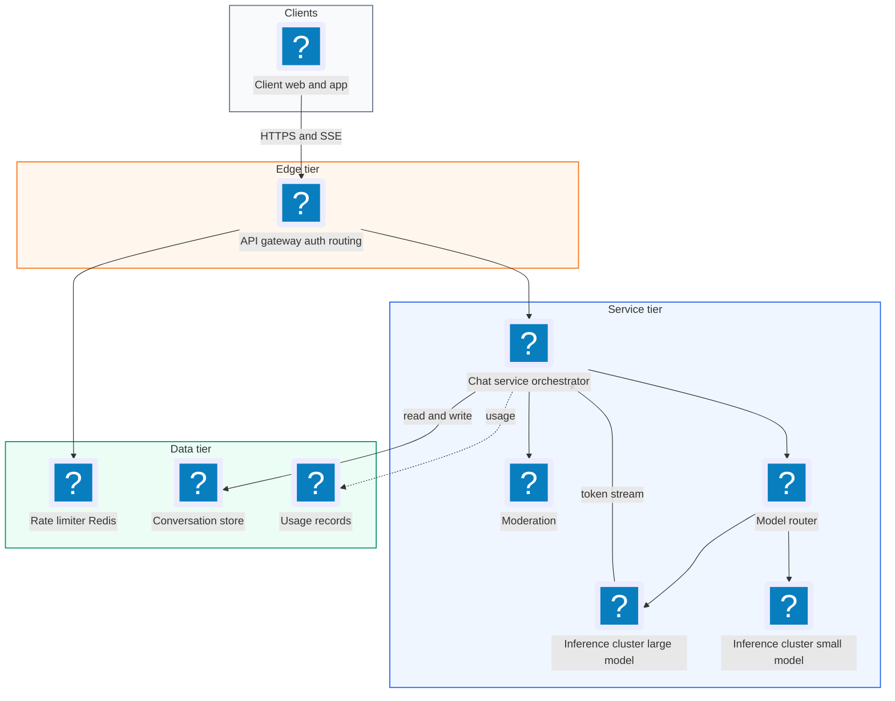
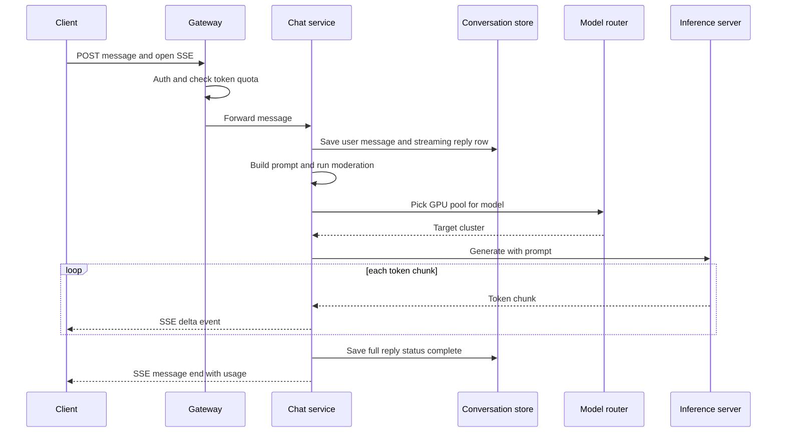
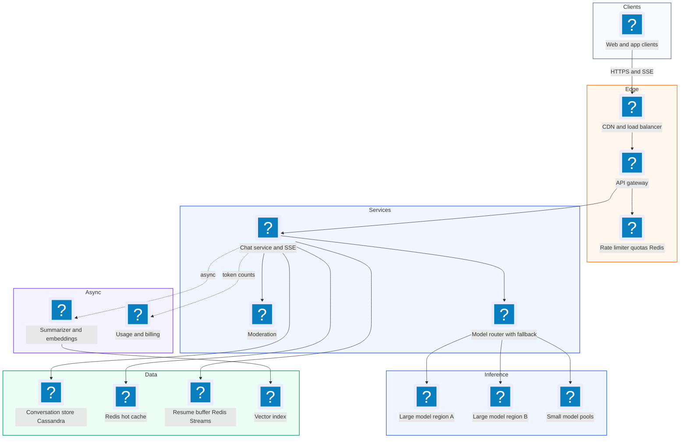

# 31. ChatGPT  (Hard)

> ChatGPT is a chat product on top of a large language model (LLM, a neural network that predicts the next piece of text, one token at a time). A user types a message, and the reply appears word by word as the model generates it. Conversations are saved so users can come back, and they can be long. Behind the scenes, every reply needs expensive GPU time. The interviewer is really testing whether you can design around a slow, costly, stateful backend: streaming tokens to the client, storing conversations and fitting them into a limited context window, serving models efficiently on GPUs with batching and KV caches, enforcing rate limits and quotas, and routing between models with failover when capacity runs out.

## 1. Functional requirements

Core (must have):

1. Users can start a conversation and send a message; the assistant's reply streams back token by token.
2. Users can continue a conversation; the model sees earlier turns as context.
3. Users can list, open, rename, and delete past conversations.
4. Users can pick a model (for example a fast small model or a slower, smarter large model), subject to their plan.
5. Users can stop a reply mid-generation and regenerate a reply.

Below the line (out of scope, and why):

- Training and fine-tuning models. A completely separate offline system.
- Tool use, browsing, file uploads, and image generation. Each adds a subsystem; the core streaming and serving path is the same.
- Safety classifiers in depth. We show where moderation plugs in.
- Voice mode. Different transport, same backend.

## 2. Non-functional requirements

1. Time to first token (TTFT): p50 under 500 ms and p99 under 2 seconds for the default model. This is what makes the product feel fast.
2. Streaming speed: at least 30 tokens per second per response for the default model (faster than people read).
3. Scale: 100 million daily active users, ~1 billion messages per day, peak ~30,000 new messages per second.
4. Availability: 99.9% for chat. When GPU capacity is short, degrade gracefully (queue, route to a smaller model, or return a clear "at capacity" message) instead of failing silently.
5. Durability: never lose a saved message; conversations persist indefinitely until the user deletes them.
6. Consistency: a user's own conversation must read their latest messages (read-your-writes). Conversation lists can be eventually consistent across devices within seconds. CAP choice: availability for the chat path, with per-conversation ordering guaranteed by a single writer.
7. Cost efficiency: maximize GPU utilization (tokens per second per GPU), since GPUs dominate cost.
8. Fairness: per-user rate limits and plan quotas so heavy users cannot starve others.

## 3. Back-of-the-envelope estimates

| Assumption | Number |
|---|---|
| Daily active users | 100 million |
| Messages per user per day | 10 |
| Average prompt context sent to the model | 2,000 tokens (history + new message) |
| Average reply length | 400 tokens |
| Peak to average ratio | 2.5x |
| Stored text per message | ~2 KB (user + assistant text, metadata) |
| Decode throughput per GPU (with batching, mid-size model) | ~2,000 output tokens/s |
| Prefill throughput per GPU | ~20,000 input tokens/s |

```text
Messages
  1e8 users * 10            = 1e9 messages/day
  avg msgs/s = 1e9 / 86,400 = ~11,600/s
  peak                      = ~30,000/s

Output tokens (decode)
  avg = 11,600 * 400        = ~4.6 million tokens/s
  peak                      = ~12 million tokens/s
  GPUs for decode at peak   = 12e6 / 2,000 = ~6,000 GPUs

Input tokens (prefill)
  peak = 30,000 * 2,000     = 60 million tokens/s
  GPUs for prefill          = 60e6 / 20,000 = ~3,000 GPUs
  (prefix caching can cut this a lot for long conversations)

Total: roughly 10,000 GPUs at peak for the default model alone.

Concurrent streams
  each reply ~400 tokens at 40 tok/s = ~10 s
  open streams at peak = 30,000/s * 10 s = ~300,000 SSE connections

Storage
  1e9 * 2 KB                = 2 TB/day
  per year                  = ~730 TB/year
```

The math shows two things. GPUs, not databases, are the expensive and scarce resource, so serving efficiency drives the design. And there are hundreds of thousands of long-lived streaming connections at any moment.

## 4. Core entities

- User: account, plan (free, plus, enterprise), quotas. Fields: user_id, plan, created_at.
- Conversation: a chat thread. Fields: conversation_id, user_id, title, model, created_at, updated_at, summary (optional).
- Message: one turn. Fields: message_id, conversation_id, parent_id, role (user, assistant, system), content, model, token_count, status (streaming, complete, stopped, failed), created_at.
- Model: a deployable LLM. Fields: model_id, context_window (max tokens), cost tier, endpoints.
- Generation request: one inference job. Fields: request_id, message_id, model_id, prompt_tokens, max_tokens, priority.
- Usage record: tokens used per user per window, for quotas and billing.

`parent_id` lets messages form a tree, so "regenerate" or "edit and resend" creates a sibling branch rather than overwriting history.

```sql
CREATE TABLE conversations (
  conversation_id UUID PRIMARY KEY,
  user_id         BIGINT NOT NULL,
  title           TEXT,
  model_id        TEXT,
  summary         TEXT,              -- rolling summary of old turns
  summary_upto    UUID,              -- last message covered by summary
  updated_at      TIMESTAMPTZ NOT NULL
);
CREATE INDEX ON conversations (user_id, updated_at DESC);

CREATE TABLE messages (
  conversation_id UUID,
  message_id      UUID,              -- time-ordered (UUIDv7)
  parent_id       UUID,
  role            TEXT,
  content         TEXT,
  token_count     INT,
  status          TEXT,
  created_at      TIMESTAMPTZ,
  PRIMARY KEY (conversation_id, message_id)
);
```

## 5. API design

`POST /v1/conversations` -- create a conversation. Response `201 {"conversation_id": "c_42"}`.

`POST /v1/conversations/{id}/messages` -- send a message and stream the reply. The response is `text/event-stream` (Server-Sent Events).

```json
// request
{"content": "Explain KV caching in one paragraph", "model": "gpt-default",
 "parent_id": "m_17", "client_message_id": "8c1f..."}
```

```text
// response: 200, Content-Type: text/event-stream
event: message_start
data: {"message_id":"m_19","model":"gpt-default"}

event: delta
data: {"text":"A KV cache"}

event: delta
data: {"text":" stores the attention"}

event: message_end
data: {"finish_reason":"stop","usage":{"prompt_tokens":2140,"completion_tokens":388}}
```

`POST /v1/messages/{message_id}/stop` -- stop generation. Response 202.

`POST /v1/messages/{message_id}/regenerate` -- new sibling reply, streamed like above.

`GET /v1/conversations?cursor=...` -- list conversations (title, updated_at), newest first.

`GET /v1/conversations/{id}` -- full conversation with messages (current branch).

`PATCH /v1/conversations/{id}` -- rename. `DELETE /v1/conversations/{id}` -- delete (soft delete, purge later).

Status codes: 200, 201, 202, 400, 401, 404, 409 (duplicate `client_message_id`), 429 (rate limit or quota, with `Retry-After`), 503 (model at capacity). Auth: bearer session token; every call checks the conversation belongs to the user. `client_message_id` is an idempotency key so a retried send does not create a duplicate turn.

## 6. High-level design



### How will users send a message and see the reply stream in?

1. The client calls `POST /v1/conversations/{id}/messages` and keeps the connection open for SSE.
2. The gateway authenticates and the rate limiter checks request and token quotas.
3. The Chat Service saves the user message (status complete), creates an assistant message row with status `streaming`, and builds the prompt: system instructions, relevant history, and the new message (see the context deep dive).
4. It runs a quick moderation check on the input.
5. It asks the Model Router for a target, which picks a GPU pool for the chosen model.
6. The inference server streams tokens back over gRPC. The Chat Service forwards each chunk to the client as an SSE `delta` event and appends it to a buffer.
7. When generation finishes, it writes the full assistant text, token counts, and status `complete`, and records usage.



### How will users continue a conversation?

1. The client sends the next message with `parent_id` set to the last assistant message.
2. The Chat Service loads the conversation branch (the chain of parent links) from the store or a cache of recent conversations.
3. It assembles context within the model's window (recent turns verbatim, older turns summarized) and proceeds as above.

### How will users browse and manage past conversations?

1. `GET /v1/conversations` reads the `(user_id, updated_at DESC)` index with a cursor.
2. Titles are generated by a cheap small model after the first exchange, asynchronously.
3. Rename updates one row. Delete marks the conversation deleted; a background job purges messages later.

### How will users choose a model and stop or regenerate?

1. The selected model id travels with each message. The router checks the user's plan allows it.
2. Stop sends `POST /stop`; the Chat Service cancels the inference request (freeing GPU capacity immediately), saves what was generated with status `stopped`, and ends the SSE stream.
3. Regenerate creates a new assistant message with the same parent and streams a fresh reply.

## 7. Deep dives

### How do we stream tokens to the client reliably?

The problem: replies take 5 to 30 seconds to generate. Making the user wait for the whole thing feels broken. We need to push small chunks as they are produced, across proxies and mobile networks, to ~300,000 concurrent streams.

| Option | Direction | Pros | Cons |
|---|---|---|---|
| Polling | Client pulls | Simple | Laggy, wasteful |
| WebSocket | Both ways | Low latency, full duplex | Stateful, more infra, needs its own auth and reconnect logic |
| Server-Sent Events (SSE) | Server to client over HTTP | Plain HTTP, works with standard proxies and load balancers, built-in event framing | One direction (fine: the user only sends once per turn) |

Recommended: SSE. The request is a normal HTTP POST, and the response is a long-lived `text/event-stream` body. It fits the pattern exactly: one request, many small server pushes.

Details that matter at scale:

- Disable proxy buffering (for example `X-Accel-Buffering: no` on Nginx) or tokens arrive in bursts.
- Send heartbeat comments (`: ping`) every 15 seconds so idle connections are not killed by load balancers during a slow first token.
- Chunk coalescing: send every token or every ~20-50 ms, whichever comes later, to cut per-event overhead.
- Resume on disconnect: the Chat Service writes deltas to a short-lived buffer (Redis Stream keyed by message_id). If the client reconnects, it sends the last event id it saw, and the server replays from there and continues. If the user simply reloads later, the saved message is shown.
- Decouple generation from the connection: generation continues even if the client briefly drops, so the answer is complete when they return. Explicit stop is the only way to cancel.

```python
async def stream_reply(req, conv, user_msg, model):
    asst = await store.create_message(conv.id, role="assistant", status="streaming",
                                      parent_id=user_msg.id)
    yield sse("message_start", {"message_id": asst.id, "model": model})
    buf, last_flush = [], time.monotonic()
    async for tok in inference.generate(build_prompt(conv, user_msg), model, req_id=asst.id):
        buf.append(tok)
        await redis.xadd(f"stream:{asst.id}", {"t": tok}, maxlen=5000)  # resume buffer
        if time.monotonic() - last_flush > 0.03:
            yield sse("delta", {"text": "".join(buf)}); buf.clear()
            last_flush = time.monotonic()
    if buf:
        yield sse("delta", {"text": "".join(buf)})
    await store.complete_message(asst.id)
    yield sse("message_end", {"finish_reason": "stop"})
```

### How do we store conversations and fit them into the context window?

The problem: models have a fixed context window (for example 128,000 tokens), and every token sent costs prefill compute. A long conversation can exceed the window, and even when it fits, sending everything every time is slow and expensive. We also need durable storage for ~730 TB per year of messages.

Storage options:

| Store | Fit | Notes |
|---|---|---|
| Postgres (sharded by user_id) | Good: relational, indexes for listing | Shard to handle 30k writes/s and hundreds of TB |
| Cassandra / DynamoDB, partition by conversation_id | Very good for append-heavy, read-by-conversation | Listing by user needs a second table |
| Object storage for old conversations | Cheap archive | Slower to open old chats |

Recommended: a wide-column store (Cassandra or DynamoDB) with messages partitioned by conversation_id and clustered by time-ordered message_id, plus a `conversations_by_user` table for listing. Cache recently active conversations (last N messages) in Redis, since most messages continue a conversation used minutes ago.

Context building options:

| Strategy | How | Pros | Cons |
|---|---|---|---|
| Send everything | Full history | Best recall | Hits the window, high cost |
| Sliding window | Last N tokens of turns | Simple, cheap | Forgets early facts |
| Summary + recent turns | Rolling summary of older turns plus recent turns verbatim | Bounded cost, keeps key facts | Summary may drop details |
| Retrieval | Embed old turns, pull the most relevant ones | Precise for specific recalls | Extra infra and latency |

Recommended: summary plus recent turns, with retrieval as an add-on for very long conversations. Count tokens with the model's tokenizer and fill a budget in priority order: system prompt, the new message, as many recent turns as fit, then the summary, leaving room for the reply.

```python
def build_prompt(conv, new_msg, model):
    budget = model.context_window - model.max_output_tokens   # leave room to answer
    parts = [system_prompt(model)]
    used = ntok(parts[0]) + ntok(new_msg.content)
    recent = []
    for m in reversed(conv.branch_messages()):               # newest first
        t = m.token_count
        if used + t > budget * 0.8:                          # keep 20% for summary
            break
        recent.append(m); used += t
    if conv.summary and len(recent) < len(conv.branch_messages()):
        parts.append({"role": "system", "content": "Earlier summary: " + conv.summary})
    parts += [as_msg(m) for m in reversed(recent)]
    parts.append(as_msg(new_msg))
    return parts
```

### How do we serve the model efficiently on GPUs?

The problem: an LLM reply has two phases. Prefill processes the whole prompt in parallel (compute heavy, fast per token). Decode generates one token at a time, and each step reads the entire model weights from GPU memory (memory-bandwidth bound). Serving one request at a time leaves the GPU mostly idle. We need ~10,000 GPUs at peak, so every percent of utilization matters.

Key ideas:

- Batching: run many users' requests through the model together in each decode step. The cost of reading weights is shared across the batch, so throughput rises nearly linearly until compute or memory runs out.
- Continuous (in-flight) batching: instead of waiting for a whole batch to finish, the scheduler adds new requests and removes finished ones at every decode step. Short replies do not wait for long ones.
- KV cache: during generation, the model computes "key" and "value" vectors for every token in the attention layers. Caching them means each new token only does work for itself instead of reprocessing the whole sequence. The KV cache lives in GPU memory and is the main limit on how many requests fit in a batch.
- Paged attention: store the KV cache in fixed-size blocks (like virtual memory pages) to avoid fragmentation, which can double usable batch size (the idea behind vLLM).
- Prefix caching: many requests share the same system prompt, and a follow-up message shares the whole previous conversation. Keep KV blocks for common prefixes and reuse them, skipping most of prefill.

| Approach | Throughput | Latency | Notes |
|---|---|---|---|
| One request per GPU | Very low | Low TTFT | Wasteful |
| Static batching | Medium | Poor: waits for slowest | Simple |
| Continuous batching + paged KV cache | High | Good | Standard today (vLLM, TensorRT-LLM, TGI) |
| Plus disaggregated prefill/decode pools | Higher at scale | Better TTFT control | Must move KV cache between GPUs |

Recommended: continuous batching with paged KV cache and prefix caching. At large scale, split prefill and decode onto separate GPU pools so long prompts do not stall token generation for others. Route follow-up messages of a conversation to the same model replica when possible (session affinity) so its prefix cache is warm.

```text
 Scheduler (per model replica group)
   waiting queue (by priority, plan)
        |
        v
 every decode step:
   + admit new requests if KV blocks free  (prefill chunk)
   - evict finished / stopped requests      (free KV blocks)
   run one forward pass for all active requests
        |
        v
 GPU memory: [ model weights | KV cache blocks: req1 req2 ... reqN ]
```

KV cache memory, worked example for a mid-size model:

```text
KV bytes per token = 2 (K and V) * layers * kv_heads * head_dim * bytes
                   = 2 * 32 * 8 * 128 * 2 B = 131 KB per token
A 4,000-token conversation        = ~0.5 GB
GPU with 80 GB, weights 16 GB     -> ~64 GB for KV -> ~120 such requests
```

Very large models are split across several GPUs (tensor parallelism inside a node, pipeline parallelism across nodes), and a replica is the group of GPUs that serves one copy of the model.

### How do we enforce rate limits and quotas?

The problem: GPU capacity is fixed in the short term. Without limits, a few heavy users or scripts can fill the queues, and free-tier load can crowd out paying users during spikes. Requests also vary hugely in cost: a 100-token question and a 100,000-token document summary are not equal.

| Limit type | Measures | Why |
|---|---|---|
| Requests per minute | Messages sent | Stops floods and scripts |
| Tokens per minute | Prompt + estimated output tokens | Reflects real GPU cost |
| Daily or rolling quota per plan and model | Messages or tokens on expensive models | Business plans, cost control |
| Concurrency | Active streams per user | Stops parallel abuse |

Recommended: token-bucket limiters in Redis, checked at the gateway, keyed by user, plan, and model. Charge prompt tokens up front plus an estimate for output, then correct with the actual usage at the end. Add priority classes in the inference scheduler (paid traffic ahead of free) so overload degrades free users first.

```python
LUA_TOKEN_BUCKET = """
local key, rate, cap, now, cost = KEYS[1], tonumber(ARGV[1]), tonumber(ARGV[2]),
                                  tonumber(ARGV[3]), tonumber(ARGV[4])
local b = redis.call('HMGET', key, 'tokens', 'ts')
local tokens = tonumber(b[1]) or cap
local ts = tonumber(b[2]) or now
tokens = math.min(cap, tokens + (now - ts) * rate)
if tokens < cost then return 0 end
redis.call('HMSET', key, 'tokens', tokens - cost, 'ts', now)
redis.call('EXPIRE', key, 3600)
return 1
"""

def allow(user, model, prompt_tokens):
    cost = prompt_tokens + model.expected_output_tokens
    lim = limits_for(user.plan, model.id)          # e.g. 40k tokens/min for plus
    return redis.eval(LUA_TOKEN_BUCKET, 1, f"tpm:{user.id}:{model.id}",
                      lim.rate_per_s, lim.capacity, time.time(), cost) == 1
```

When a user hits the limit, return 429 with `Retry-After` and a clear message ("You have reached your limit for this model, try again at 3:40 PM or switch to the faster model"), which is far better than a vague error.

### How do we handle very long conversations?

The problem: some users keep one conversation going for weeks. Even with a 128k window, sending all of it each turn is slow (prefill grows with length), expensive, and eventually impossible. Research also shows models use the middle of very long contexts less reliably.

| Option | How | Pros | Cons |
|---|---|---|---|
| Truncate oldest turns | Drop from the front | Trivial | Forgets important early facts |
| Rolling summarization | Periodically summarize older turns into a compact note | Bounded tokens, keeps key facts | Lossy; extra model calls |
| Retrieval over history | Embed each turn; fetch top-k relevant old turns per new message | Recalls specific details | Vector index, extra latency |
| Long-term memory | Store durable user facts separately | Personalization across chats | Privacy and correctness concerns |

Recommended: rolling summarization, triggered asynchronously when the un-summarized part of a conversation passes a threshold (for example 8,000 tokens), using a cheap small model. Store the summary and the id of the last covered message on the conversation row. For long chats, also index turns in a vector store and pull the top 3-5 relevant older turns into context.

```text
 turns: [1 ... 120][121 ... 160]  new message
         \_______/   \________/
          summary     recent turns verbatim
         (~800 tok)   (~6,000 tok)
   + retrieved: turns 14, 37 (relevant to the new question)
```

```python
async def maybe_summarize(conv):
    unsummarized = conv.tokens_after(conv.summary_upto)
    if unsummarized < 8000:
        return
    old = conv.messages_between(conv.summary_upto, keep_recent_tokens=4000)
    prompt = [{"role": "system", "content":
               "Update this summary with the new turns. Keep names, numbers, "
               "decisions, and user preferences. Max 300 words."},
              {"role": "user", "content": f"Summary so far:\n{conv.summary}\n\nNew turns:\n{render(old)}"}]
    new_summary = await inference.complete(prompt, model="small-fast")
    await store.update_summary(conv.id, new_summary, upto=old[-1].id)
```

Prefix caching on the inference side also helps: if the beginning of the prompt (system prompt plus summary plus early turns) is unchanged since the last message, the KV cache for it can be reused, so only the new tokens need prefill.

### How do we route between models and fail over when capacity runs out?

The problem: there are several models (small, large, specialized), each deployed in many GPU clusters across regions. Some clusters fill up, some fail, and a new model version rolls out gradually. Users should rarely see an error.

| Routing concern | Approach |
|---|---|
| Which model | User choice within plan; optional auto-routing sends simple prompts to a smaller model |
| Which cluster | Least-loaded healthy cluster in or near the user's region, weighted by queue depth and KV cache headroom |
| Affinity | Prefer the replica that served the conversation's previous turn (warm prefix cache) |
| Rollouts | Canary a new model version to 1%, then 10%, compare quality and error metrics |
| Overload | Admission control: queue briefly, then shed lowest priority, then fall back |
| Failure | Health checks, circuit breakers, retry on another cluster before the first token |

Recommended: a Model Router service that keeps a live view of every cluster (queue length, active batch size, free KV blocks, error rate) and picks a target per request. Failover rules:

1. If a cluster fails before any token is sent, retry transparently on another cluster or region.
2. If it fails mid-stream, do not silently restart (the user would see repeated text). Send an error event, keep the partial message with status `failed`, and offer a one-click retry.
3. If every cluster for the chosen model is at capacity, queue for up to a few seconds with a "high demand" indicator, then fall back to a smaller model if the plan allows and tell the user, or return 503 with `Retry-After`.

```python
def route(req):
    candidates = [c for c in clusters[req.model] if c.healthy and not c.breaker_open]
    if req.prev_replica in candidates and candidates_load(req.prev_replica) < 0.85:
        return req.prev_replica                     # warm prefix cache
    candidates.sort(key=lambda c: (c.region_distance(req.region),
                                   c.queue_depth / c.capacity))
    for c in candidates:
        if c.admit(req.priority, req.est_tokens):   # checks KV headroom
            return c
    if req.allow_fallback and (fb := fallback_model(req.model)):
        req.model, req.notice = fb, "Using a faster model due to high demand"
        return route(req)
    raise AtCapacity(retry_after=10)
```

```text
            +------------------ Model Router ------------------+
 request -> | plan check -> affinity? -> least-loaded healthy   |
            | cluster -> admit? -> else fallback model -> 503   |
            +---------------------------------------------------+
               |                 |                    |
          large-model       large-model          small-model
          us-east (80%)     us-west (95% full)   us-east
```

Other failure handling:

- Chat Service crash mid-stream: the assistant message stays `streaming`; a sweeper marks stale ones `failed` after a timeout. The client's reconnect replays from the Redis resume buffer if generation is still running elsewhere.
- Conversation store slow: buffer completed messages to a durable queue and write behind; the reply still streams.
- Moderation service down: fail closed for high-risk categories (block with a message) or fail open with post-hoc review, by policy.

## 8. Final architecture



| Component | Job | Technology example |
|---|---|---|
| CDN / LB | TLS, long-lived connections | Cloudflare, Envoy |
| API gateway | Auth, routing | Envoy, Kong |
| Rate limiter | Request, token, concurrency limits | Redis token buckets |
| Chat service | Orchestrate turn, build context, stream SSE | Python/Go async service |
| Conversation store | Durable messages and conversation lists | Cassandra, DynamoDB, or sharded Postgres |
| Hot cache | Recent conversations | Redis |
| Resume buffer | Replay deltas after reconnect | Redis Streams |
| Moderation | Input and output safety checks | Classifier models |
| Summarizer / embeddings | Rolling summaries, retrieval index | Small LLM, vector DB (pgvector, FAISS) |
| Model router | Pick model and cluster, failover | Custom service with live load view |
| Inference servers | Continuous batching, paged KV cache, prefix caching | vLLM, TensorRT-LLM, TGI on GPU clusters |
| Usage / billing | Token accounting, quotas | Kafka + analytics store |

### Deployment map (AWS)

```mermaid
architecture-beta
    group internet(mdi:earth)[Internet]
    group edge(logos:aws-cloudfront)[Edge]
    group vpc(logos:aws-vpc)[AWS VPC]
    group app(logos:aws-ecs)[Service subnet] in vpc
    group data(logos:aws-rds)[Data subnet] in vpc

    service user(mdi:cellphone)[Web and app clients] in internet
    service cdn(logos:aws-cloudfront)[CDN and load balancer] in edge
    service gw(logos:aws-api-gateway)[API gateway] in edge
    service chat(logos:aws-ecs)[Chat service and SSE] in app
    service router(logos:aws-ecs)[Model router with fallback] in app
    service large(logos:aws-sagemaker)[Large model region A] in app
    service small(logos:aws-sagemaker)[Small model pools] in app
    service summ(logos:aws-lambda)[Summarizer and embeddings] in app
    service convo(logos:aws-dynamodb)[Conversation store Cassandra] in data
    service resume(logos:aws-elasticache)[Resume buffer Redis Streams] in data

    user:R --> L:cdn
    cdn:R --> L:gw
    gw:R --> L:chat
    chat:B --> T:convo
    chat:B --> T:resume
    chat:R --> L:router
    router:R --> L:large
    router:B --> T:small
    chat:T --> B:summ
```



SSE streams terminate at the edge and the chat service, while the router and the GPU model pools share the service subnet and the conversation store and resume buffer sit in the data subnet.

## 9. Common mistakes and interviewer follow-ups

- Returning the whole reply at once. Users stare at a spinner for 20 seconds. Say: stream tokens with SSE, measure time to first token.
- Treating inference like a normal stateless web call. GPU batching, KV cache memory, and prefill vs decode are the real bottlenecks. Say: continuous batching, paged KV cache, prefix caching, and capacity math in GPUs.
- Sending the full history every turn. It breaks at the context window and wastes prefill compute. Say: token budget with recent turns, rolling summary, and optional retrieval.
- Rate limiting by request count only. One giant prompt costs 1,000 small ones. Say: tokens-per-minute buckets plus plan quotas and priority classes.
- Restarting a failed generation silently mid-stream. The user sees duplicated or inconsistent text. Say: retry only before the first token; after that, mark failed and offer retry.
- Tying generation to the HTTP connection. A flaky mobile network cancels expensive work. Say: decouple generation, buffer deltas for resume, cancel only on explicit stop.
- Overwriting messages on regenerate. History and branches are lost. Say: message tree with parent ids.
- Follow-up: "How would you cut GPU cost?" Answer: route easy prompts to smaller models, quantize models (store weights in fewer bits), raise batch sizes with paged attention, use prefix caching, and use speculative decoding (a small model drafts tokens that the large model verifies in one pass).

## 10. One-page cheat sheet

| Topic | Key point |
|---|---|
| Scale | 1B msgs/day, 30k/s peak, ~12M output tokens/s, ~10k GPUs, 300k open streams |
| Latency | TTFT p50 < 500 ms, p99 < 2 s; >= 30 tokens/s |
| Streaming | SSE, no proxy buffering, heartbeats, Redis Streams resume buffer |
| Storage | Messages by conversation_id (Cassandra/DynamoDB), list by user, Redis hot cache |
| Branches | Message tree with parent_id for regenerate and edits |
| Context | Token budget: system + recent turns + rolling summary + retrieval |
| Serving | Continuous batching, paged KV cache, prefix caching, prefill/decode split |
| KV math | ~131 KB/token for a mid-size model; KV memory caps batch size |
| Limits | Redis token buckets on tokens/min, requests/min, concurrency; plan quotas |
| Priority | Paid ahead of free in the scheduler; shed free load first |
| Routing | Plan check, conversation affinity, least-loaded healthy cluster |
| Failover | Retry before first token; mark failed after; fallback model or 503 |
| CAP | Availability for chat; single writer per conversation for ordering |

## Sources

- [Hello Interview: system design problem breakdowns](https://www.hellointerview.com/learn/system-design/problem-breakdowns/overview)
- [vLLM: Efficient memory management with PagedAttention (paper)](https://arxiv.org/abs/2309.06180)
- [Anyscale: How continuous batching enables 23x throughput in LLM inference](https://www.anyscale.com/blog/continuous-batching-llm-inference)
- [OpenAI API docs: Streaming responses](https://platform.openai.com/docs/guides/streaming-responses)
- [OpenAI API docs: Rate limits](https://platform.openai.com/docs/guides/rate-limits)
- [MDN: Using server-sent events](https://developer.mozilla.org/en-US/docs/Web/API/Server-sent_events/Using_server-sent_events)
- [Lost in the Middle: How language models use long contexts (paper)](https://arxiv.org/abs/2307.03172)
