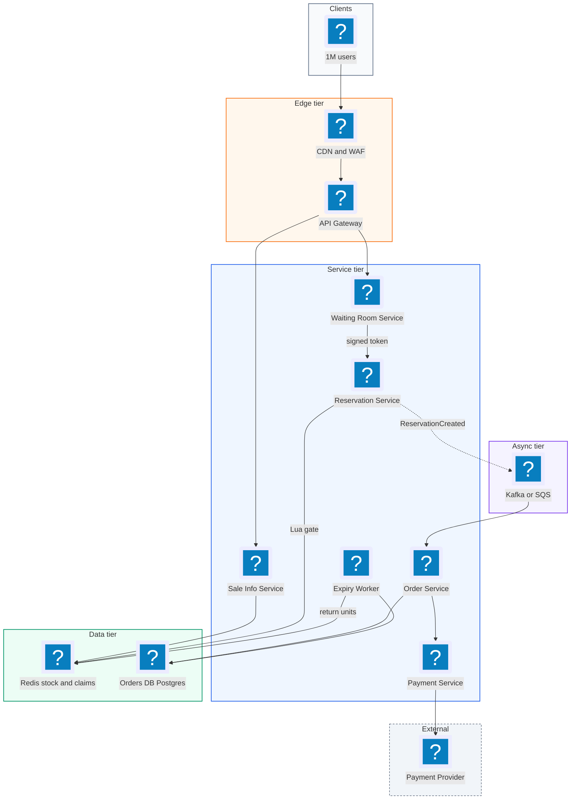
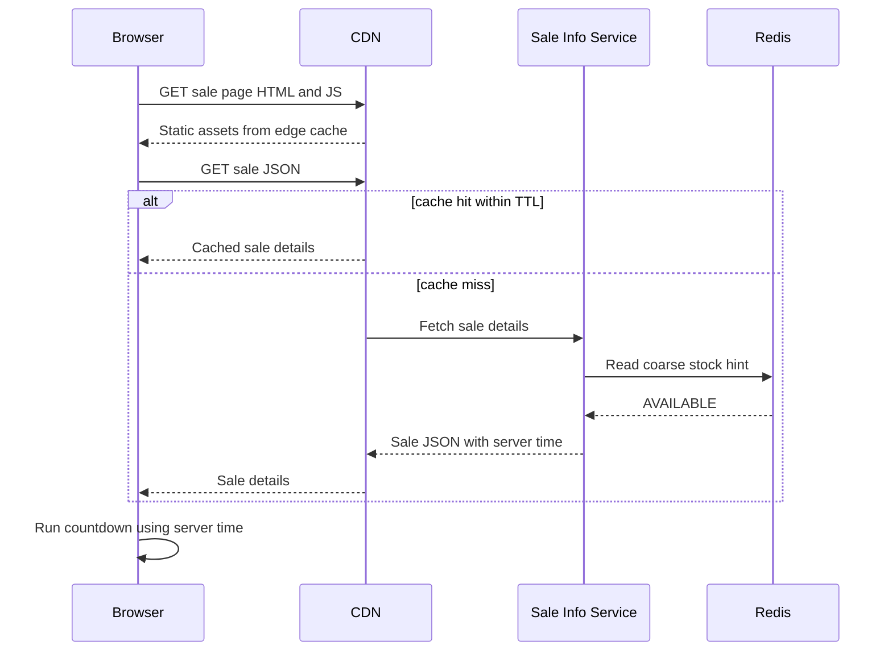
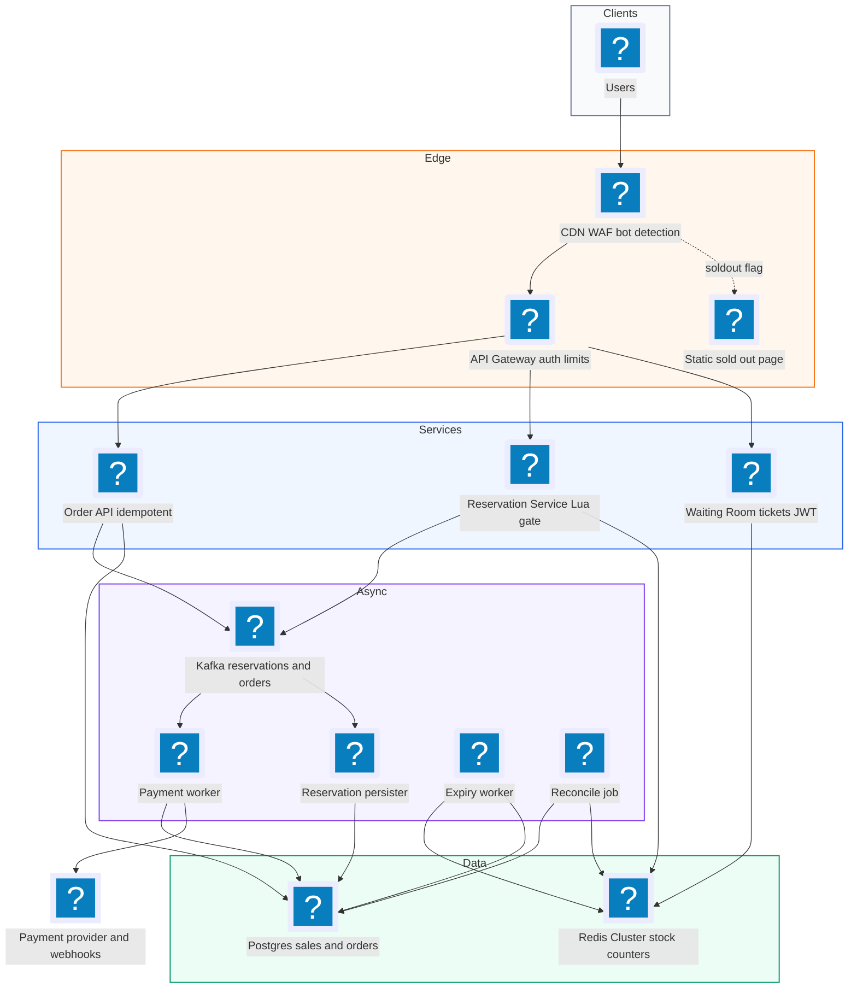

# 32. Flash Sale  (Hard)

> A flash sale sells a tiny amount of stock (say 1,000 discounted phones) to a huge crowd (say 1,000,000 shoppers) who all show up at the same second, for example at 12:00:00 noon. The product itself is simple: show the item, let people click Buy, take payment, confirm the order. What the interviewer is really testing is whether you can survive a traffic spike that is 100x to 1000x normal load, never sell item number 1,001 (no overselling), stay fair to real humans, and not let a few seconds of madness take down the rest of the shop. It is a focused problem: you design one hard corner of an e-commerce system, not the whole store.

## 1. Functional requirements

Core (must have):

1. Users can view a flash sale page: product, price, start time, and a rough "items left" indicator.
2. When the sale opens, users can try to reserve (claim) one unit of the item.
3. A user who wins a reservation can pay within a time window (for example 10 minutes) to turn it into an order.
4. If the user does not pay in time, the unit goes back into stock for someone else.
5. Each user can buy at most N units (usually 1) per sale.
6. Users get a clear answer: "you got one, pay now", "you are in the queue", or "sold out".

Below the line (out of scope):

- Product catalog management, search, and recommendations. These already exist in the normal store.
- Shipping, returns, and warehouse fulfilment. They happen hours later and are not under spike load.
- Building a payment processor. We call an existing one (Stripe, Adyen, an internal payments service).
- Dynamic pricing. The price is fixed for the sale.

## 2. Non-functional requirements

1. **Correctness (no overselling):** the number of confirmed orders must never exceed stock. This needs strong consistency for the inventory counter. Zero tolerance.
2. **Spike tolerance:** handle about 1,000,000 users arriving within roughly 10 seconds, which peaks near 200,000 to 500,000 requests per second at the edge.
3. **Low latency for the decision:** p99 time to tell a user "won / lost / waiting" under 500 ms once they reach the buy step.
4. **Availability:** the sale page and waiting room should stay up (99.99%). If a backend part is struggling, shed load gracefully with a "please wait" instead of errors.
5. **Isolation:** the flash sale must not hurt the rest of the store. Normal checkout keeps its normal latency.
6. **Fairness:** roughly first come, first served among real users. Bots and scripts should not win most of the stock.
7. **Idempotency:** a user double-clicking or a client retrying must never create two orders or two charges.
8. **CAP choice:** for the inventory counter we choose **consistency over availability (CP)**. If we cannot be sure a unit is free, we say "try again" rather than risk selling it twice. For the product page and "items left" display we choose **availability (AP)** and accept a number that is a second or two stale.

## 3. Back-of-the-envelope estimates

| Assumption | Number |
|---|---|
| Units of stock | 1,000 |
| Users who show up | 1,000,000 |
| Arrival window for most users | 10 seconds |
| Page refreshes and retries per user in first minute | about 5 |
| Reservation window to pay | 10 minutes |
| Size of one order record | about 1 KB |
| Flash sales per day (whole company) | about 20 |
| Product page size (HTML + JSON, images on CDN) | about 50 KB |

```text
Edge traffic at peak:
  1,000,000 users * 5 requests / 10 s = 500,000 req/s  (mostly page loads,
  polling, retries; must be served by CDN and waiting room, not the backend)

Buy attempts reaching the inventory service (after the waiting room):
  We only need ~1,000 winners. Let in, say, 10,000 users per second.
  -> 10,000 write attempts/s at the counter, easy for one Redis node
     (a single Redis node handles ~100k simple ops/s)

Successful writes (orders):
  1,000 orders per sale * 20 sales/day = 20,000 orders/day
  -> tiny for a database; the hard part is the burst, not the volume

Storage per year:
  20,000 orders/day * 365 * 1 KB = ~7.3 GB/year of orders
  Plus reservation and audit logs, maybe 10x -> ~73 GB/year. Small.

Bandwidth at peak (page loads served from CDN):
  500,000 req/s * 50 KB = 25 GB/s  -> this is why the page must be static
  and cached at the CDN edge. Our origin servers must not see this.
```

The key insight from the math: the total amount of work is small, but it all arrives at once. 99.9% of the users will lose. Our job is to say "no" to them cheaply and say "yes" to 1,000 of them correctly.

## 4. Core entities

- **Sale**: one flash sale event. Fields: sale_id, product_id, price, total_stock, start_at, end_at, per_user_limit, status.
- **Product**: the item being sold. Fields: product_id, title, images, description (already exists in the catalog).
- **InventoryCounter**: the live number of units left for a sale. Lives in Redis as the fast source of truth during the sale, backed by the database.
- **Reservation**: a temporary hold on one unit for one user. Fields: reservation_id, sale_id, user_id, status (HELD, PAID, EXPIRED), expires_at.
- **Order**: the final purchase after payment. Fields: order_id, reservation_id, user_id, amount, payment_id, status.
- **QueueTicket**: a user's place in the virtual waiting room. Fields: ticket_id, user_id, sale_id, position, signed token.
- **IdempotencyKey**: a client-generated key that makes a request safe to retry. Fields: key, user_id, response, created_at.

```sql
CREATE TABLE sales (
  sale_id        BIGINT PRIMARY KEY,
  product_id     BIGINT NOT NULL,
  price_cents    INT NOT NULL,
  total_stock    INT NOT NULL,
  per_user_limit INT NOT NULL DEFAULT 1,
  start_at       TIMESTAMP NOT NULL,
  end_at         TIMESTAMP NOT NULL,
  status         VARCHAR(16) NOT NULL  -- SCHEDULED, LIVE, ENDED
);

CREATE TABLE reservations (
  reservation_id UUID PRIMARY KEY,
  sale_id        BIGINT NOT NULL,
  user_id        BIGINT NOT NULL,
  status         VARCHAR(16) NOT NULL, -- HELD, PAID, EXPIRED
  expires_at     TIMESTAMP NOT NULL,
  created_at     TIMESTAMP NOT NULL,
  UNIQUE (sale_id, user_id)            -- one active claim per user
);

CREATE TABLE orders (
  order_id        UUID PRIMARY KEY,
  reservation_id  UUID NOT NULL UNIQUE,  -- one order per reservation
  user_id         BIGINT NOT NULL,
  amount_cents    INT NOT NULL,
  payment_id      VARCHAR(64),
  status          VARCHAR(16) NOT NULL   -- PENDING, CONFIRMED, FAILED
);
```

The `UNIQUE` constraints are a safety net. Even if the fast path had a bug, the database refuses a second reservation for the same user or a second order for the same reservation.

## 5. API design

All write endpoints need a logged-in user (session cookie or JWT). Buy endpoints also need a valid waiting-room token.

`GET /sales/{saleId}` -- get sale details (cacheable at CDN).

```json
// response 200
{ "saleId": 77, "product": {"id": 9, "title": "Phone X"},
  "priceCents": 19900, "startAt": "2026-11-11T12:00:00Z",
  "status": "SCHEDULED", "stockHint": "AVAILABLE" }
```

`POST /sales/{saleId}/queue` -- join the waiting room, get a ticket.

```json
// response 202
{ "ticketId": "t_8f2", "position": 48210, "pollAfterMs": 2000 }
```

`GET /sales/{saleId}/queue/{ticketId}` -- poll your status in the waiting room.

```json
// response 200, still waiting
{ "state": "WAITING", "position": 3120, "pollAfterMs": 2000 }
// response 200, your turn
{ "state": "ADMITTED", "accessToken": "eyJhbGciOi...", "expiresInSec": 60 }
// response 200, sale over
{ "state": "SOLD_OUT" }
```

`POST /sales/{saleId}/reservations` -- try to claim one unit.
Headers: `Authorization`, `X-Access-Token` (from the waiting room), `Idempotency-Key`.

```json
// request
{ "quantity": 1 }
// response 201
{ "reservationId": "r_51a", "expiresAt": "2026-11-11T12:10:04Z" }
```

Status codes: `201` won, `409` already have a reservation (returns the existing one), `410` sold out, `403` bad or expired access token, `429` slow down.

`POST /reservations/{reservationId}/orders` -- pay and confirm.
Headers: `Idempotency-Key`.

```json
// request
{ "paymentMethodId": "pm_123" }
// response 202 (payment is processed async)
{ "orderId": "o_9c1", "status": "PENDING" }
```

`GET /orders/{orderId}` -- check order status (PENDING, CONFIRMED, FAILED).

## 6. High-level design



### How will users view the sale page?

1. The client loads `/sales/77`. The HTML, JS and images are static and served by the CDN. No origin hit.
2. The page fetches `GET /sales/77` JSON. This is also cached at the CDN with a short TTL (1 to 5 seconds).
3. A countdown runs in the browser using server time from a response header, so users with wrong clocks do not hit Buy early.
4. The "items left" hint is a coarse value (AVAILABLE, FEW_LEFT, SOLD_OUT) refreshed every couple of seconds from Redis by the Sale Info Service. It is fine for this to be slightly stale.



### How will users get a fair chance to buy?

1. At 12:00:00 the Buy button turns into "Join queue". The client calls `POST /sales/77/queue`.
2. The Waiting Room Service gives the user a ticket with a position. Positions come from `INCR` on a Redis key, so arrival order is preserved.
3. The client polls with the `pollAfterMs` the server suggests. The server can raise this number to slow down polling when it is busy.
4. A releaser lets in, say, 2,000 users per second. Admitted users get a short-lived signed access token.
5. Once stock hits zero, every remaining ticket gets "SOLD_OUT" right away, so the crowd leaves quickly.

### How will users reserve a unit?

1. The admitted client calls `POST /sales/77/reservations` with the access token and an `Idempotency-Key`.
2. The Reservation Service checks the token signature (no DB call, just crypto).
3. It runs one Lua script in Redis that atomically checks the per-user limit and decrements stock (see deep dive).
4. If the script says "won", the service writes the reservation to Redis with a TTL and publishes a `ReservationCreated` event to Kafka.
5. It returns `201` with a reservation id. This all takes a few milliseconds.

### How will users pay and get an order?

1. The client calls `POST /reservations/r_51a/orders` with a payment method and a new `Idempotency-Key`.
2. The Order Service checks the reservation is still HELD and not expired, inserts an order as PENDING, and asks the Payment Service to charge.
3. The Payment Service calls the provider with the same idempotency key, so a retry never double-charges.
4. When the provider confirms (often by webhook), the order becomes CONFIRMED and the reservation PAID.
5. The client polls `GET /orders/o_9c1` or gets a push notification.

### What happens if someone does not pay?

1. Every reservation has `expires_at`. An Expiry Worker scans for HELD reservations past their time.
2. It marks them EXPIRED and runs `INCR` on the stock counter so the unit is free again.
3. The waiting room releases a few more users to take those units.

## 7. Deep dives

### How do we make sure we never sell more units than we have?

The classic bug is read-then-write. Two servers both read "stock = 1", both think there is one left, both sell it. We need the check and the decrement to happen as one atomic step.

| Option | How it works | Pros | Cons |
|---|---|---|---|
| DB row lock (`SELECT ... FOR UPDATE`) | Lock the inventory row, check, update, commit | Simple, strongly consistent, durable | One hot row; maybe 500 to 2,000 updates/s before lock waits pile up |
| DB conditional update | `UPDATE ... SET stock = stock - 1 WHERE stock > 0` | No explicit lock, atomic in one statement | Still one hot row, same throughput ceiling |
| Redis `DECR` alone | Decrement, if result < 0 then `INCR` back | Very fast | Brief negative values; per-user limit needs a second call, so not atomic |
| Redis Lua script | Check user limit + stock + decrement in one script | Atomic, about 100k ops/s on one node, handles limits | Redis is in memory, so we need persistence and a reconcile step |

Recommended: **Redis Lua script as the gate, database as the record.** Redis runs a Lua script as one uninterruptible unit, so no other command sneaks in between the check and the decrement.

```lua
-- KEYS[1] = stock:{77}        (integer units left)
-- KEYS[2] = buyers:{77}       (hash user_id -> units bought)
-- ARGV[1] = user_id, ARGV[2] = qty, ARGV[3] = per_user_limit
local stock = tonumber(redis.call('GET', KEYS[1]) or '0')
local qty   = tonumber(ARGV[2])
local had   = tonumber(redis.call('HGET', KEYS[2], ARGV[1]) or '0')

if had + qty > tonumber(ARGV[3]) then
  return -2              -- over the per-user limit
end
if stock < qty then
  return -1              -- sold out
end
redis.call('DECRBY', KEYS[1], qty)
redis.call('HINCRBY', KEYS[2], ARGV[1], qty)
return stock - qty       -- units left after this claim
```

The `{77}` in the key names is a Redis Cluster hash tag. It forces both keys onto the same shard, which Lua scripts need.

```python
def reserve(sale_id: int, user_id: int, qty: int = 1) -> str:
    left = redis.evalsha(RESERVE_SHA, 2,
                         f"stock:{{{sale_id}}}", f"buyers:{{{sale_id}}}",
                         user_id, qty, PER_USER_LIMIT)
    if left == -1:
        raise SoldOut()
    if left == -2:
        raise LimitReached()
    rid = new_uuid()
    redis.set(f"resv:{rid}", user_id, ex=600)        # 10 min hold
    kafka.send("reservations", {"rid": rid, "sale": sale_id,
                                "user": user_id, "qty": qty})
    return rid
```

If the 1,000 units are the only thing that matters, you could even skip Redis and use the database conditional update, because the waiting room limits traffic to a few thousand attempts per second. Say this in the interview: "With a waiting room in front, a single Postgres row with a conditional update can work. I pick Redis because it gives me headroom and keeps the hot row off the main DB."

A second safety net: the `UNIQUE (sale_id, user_id)` constraint in the reservations table, and a periodic reconcile job that checks `total_stock = redis_stock + held + paid`.

### How do we stop 1,000,000 users from crushing the backend?

Only 1,000 can win. Letting 1,000,000 requests hit the Reservation Service wastes capacity and creates a thundering herd (everyone retrying at once).

| Option | Idea | Pros | Cons |
|---|---|---|---|
| Rate limit only | Return 429 above N req/s | Easy | Users hammer refresh; unfair; random who wins |
| Virtual waiting room | Give everyone a queue position, admit at a fixed rate | Fair, smooth load, clear UX | More moving parts, users must wait |
| Lottery / pre-registration | Users register before; random draw picks buyers | Calmest load, very bot resistant | Changes the product; not first come first served |
| Load shedding at the edge | Once sold out, CDN serves a static "sold out" page | Kills traffic instantly | Only helps after stock is gone |

Recommended: **waiting room plus edge shedding, with rate limits as a backstop.**

```text
 users --> CDN --> Waiting Room --(N/sec)--> Reservation Svc --> Redis
               \                                    |
                \--- "SOLD OUT" static page <-------+ (flag flips at stock 0)
```

The waiting room is cheap because it only does `INCR` for a position and returns small JSON. The admission rule can be simple:

```python
# runs every 100 ms
def release_batch(sale_id):
    if int(redis.get(f"stock:{{{sale_id}}}") or 0) <= 0:
        redis.set(f"soldout:{sale_id}", 1)   # CDN and APIs read this
        return
    admitted = int(redis.get(f"admitted:{sale_id}") or 0)
    # admit a bit more than remaining stock to cover drop-outs
    target = admitted + RELEASE_PER_TICK     # e.g. 200 per 100 ms
    redis.set(f"admitted:{sale_id}", target)
    # tickets with position <= target are now ADMITTED
```

When a user polls, the service compares their position with `admitted`. If position is lower, it signs an access token:

```python
token = jwt.encode({"sub": user_id, "sale": sale_id,
                    "exp": now() + 60}, SECRET, algorithm="HS256")
```

The Reservation Service only checks the signature. No database call, so it stays fast.

Polling control: the server returns `pollAfterMs`. Under heavy load it raises the number from 2,000 to 5,000 ms. This alone can cut polling traffic in half. Add random jitter so clients do not poll in lockstep.

### How do we make order placement safe to retry?

Networks fail. A user taps Pay, the phone loses signal, the app retries. Without care, we charge twice or create two orders.

| Option | How | Pros | Cons |
|---|---|---|---|
| Idempotency key table | Client sends a UUID; server stores key -> response | Exact replay of the first answer | Extra table and lookup |
| Natural unique key | `UNIQUE(reservation_id)` on orders | Simple, enforced by DB | Does not cover the payment call itself |
| Both | Key for the API, unique constraint as a net, same key passed to payment provider | End-to-end safe | Slightly more code |

Recommended: **both.**

```python
def create_order(resv_id, payment_method, idem_key, user_id):
    cached = db.fetch_one(
        "SELECT response FROM idempotency_keys WHERE key=%s AND user_id=%s",
        (idem_key, user_id))
    if cached:
        return cached["response"]                 # replay, no new work

    with db.transaction():
        resv = db.fetch_one("SELECT * FROM reservations "
                            "WHERE reservation_id=%s FOR UPDATE", (resv_id,))
        if resv["status"] != "HELD" or resv["expires_at"] < now():
            raise ReservationExpired()
        order_id = new_uuid()
        db.execute("INSERT INTO orders (order_id, reservation_id, user_id, "
                   "amount_cents, status) VALUES (%s,%s,%s,%s,'PENDING') "
                   "ON CONFLICT (reservation_id) DO NOTHING",
                   (order_id, resv_id, user_id, PRICE))
        resp = {"orderId": order_id, "status": "PENDING"}
        db.execute("INSERT INTO idempotency_keys VALUES (%s,%s,%s,now())",
                   (idem_key, user_id, json.dumps(resp)))

    payments.charge(order_id, payment_method, PRICE,
                    idempotency_key=f"order-{order_id}")   # async
    return resp
```

Payment providers like Stripe accept an idempotency key header. Passing `order-{order_id}` means a retry of the charge returns the same result instead of charging again.

### How do we keep it fair and stop bots?

Bots can open thousands of sessions, poll faster than humans, and grab most of the stock to resell.

| Defense | What it stops | Cost |
|---|---|---|
| Login required, account age check | Throwaway accounts | Some friction |
| Per-user and per-device limits (1 unit, 1 queue ticket) | One bot with many tabs | Needs device fingerprint |
| CAPTCHA or proof-of-work before joining queue | Cheap scripted requests | Slight UX cost |
| Pre-registration window | Last-second bot floods | Product change |
| Randomize queue order for arrivals in the first second | Bots racing to be first by milliseconds | Less strict FIFO |
| Post-sale audit, cancel suspicious orders | Bots that got through | Refund handling |

Recommended: login plus per-user limit (enforced in the Lua script), a CAPTCHA or proof-of-work at queue join, and **randomizing order within the first few seconds**. Being 3 ms faster than a human should not matter.

```python
def join_queue(user_id, sale_id):
    if not captcha_ok(request): raise Forbidden()
    if not redis.set(f"qticket:{sale_id}:{user_id}", 1, nx=True, ex=3600):
        return existing_ticket(user_id, sale_id)    # one ticket per user
    if now() < SALE_START + 5:                     # early burst window
        pos = random_slot_in_first_bucket()        # shuffled
    else:
        pos = redis.incr(f"qpos:{sale_id}") + EARLY_BUCKET_SIZE
    return pos
```

### How do we prepare the system before the spike?

A cold system fails on the first second: empty caches, small autoscaling groups, cold DB connection pools.

| Pre-warm step | Why |
|---|---|
| Push sale page and JSON to CDN 10 minutes before | Edge serves 25 GB/s without origin |
| Load stock counter into Redis (`SET stock:{77} 1000`) | Gate is ready, no lazy load |
| Scale out waiting room and API pods to peak size in advance | Autoscaling takes minutes, the spike takes seconds |
| Open DB connection pools, warm the Lua script with `SCRIPT LOAD` | Avoid first-request latency |
| Load test with a replay of last sale's traffic | Find bottlenecks before customers do |
| Set a feature flag to turn flash sale paths off | Fast kill switch if things go wrong |

```bash
# T-10 minutes runbook
redis-cli SET "stock:{77}" 1000
redis-cli SCRIPT LOAD "$(cat reserve.lua)"
kubectl scale deploy waiting-room --replicas=200
kubectl scale deploy reservation-svc --replicas=60
curl -X POST https://cdn.example.com/purge-and-prefetch -d '{"path":"/sales/77"}'
```

### How do we decouple reservation from order creation, and handle failures?

If the reservation call also wrote to the database and called the payment provider in the same request, the slowest part (payment, often 1 to 3 seconds) would set the speed for everyone.

| Option | How | Pros | Cons |
|---|---|---|---|
| Synchronous all-in-one | Reserve + order + charge in one request | Simple code | Slow, payment outages block reservations |
| Async via queue | Reserve fast in Redis, publish event, workers write DB and charge | Fast answers, absorbs bursts, retryable | Eventually consistent order status |

Recommended: **async via Kafka (or SQS).** The user gets "you got one" in milliseconds. Workers persist the reservation to Postgres at whatever rate the DB can take.

Failure cases and what we do:

| Failure | Effect | Handling |
|---|---|---|
| Redis primary dies mid-sale | Counter could be lost or stale on replica | Use Redis with AOF `appendfsync always` for this key, or fail over and rebuild from DB + Kafka; pause sale briefly (CP choice) |
| Kafka publish fails after Redis decrement | Unit is "taken" but no reservation record | Retry publish; if it keeps failing, `INCR` stock back (compensation) |
| Order worker crashes | Event not processed | Kafka redelivers; DB unique keys make the replay safe |
| Payment provider down | Orders stay PENDING | Retry with backoff; extend hold window; if still failing, expire and release stock |
| User never pays | Unit stuck | Expiry worker returns it after 10 minutes |

Rebuild after a Redis loss:

```sql
-- true remaining stock
SELECT s.total_stock
     - COUNT(*) FILTER (WHERE r.status IN ('HELD','PAID')) AS remaining
FROM sales s LEFT JOIN reservations r ON r.sale_id = s.sale_id
WHERE s.sale_id = 77
GROUP BY s.total_stock;
```

Events still in Kafka but not yet in the DB must also be counted, so we pause the waiting room, let the consumer catch up, then compute and `SET` the counter.

## 8. Final architecture



| Component | Job | Technology example |
|---|---|---|
| CDN + WAF | Serve static page, block bad bots, serve sold-out page | CloudFront, Akamai, Cloudflare |
| API Gateway | Auth, rate limiting | Envoy, Kong, API Gateway |
| Waiting Room | Queue positions, admission tokens | Stateless service + Redis, or a managed waiting room |
| Reservation Service | Atomic stock gate | Go/Java service + Redis Lua |
| Redis Cluster | Hot counters and holds | Redis / ElastiCache with AOF |
| Message queue | Decouple fast path from DB and payments | Kafka, SQS |
| Order + Payment workers | Persist orders, charge cards | Java/Python workers |
| Orders DB | Durable record of truth | Postgres, Aurora |
| Expiry worker | Release unpaid holds | Cron worker or Redis keyspace events |
| Reconcile job | Detect drift between Redis and DB | Scheduled job + alert |

### Deployment map (AWS)

```mermaid
architecture-beta
    group internet(mdi:earth)[Internet]
    group edge(logos:aws-cloudfront)[Edge]
    group vpc(logos:aws-vpc)[AWS VPC]
    group app(logos:aws-ecs)[Service subnet] in vpc
    group data(logos:aws-rds)[Data subnet] in vpc
    group ext(mdi:earth)[Third parties]

    service users(mdi:cellphone)[Users] in internet
    service cdn(logos:aws-cloudfront)[CDN WAF bot detection] in edge
    service gw(logos:aws-api-gateway)[API Gateway auth limits] in edge
    service wr(logos:aws-ecs)[Waiting Room tickets JWT] in app
    service rs(logos:aws-ecs)[Reservation Service Lua gate] in app
    service pw(logos:aws-lambda)[Payment worker] in app
    service redis(logos:aws-elasticache)[Redis Cluster stock counters] in data
    service pg(logos:aws-rds)[Postgres sales and orders] in data
    service kafka(logos:kafka-icon)[Kafka reservations and orders] in data
    service pp(logos:stripe)[Payment provider and webhooks] in ext

    users:R --> L:cdn
    cdn:R --> L:gw
    gw:R --> L:wr
    gw:R --> L:rs
    wr:B --> T:redis
    rs:B --> T:redis
    rs:B --> T:kafka
    kafka:T --> B:pw
    pw:B --> T:pg
    pw:R --> L:pp
```



The CDN and gateway absorb the crowd at the edge, so only admitted users reach the Lua gate on Redis in the data subnet, and only the payment worker talks to the payment provider.

## 9. Common mistakes and interviewer follow-ups

- **Mistake: read stock, then write stock in two steps.** It oversells under concurrency. Say instead: "The check and the decrement happen atomically, in a Lua script or a conditional `UPDATE ... WHERE stock > 0`."
- **Mistake: sending all 1M users to the database.** The DB melts and the rest of the store goes down with it. Say instead: "The CDN and waiting room absorb the crowd; only a controlled rate reaches the counter."
- **Mistake: calling the payment provider inside the reservation request.** Slow, and a provider outage blocks everything. Say instead: "Reserve fast, pay async, with a hold timer."
- **Mistake: no plan for unpaid reservations.** Stock leaks and the sale ends with unsold units. Say instead: "Holds expire after 10 minutes and an expiry worker returns units."
- **Mistake: forgetting idempotency.** Double clicks create double charges, which is the worst customer experience. Say instead: "Idempotency keys on the API and on the payment call, plus unique constraints."
- **Mistake: trusting Redis alone forever.** A failover can lose a few writes. Say instead: "Redis is the gate, Postgres is the record, and a reconcile job checks they agree."
- **Follow-up: "What if there are 100 different products in one sale?"** Each product gets its own counter key and hash tag, so they spread across Redis shards naturally.
- **Follow-up: "What if one product has 1,000,000 units?"** Split the stock into buckets (10 keys of 100,000) and pick a random bucket per request; when a bucket is empty try another. This avoids one hot key.

## 10. One-page cheat sheet

| Topic | Key point |
|---|---|
| Scale | 1M users, 1,000 units, 500k req/s at edge, ~10k/s at the counter |
| Core trick | Say "no" cheaply to 99.9%, say "yes" correctly to 0.1% |
| Inventory gate | Redis Lua: check per-user limit + stock + decrement atomically |
| Fallback gate | Postgres `UPDATE ... SET stock = stock - 1 WHERE stock > 0` |
| Load control | CDN static page, virtual waiting room, admit N/s, signed token |
| Sold out | Flip a flag; CDN serves static sold-out page |
| Reservations | 10-minute hold with TTL, expiry worker releases stock |
| Orders | Async via Kafka; Order + Payment workers |
| Idempotency | `Idempotency-Key` header, key table, unique(reservation_id), provider idem key |
| Fairness | Login, 1 per user, CAPTCHA, shuffle first-second arrivals |
| Pre-warm | Load counter, scale pods, prefetch CDN, `SCRIPT LOAD`, kill switch |
| CAP | CP for stock counter, AP for page and stock hint |
| Safety nets | DB unique constraints, reconcile job, compensation on publish failure |

## Sources

- [Hello Interview: Design a Flash Sale System](https://www.hellointerview.com/learn/system-design/problem-breakdowns/flash-sale)
- [HackerNoon: How to Design a Flash Sale System That Doesn't Oversell](https://hackernoon.com/how-to-design-a-flash-sale-system-that-doesnt-oversell)
- [DEV: From Database Locks to Redis+Lua in Coupon Flash Sales](https://dev.to/_eb7f2a654e97a60ae9f96e/from-database-locks-to-redislua-100x-qps-boost-in-coupon-flash-sales-13o0)
- [DEV: Flash Sale Engine, Solving Overselling and Hot Keys](https://dev.to/vesviet/system-design-chapter-2-flash-sale-engine-solving-overselling-and-hot-keys-3pb9)
- [OneUptime: How to Implement Flash Sale Systems with Redis](https://oneuptime.com/blog/post/2026-01-21-redis-flash-sale-systems/view)
- [Stripe Docs: Idempotent requests](https://docs.stripe.com/api/idempotent_requests)
