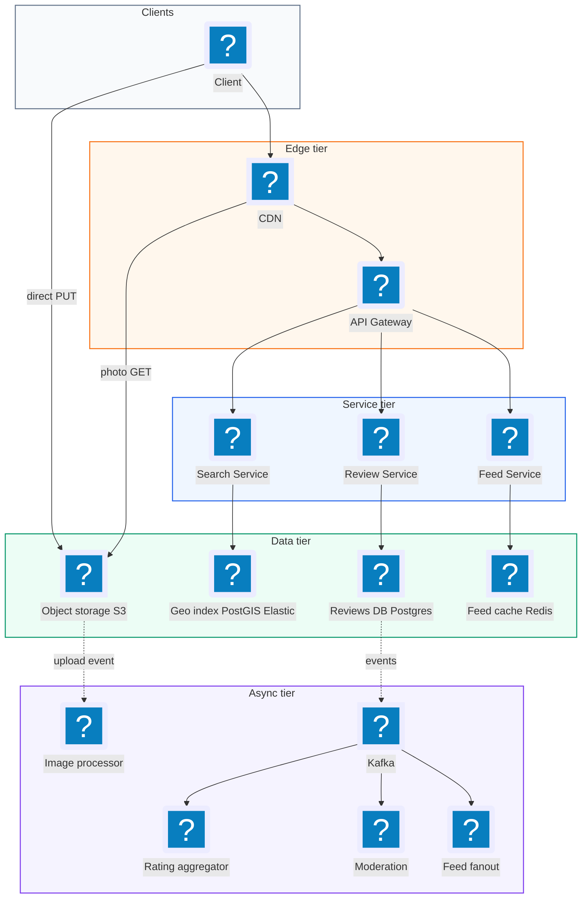
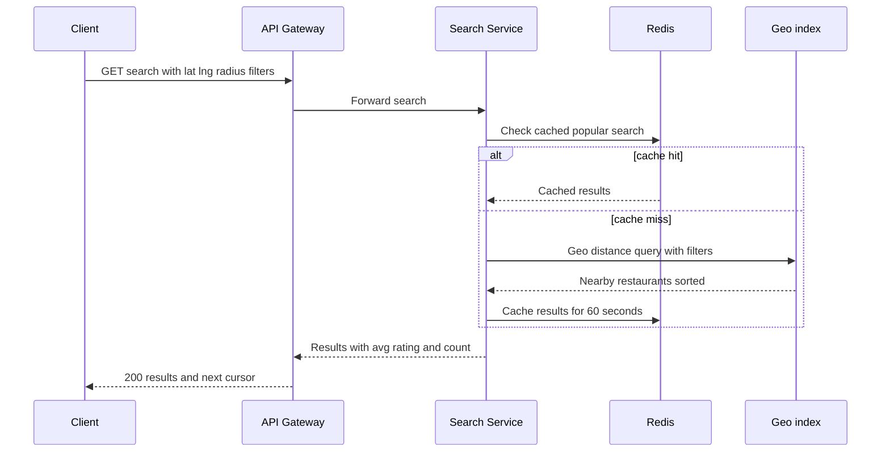
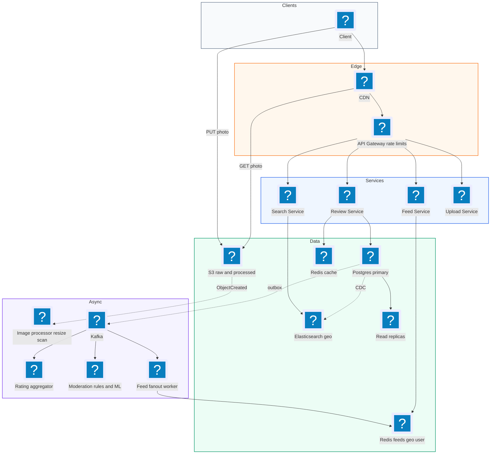

# 33. Food Review App  (Medium)

> A food review app lets people find restaurants near them, read what others thought, and post their own review with a star rating and photos. Think of a slimmer Yelp or Zomato focused on food. The interviewer wants to see three things: that you can store reviews and large photos without pushing image bytes through your own servers, that you can keep a restaurant's average rating correct while many reviews arrive at once, and that you can answer "good ramen within 2 km of me" quickly using a geo index. Moderation and the "one review per user per restaurant" rule are classic correctness follow-ups.

## 1. Functional requirements

Core (must have):

1. Users can search for restaurants near a location, filtered by cuisine and sorted by distance or rating.
2. Users can view a restaurant page: details, average rating, review count, photos, and reviews.
3. Users can post a review with a 1 to 5 star rating, text, and up to 10 photos.
4. Each user can have at most one review per restaurant (they can edit it).
5. Users can see a feed of recent reviews (near them, or from people they follow).
6. Reviews and photos are moderated (spam, offensive content, fake reviews) before or shortly after they go live.

Below the line (out of scope):

- Table booking and food delivery. Separate products with their own hard problems (payments, real-time tracking).
- Restaurant owner dashboards and ads. Business features, not core to reviews.
- Personalized recommendations with machine learning. We mention ranking but do not design the model.
- Direct messaging between users.

## 2. Non-functional requirements

1. **Read-heavy:** reads outnumber writes about 100:1. Optimize the read path with caching.
2. **Search latency:** p99 under 300 ms for a nearby search.
3. **Restaurant page latency:** p99 under 200 ms (cached).
4. **Review post latency:** under 1 s to accept the review. Photos upload directly to object storage, so they do not count against this.
5. **Availability:** 99.9% for writes, 99.99% for reads. Users browsing are more common than users posting.
6. **Consistency:** eventual consistency for search results, feeds, and average ratings (a few seconds of lag is fine). Strong consistency for the "one review per user per restaurant" rule, which must never be broken.
7. **Durability:** photos and reviews must never be lost (object storage with 11 nines durability, replicated DB).
8. **CAP choice:** for browsing and search we choose **availability (AP)**, since a slightly stale rating does not hurt anyone. The uniqueness rule is enforced inside one database partition, so it stays strongly consistent.

## 3. Back-of-the-envelope estimates

| Assumption | Number |
|---|---|
| Restaurants | 10 million |
| Daily active users (DAU) | 20 million |
| Searches per DAU per day | 5 |
| Restaurant page views per DAU per day | 10 |
| New reviews per day | 1 million |
| Photos per review (average) | 2 |
| Average photo size (after compression) | 2 MB original, 200 KB for display sizes |
| Average review text | 1 KB |

```text
Read QPS:
  searches:   20M * 5  / 86,400 s = ~1,150/s   (peak x3 = ~3,500/s)
  page views: 20M * 10 / 86,400 s = ~2,300/s   (peak x3 = ~7,000/s)

Write QPS:
  reviews:    1M / 86,400 s       = ~12/s      (peak ~40/s)
  photos:     2M / 86,400 s       = ~23/s

Storage per year:
  review text: 1M/day * 1 KB * 365       = ~365 GB/year
  photos:      2M/day * (2 MB + 0.6 MB)  = ~5.2 TB/day
               5.2 TB * 365               = ~1.9 PB/year  (object storage)
  restaurants: 10M * 2 KB                 = ~20 GB (fits in one DB + index)

Bandwidth (photo reads dominate):
  page views 7,000/s * 10 thumbnails * 30 KB = ~2.1 GB/s at peak
  -> must be served by a CDN, not by our servers
```

Takeaways: writes are tiny, reads are moderate, photos are huge. That points at a CDN in front of object storage, presigned uploads, and caching for restaurant pages.

## 4. Core entities

- **User**: someone who browses and writes reviews. Fields: user_id, name, avatar_url, created_at, trust_score.
- **Restaurant**: a place that serves food. Fields: restaurant_id, name, lat, lng, geohash, cuisine, price_level, avg_rating, review_count.
- **Review**: one user's opinion of one restaurant. Fields: review_id, restaurant_id, user_id, rating, text, status, created_at.
- **Photo**: an image attached to a review. Fields: photo_id, review_id, s3_key, status (PENDING, READY, REJECTED), width, height.
- **RatingAggregate**: running totals per restaurant. Fields: restaurant_id, rating_sum, rating_count, histogram (count per star).
- **Follow**: user A follows user B, used for the feed.
- **ModerationCase**: a review or photo flagged for checking. Fields: case_id, target_id, reason, decision.

```sql
CREATE TABLE restaurants (
  restaurant_id BIGINT PRIMARY KEY,
  name          TEXT NOT NULL,
  lat           DOUBLE PRECISION NOT NULL,
  lng           DOUBLE PRECISION NOT NULL,
  location      GEOGRAPHY(POINT) NOT NULL,   -- PostGIS
  cuisine       TEXT,
  price_level   SMALLINT,
  rating_sum    BIGINT NOT NULL DEFAULT 0,
  rating_count  INT NOT NULL DEFAULT 0
);
CREATE INDEX idx_rest_loc ON restaurants USING GIST (location);

CREATE TABLE reviews (
  review_id     BIGINT PRIMARY KEY,
  restaurant_id BIGINT NOT NULL REFERENCES restaurants,
  user_id       BIGINT NOT NULL,
  rating        SMALLINT NOT NULL CHECK (rating BETWEEN 1 AND 5),
  body          TEXT,
  status        VARCHAR(16) NOT NULL DEFAULT 'PENDING',
  created_at    TIMESTAMP NOT NULL DEFAULT now(),
  updated_at    TIMESTAMP NOT NULL DEFAULT now(),
  UNIQUE (restaurant_id, user_id)          -- one review per user per place
);
CREATE INDEX idx_reviews_rest_time ON reviews (restaurant_id, created_at DESC);

CREATE TABLE photos (
  photo_id   BIGINT PRIMARY KEY,
  review_id  BIGINT NOT NULL REFERENCES reviews,
  s3_key     TEXT NOT NULL,
  status     VARCHAR(16) NOT NULL DEFAULT 'PENDING'
);
```

Storing `rating_sum` and `rating_count` (not the average itself) is deliberate. You can always compute the average as `sum / count`, and adding or removing a review is just a plus or minus on two numbers.

## 5. API design

All write endpoints require a logged-in user (bearer token). Read endpoints are public.

`GET /restaurants/search?lat=..&lng=..&radiusKm=2&cuisine=ramen&sort=rating&cursor=..` -- find nearby restaurants.

```json
// response 200
{ "results": [
    { "id": 81, "name": "Ichiran", "distanceM": 420,
      "avgRating": 4.6, "reviewCount": 1832, "thumbUrl": "https://cdn/.../t.jpg" }
  ],
  "nextCursor": "eyJvZmZzZXQiOjIwfQ" }
```

`GET /restaurants/{id}` -- restaurant details plus rating summary.

```json
{ "id": 81, "name": "Ichiran", "cuisine": "ramen",
  "avgRating": 4.6, "reviewCount": 1832,
  "histogram": {"5": 1200, "4": 400, "3": 150, "2": 50, "1": 32} }
```

`GET /restaurants/{id}/reviews?sort=recent&cursor=..` -- paginated reviews.

`POST /uploads/photos` -- get presigned URLs for photo upload.

```json
// request
{ "count": 2, "contentTypes": ["image/jpeg", "image/jpeg"] }
// response 200
{ "uploads": [
    { "photoId": 9001, "url": "https://s3/...&X-Amz-Signature=...", "expiresInSec": 900 },
    { "photoId": 9002, "url": "https://s3/...", "expiresInSec": 900 } ] }
```

`POST /restaurants/{id}/reviews` -- create a review. Header `Idempotency-Key`.

```json
// request
{ "rating": 5, "text": "Rich broth, fast service.", "photoIds": [9001, 9002] }
// response 201
{ "reviewId": 5551, "status": "PENDING" }
```

Status codes: `201` created, `409` you already reviewed this restaurant (response includes your existing review id), `400` bad rating, `401` not logged in.

`PUT /reviews/{reviewId}` -- edit your own review (owner only, `403` otherwise).

`DELETE /reviews/{reviewId}` -- delete your own review.

`GET /feed?lat=..&lng=..&cursor=..` -- recent reviews near you or from people you follow.

`POST /reviews/{reviewId}/reports` -- report a review for moderation.

## 6. High-level design



### How will users find restaurants near them?

1. The client sends `GET /restaurants/search` with its latitude, longitude, radius and filters.
2. The Search Service runs a geo query on the geo index (Elasticsearch `geo_distance`, or PostGIS `ST_DWithin`).
3. It applies filters (cuisine, price) and sorts by distance or by a mix of rating and distance.
4. Results include the cached `avgRating` and `reviewCount`, so no join to the reviews table is needed.
5. Popular searches (for example "downtown, pizza") are cached in Redis for 60 seconds.



### How will users view a restaurant and its reviews?

1. The client calls `GET /restaurants/81`. The Review Service checks Redis first (`restaurant:81`, TTL 5 min).
2. On a miss it reads the restaurant row (with `rating_sum`, `rating_count`, histogram) and caches it.
3. `GET /restaurants/81/reviews?sort=recent` reads from the `(restaurant_id, created_at DESC)` index, 20 at a time with a cursor.
4. Photo URLs point to the CDN, so images load straight from the edge.

### How will users post a review with photos?

1. The client asks `POST /uploads/photos` for 2 presigned URLs. The server creates PENDING photo rows and returns signed S3 URLs.
2. The client uploads each photo straight to S3 with an HTTP PUT. Our servers never touch the bytes.
3. The client sends `POST /restaurants/81/reviews` with rating, text, and the photo ids.
4. The Review Service inserts the review. The unique constraint `(restaurant_id, user_id)` rejects a second review.
5. It publishes a `ReviewCreated` event to Kafka.
6. Consumers update the rating aggregate, run moderation, and push the review into feeds.

### How will users see a feed of recent reviews?

1. The client calls `GET /feed`. The Feed Service reads a precomputed list of review ids from Redis for the user's area (geohash cell) and from people they follow.
2. It hydrates the ids into full reviews from a cache, then returns them newest first.

## 7. Deep dives

### How do we handle photo uploads without overloading our servers?

At 2 MB per photo and 2 million photos per day, piping uploads through our API servers would waste bandwidth and tie up threads for seconds per request on slow mobile networks.

| Option | How | Pros | Cons |
|---|---|---|---|
| Upload through API server | Client sends bytes to us, we forward to S3 | Simple, full control | Servers become a bandwidth bottleneck, slow uploads hold connections |
| Presigned URL direct to S3 | Server signs a short-lived URL, client PUTs to S3 | No bytes through our servers, scales with S3 | Need a callback to know upload finished |
| Multipart presigned upload | Same, but file split into parts | Resumable for huge files | Overkill for 2 MB photos |

Recommended: **presigned PUT URLs**, then process asynchronously.

```python
import boto3, uuid
s3 = boto3.client("s3")

def create_photo_uploads(user_id: int, count: int):
    uploads = []
    for _ in range(min(count, 10)):
        photo_id = id_gen.next()
        key = f"raw/{user_id}/{photo_id}.jpg"
        url = s3.generate_presigned_url(
            "put_object",
            Params={"Bucket": "food-photos", "Key": key,
                    "ContentType": "image/jpeg"},
            ExpiresIn=900)                       # 15 minutes
        db.execute("INSERT INTO photos (photo_id, review_id, s3_key, status) "
                   "VALUES (%s, NULL, %s, 'PENDING')", (photo_id, key))
        uploads.append({"photoId": photo_id, "url": url})
    return uploads
```

After the upload, S3 sends an event (`ObjectCreated`) to a queue. An image processor worker:

1. Checks the file is really an image and under the size limit (10 MB).
2. Strips EXIF metadata (it can contain the uploader's home GPS location).
3. Creates thumbnail (150 px), medium (600 px) and large (1200 px) versions.
4. Runs an image moderation model (nudity, violence).
5. Marks the photo READY or REJECTED.

Orphan cleanup: photos still PENDING after 24 hours with no review attached are deleted by a nightly job.

### How do we keep the average rating correct and fast to read?

Restaurant pages show "4.6 stars from 1,832 reviews". Computing `AVG(rating)` over all reviews on every page view is too slow for popular places. But a naive "read average, compute new average, write back" loses updates when two reviews arrive at the same moment.

| Option | How | Pros | Cons |
|---|---|---|---|
| Compute on read | `SELECT AVG(rating) FROM reviews WHERE restaurant_id=?` | Always exact | Slow for big restaurants, heavy on DB |
| Read-modify-write the average | Read avg, recompute, write | Simple | Race conditions lose updates |
| Atomic increment of sum and count | `UPDATE ... SET sum = sum + r, count = count + 1` | Exact, fast, no race | Hot row for very popular places |
| Async aggregation via events | Consumer batches events and applies deltas | Absorbs bursts, decoupled | Seconds of lag (fine here) |

Recommended: **async consumer applying atomic deltas.** Each event carries the change, so creates, edits, and deletes are all handled the same way.

```python
def on_review_event(evt):
    # evt: {"type": "CREATED"|"UPDATED"|"DELETED", "restaurantId": 81,
    #       "old": 3 or None, "new": 5 or None, "eventId": "..."}
    if already_processed(evt["eventId"]):        # dedupe, Kafka is at-least-once
        return
    d_sum   = (evt["new"] or 0) - (evt["old"] or 0)
    d_count = (1 if evt["new"] else 0) - (1 if evt["old"] else 0)
    db.execute("""
        UPDATE restaurants
           SET rating_sum   = rating_sum + %s,
               rating_count = rating_count + %s
         WHERE restaurant_id = %s""",
        (d_sum, d_count, evt["restaurantId"]))
    redis.delete(f"restaurant:{evt['restaurantId']}")   # invalidate cache
    mark_processed(evt["eventId"])
```

Example edit: a user changes 3 stars to 5 stars. The delta is `sum + 2, count + 0`. A delete of a 4-star review is `sum - 4, count - 1`.

A nightly job recomputes `SUM` and `COUNT` from the reviews table and fixes any drift. Only approved reviews count, so moderation decisions also emit events.

Bonus: raw average favors places with 2 five-star reviews. For sorting, use a Bayesian average that pulls small samples toward the global mean:

```python
def bayesian_avg(sum_, count, global_mean=3.8, prior_weight=20):
    return (sum_ + global_mean * prior_weight) / (count + prior_weight)
```

### How do we find nearby restaurants quickly?

A plain SQL `WHERE lat BETWEEN .. AND lng BETWEEN ..` with two separate B-tree indexes is slow, because the database can only use one index well at a time.

| Option | How | Pros | Cons |
|---|---|---|---|
| Geohash prefix | Encode lat/lng into a string; nearby places share prefixes | Works on any key-value store, easy to shard | Edge effects at cell borders, need to query 9 neighbor cells |
| Quadtree | Split the map into cells until each has under N places | Adapts to density (cities vs deserts) | Custom in-memory structure to maintain |
| PostGIS (R-tree / GiST index) | Native spatial index in Postgres | Exact distance, SQL filters, easy | One DB can become a bottleneck for very high QPS |
| Elasticsearch geo queries | `geo_distance` filter + text and filters | Combines geo, text search, ranking | Another system to run, eventually consistent |

Recommended: **Elasticsearch** (or OpenSearch) for search, because users also type text ("spicy ramen") and filter by cuisine. 10 million restaurants is small for Elasticsearch. Postgres stays the source of truth, and changes stream into Elasticsearch through change data capture (CDC).

```json
POST /restaurants/_search
{
  "query": {
    "bool": {
      "must":   [{ "match": { "cuisine": "ramen" } }],
      "filter": [{ "geo_distance": {
                     "distance": "2km",
                     "location": { "lat": 37.776, "lon": -122.417 } } }]
    }
  },
  "sort": [
    { "_geo_distance": { "location": { "lat": 37.776, "lon": -122.417 },
                          "order": "asc", "unit": "m" } }
  ],
  "size": 20
}
```

If the interviewer pushes for no Elasticsearch, explain geohash: precision 6 gives cells of about 1.2 km by 0.6 km. Compute the user's cell plus its 8 neighbors and look up all restaurants in those 9 cells, then filter by exact distance.

```python
import pygeohash as pgh
cell = pgh.encode(37.776, -122.417, precision=6)   # e.g. '9q8yyk'
cells = [cell] + neighbors(cell)                     # 9 cells total
candidates = db.query("SELECT * FROM restaurants WHERE geohash6 = ANY(%s)", (cells,))
```

### How do we build a feed of recent reviews?

Two flavors: "recent reviews near me" and "reviews from people I follow". A review is written about 12 times a second, so writes are rare and reads are frequent.

| Option | How | Pros | Cons |
|---|---|---|---|
| Pull (fan-out on read) | At read time, query reviews by followed users / nearby cells | No extra storage, always fresh | Slow for users who follow many people |
| Push (fan-out on write) | On new review, append id to each follower's feed list | Very fast reads | Heavy writes for users with millions of followers |
| Hybrid | Push for normal users, pull for "celebrity" food critics | Balanced | More logic |

Recommended: **hybrid**, plus a per-geohash list for "nearby".

```python
def on_review_approved(review):
    # nearby feed: one capped list per geohash-5 cell (~5 km)
    cell = review.restaurant_geohash[:5]
    redis.lpush(f"feed:geo:{cell}", review.id)
    redis.ltrim(f"feed:geo:{cell}", 0, 499)       # keep latest 500

    author = users.get(review.user_id)
    if author.follower_count < 10_000:             # push for normal users
        for follower_id in followers_of(author.id):
            redis.lpush(f"feed:user:{follower_id}", review.id)
            redis.ltrim(f"feed:user:{follower_id}", 0, 499)
    # big critics: their reviews are merged in at read time (pull)
```

Only approved reviews enter feeds, so moderation must finish first (usually a second or two for automatic checks).

### How do we enforce one review per user and moderate content?

Two correctness problems. First, a user double-taps Post, or two devices post at once, and we end up with two reviews. Second, spam, fake reviews, and offensive photos.

For uniqueness:

| Option | How | Pros | Cons |
|---|---|---|---|
| Check then insert in app code | `SELECT` exists, then `INSERT` | Simple | Race: two requests both see "no review" |
| DB unique constraint | `UNIQUE (restaurant_id, user_id)` | Bulletproof, atomic | Need to handle the error nicely |
| Distributed lock | Lock on `user:restaurant` key | Works across stores | More moving parts, locks can leak |

Recommended: **unique constraint**, and map the error to `409` with the existing review id so the client can switch to edit mode.

```sql
INSERT INTO reviews (review_id, restaurant_id, user_id, rating, body)
VALUES ($1, $2, $3, $4, $5)
ON CONFLICT (restaurant_id, user_id) DO NOTHING
RETURNING review_id;
-- no row returned -> 409 Conflict
```

If reviews are sharded, shard by `restaurant_id` so the constraint lives on one shard.

For moderation, use a layered pipeline:

```text
 ReviewCreated --> [1. rules: banned words, links, rate limits]
               --> [2. ML: spam, toxicity, fake-review score]
               --> score < 0.3 : APPROVED (live)
                   score > 0.8 : REJECTED
                   otherwise   : human review queue
```

Signals for fake reviews: brand-new account, many 5-star reviews in a short time, reviews from far away from the user's usual area, many reviews from the same device or IP. Rate limit posting to, say, 10 reviews per user per day. Only APPROVED reviews count toward the rating aggregate and appear in feeds.

### How does it scale and survive failures?

- **Reads:** cache restaurant pages and review first pages in Redis (hit rate around 90%). Add Postgres read replicas.
- **Writes:** 40 writes per second at peak fits one Postgres primary easily. Shard by `restaurant_id` only if growth requires it.
- **Photos:** S3 plus CDN scales on its own.
- **Kafka consumer down:** events wait in Kafka; ratings and feeds catch up when it returns. The nightly recompute fixes drift.
- **Elasticsearch down:** fall back to a PostGIS query with a smaller page size.
- **Region outage:** replicate Postgres to a second region and serve reads from there; writes pause or fail over.

## 8. Final architecture



| Component | Job | Technology example |
|---|---|---|
| CDN | Serve photos and static assets | CloudFront, Fastly |
| API Gateway | Auth, rate limit, routing | Envoy, AWS API Gateway |
| Upload Service | Issue presigned URLs | Small stateless service + AWS SDK |
| Object storage | Store original and resized photos | S3, GCS |
| Image processor | Resize, strip EXIF, scan | Lambda or worker pool with libvips |
| Review Service | CRUD for reviews, uniqueness | Java/Go service |
| Postgres | Source of truth for restaurants and reviews | Postgres / Aurora + PostGIS |
| Search Service + index | Geo + text search | Elasticsearch / OpenSearch |
| Kafka | Events for rating, moderation, feeds | Kafka, Kinesis |
| Rating aggregator | Apply rating deltas | Kafka consumer |
| Moderation | Rules, ML, human queue | Rules engine + ML model + review tool |
| Redis | Page cache, feed lists | Redis / ElastiCache |

### Deployment map (AWS)

```mermaid
architecture-beta
    group internet(mdi:earth)[Internet]
    group edge(logos:aws-cloudfront)[Edge]
    group vpc(logos:aws-vpc)[AWS VPC]
    group app(logos:aws-ecs)[Service subnet] in vpc
    group data(logos:aws-rds)[Data subnet] in vpc

    service client(mdi:cellphone)[Client] in internet
    service cdn(logos:aws-cloudfront)[CDN] in edge
    service gw(logos:aws-api-gateway)[API Gateway rate limits] in edge
    service search(logos:aws-ecs)[Search Service] in app
    service review(logos:aws-ecs)[Review Service] in app
    service imgproc(logos:aws-lambda)[Image processor resize scan] in app
    service photos(logos:aws-s3)[S3 raw and processed] in data
    service es(logos:aws-opensearch)[Elasticsearch geo] in data
    service pg(logos:aws-rds)[Postgres primary] in data
    service kafka(logos:kafka-icon)[Kafka] in data

    client:R --> L:cdn
    cdn:R --> L:gw
    cdn:R --> L:photos
    gw:R --> L:search
    gw:R --> L:review
    search:B --> T:es
    review:B --> T:pg
    pg:R --> L:es
    pg:R --> L:kafka
    photos:T --> B:imgproc
```



The CDN serves photos straight from S3 while API calls pass the gateway to the search and review services, and Postgres in the data subnet feeds both the geo index and Kafka.

## 9. Common mistakes and interviewer follow-ups

- **Mistake: uploading photos through the API server.** It wastes bandwidth and slows everyone. Say instead: "Presigned URLs, direct to S3, async processing."
- **Mistake: storing only the average rating.** You cannot update it correctly on edits or deletes. Say instead: "Store sum and count, apply deltas atomically."
- **Mistake: computing `AVG()` on every page view.** It does not scale for popular restaurants. Say instead: "Precomputed aggregate, cached, refreshed by events."
- **Mistake: checking for an existing review in code, then inserting.** Race conditions create duplicates. Say instead: "A unique constraint on (restaurant_id, user_id) is the real guard."
- **Mistake: using two plain lat/lng indexes for nearby search.** Slow scans. Say instead: "A real geo index: geohash, quadtree, PostGIS GiST, or Elasticsearch."
- **Mistake: forgetting EXIF data.** Photos can leak a user's home location. Say instead: "Strip metadata during processing."
- **Follow-up: "How do you rank reviews on a restaurant page?"** Mix recency, helpful votes, reviewer trust score, and whether it has photos. Precompute a score per review.
- **Follow-up: "How do you handle a restaurant that gets 10,000 reviews in an hour after going viral?"** The async aggregator batches deltas per restaurant, so it is one update per batch instead of 10,000 row updates.

## 10. One-page cheat sheet

| Topic | Key point |
|---|---|
| Scale | 20M DAU, ~7k reads/s peak, ~40 review writes/s, ~2 PB photos/year |
| Photos | Presigned PUT to S3, async resize + EXIF strip + scan, served via CDN |
| Rating | Store `rating_sum` and `rating_count`; atomic deltas from Kafka events |
| Ranking | Bayesian average to avoid "2 reviews, 5 stars" winning |
| Geo search | Elasticsearch `geo_distance`; geohash-6 + 9 cells as a fallback |
| Uniqueness | `UNIQUE (restaurant_id, user_id)`, return 409 with existing id |
| Feed | Hybrid fan-out; per-geohash capped Redis lists for "nearby" |
| Moderation | Rules -> ML score -> human queue; only approved reviews count |
| Caching | Restaurant page + first review page in Redis, invalidate on event |
| CAP | AP for browsing and ratings, strong for uniqueness |

## Sources

- [System Design School: Design Yelp](https://systemdesignschool.io/problems/yelp/solution)
- [Hello Interview: Design Yelp](https://www.hellointerview.com/learn/system-design/problem-breakdowns/yelp)
- [AlgoMaster: Designing a Proximity Service like Yelp](https://blog.algomaster.io/p/designing-proximity-service-like-yelp)
- [EnjoyAlgorithms: Design Yelp](https://www.enjoyalgorithms.com/blog/design-yelp/)
- [AWS Docs: Uploading objects with presigned URLs](https://docs.aws.amazon.com/AmazonS3/latest/userguide/PresignedUrlUploadObject.html)
- [Elasticsearch Docs: Geo-distance query](https://www.elastic.co/guide/en/elasticsearch/reference/current/query-dsl-geo-distance-query.html)
