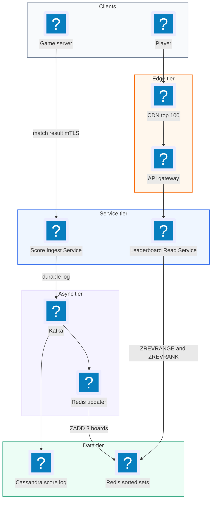
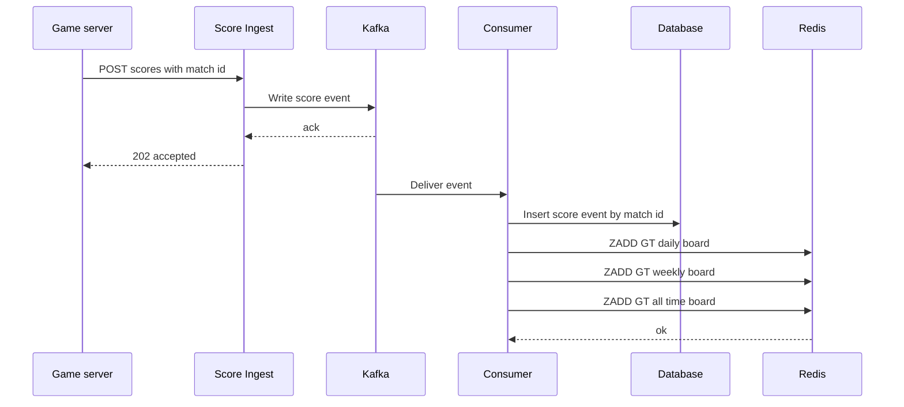
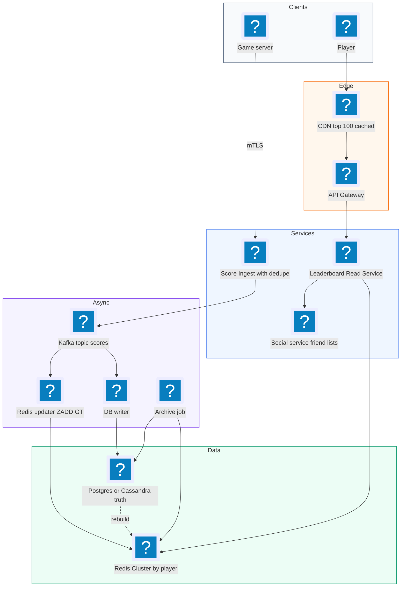

# 34. Game Leaderboard  (Medium)

> A game leaderboard shows players ranked by score. Players want to see the top 10 in the world, their own rank ("you are #48,213"), the players just above and below them, and how they compare with friends. Boards usually come in daily, weekly and all-time versions. This question has been asked at Google. The interviewer is testing whether you know the right data structure (a sorted set, usually Redis), whether you can explain why a SQL `ORDER BY` with `COUNT(*)` does not work at scale, how you shard when one sorted set gets too big, how you handle ties and time windows, and how you recover if the in-memory store is lost.

## 1. Functional requirements

Core (must have):

1. A game server can submit a player's score after a match.
2. Players can see the top N players (for example top 100) of a board.
3. Players can see their own rank and score.
4. Players can see the players around them (5 above and 5 below).
5. There are daily, weekly and all-time boards.
6. Players can see a leaderboard of just their friends.

Below the line (out of scope):

- Anti-cheat and score validation logic. We assume the game server is trusted and already validated the match. We mention it but do not design it.
- Matchmaking and the game itself.
- Regional boards per country. Same design with a different key, so we only note it.
- Rewards and prizes at the end of a season.

## 2. Non-functional requirements

1. **Scale:** 50 million total players, 10 million daily active users (DAU).
2. **Fresh:** a submitted score shows up on the board within 1 to 2 seconds.
3. **Low latency:** p99 under 50 ms for "top 100" and "my rank".
4. **Write throughput:** handle at least 5,000 score updates per second at peak.
5. **Availability:** 99.99% for reads. If the leaderboard is down the game still works, but players notice.
6. **Durability:** no score is lost. Redis is fast but in memory, so we need a durable record somewhere.
7. **Consistency:** eventual consistency is fine for ranks (a rank that is 1 second old is OK). The stored score per player must be correct (no lost updates).
8. **CAP choice:** **availability (AP)**. Showing a slightly stale rank is far better than showing an error.

## 3. Back-of-the-envelope estimates

| Assumption | Number |
|---|---|
| Total players | 50 million |
| DAU | 10 million |
| Matches per DAU per day | 10 |
| Leaderboard views per DAU per day | 10 |
| Peak to average ratio | 5x |
| Bytes per sorted set entry (member + score + overhead) | about 100 bytes |
| Boards kept in memory | all-time, current week, current day (plus a few old ones) |

```text
Writes (score submissions):
  10M * 10 matches / 86,400 s = ~1,160/s average
  peak 5x                      = ~5,800/s
  each submission updates 3 boards (daily, weekly, all-time) -> ~17,400 ZADDs/s

Reads (leaderboard views):
  10M * 10 / 86,400 s          = ~1,160/s average
  peak 5x                      = ~5,800/s
  each view = top-N + my-rank  -> ~12,000 Redis ops/s

Memory:
  all-time board: 50M entries * 100 B = 5 GB
  weekly board:   ~20M players  * 100 B = 2 GB
  daily board:    10M players   * 100 B = 1 GB
  total hot data                        = ~8 GB  (fits on one large Redis node,
                                                  plus a replica)

Durable storage (score history):
  10M * 10 matches * 50 B per row = 5 GB/day -> ~1.8 TB/year
```

One Redis node can do around 100,000 simple ops per second, and `ZADD` on a 50 million entry set is O(log N), about 26 steps. So for this size a single primary with replicas is enough. Sharding becomes necessary at roughly 10x this size, or for a game with hundreds of millions of players.

## 4. Core entities

- **Player**: a user of the game. Fields: player_id, display_name, avatar_url, country.
- **Match**: one finished game. Fields: match_id, player_id, score, played_at.
- **Leaderboard**: a named board with a time window. Fields: board_id, game_id, window (DAILY, WEEKLY, ALL_TIME), period key (for example `2026-11-05` or `2026-W45`).
- **LeaderboardEntry**: a player's score on one board. Lives in Redis as a member of a sorted set. Fields: player_id, score.
- **Friendship**: player A is friends with player B.
- **ScoreEvent**: the durable log of every submitted score, used to rebuild boards.

```sql
CREATE TABLE score_events (
  event_id    UUID PRIMARY KEY,          -- idempotency, one row per match
  player_id   BIGINT NOT NULL,
  game_id     INT NOT NULL,
  score       BIGINT NOT NULL,
  played_at   TIMESTAMP NOT NULL
);
CREATE INDEX idx_score_events_time ON score_events (game_id, played_at);

CREATE TABLE player_best (
  game_id     INT NOT NULL,
  player_id   BIGINT NOT NULL,
  best_score  BIGINT NOT NULL,
  achieved_at TIMESTAMP NOT NULL,
  PRIMARY KEY (game_id, player_id)
);
```

```text
Redis keys:
  lb:{game}:all                -> sorted set  member=player_id score=best
  lb:{game}:week:2026-W45      -> sorted set  (TTL 30 days)
  lb:{game}:day:2026-11-05     -> sorted set  (TTL 7 days)
  player:{id}                  -> hash  name, avatar  (kept out of the set)
```

## 5. API design

Score submission is called by trusted game servers (service-to-service auth like mTLS or a signed token), never directly by the client, so players cannot post fake scores.

`POST /games/{gameId}/scores` -- submit the result of a match.

```json
// request
{ "matchId": "m_7f3a", "playerId": 1234, "score": 98200,
  "playedAt": "2026-11-05T18:02:11Z" }
// response 202
{ "accepted": true }
```

Status codes: `202` accepted, `200` duplicate match id (already processed), `400` invalid, `401` caller is not a game server.

`GET /games/{gameId}/leaderboards/{window}?limit=100&offset=0` -- top N of a board. `window` is `daily`, `weekly` or `alltime`.

```json
// response 200
{ "window": "weekly", "period": "2026-W45",
  "entries": [
    { "rank": 1, "playerId": 88, "name": "Kai", "score": 151000 },
    { "rank": 2, "playerId": 12, "name": "Mira", "score": 149800 } ] }
```

`GET /games/{gameId}/leaderboards/{window}/players/{playerId}` -- one player's rank.

```json
{ "rank": 48213, "score": 98200, "percentile": 99.03 }
```

`GET /games/{gameId}/leaderboards/{window}/players/{playerId}/around?count=5` -- players around you.

`GET /games/{gameId}/leaderboards/{window}/friends?playerId=1234` -- friends-only board.

Read endpoints need a logged-in player. Public "top 100" can be cached at a CDN for a few seconds.

## 6. High-level design



### How will a score get onto the board?

1. The game server sends `POST /scores` with a unique `matchId`.
2. The Score Ingest Service writes the event to Kafka (durable log) first.
3. A consumer stores the event in the database (the source of truth) and updates Redis.
4. For each board (daily, weekly, all-time) it runs `ZADD` with the `GT` flag, so the stored score only goes up if the new one is higher (for "best score" games).
5. Within about a second, the new score is visible.



### How will players see the top 100?

1. The client calls `GET /leaderboards/weekly?limit=100`.
2. The Read Service runs `ZREVRANGE lb:{g}:week:2026-W45 0 99 WITHSCORES` on a Redis replica.
3. It looks up names and avatars for those 100 ids with one pipelined `HMGET` batch (or a local cache).
4. The response is cached for 2 to 5 seconds, because thousands of players ask for the same top 100.

### How will a player see their own rank?

1. The client calls `GET /leaderboards/weekly/players/1234`.
2. The Read Service runs `ZREVRANK` (0-based rank from the top) and `ZSCORE`.
3. It adds 1 to the rank and returns it. Both calls are O(log N), well under a millisecond.

### How will a player see the players around them?

1. Get the player's rank `r` with `ZREVRANK`.
2. Run `ZREVRANGE key max(0, r-5) r+5 WITHSCORES`.
3. Hydrate names and return 11 rows with the player in the middle.

### How will a player see their friends' board?

1. Load the friend list (say 200 ids) from the social service.
2. Fetch each friend's score with `ZMSCORE` in one call, sort in the service, return. Details in the deep dive.

## 7. Deep dives

### Why a sorted set, and what does the code look like?

The naive SQL design is one `scores` table and:

```sql
-- top 100: fine with an index on score
SELECT player_id, score FROM scores ORDER BY score DESC LIMIT 100;

-- my rank: this is the problem
SELECT COUNT(*) + 1 FROM scores WHERE score > (SELECT score FROM scores
                                               WHERE player_id = 1234);
```

The rank query has to count every row above you. For a player in the middle of 50 million rows, that is 25 million index entries scanned per request. At thousands of requests per second the DB collapses.

| Option | Top N | My rank | Updates | Notes |
|---|---|---|---|---|
| SQL table + index | Fast | O(N) count, slow | Fast | Fine under ~1M players |
| Redis sorted set | O(log N + M) | O(log N) | O(log N) | Skip list + hash map, in memory |
| Precomputed ranks (batch job) | Fast | Fast | Stale by minutes | Good for huge boards, not live |

Recommended: **Redis sorted set.** It is a skip list (a sorted linked list with "express lanes" so you can jump ahead) plus a hash map from member to score. Each skip list node also stores span counts, which is why Redis can tell you a rank without counting every member.

```python
import redis
r = redis.Redis(host="lb-redis", decode_responses=True)

def board_keys(game, ts):
    day  = ts.strftime("%Y-%m-%d")
    week = ts.strftime("%G-W%V")              # ISO week, e.g. 2026-W45
    return [f"lb:{game}:all", f"lb:{game}:week:{week}", f"lb:{game}:day:{day}"]

def submit_score(game, player_id, score, ts):
    pipe = r.pipeline()
    for key in board_keys(game, ts):
        pipe.zadd(key, {player_id: score}, gt=True)   # keep the best score
    pipe.expire(board_keys(game, ts)[1], 60 * 86400)  # weekly TTL
    pipe.expire(board_keys(game, ts)[2], 8 * 86400)   # daily TTL
    pipe.execute()

def top_n(key, n=100):
    return r.zrevrange(key, 0, n - 1, withscores=True)

def my_rank(key, player_id):
    rank = r.zrevrank(key, player_id)          # 0-based, None if absent
    if rank is None:
        return None
    return {"rank": rank + 1, "score": r.zscore(key, player_id)}

def around_me(key, player_id, k=5):
    rank = r.zrevrank(key, player_id)
    start = max(0, rank - k)
    return r.zrevrange(key, start, rank + k, withscores=True)
```

If the game sums points instead of keeping the best score, use `ZINCRBY key points player_id`. Both are atomic in Redis, so two concurrent updates never lose each other.

### How do we break ties?

Two players with 98,200 points. Redis sorts equal scores by member name (lexicographic), which is not fair. Most games say "whoever reached the score first ranks higher".

| Option | How | Pros | Cons |
|---|---|---|---|
| Accept Redis default | Ties ordered by player id string | Nothing to do | Arbitrary, players complain |
| Share the rank | Both are #5, next is #7 | Fair, simple to explain | Need extra query (`ZCOUNT` of higher scores) |
| Encode time into the score | score * 2^k + (MAX_TS - ts) | First to reach wins, one sorted set | Must fit in 53 bits of a double |

Recommended: **encode the time into the score.** Redis scores are 64-bit floats, which hold integers exactly up to 2^53 (about 9 * 10^15).

```python
MAX_TS = 2_000_000_000            # seconds, year 2033

def encode(score: int, ts_sec: int) -> int:
    # score up to ~4.5 million fits: 4.5e6 * 2e9 = 9e15 < 2^53
    return score * MAX_TS + (MAX_TS - ts_sec)   # earlier ts -> bigger tail

def decode(packed: int) -> int:
    return packed // MAX_TS
```

If scores are too large for this trick, use "shared rank": `rank = ZCOUNT(key, "(" + score, "+inf") + 1`, which counts players with a strictly higher score.

### How do we shard when one sorted set is too big?

A single sorted set lives on one Redis node. If the game has 500 million players (50 GB) or 200,000 writes per second, one node is not enough.

| Option | How | Top N | My rank | Cons |
|---|---|---|---|---|
| Shard by player id (hash) | Player goes to shard `hash(id) % K` | Merge top N from all K shards | Sum of ranks across all K shards | Rank needs K queries |
| Shard by score range | Shard 1: 0 to 1k, shard 2: 1k to 10k, ... | Read from top shard only | Rank in own shard + sizes of higher shards | Uneven shards, players move between shards |
| Exact top, approximate rank | Keep a small exact top 10k set; estimate others from a histogram | Exact | "Top 3%" | Not exact for most players |

Recommended for most games: **hash by player id with scatter-gather**, plus the approximate trick for players far from the top.

```python
SHARDS = [redis.Redis(host=f"lb-{i}") for i in range(16)]

def shard_for(player_id):
    return SHARDS[hash(player_id) % len(SHARDS)]

def global_top_n(key, n=100):
    # each shard returns its own top n; merge and keep the best n
    pipes = [s.zrevrange(key, 0, n - 1, withscores=True) for s in SHARDS]
    merged = sorted((e for part in pipes for e in part),
                    key=lambda x: x[1], reverse=True)
    return merged[:n]

def global_rank(key, player_id):
    score = shard_for(player_id).zscore(key, player_id)
    if score is None:
        return None
    higher = sum(s.zcount(key, f"({score}", "+inf") for s in SHARDS)
    return higher + 1
```

Each `ZCOUNT` is O(log N), and the 16 calls run in parallel, so rank lookup is still a few milliseconds. Cache the global top 100 for a couple of seconds so the merge does not run for every request.

The approximate trick: most players do not care whether they are #4,812,331 or #4,812,330. Keep a histogram of score buckets (for example count of players per 100-point bucket) and answer "you are in the top 9.6%". Only the top 10,000 get an exact number.

### How do we handle daily, weekly and all-time boards?

| Option | How | Pros | Cons |
|---|---|---|---|
| One set per period key | `lb:g:day:2026-11-05`, TTL to expire | Simple, reset is automatic (new key) | 3 writes per score |
| One set + filter by time | Store timestamps, filter at read | One write | Sorted set cannot filter by time; needs rebuild |
| Rebuild with `ZUNIONSTORE` | Weekly = union of 7 daily sets with `AGGREGATE MAX` | Fewer writes | Union of big sets is slow, must be run on schedule |

Recommended: **one sorted set per period**, written in the same pipeline. A new day simply means a new key name, so there is no "reset" job and no race at midnight. TTLs clean up old boards. Before a key expires, a job copies the final top 1,000 into the database as a permanent record ("last week's winners").

Time zones: pick one (UTC) for global boards and say so. Regional boards can use local time with a region in the key: `lb:g:day:IN:2026-11-05`.

### How do we build a friends leaderboard?

A player has maybe 50 to 500 friends. Keeping a separate sorted set per player would mean every score update writes to every friend's set (fan-out on write), which is expensive for players with many friends.

| Option | How | Pros | Cons |
|---|---|---|---|
| Fan-out on write | Update every friend's personal sorted set | Fast read | Write amplification, 500x writes |
| Fan-out on read with `ZMSCORE` | Fetch friends' scores from the global set, sort in app | No extra storage, always fresh | 1 call per read, fine for 500 friends |
| `ZINTERSTORE` with friend set | Intersect global board with a set of friend ids | Pure Redis | Creates temp keys, slower on big sets |

Recommended: **fan-out on read with `ZMSCORE`.** One round trip, 500 lookups at O(1) each.

```python
def friends_board(key, player_id, friend_ids):
    ids = list(friend_ids) + [player_id]
    scores = r.zmscore(key, ids)                 # list, None if no score
    rows = [(pid, s) for pid, s in zip(ids, scores) if s is not None]
    rows.sort(key=lambda x: x[1], reverse=True)
    return [{"rank": i + 1, "playerId": pid, "score": s}
            for i, (pid, s) in enumerate(rows)]
```

Cache the result for 10 seconds per player.

### How do we persist and recover if Redis is lost?

Redis is the fast view, not the source of truth. If a node dies and data is lost, we must rebuild.

| Option | How | Pros | Cons |
|---|---|---|---|
| Redis persistence only (RDB snapshots + AOF) | Redis writes to disk | Simple | Can lose last second; corrupted file means total loss |
| Durable event log + rebuild | Every score in Kafka and DB; replay to rebuild | Full recovery, audit trail | Rebuild of 50M entries takes minutes |
| Replicas + failover | Redis Sentinel or Cluster promotes a replica | Seconds of downtime | Async replication can lose a few writes |

Recommended: **all three.** Replicas for fast failover, AOF with `appendfsync everysec` to limit loss, and the database `player_best` table as the true record.

```sql
-- rebuild all-time board from the source of truth
SELECT player_id, best_score, achieved_at
FROM player_best
WHERE game_id = 7;
```

```python
def rebuild(game):
    tmp = f"lb:{game}:all:rebuild"
    for batch in db.stream("SELECT player_id, best_score FROM player_best "
                           "WHERE game_id=%s", (game,), batch_size=10_000):
        r.zadd(tmp, {row.player_id: row.best_score for row in batch})
    r.rename(tmp, f"lb:{game}:all")       # atomic swap, readers never see half
```

At 10,000 entries per pipelined batch and about 500,000 entries per second, 50 million rows take under 2 minutes. During that time the replica serves reads. Kafka consumers then replay any events newer than the snapshot. Because `ZADD GT` is idempotent (the same score twice does nothing), replay is safe.

Idempotency on ingest: the `matchId` is the primary key of `score_events`, so a retried submission is a no-op in the DB, and `ZADD GT` with the same score changes nothing in Redis.

## 8. Final architecture



| Component | Job | Technology example |
|---|---|---|
| Score Ingest | Authenticate game servers, dedupe, publish | Go/Java service |
| Kafka | Durable ordered log of scores | Kafka, Kinesis |
| Redis updater | Apply `ZADD GT` to all period boards | Kafka consumer |
| Redis Cluster | Sorted sets for live ranking | Redis, ElastiCache, MemoryDB |
| DB writer + DB | Source of truth, history, rebuild | Postgres, Cassandra, DynamoDB |
| Read Service | Top N, rank, around me, friends | Stateless service |
| CDN | Cache public top 100 | CloudFront |
| Archive job | Save final standings of each period | Scheduled job |

### Deployment map (AWS)

```mermaid
architecture-beta
    group internet(mdi:earth)[Internet]
    group edge(logos:aws-cloudfront)[Edge]
    group vpc(logos:aws-vpc)[AWS VPC]
    group app(logos:aws-ecs)[Service subnet] in vpc
    group data(logos:aws-rds)[Data subnet] in vpc

    service gameserver(mdi:laptop)[Game server] in internet
    service player(mdi:cellphone)[Player] in internet
    service cdn(logos:aws-cloudfront)[CDN top 100 cached] in edge
    service ingest(logos:aws-ecs)[Score Ingest with dedupe] in app
    service read(logos:aws-ecs)[Leaderboard Read Service] in app
    service updater(logos:aws-lambda)[Redis updater ZADD GT] in app
    service dbwriter(logos:aws-lambda)[DB writer] in app
    service kafka(logos:kafka-icon)[Kafka topic scores] in data
    service db(logos:aws-dynamodb)[Postgres or Cassandra truth] in data
    service redis(logos:aws-elasticache)[Redis Cluster by player] in data

    gameserver:R --> L:ingest
    player:R --> L:cdn
    cdn:R --> L:read
    ingest:B --> T:kafka
    kafka:T --> B:updater
    kafka:T --> B:dbwriter
    updater:B --> T:redis
    dbwriter:B --> T:db
    read:B --> T:redis
    db:R --> L:redis
```



Game servers write over mTLS straight into the ingest service and players read through the CDN, while Kafka, the source-of-truth database and the Redis sorted sets all sit in the data subnet.

## 9. Common mistakes and interviewer follow-ups

- **Mistake: `COUNT(*)` in SQL for rank.** It scans millions of rows per request. Say instead: "A sorted set gives rank in O(log N)."
- **Mistake: letting the client submit its own score.** Easy to cheat. Say instead: "Only the trusted game server submits, after validating the match."
- **Mistake: a nightly reset job for the daily board.** Race conditions at midnight and a window where the board is empty. Say instead: "A new key per period, old keys expire with a TTL."
- **Mistake: treating Redis as the only copy.** One bad failover loses everything. Say instead: "Kafka and a database are the truth; Redis can be rebuilt."
- **Mistake: ignoring ties.** Players notice and complain. Say instead: "Encode the timestamp in the score so whoever got there first ranks higher."
- **Mistake: sharding too early.** 50 million players is about 5 GB, which fits on one node. Say instead: "Start with one primary and replicas; shard by player id with scatter-gather when memory or write rate requires it."
- **Follow-up: "How would you show a percentile?"** `rank / ZCARD(key)`. With shards, sum `ZCARD` from each shard.
- **Follow-up: "What if 1 million players finish a tournament at the same second?"** Kafka absorbs the burst, the Redis updater batches `ZADD` calls with pipelining, and ranks catch up within seconds.

## 10. One-page cheat sheet

| Topic | Key point |
|---|---|
| Scale | 50M players, ~6k score submits/s peak, ~17k ZADD/s, ~8 GB in Redis |
| Data structure | Redis sorted set (skip list + hash), O(log N) for update and rank |
| Commands | `ZADD GT`, `ZINCRBY`, `ZREVRANGE`, `ZREVRANK`, `ZSCORE`, `ZMSCORE`, `ZCOUNT` |
| Time windows | One key per period (`day:2026-11-05`, `week:2026-W45`), TTL cleanup |
| Ties | Pack score and (MAX_TS - ts) into one 53-bit number |
| Sharding | Hash by player id; top N = merge of shard tops; rank = sum of ZCOUNT |
| Huge boards | Exact top 10k, approximate percentile for the rest |
| Friends | Fan-out on read with `ZMSCORE`, sort in app, cache 10 s |
| Durability | Kafka + DB as truth, Redis replicas + AOF, rebuild with atomic RENAME |
| Security | Scores only from game servers (mTLS), dedupe by match id |
| CAP | AP, stale-by-a-second ranks are fine |

## Sources

- [Redis Docs: Leaderboard use case](https://redis.io/docs/latest/develop/use-cases/leaderboard/)
- [Redis Tutorial: Real-time leaderboard with sorted sets](https://redis.io/tutorials/howtos/leaderboard/)
- [Hello Interview: Leaderboard / Top-K breakdowns](https://www.hellointerview.com/learn/system-design/problem-breakdowns/top-k)
- [DEV: Design a Live Leaderboard for 50M Players](https://dev.to/gabrielanhaia/design-a-live-leaderboard-for-50m-players-sorted-sets-rank-queries-sharded-tops-mbe)
- [System Design Academy: Real-Time Leaderboard with Redis Sorted Sets](https://systemdesignacademy.hashnode.dev/designing-a-real-time-leaderboard-with-redis-sorted-sets)
- [OneUptime: How to Use Redis for Gaming Leaderboards](https://oneuptime.com/blog/post/2026-01-21-redis-gaming-leaderboards/view)
