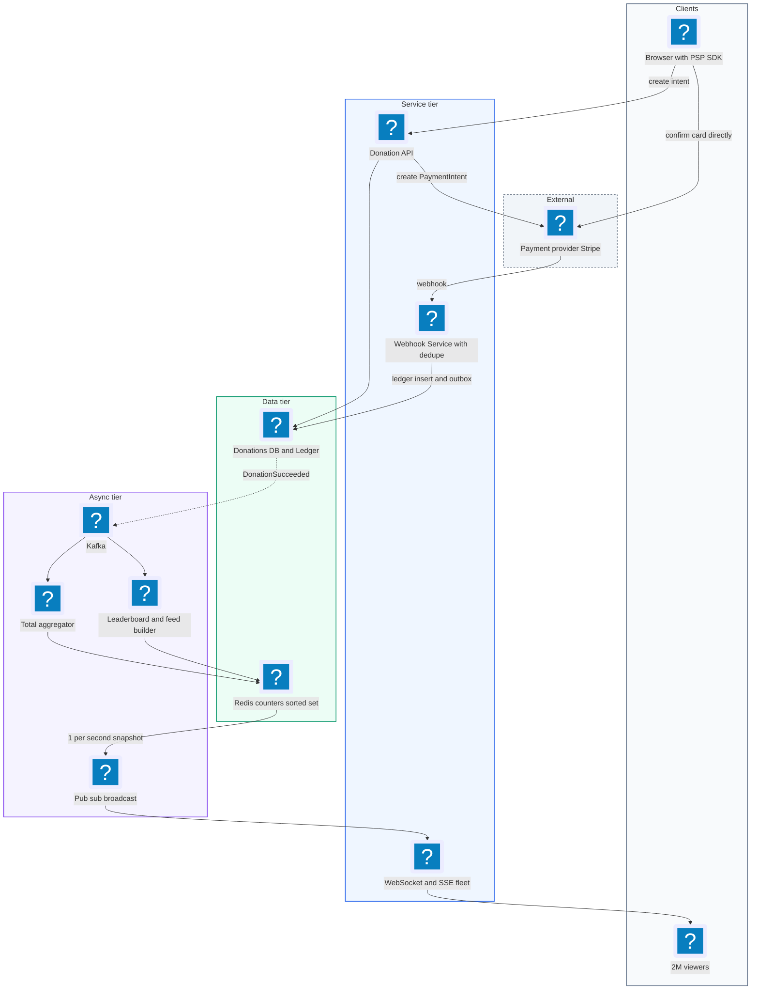
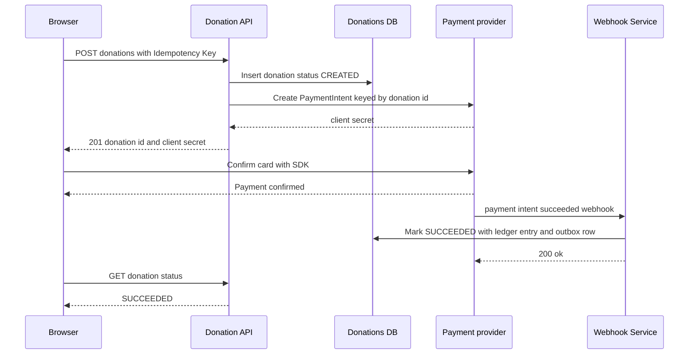
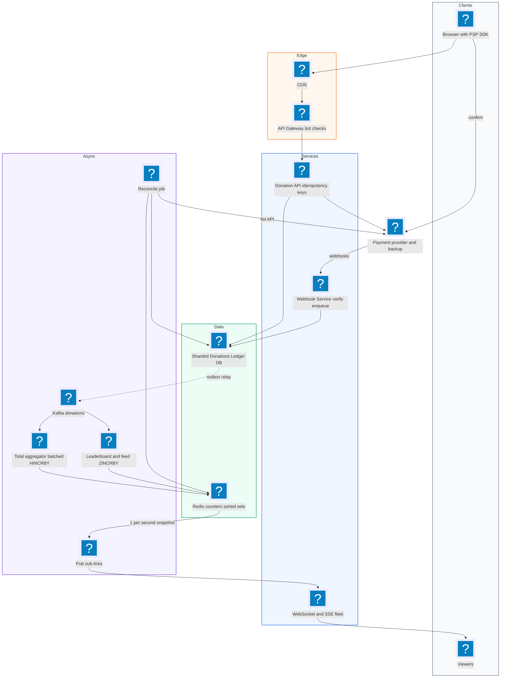

# 35. Donations Website  (Hard)

> A donations website lets viewers of a charity livestream give money to pre-selected charities while the show is on. The page shows a big running total ("$1,284,330 raised"), a goal bar, and a live list of top donors, and the host reads out donations on air. This was asked at Whatnot, a live shopping company, so the "live" part matters. The interviewer is testing four things: that you handle real money correctly (payment provider integration, idempotency, no double charges, no lost donations), that you can keep a running total accurate under thousands of donations per second during a spike, that the number on screen matches the money actually collected (and handles refunds and chargebacks), and that the system survives the moment a celebrity says "donate now".

## 1. Functional requirements

Core (must have):

1. Users can donate an amount to one of the charities in an event using a card or wallet (Apple Pay, Google Pay).
2. Users see a confirmation once their payment succeeds.
3. Everyone watching sees a real-time running total for the event (and per charity).
4. Everyone sees a live top donors leaderboard and a feed of recent donations (with an optional name and message).
5. Donors can choose to be anonymous.
6. Admins can see reconciled totals and handle refunds and chargebacks.

Below the line (out of scope):

- The video streaming itself. We assume the livestream already exists and we embed a widget next to it.
- Paying out money to charities (settlement to bank accounts). Done after the event, low volume, offline.
- Recurring donations and tax receipts by mail. Nice to have, not core to the live event.
- Building our own card processing. We use a payment provider (Stripe, Adyen, Braintree).

## 2. Non-functional requirements

1. **Correctness of money:** a donor must never be charged twice for one click, and a successful charge must never be lost. This needs strong consistency in the payment ledger.
2. **Spike tolerance:** normal rate maybe 50 donations per second, but a shout-out on stream can cause 5,000 to 10,000 donations per second for a minute.
3. **Freshness of the total:** the displayed total updates within 1 to 2 seconds of a payment succeeding.
4. **Fan-out:** 2 million concurrent viewers all watching the same total and feed.
5. **Latency:** donate button to "thank you" in under 3 seconds p99 (most of that is the payment provider).
6. **Availability:** 99.99% during the event window (24 to 48 hours). Losing donations during a peak is the worst failure.
7. **Accuracy of the display:** the displayed total can lag, but must converge to the ledger total. It must never show money that was not collected for more than a few seconds, and refunds must eventually be subtracted.
8. **Security:** PCI DSS scope kept minimal (card numbers never touch our servers), fraud checks for stolen cards.
9. **CAP choice:** the **payment ledger is CP** (correct or nothing). The **live total and leaderboard are AP**: always show something, accept a short lag.

## 3. Back-of-the-envelope estimates

| Assumption | Number |
|---|---|
| Event length | 48 hours |
| Total donations in the event | 5 million |
| Average donation | $25 |
| Peak donation rate (after a shout-out) | 10,000 per second for 60 s |
| Concurrent viewers at peak | 2 million |
| Donation record size | 1 KB |
| Total update push to viewers | 1 per second (batched) |
| Feed messages shown per second | 20 (sampled at peak) |

```text
Average write rate:
  5,000,000 / (48 * 3,600 s) = ~29 donations/s

Peak write rate:
  10,000 donations/s  (300x average)
  -> payment provider calls at 10,000/s; check provider rate limits!
  -> ledger inserts at 10,000/s; fine for a sharded DB or DynamoDB,
     tight for one Postgres primary

Money:
  5M * $25 = $125M total for the event

Storage:
  5M * 1 KB = 5 GB for donations + ~3x for payment events and audit
  -> ~20 GB total. Tiny.

Fan-out to viewers:
  2M viewers * 1 total update/s           = 2M messages/s
  2M viewers * 20 feed items/s (peak)     = 40M messages/s if naive
  -> batch: one message/s per viewer with total + last N items
  -> 2M messages/s, each ~500 bytes = ~1 GB/s outbound across the fleet
  -> with ~50k connections per WebSocket server: 40 servers at peak
```

The math says: the write rate is spiky but manageable, the money must be exact, and the read side (2 million watchers) is a broadcast problem, not a database problem.

## 4. Core entities

- **Event**: a fundraising livestream. Fields: event_id, title, start_at, end_at, goal_cents, status.
- **Charity**: an organization in the event. Fields: charity_id, event_id, name, logo_url.
- **Donor**: a user, possibly a guest. Fields: donor_id, email, display_name.
- **Donation**: one gift intent. Fields: donation_id, event_id, charity_id, donor_id, amount_cents, currency, status (CREATED, AUTHORIZED, SUCCEEDED, FAILED, REFUNDED, DISPUTED), is_anonymous, message, idempotency_key.
- **PaymentAttempt**: one call to the provider for a donation. Fields: attempt_id, donation_id, provider, provider_payment_id, status, raw_response.
- **LedgerEntry**: an append-only money record (credit on success, debit on refund or chargeback). Fields: entry_id, donation_id, amount_cents (positive or negative), type, created_at.
- **TotalCounter**: the live running total, sharded in Redis, rebuilt from the ledger.

```sql
CREATE TABLE donations (
  donation_id     UUID PRIMARY KEY,
  event_id        BIGINT NOT NULL,
  charity_id      BIGINT NOT NULL,
  donor_id        BIGINT,
  amount_cents    BIGINT NOT NULL CHECK (amount_cents > 0),
  currency        CHAR(3) NOT NULL,
  status          VARCHAR(16) NOT NULL,
  is_anonymous    BOOLEAN NOT NULL DEFAULT false,
  message         VARCHAR(280),
  idempotency_key VARCHAR(64) NOT NULL,
  created_at      TIMESTAMP NOT NULL DEFAULT now(),
  UNIQUE (donor_id, idempotency_key)
);

CREATE TABLE ledger_entries (
  entry_id      UUID PRIMARY KEY,
  donation_id   UUID NOT NULL REFERENCES donations,
  event_id      BIGINT NOT NULL,
  charity_id    BIGINT NOT NULL,
  amount_cents  BIGINT NOT NULL,         -- +credit, -refund/chargeback
  type          VARCHAR(16) NOT NULL,    -- CAPTURE, REFUND, CHARGEBACK
  provider_ref  VARCHAR(64) NOT NULL,
  created_at    TIMESTAMP NOT NULL DEFAULT now(),
  UNIQUE (provider_ref, type)            -- a provider event applies once
);
```

Money is always stored as integer cents, never floats. `0.1 + 0.2` in floating point is not `0.3`, and auditors notice.

## 5. API design

Donating requires either a logged-in user or a guest session with email. Admin endpoints require an admin role.

`GET /events/{eventId}` -- event info, charities, goal (CDN-cacheable).

`POST /events/{eventId}/donations` -- create a donation intent. Header `Idempotency-Key` (UUID created by the client when the form opens).

```json
// request
{ "charityId": 3, "amountCents": 2500, "currency": "USD",
  "isAnonymous": false, "displayName": "Sam", "message": "Go team!" }
// response 201
{ "donationId": "d_71c", "status": "CREATED",
  "clientSecret": "pi_3Nx..._secret_abc" }
```

The `clientSecret` lets the browser confirm the payment directly with the provider's SDK (Stripe Elements, for example), so card numbers never reach us.

`GET /donations/{donationId}` -- poll status (CREATED, SUCCEEDED, FAILED).

```json
{ "donationId": "d_71c", "status": "SUCCEEDED", "amountCents": 2500 }
```

`POST /webhooks/payments` -- the provider calls this with payment results. Verified by signature header, not by user auth.

```json
{ "id": "evt_1PQ", "type": "payment_intent.succeeded",
  "data": { "object": { "id": "pi_3Nx", "amount": 2500,
            "metadata": { "donationId": "d_71c" } } } }
```

Responds `200` quickly (even for duplicates), `400` for bad signature.

`GET /events/{eventId}/live` -- WebSocket or Server-Sent Events (SSE) stream of totals, top donors and recent donations.

```json
{ "type": "tick", "totalCents": 128433000, "byCharity": {"3": 51200000},
  "topDonors": [{"name": "Ana", "cents": 1000000}],
  "recent": [{"name": "Sam", "cents": 2500, "msg": "Go team!"}] }
```

`GET /events/{eventId}/leaderboard?limit=50` -- top donors (REST fallback).

`POST /admin/donations/{donationId}/refund` -- admin refund (admin role, audited).

## 6. High-level design



### How will a user donate?

1. The page opens the donation form and generates an `Idempotency-Key` (UUID) once.
2. The client calls `POST /donations`. The Donation API inserts a CREATED donation row. The unique `(donor_id, idempotency_key)` makes a double submit return the same row.
3. The API asks the provider to create a PaymentIntent with `idempotency_key = donation_id` and `metadata.donationId`. It returns the `clientSecret`.
4. The browser confirms the payment with the provider SDK. 3-D Secure (the bank's extra check) happens here if needed.
5. The provider sends a `payment_intent.succeeded` webhook. The Webhook Service verifies the signature, marks the donation SUCCEEDED, and writes a CAPTURE ledger entry plus an outbox row in one transaction.
6. The client polls `GET /donations/d_71c` (or listens on the live socket) and shows "Thank you".



### How will viewers see the running total?

1. An outbox relay publishes `DonationSucceeded` to Kafka.
2. The Total Aggregator adds the amount to a sharded counter in Redis (see deep dive).
3. Once per second, a Snapshot job sums the shards and publishes one "tick" to a pub/sub channel.
4. WebSocket/SSE servers subscribed to that channel push the tick to every connected viewer.

### How will viewers see top donors and recent donations?

1. The Leaderboard builder runs `ZINCRBY lb:event:9 2500 donor:42` for each success (top donors by total given).
2. The Feed builder pushes non-anonymous donations with messages into a capped Redis list, after a profanity filter.
3. The Snapshot job adds the top 10 donors and the last few feed items to the 1-second tick.

### How are refunds and chargebacks reflected?

1. An admin refund, or a provider `charge.dispute.created` webhook, writes a negative ledger entry.
2. A `DonationReversed` event flows through Kafka and decrements the counter and the leaderboard.

## 7. Deep dives

### How do we integrate payments without double charging or losing donations?

Money has two classic failure modes. A retry creates a second charge (the user clicked twice, or our server timed out and retried). Or the charge succeeds at the provider, but our server crashed before recording it, so the donation is lost from our books.

| Option | How | Pros | Cons |
|---|---|---|---|
| Server collects card and charges synchronously | Card goes through our server; we call the provider and wait | Simple flow | Full PCI scope, timeouts leave unknown state |
| Client-side confirm + webhooks (PaymentIntent) | Server creates intent, browser confirms, provider tells us by webhook | Minimal PCI scope, 3-D Secure built in, async truth | Need webhook handling and reconciliation |
| Hosted checkout page | Redirect to provider's page | Least code | Leaves our live page, worse UX on stream |

Recommended: **PaymentIntent with client-side confirm, and webhooks as the source of truth**. Three layers of idempotency:

1. Client to us: `Idempotency-Key` header, unique in the DB.
2. Us to provider: provider idempotency key = `donation_id`.
3. Provider to us: webhook event id and `(provider_ref, type)` unique in the ledger.

```python
def create_donation(req, user, idem_key):
    row = db.fetch_one("SELECT * FROM donations WHERE donor_id=%s "
                       "AND idempotency_key=%s", (user.id, idem_key))
    if row:
        return to_response(row)                       # safe replay
    donation_id = uuid4()
    db.execute("INSERT INTO donations (donation_id, event_id, charity_id, "
               "donor_id, amount_cents, currency, status, idempotency_key) "
               "VALUES (%s,%s,%s,%s,%s,%s,'CREATED',%s) "
               "ON CONFLICT (donor_id, idempotency_key) DO NOTHING",
               (donation_id, req.event_id, req.charity_id, user.id,
                req.amount_cents, req.currency, idem_key))
    intent = stripe.PaymentIntent.create(
        amount=req.amount_cents, currency=req.currency.lower(),
        metadata={"donationId": str(donation_id)},
        idempotency_key=str(donation_id))             # provider-side dedupe
    return {"donationId": donation_id, "clientSecret": intent.client_secret}
```

Webhook handler, with the transactional outbox pattern (write the business row and the event row in the same DB transaction, and a relay publishes the event later, so we never update the DB and forget to publish, or publish and forget the DB):

```python
def on_webhook(payload, sig_header):
    evt = stripe.Webhook.construct_event(payload, sig_header, WEBHOOK_SECRET)
    if evt.type != "payment_intent.succeeded":
        return 200
    pi = evt.data.object
    did = pi.metadata["donationId"]
    with db.transaction():
        inserted = db.execute(
            "INSERT INTO ledger_entries (entry_id, donation_id, event_id, "
            "charity_id, amount_cents, type, provider_ref) "
            "SELECT %s, donation_id, event_id, charity_id, %s, 'CAPTURE', %s "
            "FROM donations WHERE donation_id=%s "
            "ON CONFLICT (provider_ref, type) DO NOTHING",
            (uuid4(), pi.amount, pi.id, did)).rowcount
        if inserted == 0:
            return 200                                # duplicate webhook
        db.execute("UPDATE donations SET status='SUCCEEDED' "
                   "WHERE donation_id=%s", (did,))
        db.execute("INSERT INTO outbox (topic, key, payload) VALUES "
                   "('donations', %s, %s)", (did, json.dumps({
                       "donationId": did, "cents": pi.amount, "sign": 1})))
    return 200
```

Webhooks can be late or lost. A **reconciliation job** runs every minute, lists payments from the provider API for the last hour, and inserts any missing ledger entries. A nightly job compares the provider's settlement report with our ledger to the cent.

Backup payment methods: if the main provider has an outage (5xx or timeouts above a threshold), a circuit breaker routes new intents to a second provider. Each donation records which provider it used.

### How do we keep a running total under 10,000 donations per second?

The naive approach is one Redis key: `INCRBY total:event:9 2500`. Redis can do this about 100,000 times per second, so 10,000 per second actually fits on one key. But in an interview you should show you know the hot-key problem: a single key lives on one shard and one CPU core, and Kafka consumers all hammering it adds latency. It also gets worse if the counter is in a database row (row lock contention at a few hundred writes per second).

| Option | How | Write scale | Read cost | Cons |
|---|---|---|---|---|
| Single DB row `UPDATE total = total + x` | Row lock per update | ~500 to 1,000/s | 1 read | Lock contention, blocks during spike |
| Single Redis key `INCRBY` | Atomic increment | ~100k/s on one core | 1 read | Hot key, one shard, no headroom for bigger events |
| Sharded counters (N keys) | Increment a random one of N keys; sum them to read | N x single key | N reads (cheap, once per second) | Read must sum shards |
| Batch in the consumer | Consumer sums 1 second of events, 1 `INCRBY` per second | Unlimited | 1 read | Up to 1 s extra lag |

Recommended: **batch in the Kafka consumer, writing to sharded counters.** Each consumer instance keeps a local sum per charity for 200 ms, then flushes with one `INCRBY` to its own shard key. Readers sum the shards once per second.

```python
NUM_SHARDS = 16

class TotalAggregator:
    def __init__(self, shard_id):
        self.shard_id = shard_id                 # one per consumer instance
        self.pending = defaultdict(int)          # charity_id -> cents
        self.offsets = None

    def on_event(self, evt, offset):
        self.pending[evt["charityId"]] += evt["cents"] * evt["sign"]
        self.offsets = offset

    def flush(self):                             # every 200 ms
        pipe = redis.pipeline(transaction=True)
        for charity, cents in self.pending.items():
            pipe.hincrby(f"total:9:shard:{self.shard_id}", charity, cents)
        pipe.hset(f"total:9:shard:{self.shard_id}:offset",
                  "partition_offset", self.offsets)   # for exactly-once
        pipe.execute()
        kafka.commit(self.offsets)
        self.pending.clear()

def read_total(event_id):
    pipe = redis.pipeline()
    for s in range(NUM_SHARDS):
        pipe.hgetall(f"total:{event_id}:shard:{s}")
    totals = defaultdict(int)
    for shard in pipe.execute():
        for charity, cents in shard.items():
            totals[int(charity)] += int(cents)
    return totals
```

Storing the Kafka offset in the same Redis transaction as the increment makes the update effectively exactly-once: after a crash, the consumer reads its saved offset and skips events it already counted.

The Kafka topic is partitioned by `donation_id`, so load spreads evenly across consumers, and each consumer owns one shard key.

### How do we build the top donors leaderboard?

Top donors are ranked by total given across all their donations, not by single gift.

| Option | How | Pros | Cons |
|---|---|---|---|
| SQL `GROUP BY donor ORDER BY SUM DESC LIMIT 10` | Query the ledger | Exact | Heavy at 10k writes/s, run every second = expensive |
| Redis sorted set `ZINCRBY` | Increment donor's total, read `ZREVRANGE 0 9` | O(log N), live | Must handle refunds (negative increments) |
| Min-heap of top K in the consumer | Keep only the top K in memory | Very cheap | Hard to handle refunds and restarts |

Recommended: **Redis sorted set with `ZINCRBY`**, keyed per event (and per charity if needed). Refunds are a negative `ZINCRBY`. Anonymous donors are stored under their id but displayed as "Anonymous".

```python
def on_leaderboard_event(evt):
    member = f"donor:{evt['donorId']}"
    redis.zincrby(f"lb:{evt['eventId']}", evt["cents"] * evt["sign"], member)

def top_donors(event_id, n=10):
    rows = redis.zrevrange(f"lb:{event_id}", 0, n - 1, withscores=True)
    return [{"name": display_name(m), "cents": int(s)} for m, s in rows]
```

The leaderboard consumer must also be idempotent. Use the same offset trick as the totals, or keep a `SETNX seen:{donation_id}:{sign}` key with a 3-day TTL.

Moderation: names and messages are public on a live stream. Run a profanity filter and let a human moderator remove items from the feed. A hidden message still counts toward the total.

### How do we keep the displayed total consistent with the money we actually collected?

The display path (Redis counters) and the money path (ledger) are separate. They can drift: a consumer bug, a lost event, a refund that was not applied.

| Option | How | Pros | Cons |
|---|---|---|---|
| Display reads the ledger directly | `SELECT SUM(amount_cents)` every second | Always matches | Heavy query at scale, DB becomes the bottleneck |
| Display from counters only | Trust Redis forever | Fast | Drift is never fixed |
| Counters + periodic reconcile from ledger | Redis for live; every minute compare with ledger sum, fix drift | Fast and correct over time | Brief windows of small mismatch |

Recommended: **counters for live display, ledger as truth, reconcile every minute.**

```sql
-- ledger truth, per charity, using an index on (event_id, charity_id)
SELECT charity_id, SUM(amount_cents) AS cents
FROM ledger_entries
WHERE event_id = 9
GROUP BY charity_id;
```

```python
def reconcile(event_id):
    truth = dict(db.query(LEDGER_SUM_SQL, (event_id,)))
    live  = read_total(event_id)
    for charity, cents in truth.items():
        drift = cents - live.get(charity, 0)
        if abs(drift) > 0:
            # write the correction into a dedicated shard, so normal
            # consumers never fight over it
            redis.hincrby(f"total:{event_id}:shard:reconcile", charity, drift)
            metrics.increment("total_drift_cents", abs(drift))
```

Remember that events in flight (in Kafka, not yet in Redis) make the live total legitimately a bit lower than the ledger. Reconcile only against ledger entries older than, say, 30 seconds, so you do not "correct" lag into a double count.

What should the display mean? We only count **captured** payments (SUCCEEDED). We do not count CREATED or AUTHORIZED, since many of those fail. Some products show "pledged" separately, but on a charity stream the honest number is money collected.

### How do we handle fraud and chargebacks?

Donation pages are a magnet for card testing: fraudsters try thousands of stolen cards with $1 donations to see which ones work. This costs us provider fees, gets the account flagged, and later turns into chargebacks (the real card owner disputes the charge, the money is pulled back, and a fee is added).

| Defense | Stops | Notes |
|---|---|---|
| Provider fraud scoring (Stripe Radar, Adyen RevenueProtect) | Known bad cards and patterns | Turn on, tune rules |
| Minimum amount (for example $5) | Card testing with $1 | Small UX cost |
| Rate limits per IP, device, card fingerprint, email | Bulk attempts | Return a generic error |
| CAPTCHA after N failed attempts | Bots | Only shown to suspicious traffic |
| 3-D Secure for risky payments | Stolen cards, shifts liability to the bank | Adds a step |
| Velocity rules on the leaderboard | Fraudster buying the #1 spot with a stolen card | Hold large gifts from the board until reviewed |

Chargebacks arrive days or weeks later through a `charge.dispute.created` webhook. The flow is the same as a refund: write a negative CHARGEBACK ledger entry, publish `DonationReversed (sign = -1)`, the total and leaderboard decrease. If the event is over, the final reported total is adjusted in the admin report.

```python
def on_dispute(evt):
    d = evt.data.object
    with db.transaction():
        db.execute("INSERT INTO ledger_entries (entry_id, donation_id, event_id,"
                   " charity_id, amount_cents, type, provider_ref) "
                   "SELECT %s, donation_id, event_id, charity_id, %s, "
                   "'CHARGEBACK', %s FROM donations WHERE donation_id=%s "
                   "ON CONFLICT (provider_ref, type) DO NOTHING",
                   (uuid4(), -d.amount, d.id, d.metadata["donationId"]))
        db.execute("UPDATE donations SET status='DISPUTED' WHERE donation_id=%s",
                   (d.metadata["donationId"],))
        db.execute("INSERT INTO outbox (topic, key, payload) VALUES "
                   "('donations', %s, %s)", (d.metadata["donationId"],
                   json.dumps({"donationId": d.metadata["donationId"],
                               "cents": d.amount, "sign": -1})))
```

### How do we survive the spike during a live shout-out, and what fails?

When the host says "everyone donate $10 right now", traffic jumps 300x in seconds.

| Pressure point | Risk | Mitigation |
|---|---|---|
| Event page loads | Origin overload | Static page + event JSON on CDN |
| Donation API | Pod saturation | Pre-scale before scheduled moments, autoscale on CPU and queue depth |
| Payment provider | Rate limits (provider-side), latency spikes | Ask provider to raise limits for the event, client confirms directly so our servers do not wait |
| Ledger DB | Insert rate at 10k/s | Shard by `donation_id`, or use DynamoDB with on-demand capacity |
| Webhook endpoint | Burst of 10k/s | Webhook Svc only verifies + enqueues, returns 200 fast; workers do DB writes |
| Live fan-out | 2M sockets | 1 tick per second, batched; pub/sub fan-out to 40+ WebSocket nodes |

The key design choice for the spike is that **the donation path never waits on the display path**. If Kafka, Redis, or the WebSocket fleet are slow, donations still succeed and the ledger is still correct. The total just catches up a few seconds later.

Failure handling:

| Failure | What happens | Handling |
|---|---|---|
| Our server crashes after the provider charged | No ledger entry yet | Webhook (retried by provider for days) and the reconcile job will record it |
| Webhook delivered twice | Duplicate capture attempt | Unique `(provider_ref, type)` makes the second insert a no-op |
| Kafka down | No live updates | Outbox rows pile up in the DB; relay drains them when Kafka returns |
| Redis lost | Total disappears | Rebuild from ledger SUM, then resume consumers from current offset |
| Primary provider outage | Donations fail | Circuit breaker switches to backup provider |
| WebSocket server dies | Its viewers disconnect | Clients reconnect with backoff to another node, get the latest tick at once |

For the fan-out, each WebSocket server subscribes to one pub/sub channel (`event:9:ticks`). The snapshot job publishes once per second, so whether there are 10 or 2 million viewers, the backend work is the same: one publish, then each server writes to its own sockets.

```text
 Snapshot job --1 msg/s--> Redis Pub/Sub or Kafka topic "ticks"
                              |        |         |
                         WS node 1  WS node 2 ... WS node 40
                         50k conns  50k conns     50k conns
```

## 8. Final architecture



| Component | Job | Technology example |
|---|---|---|
| CDN | Static event page and JSON | CloudFront, Fastly |
| API Gateway | Auth, rate limit, bot checks | Envoy, Cloudflare, AWS WAF |
| Donation API | Create donations and payment intents | Stateless service |
| Payment provider | Card processing, 3-D Secure, fraud scoring | Stripe (primary), Adyen (backup) |
| Webhook Service | Verify signatures, write ledger + outbox | Small stateless service |
| Donations + Ledger DB | Source of truth for money | Postgres (sharded), Aurora, DynamoDB |
| Outbox relay | Publish DB events to Kafka reliably | Debezium CDC or polling relay |
| Kafka | Ordered event stream | Kafka, Kinesis |
| Total aggregator | Batched sharded counters | Kafka consumer |
| Leaderboard + feed | Top donors, recent messages | Kafka consumer + Redis sorted set |
| Redis | Live counters and sorted sets | Redis Cluster / ElastiCache |
| Broadcast + WebSocket fleet | Push 1 tick/s to millions | Redis Pub/Sub + WS servers, or a managed service |
| Reconcile jobs | Fix drift, catch missed webhooks | Scheduled workers |

### Deployment map (AWS)

```mermaid
architecture-beta
    group internet(mdi:earth)[Internet]
    group edge(logos:aws-cloudfront)[Edge]
    group vpc(logos:aws-vpc)[AWS VPC]
    group app(logos:aws-ecs)[Service subnet] in vpc
    group data(logos:aws-rds)[Data subnet] in vpc
    group ext(mdi:earth)[Third parties]

    service browser(mdi:laptop)[Browser with PSP SDK] in internet
    service viewers(mdi:cellphone)[Viewers] in internet
    service gw(logos:aws-api-gateway)[API Gateway bot checks] in edge
    service donation(logos:aws-ecs)[Donation API idempotency keys] in app
    service webhook(logos:aws-lambda)[Webhook Service verify enqueue] in app
    service aggregator(logos:aws-lambda)[Total aggregator batched HINCRBY] in app
    service wsfleet(logos:aws-ecs)[WebSocket and SSE fleet] in app
    service ledger(logos:aws-rds)[Sharded Donations Ledger DB] in data
    service redis(logos:aws-elasticache)[Redis counters sorted sets] in data
    service pp(logos:stripe)[Payment provider and backup] in ext

    browser:R --> L:gw
    gw:R --> L:donation
    donation:B --> T:ledger
    donation:R --> L:pp
    pp:L --> R:webhook
    webhook:B --> T:ledger
    ledger:T --> B:aggregator
    aggregator:B --> T:redis
    redis:T --> B:wsfleet
    wsfleet:L --> R:viewers
```



Donations and provider webhooks write the ledger in the data subnet, and the aggregator turns ledger events into Redis counters that the WebSocket fleet pushes out to viewers once per second.

## 9. Common mistakes and interviewer follow-ups

- **Mistake: counting a donation as soon as the user clicks Donate.** Many payments fail or need 3-D Secure. Say instead: "We only count captured payments, confirmed by webhook."
- **Mistake: one database row for the total.** Row locks collapse under 10,000 writes per second. Say instead: "Batched, sharded counters in Redis, rebuilt from the ledger."
- **Mistake: no idempotency anywhere.** Double clicks and webhook retries cause double charges or double counting. Say instead: "Idempotency key from client, provider idempotency key, unique ledger key per provider event."
- **Mistake: updating the DB and publishing to Kafka as two separate steps.** A crash in between loses or duplicates events. Say instead: "Transactional outbox."
- **Mistake: storing money as floats.** Rounding errors in totals. Say instead: "Integer cents, plus currency code."
- **Mistake: forgetting refunds and chargebacks.** The total only goes up and becomes wrong. Say instead: "Negative ledger entries and a reversal event with sign = -1."
- **Mistake: pushing every donation to every viewer.** 40 million messages per second. Say instead: "One batched tick per second per viewer via pub/sub."
- **Follow-up: "What about multiple currencies?"** Store original currency and amount, plus a converted amount in the event's display currency using a fixed rate locked at capture time.

## 10. One-page cheat sheet

| Topic | Key point |
|---|---|
| Scale | 5M donations / 48 h, peak 10k/s, 2M viewers, $125M total |
| Payment flow | Create donation + PaymentIntent, client confirms with provider SDK, webhook is truth |
| Idempotency | Client key (unique in DB), provider key = donation_id, ledger unique (provider_ref, type) |
| Ledger | Append-only, integer cents, +capture, -refund, -chargeback |
| Reliable events | Transactional outbox -> Kafka |
| Running total | Consumer batches 200 ms, sharded `HINCRBY`, offset stored with increment |
| Display | 1 tick per second via pub/sub to WebSocket/SSE fleet |
| Top donors | Redis sorted set `ZINCRBY`, negative on refund |
| Consistency | Counters AP for display, ledger CP for money, reconcile every minute |
| Fraud | Provider scoring, min amount, rate limits, 3-D Secure, hold big gifts from board |
| Spike | CDN, pre-scale, donation path never waits on display path |
| Failure | Missed webhooks caught by reconcile job; Redis rebuilt from ledger; backup provider |

## Sources

- [Hello Interview: Design a Donations Website (community question)](https://www.hellointerview.com/community/questions/donations-website-charities/cmbdisew101kuad08fuuiky5v)
- [Hello Interview: Design a Payment System](https://www.hellointerview.com/learn/system-design/problem-breakdowns/payment-system)
- [Hello Interview: Real-time Updates pattern](https://www.hellointerview.com/learn/system-design/deep-dives/realtime-updates)
- [Stripe Docs: Idempotent requests](https://docs.stripe.com/api/idempotent_requests)
- [Stripe Docs: Receive events with webhooks](https://docs.stripe.com/webhooks)
- [microservices.io: Transactional outbox pattern](https://microservices.io/patterns/data/transactional-outbox.html)
- [Google Cloud: Sharded counters in Firestore](https://firebase.google.com/docs/firestore/solutions/counters)
